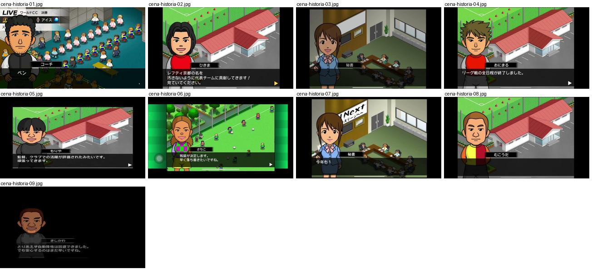
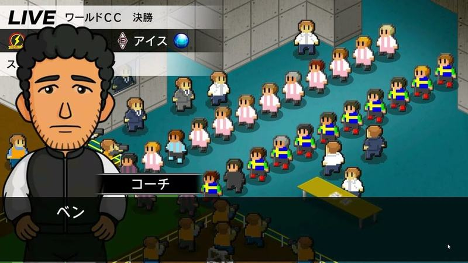
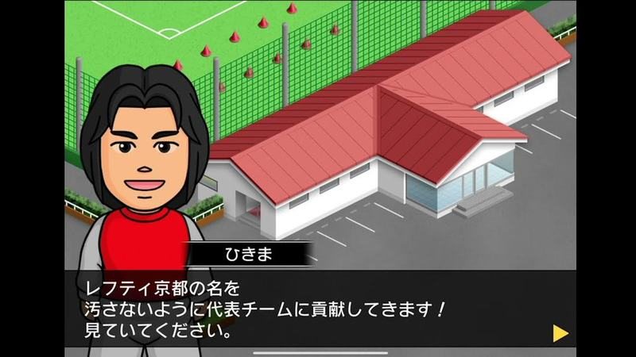
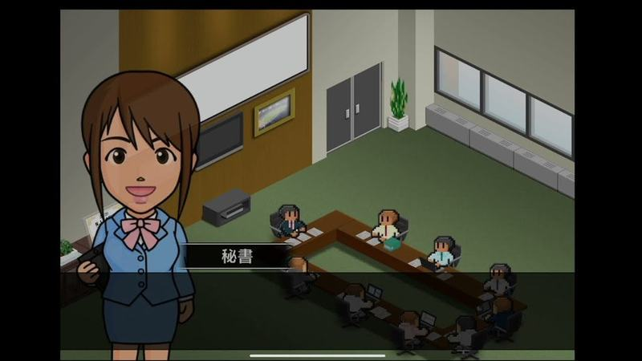
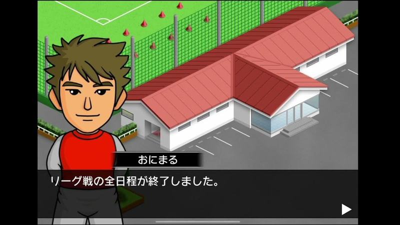
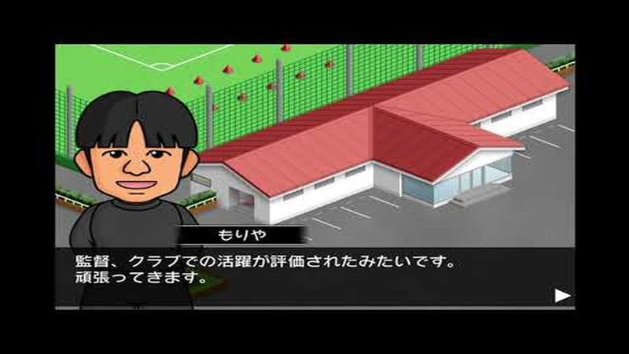
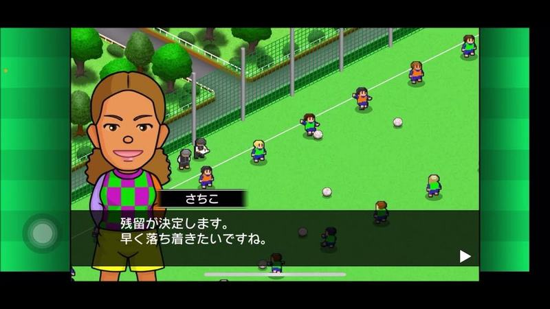
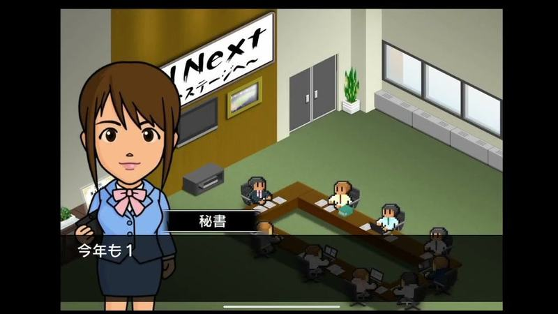
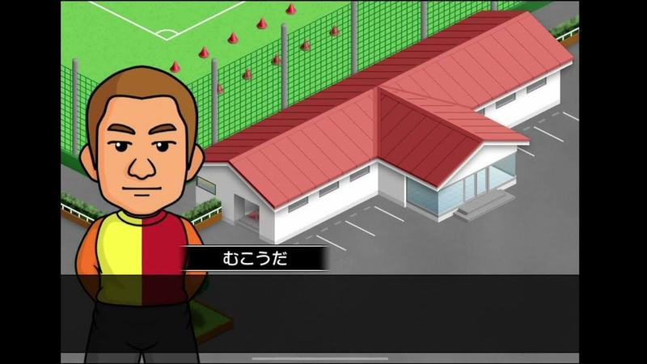
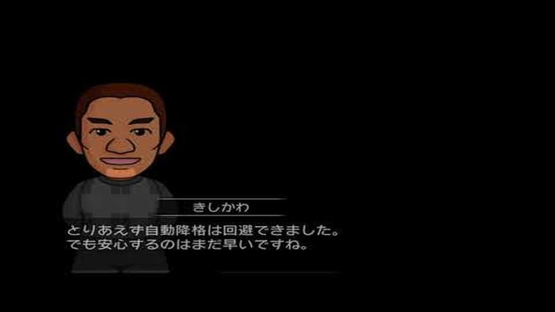

# cena-historia

Categoria: Cenas fora do campo. 9 imagens. A folha `_folha.jpg` mostra-as todas de uma vez.

## cena-historia-01.jpg

Cena «LIVE ワールドCC 決勝» com adeptos pixel numa sala/bancada isométrica e o adjunto em primeiro plano; faixa escura com emblema e nome do rival no topo.

- Etiquetas: live, treinador-adjunto, adeptos, isometrico, emblemas
- Qualidade: boa
- Origem: [1k_Aw8Q4FbE](https://www.youtube.com/watch?v=1k_Aw8Q4FbE&t=248s) (25%, ~248 s), canal いとま 夜香学園

## cena-historia-02.jpg

Jogador em primeiro plano diante de um edifício isométrico de telhado vermelho (centro de treino) a falar numa caixa escura com seta amarela.

- Etiquetas: dialogo, edificio, isometrico, jogador, seta-avancar
- Qualidade: boa
- Origem: [VpaLZNu6tkk](https://www.youtube.com/watch?v=VpaLZNu6tkk&t=453s) (75%, ~453 s), canal NA

## cena-historia-03.jpg

Secretária em primeiro plano diante do escritório do clube em vista isométrica, com mesa de reuniões e funcionários; caixa de nome «秘書».

- Etiquetas: escritorio, secretaria, isometrico, mesa-reunioes, dialogo
- Qualidade: boa
- Origem: [Z7PStmPQDBw](https://www.youtube.com/watch?v=Z7PStmPQDBw&t=372s) (75%, ~372 s), canal しゃり

## cena-historia-04.jpg

Jogador diante do edifício isométrico do clube a anunciar o fim do calendário da liga numa caixa de diálogo escura.

- Etiquetas: dialogo, edificio, isometrico, jogador, seta-avancar
- Qualidade: boa
- Origem: [cOswRjNtAbo](https://www.youtube.com/watch?v=cOswRjNtAbo&t=638s) (75%, ~638 s), canal NA

## cena-historia-05.jpg

Jogador diante do edifício do clube a dizer que foi notado; caixa de diálogo escura com seta.

- Etiquetas: dialogo, edificio, isometrico, jogador, seta-avancar
- Qualidade: boa
- Origem: [d6ftAvWjG94](https://www.youtube.com/watch?v=d6ftAvWjG94&t=147s) (25%, ~147 s), canal NA

## cena-historia-06.jpg

Jogadora em primeiro plano a falar sobre a renovação diante do campo de treino isométrico com rede verde; caixa de diálogo escura.

- Etiquetas: dialogo, jogador, campo-treino, isometrico, seta-avancar
- Qualidade: boa
- Origem: [i79-W2Ukxxw](https://www.youtube.com/watch?v=i79-W2Ukxxw&t=759s) (75%, ~759 s), canal ゲーム動画で行こう! Playing Games.

## cena-historia-07.jpg

Secretária em primeiro plano no escritório isométrico com cartaz «Next», a falar numa caixa de diálogo escura em baixo.

- Etiquetas: secretaria, escritorio-isometrico, dialogo, cartaz
- Qualidade: boa
- Origem: [jzx5F8k_OEw](https://www.youtube.com/watch?v=jzx5F8k_OEw&t=169s) (25%, ~169 s), canal しゃり

## cena-historia-08.jpg

Jogador de outro clube em primeiro plano diante de um edifício isométrico de telhado vermelho, com caixa de nome e diálogo.

- Etiquetas: jogador, edificio, isometrico, dialogo, nome
- Qualidade: boa
- Origem: [nGYb-1QUDIU](https://www.youtube.com/watch?v=nGYb-1QUDIU&t=477s) (75%, ~477 s), canal しゃり

## cena-historia-09.jpg

Jogador em busto sobre fundo escuro a falar numa caixa de diálogo cinzenta (sobre ter escapado à descida); cena de transição escurecida.

- Etiquetas: dialogo, fundo-escuro, jogador, busto
- Qualidade: ok
- Origem: [d6ftAvWjG94](https://www.youtube.com/watch?v=d6ftAvWjG94&t=441s) (75%, ~441 s), canal NA
