# cidade-mapa

Categoria: Cenas fora do campo. 12 imagens. A folha `_folha.jpg` mostra-as todas de uma vez.

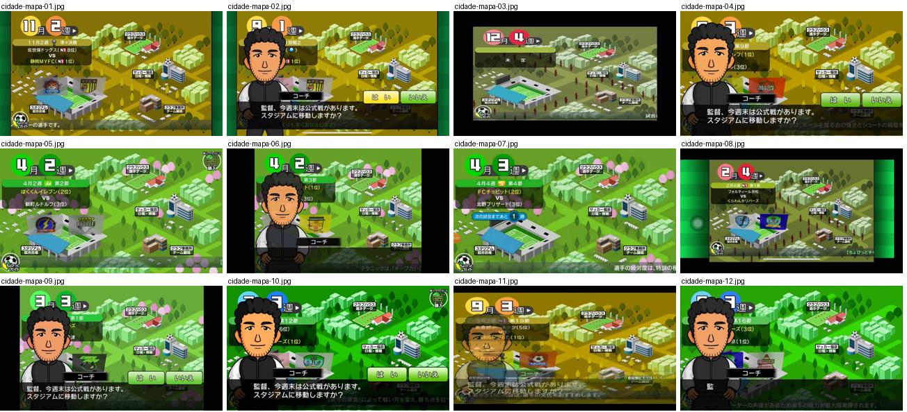

## cidade-mapa-01.jpg

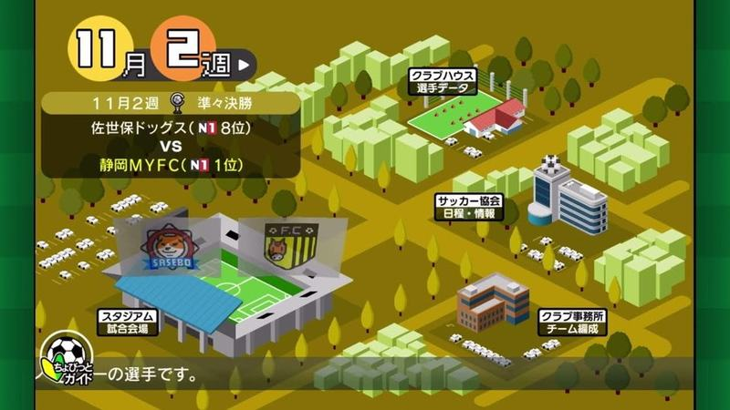

Mapa isométrico da cidade do clube (estádio, casa do clube, federação, escritório) com data «11月2週» em círculos laranja e o próximo jogo indicado no topo.

- Etiquetas: mapa-isometrico, calendario, edificios, estadio, proximo-jogo
- Qualidade: boa
- Origem: [DEmYbvCV-mA](https://www.youtube.com/watch?v=DEmYbvCV-mA&t=167s) (50%, ~167 s), canal つばきち【Jリーグ系YouTuber】

## cidade-mapa-02.jpg

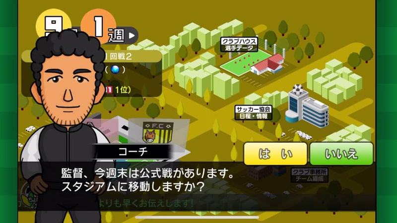

Mapa da cidade com o adjunto a perguntar se o mister quer ir ao estádio; botões «はい/いいえ» amarelo e verde por cima da caixa de texto.

- Etiquetas: mapa-isometrico, calendario, sim-nao, treinador, caixa-texto
- Qualidade: boa
- Origem: [FAej4GXXc-g](https://www.youtube.com/watch?v=FAej4GXXc-g&t=263s) (25%, ~263 s), canal NA

## cidade-mapa-03.jpg

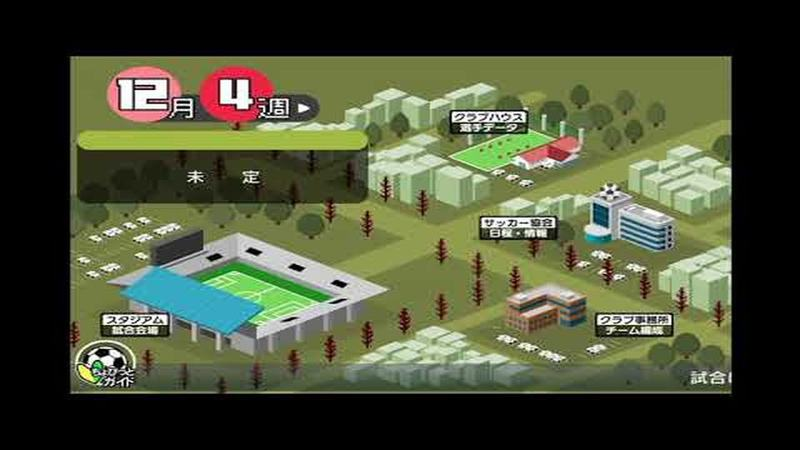

Mapa da cidade em tons apagados de inverno (12月4週), árvores sem folhas e caixa «未定» sem jogo marcado; estádio em destaque em baixo à esquerda.

- Etiquetas: mapa-isometrico, calendario, inverno, estadio, sem-jogo
- Qualidade: boa
- Origem: [HiNIxKn0wx8](https://www.youtube.com/watch?v=HiNIxKn0wx8&t=142s) (50%, ~142 s), canal しゃり

## cidade-mapa-04.jpg

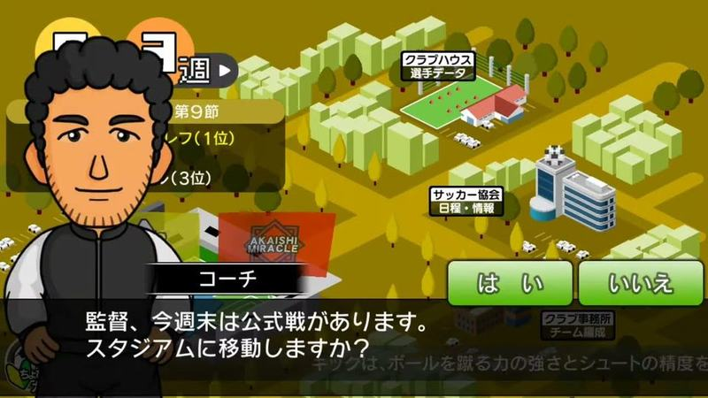

Mapa da cidade em tons dourados (outono) com o adjunto a perguntar se vai ao estádio, botões verdes sim/não e dica em rodapé.

- Etiquetas: mapa-isometrico, calendario, sim-nao, treinador, caixa-texto
- Qualidade: boa
- Origem: [KbPiy1_7C58](https://www.youtube.com/watch?v=KbPiy1_7C58&t=179s) (25%, ~179 s), canal nakanaka

## cidade-mapa-05.jpg

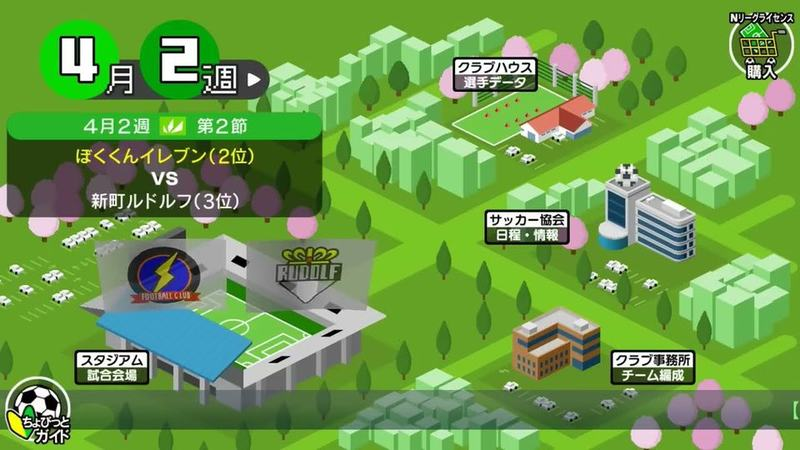

Mapa da cidade na primavera (4月2週) com cerejeiras, caixa verde do próximo jogo com posições, estádio e edifícios com etiquetas; ícone de loja no canto.

- Etiquetas: mapa-isometrico, calendario, primavera, proximo-jogo, estadio, icones
- Qualidade: boa
- Origem: [S5j2j-O6g-Y](https://www.youtube.com/watch?v=S5j2j-O6g-Y&t=184s) (25%, ~184 s), canal ぼくくんゲーム

## cidade-mapa-06.jpg

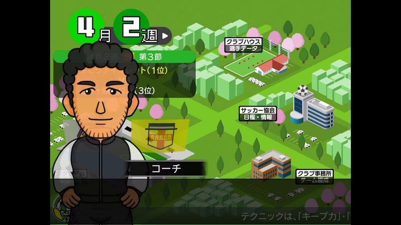

Mapa da cidade na primavera (4月2週) com o adjunto em retrato grande, próximo jogo à esquerda e dica de jogo em rodapé.

- Etiquetas: mapa-isometrico, calendario, primavera, treinador, proximo-jogo, dica
- Qualidade: boa
- Origem: [T9rd4tP7Egg](https://www.youtube.com/watch?v=T9rd4tP7Egg&t=147s) (25%, ~147 s), canal Jリーグファン

## cidade-mapa-07.jpg

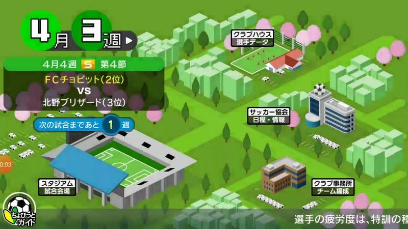

Mapa da cidade na primavera com caixa verde do próximo jogo, aviso «faltam 1 semana(s) para o jogo», estádio azul e dica em rodapé.

- Etiquetas: mapa-isometrico, calendario, primavera, proximo-jogo, contagem, estadio, dica
- Qualidade: boa
- Origem: [TO7dM6-mKGE](https://www.youtube.com/watch?v=TO7dM6-mKGE&t=68s) (25%, ~68 s), canal ゆーげーむず

## cidade-mapa-08.jpg

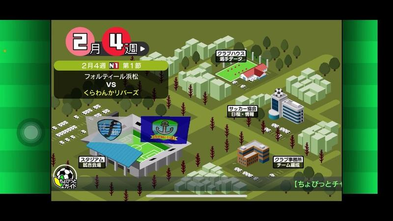

Ecrã principal com o mapa isométrico da cidade (estádio, casa do clube, associação), mês e semana em círculos vermelhos e cartão com o próximo jogo (jornada e adversário).

- Etiquetas: mapa-cidade, isometrico, calendario-semana, proximo-jogo, estadio, edificios, emblemas
- Qualidade: boa
- Origem: [_hd7RGsQcHs](https://www.youtube.com/watch?v=_hd7RGsQcHs&t=770s) (75%, ~770 s), canal ゲーム動画で行こう! Playing Games.

## cidade-mapa-09.jpg

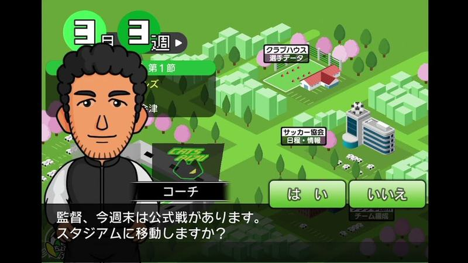

Mapa isométrico da cidade na primavera (cerejeiras) com o adjunto a perguntar se se vai para o estádio jogar e botões verdes «はい/いいえ»; mês e semana em círculos verdes.

- Etiquetas: mapa-cidade, isometrico, calendario-semana, treinador, dialogo, botoes-sim-nao, cerejeiras
- Qualidade: boa
- Origem: [hsyvccyFcag](https://www.youtube.com/watch?v=hsyvccyFcag&t=126s) (25%, ~126 s), canal NA

## cidade-mapa-10.jpg

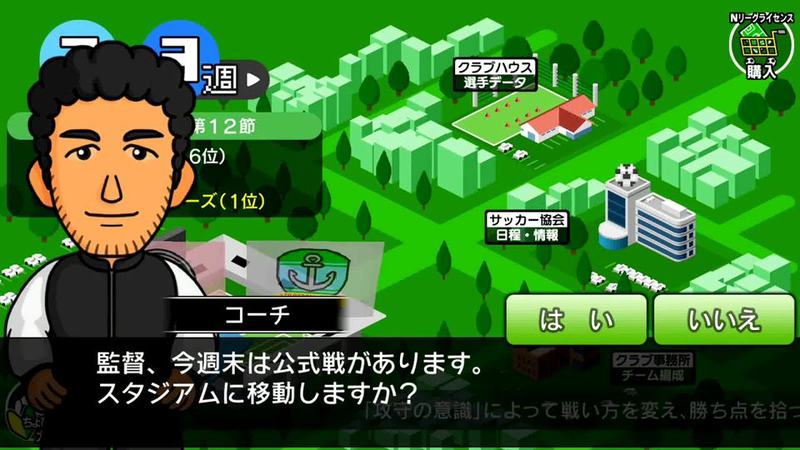

Mapa isométrico da cidade com o adjunto a perguntar se se vai para o estádio e botões «はい/いいえ».

- Etiquetas: mapa-cidade, isometrico, calendario-semana, treinador, dialogo, botoes-sim-nao
- Qualidade: boa
- Origem: [ihNogFC-lCc](https://www.youtube.com/watch?v=ihNogFC-lCc&t=222s) (25%, ~222 s), canal ゲーム動画で行こう! Playing Games.

## cidade-mapa-11.jpg

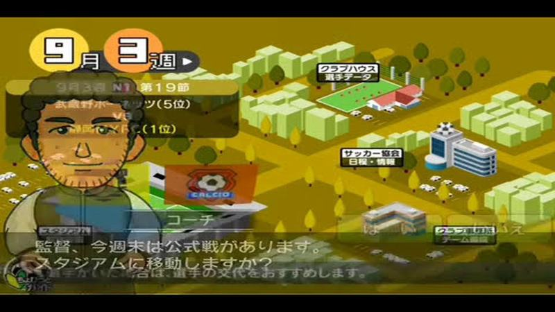

Mapa da cidade com data em círculos laranja e o adjunto em transição a avisar que há jogo oficial; imagem apanhada a meio de um esbatimento.

- Etiquetas: mapa-isometrico, calendario, treinador, caixa-texto
- Qualidade: ok
- Origem: [DKhDqBiMmng](https://www.youtube.com/watch?v=DKhDqBiMmng&t=113s) (25%, ~113 s), canal つばきち【Jリーグ系YouTuber】

## cidade-mapa-12.jpg

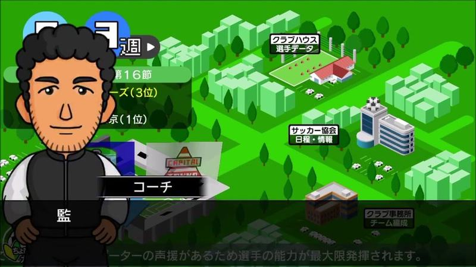

Mapa da cidade verde-claro com o adjunto em retrato grande à esquerda e o próximo jogo no topo; dica de jogo em texto pequeno no fundo.

- Etiquetas: mapa-isometrico, calendario, treinador, caixa-texto, proximo-jogo
- Qualidade: ok
- Origem: [GWbB8Z4MXBI](https://www.youtube.com/watch?v=GWbB8Z4MXBI&t=274s) (25%, ~274 s), canal ゲーム動画で行こう! Playing Games.
