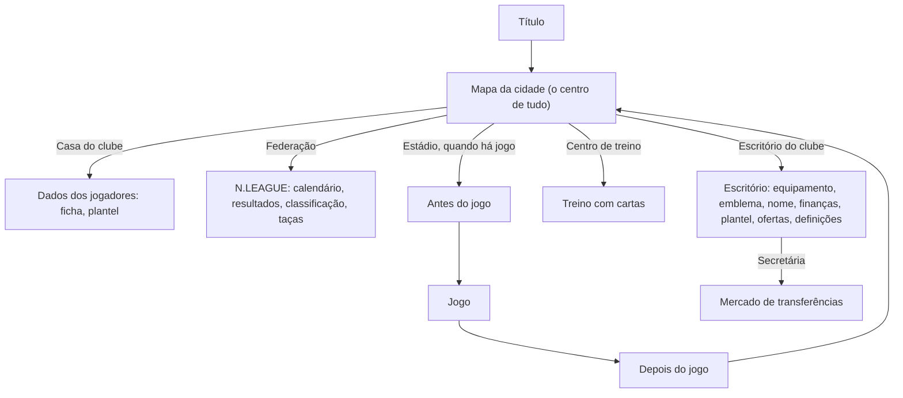

# Fluxos de UI do Calciobit A

Reconstruído a partir das 1141 imagens, que são momentos soltos e não sequências gravadas. Um passo vem de uma só imagem quando tem só uma referência ao lado. As referências apontam para as pastas de ecrã: [menu/](menu/), [jogo/](jogo/) e [cena/](cena/).

## Mapa geral

## O mapa da cidade, ecrã principal ([cena/cidade-mapa](cena/cidade-mapa/README.md))

- **Vista:** um mapa isométrico de uma cidade pequena. Cada edifício é um destino e tem uma etiqueta: casa do clube, federação, escritório do clube, estádio e centro de treino.
- **Estações:** o mapa muda com a estação. Há cerejeiras na primavera, verde no verão, dourado no outono e árvores nuas no inverno. Ao fim do dia fica amarelado.
- **Data:** no canto superior esquerdo, o mês e a semana aparecem em dois círculos laranja ou vermelhos (por exemplo «10月 3週»), com uma seta para avançar a semana.
- **Próximo jogo:** por baixo da data há um cartão com a jornada, as posições das duas equipas e quantas semanas faltam.
- **Outros elementos:** um botão de compra no canto superior direito, um ícone de guia em baixo à esquerda e uma dica em letra pequena a passar no rodapé.
- **Ir para o jogo:** na semana de jogo, o adjunto aparece em retrato grande à esquerda e pergunta se vamos para o estádio. A pergunta vem numa caixa escura translúcida, com os botões «はい/いいえ» (sim/não) em verde e amarelo.

## Escritório do clube ([menu/escritorio-clube](menu/escritorio-clube/README.md))

- **Vista:** uma sala isométrica com a secretária e o lema do clube na parede.
- **Coluna de botões redondos à esquerda:** equipamento, emblema, mudar nome, sair do cargo, definições e voltar ao título.
- **Coluna à direita:** finanças, plantel/formação e ofertas.
- **Voltar:** um botão verde redondo, com seta, no canto.
- **Secretária:** trata das contratações e da demissão, sempre com sim/não. Também anuncia o fim da época.

## Plantel e ficha do jogador ([menu/plantel-lista](menu/plantel-lista/README.md), [menu/jogador-ficha](menu/jogador-ficha/README.md))

- **Lista do plantel:**
  - a posição numa etiqueta de cor fixa: GK roxo ou rosa, DF vermelho, MF laranja ou amarelo, FW azul;
  - sete notas em letras coloridas, de S a E;
  - o tipo de jogador numa cápsula;
  - os suplentes em linhas azul-escuras.
- **Ficha do jogador:** é sempre a mesma, seja no plantel, no mercado ou numa ficha rival. Mostra:
  - moldura azul, retrato, posição, nome, preço e número grande;
  - sete ícones de atributos, cada um com a nota em letra;
  - cansaço, num círculo de cor, pé preferido e tipo de jogador;
  - potencial, em setas amarelas;
  - treinos especiais já feitos e carreira por época;
  - o selo da seleção, quando o jogador é internacional.
- **Separadores da ficha:** barras de progresso e habilidades aprendidas. As habilidades por descobrir aparecem como «?».

## Treino com cartas ([menu/treino](menu/treino/README.md), [menu/cartas-habilidades](menu/cartas-habilidades/README.md))

- **Plantel:** os jogadores ficam de pé em fila sobre a relva, de corpo inteiro.
- **Gavetas de cartas:** em baixo, uma por categoria e cor: Tactical, Technical, Physical e Support.
- **Treino especial:** juntar certas cartas abre o «SPECIAL MENU». É um cartão com uma ilustração cómica do treino, o nome, uma mini-ficha com barras e notas, e o ganho em cada atributo.
- **Cartas novas:** depois dos jogos o adjunto pode dar cartas novas, mostradas como cartões ilustrados.

## Federação: N.LEAGUE ([menu/classificacao-liga](menu/classificacao-liga/README.md), [menu/torneio-taca](menu/torneio-taca/README.md))

- **Topo:** uma faixa com os emblemas, e separadores para calendário, resultados, treinador, transferências e seleção.
- **Competições:** cada uma tem uma grelha de botões (classificação, marcadores, assistências, quadro do torneio).
- **Classificação:** as linhas coloridas marcam as zonas da tabela: azul para a subida, amarelo e vermelho para a descida.
- **Torneios internacionais:** chave sobre um mapa-mundo, com tabelas de grupo em castanho e dourado.
- **Ficha de um clube rival** ([menu/ficha-equipa](menu/ficha-equipa/README.md)): posições nas últimas épocas, sliders de estilo de jogo e a grelha de resultados em casa e fora.

## Mercado ([menu/mercado-transferencias](menu/mercado-transferencias/README.md))

- **Topo:** o orçamento («予算»), com separadores ALL/GK/DF/MF/FW.
- **Jogador escolhido:** a ficha abre por cima da lista.
- **Resposta:** a secretária ou o adjunto comentam se a contratação foi aceite ou recusada.

## Antes do jogo ([menu/apresentacao-jogo](menu/apresentacao-jogo/README.md), [menu/pre-jogo](menu/pre-jogo/README.md), [jogo/entrada-jogadores](jogo/entrada-jogadores/README.md))

1. **Mapa:** o adjunto pergunta «vamos para o estádio?» e respondemos «はい».
2. **Antevisão:**
   - no topo, a competição e a jornada;
   - duas faixas inclinadas, amarelas (ou vermelhas na taça), uma por equipa, com o emblema, casa ou fora, a divisão e a posição;
   - um «VS» ao meio;
   - uma coluna TOTO com as percentagens de vitória, empate e derrota, que é a previsão dos adeptos;
   - o nome do estádio no rodapé e uma seta verde para avançar.
3. **Pré-jogo «LIVE»:** a prova, as equipas e a divisão, com botões para o onze, a tática, o equipamento e começar. Há também um ecrã com os cartões de camisola de casa e fora de cada equipa. Às vezes o jogo pergunta por uma substituição por cima da formação.
4. **Balneário isométrico:** o adjunto motiva a equipa.
5. **Claque:** um grande plano da bancada atrás da baliza, com bandeiras do emblema ([jogo/adeptos-claque](jogo/adeptos-claque/README.md)).
6. **Entrada das equipas:** as duas equipas entram em fila pela parte de baixo do ecrã e alinham-se na lateral, com o árbitro ao centro.
7. **Sorteio:** em grande plano, com o árbitro entre os dois capitães.
8. **Pontapé de saída:** em grande plano, no círculo central. Às vezes aparece antes um 0-0 gigante com os emblemas.

## Durante o jogo ([jogo/camara-geral](jogo/camara-geral/README.md), [jogo/interface-durante-jogo](jogo/interface-durante-jogo/README.md))

- **Marcador:** uma barra fina e escura no topo, com «equipa, resultado numa cápsula, equipa, relógio». Os descontos aparecem como «+N».
- **Botões:** três botões redondos à direita, para substituição, jogadores e estado da equipa.
- **Tática:** um painel TACTICAL com as cartas de tática.
- **Substituições:** placas LED OUT/IN no canto inferior esquerdo, sem parar o jogo ([jogo/substituicao](jogo/substituicao/README.md)).
- **Golo:**
  - aparece um resultado gigante a meio do campo;
  - a seguir vem a repetição, com «REPLAY» no canto e um botão de avançar;
  - depois a claque, com um balão de grito.
- **Habilidade especial:** três cartas pequenas no canto inferior esquerdo e o nome em letras amarelas grossas ([jogo/habilidade-especial](jogo/habilidade-especial/README.md)).
- **Intervalo** ([jogo/intervalo](jogo/intervalo/README.md)): volta-se ao balneário isométrico, com os jogadores sentados e um a receber massagem. À direita há os ícones de substituição, tática, estado e «後半開始» (começar a 2.ª parte).
- **Penáltis:** a ordem dos marcadores aparece numa prancheta. A câmara fica de frente para a baliza, com a ficha do marcador em cima e uma tabela de círculos e cruzes em baixo.

## Depois do jogo ([jogo/fim-jogo](jogo/fim-jogo/README.md), [menu/relatorio-pos-jogo](menu/relatorio-pos-jogo/README.md), [cena/cerimonia-trofeu](cena/cerimonia-trofeu/README.md))

1. **Fim:** papelinhos no campo. Os adeptos invadem o relvado com bandeiras e um balão amarelo de grito («決まったぁ», «よくやった！»).
2. **Resumo dos golos:** o minuto e uma frase de narração para cada golo.
3. **Balneário:** o adjunto dá o resultado e um novo problema a resolver («監督、4−1で勝利です！新しい課題も…»). Às vezes entrega cartas de treino.
4. **Título ganho:**
   - um mosaico de retratos com confetis e «WE ARE THE CHAMPIONS»;
   - depois o painel dourado «N.LEAGUE Division 1 優勝» com a taça;
   - no fim da época, a sala de troféus e os créditos.
5. **Fim de época sem título:** a secretária anuncia o fim da época e há um play-off de subida e descida.
6. **Regresso:** volta-se ao mapa da cidade.

## Editores ([menu/emblema-equipamento](menu/emblema-equipamento/README.md))

- **Disposição:** a pré-visualização à esquerda e, à direita, uma grelha de 12 formas ou padrões, com páginas («3/10»).
- **Cores:** uma paleta de cores em pinceladas.

## Táticas ([menu/taticas-formacao](menu/taticas-formacao/README.md))

- **Formação:** um campo dividido em faixas de cor (FW azul, MF amarelo, DF vermelho), com o banco à direita.
- **Quadro tático:** um campo branco com a direção do ataque, a marcação, as zonas (largura e altura) e a atitude: ofensiva, equilibrada ou defensiva.

## Notas para o Pocket Basketball

- **Ecrã principal:** o centro é um mapa da cidade, não um menu de lista. O Pocket Basketball já tem uma cidade, por isso este é o modelo a seguir para um ecrã só, em vez de dois.
- **Diálogos:** as perguntas que mudam de ecrã («vamos para o estádio?») vêm sempre de uma personagem, numa caixa escura com sim/não.
- **O mesmo componente em todo o lado:** a ficha do jogador e as etiquetas de posição de cor fixa repetem-se em todos os ecrãs.
- **Antes do jogo:** a ordem é sempre a mesma: antevisão com previsão dos adeptos, balneário, entrada das equipas, pontapé de saída.
