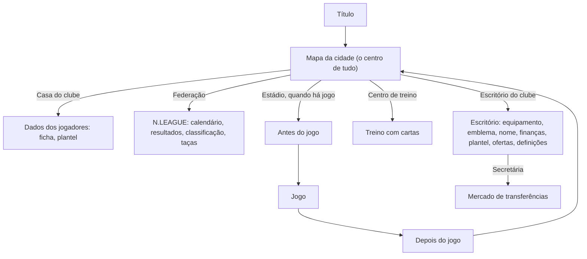

# Fluxos de UI do Calciobit A

Reconstruído primeiro a partir das 1141 imagens soltas, e depois confirmado e corrigido com as [sequências](sequencias/) tiradas dos vídeos. As referências apontam para as pastas de ecrã, [menu/](menu/), [jogo/](jogo/) e [cena/](cena/), e para as sequências, `sequencias/<area>/<nome>`. Um passo com só uma imagem de pasta ao lado não foi visto em vídeo.

## Como se muda de ecrã ([sequencias/menus-transicoes](sequencias/menus-transicoes/))

- **Tudo passa por preto.** O ecrã escurece, fica preto e o seguinte clareia. Não há cortinas, deslizes de ecrã inteiro nem zooms entre ecrãs.
  - Nos menus (escritório, mapa, treino, federação) são 0,6–0,8 s ao todo: cerca de 0,2 s a escurecer, 0,2–0,3 s de preto e 0,2–0,3 s a clarear ([escritorio-cidade-treino](sequencias/menus-transicoes/escritorio-cidade-treino/README.md)).
  - Avançar a semana é mais lento, cerca de 1,1 s ([cidade-avancar-semana](sequencias/menus-transicoes/cidade-avancar-semana/README.md)).
  - À volta do jogo os fundidos são mais longos: 0,9–1,3 s a escurecer, 0,2–0,5 s de preto e 0,7–1 s a clarear.
- **Exceções:** um clarão branco só nos momentos de título, e um corte seco do preto para o alinhamento antes do sorteio.
- **Botões redondos laterais:** entram e saem a rolar. Deslizam da borda mais próxima enquanto rodam 90°, em cerca de 0,3 s, e abrandam no fim.
- **Toque num botão:** o botão fica amarelo vivo durante um só frame (33 ms). Não muda de escala nem afunda. A ação começa cerca de 66 ms depois.
- **Diálogos:** a barra preta, a etiqueta com o nome e o retrato aparecem e desaparecem juntos num fade de 0,2–0,3 s. Trocar de personagem é um fade para fora e outro para dentro no mesmo sítio. O texto de uma fala aparece letra a letra, a cerca de 25 caracteres por segundo, mas as perguntas sim/não aparecem inteiras.

## Mapa geral

## O mapa da cidade, ecrã principal ([cena/cidade-mapa](cena/cidade-mapa/README.md))

- **Vista:** um mapa isométrico de uma cidade pequena. Cada edifício é um destino e tem uma etiqueta: casa do clube, federação, escritório do clube, estádio e centro de treino.
- **Estações:** o mapa muda com a estação. Há cerejeiras na primavera, verde no verão, dourado no outono e árvores nuas no inverno. Ao fim do dia fica amarelado.
- **Data:** no canto superior esquerdo, o mês e a semana aparecem em dois círculos laranja ou vermelhos (por exemplo «10月 3週»), com uma seta para avançar a semana.
- **Próximo jogo:** por baixo da data há um cartão com a jornada, as posições das duas equipas e quantas semanas faltam.
- **Outros elementos:** um botão de compra no canto superior direito, um ícone de guia em baixo à esquerda e uma dica em letra pequena a passar no rodapé.
- **Ir para o jogo:** na semana de jogo, o adjunto aparece em retrato grande à esquerda e pergunta se vamos para o estádio. A pergunta vem numa caixa escura translúcida, com os botões «はい/いいえ» (sim/não), os dois verdes. O «はい» só fica amarelo no frame do toque, que é o que algumas imagens soltas apanharam ([mercado-resposta-secretaria](sequencias/menus-transicoes/mercado-resposta-secretaria/README.md), frame 18).
- **Câmara:** nunca se mexe. Não há panorâmica nem aproximação ao edifício tocado. O edifício acende-se com um véu branco durante um frame e vem logo o preto.
- **Avançar a semana:** toca-se no ▶ ao lado da data e o mapa passa por preto. A semana muda enquanto o ecrã está preto, sem animação do calendário. Na semana de jogo o mapa volta com as bandeiras das duas equipas no estádio, e o adjunto faz a pergunta ([cidade-avancar-semana](sequencias/menus-transicoes/cidade-avancar-semana/README.md)).
- **Cartão do próximo jogo:** entra depois do mapa com um salto de escala a partir do centro, de 0,68 a 1,09 e de volta a 1,0 em 0,4 s ([regresso-cidade-proximo-jogo](sequencias/menus-transicoes/regresso-cidade-proximo-jogo/README.md)).
- **Taxa de apoio dos adeptos:** «支持率» aparece diante da casa do clube e conta 1 % por frame, ou 10 % por segundo ([apoio-adeptos-e-entrar-escritorio](sequencias/menus-transicoes/apoio-adeptos-e-entrar-escritorio/README.md)).

## Escritório do clube ([menu/escritorio-clube](menu/escritorio-clube/README.md))

- **Vista:** uma sala isométrica com a secretária e o lema do clube na parede.
- **Coluna de botões redondos à esquerda:** equipamento, emblema, mudar nome, sair do cargo, definições e voltar ao título.
- **Coluna à direita:** finanças, plantel/formação e ofertas.
- **Voltar:** um botão verde redondo, com seta, no canto.
- **Secretária:** trata das contratações e da demissão, sempre com sim/não. Também anuncia o fim da época.
- **Entrada:** as duas colunas de botões entram a rolar das bordas depois do fundido ([apoio-adeptos-e-entrar-escritorio](sequencias/menus-transicoes/apoio-adeptos-e-entrar-escritorio/README.md)).

## Plantel e ficha do jogador ([menu/plantel-lista](menu/plantel-lista/README.md), [menu/jogador-ficha](menu/jogador-ficha/README.md))

- **Lista do plantel:**
  - a posição numa etiqueta de cor fixa: GK roxo ou rosa, DF vermelho, MF laranja ou amarelo, FW azul;
  - sete notas em letras coloridas, de S a E;
  - o tipo de jogador numa cápsula;
  - os suplentes em linhas azul-escuras.
- **Ficha do jogador:** é sempre a mesma, seja no plantel, no mercado ou numa ficha rival. Mostra:
  - moldura azul, retrato, posição, nome, preço e número grande;
  - sete ícones de atributos, cada um com a nota em letra;
  - cansaço, num círculo de cor, pé preferido e tipo de jogador;
  - potencial, em setas amarelas;
  - treinos especiais já feitos e carreira por época;
  - o selo da seleção, quando o jogador é internacional.
- **Separadores da ficha:** barras de progresso e habilidades aprendidas. As habilidades por descobrir aparecem como «?».
- **Abrir e fechar a ficha:** um deslize horizontal curto com fade ao mesmo tempo, sem escala. Abre a entrar da direita, de +50 px até ao sítio, em 0,13 s. Fecha a sair para a direita, cerca de 85 px, em 0,17 s. O ecrã de trás fica desfocado ([ficha-jogador-fechar-abrir](sequencias/menus-transicoes/ficha-jogador-fechar-abrir/README.md)).

## Treino com cartas ([menu/treino](menu/treino/README.md), [menu/cartas-habilidades](menu/cartas-habilidades/README.md))

- **Plantel:** os jogadores ficam de pé em fila sobre a relva, de corpo inteiro.
- **Gavetas de cartas:** em baixo, uma por categoria e cor: Tactical, Technical, Physical e Support.
- **Treino especial:** juntar certas cartas abre o «SPECIAL MENU». É um cartão com uma ilustração cómica do treino, o nome, uma mini-ficha com barras e notas, e o ganho em cada atributo. Também se pode descobrir sem cartas, por um aviso de que chegou um vídeo do patrocinador ([treino-special-menu-descoberto](sequencias/menus-transicoes/treino-special-menu-descoberto/README.md)).
- **O combo, por ordem** ([treino-combo-cartas-special-menu](sequencias/menus-transicoes/treino-combo-cartas-special-menu/README.md), cerca de 9 s ao todo):
  1. um fundo de favos (amarelo; azul num combo de duas cartas) entra num fade de 0,6 s;
  2. as cartas aparecem uma a uma, de 0,3 em 0,4 s, num triângulo;
  3. giram depressa, em cerca de 0,3 s;
  4. encolhem no sítio em 0,3 s e viram bolas de luz;
  5. as bolas pulsam três vezes para o centro e voltam, em cerca de 1,8 s;
  6. apagam-se uma a uma, em cerca de 1 s;
  7. uma faísca, o título «SPECIAL MENU» e o clarão, em cerca de 1,9 s: um oval branco cresce do centro sobre raios amarelos e laranja até o ecrã ficar branco. Um corte seco mostra a ilustração com o nome numa faixa escura inclinada.
- **Subir de nível:** não se viu animação. Depois do SPECIAL MENU volta-se à fila de jogadores e as notas mudam sem efeito visível.
- **Cartas novas:** depois dos jogos o adjunto pode dar cartas novas, mostradas como cartões ilustrados.

## Federação: N.LEAGUE ([menu/classificacao-liga](menu/classificacao-liga/README.md), [menu/torneio-taca](menu/torneio-taca/README.md))

- **Topo:** uma faixa com os emblemas, e separadores para calendário, resultados, treinador, transferências e seleção.
- **Competições:** cada uma tem uma grelha de botões (classificação, marcadores, assistências, quadro do torneio).
- **Classificação:** as linhas coloridas marcam as zonas da tabela: azul para a subida, amarelo e vermelho para a descida.
- **Torneios internacionais:** chave sobre um mapa-mundo, com tabelas de grupo em castanho e dourado.
- **Ficha de um clube rival** ([menu/ficha-equipa](menu/ficha-equipa/README.md)): posições nas últimas épocas, sliders de estilo de jogo e a grelha de resultados em casa e fora.

## Mercado ([menu/mercado-transferencias](menu/mercado-transferencias/README.md))

- **Topo:** o orçamento («予算»), com separadores ALL/GK/DF/MF/FW.
- **Jogador escolhido:** a ficha abre por cima da lista.
- **Resposta:** a secretária ou o adjunto comentam se a contratação foi aceite ou recusada. A secretária confirma com sim/não e depois passa a palavra ao adjunto, com um fade para fora e outro para dentro ([mercado-resposta-secretaria](sequencias/menus-transicoes/mercado-resposta-secretaria/README.md)).
- **Menus da federação:** o separador escolhido fica laranja e o menu escuro translúcido aparece de uma vez, sem animação ([cidade-entrar-federacao](sequencias/menus-transicoes/cidade-entrar-federacao/README.md)).

## Antes do jogo ([menu/apresentacao-jogo](menu/apresentacao-jogo/README.md), [menu/pre-jogo](menu/pre-jogo/README.md), [jogo/entrada-jogadores](jogo/entrada-jogadores/README.md), [sequencias/entrada-saida](sequencias/entrada-saida/))

A ordem medida nos vídeos (KbPiy1_7C58, de 41 s a 86 s; 0AWtZz7qiDM, de 0 s a 28 s):

1. **Mapa:** o adjunto pergunta «vamos para o estádio?» e respondemos «はい». O retrato sai em 0,2 s e o mapa funde para preto em 0,9 s ([mapa-para-tunel-live](sequencias/entrada-saida/mapa-para-tunel-live/README.md)).
2. **Ecrã «LIVE», que é o túnel:** uma vista isométrica com as duas equipas em duas filas diagonais, os árbitros à frente e uma mesa de oficiais. O cabeçalho mostra a prova, a jornada, as equipas e o estádio. À direita há quatro botões: onze, tática, equipamento e começar («試合開始»). O jogador fica aqui o tempo que quiser, e a escolha de equipamentos abre por cima. O adjunto pode dar uma dica sobre a formação, mas não há discurso no balneário.
3. **Antevisão** (depois de um fundido para preto):
   - no topo, a competição e a jornada;
   - duas faixas inclinadas, uma por equipa, com o emblema, casa ou fora, a divisão e a posição, e um «VS» ao meio. Na liga a cor segue a divisão (verde numa, amarelo noutra); na final da taça são vermelha e azul, depois de um painel com o emblema da taça;
   - uma coluna TOTO com as percentagens de vitória, empate e derrota, que é a previsão dos adeptos;
   - o nome do estádio no rodapé e uma seta verde para avançar;
   - por trás, o estádio 3D mexe-se devagar.
   - **Entrada:** as faixas, as cápsulas e a coluna TOTO entram da direita e abrandam no fim, em cerca de 1,3 s, com o TOTO por último ([antevisao-faixas-entram](sequencias/entrada-saida/antevisao-faixas-entram/README.md)).
   - **Saída:** o fundo corta para a bancada principal com os 22 jogadores já em fila junto à linha. As faixas saem para a esquerda a acelerar, a da casa primeiro, cerca de 0,5 s cada ([antevisao-faixas-saem](sequencias/entrada-saida/antevisao-faixas-saem/README.md)).
4. **Bancada com a fila de jogadores**, sozinha durante cerca de 3 s, e fundido para preto.
5. **Claque** atrás da baliza, durante cerca de 5 s, com bandeiras do emblema e balões de grito com o nome do clube ([jogo/adeptos-claque](jogo/adeptos-claque/README.md)). Na final da taça vista não houve claque.
6. **Alinhamento:** um corte seco do preto para o plano alto. As equipas já estão em linhas a meio do campo e desfazem-se em leque até às posições, em 2 s, com a câmara parada ([alinhamento-ate-ao-sorteio](sequencias/entrada-saida/alinhamento-ate-ao-sorteio/README.md)). Não há entrada a andar pelo túnel.
7. **Sorteio:** corte para o grande plano do círculo central e zoom; o árbitro lança a moeda entre os dois capitães. Sai por um corte a preto e um fundido de 1 s para o plano largo, já com o marcador a 0:00 ([sorteio-zoom-e-fade](sequencias/jogo-camara/sorteio-zoom-e-fade/README.md)).
8. **Pontapé de saída:** outro grande plano, com os dois avançados no centro. Mal a bola anda, um zoom-out rápido devolve o plano largo ([pontape-de-saida-corte-e-zoom-out](sequencias/jogo-camara/pontape-de-saida-corte-e-zoom-out/README.md)).

Da antevisão à bola a rolar passam cerca de 21 s sem tocar em nada, com o botão de avançar sempre no canto. O marcador e os botões redondos só aparecem depois do sorteio.

## Durante o jogo ([jogo/camara-geral](jogo/camara-geral/README.md), [jogo/interface-durante-jogo](jogo/interface-durante-jogo/README.md), [sequencias/jogo-camara](sequencias/jogo-camara/))

- **Marcador:** uma barra fina e escura no topo, com «equipa, resultado numa cápsula, equipa, relógio». Os descontos aparecem como «+N». O relógio anda cerca de 17,8 vezes mais depressa do que o tempo real e não para nos grandes planos.
- **Botões:** três botões redondos à direita, para substituição, jogadores e estado da equipa.
- **Tática:** um painel TACTICAL com as cartas de tática.
- **Substituições:** placas LED OUT/IN no canto inferior esquerdo, sem parar o jogo ([jogo/substituicao](jogo/substituicao/README.md)).
- **Faltas e cartões:** grande plano do árbitro com o cartão e uma faixa escura translúcida com o nome do jogador, que entra e sai num fade de 0,3 s. O recomeço vem depois de um corte a preto e um fundido ([cartao-amarelo-zoom-e-saida](sequencias/jogo-camara/cartao-amarelo-zoom-e-saida/README.md)).
- **Fora de jogo:** grande plano do fiscal de linha (cerca de 1 s), preto, repetição de cerca de 5 s que começa congelada com uma linha vermelha em perspetiva, preto e fundido para o recomeço ([fora-de-jogo-fiscal-e-linha](sequencias/jogo-camara/fora-de-jogo-fiscal-e-linha/README.md)).
- **Golo** (medido em OSCtF-d6e4E e ecma51SSHsI; do golo ao pontapé de saída passam cerca de 20 s):
  1. a bola entra e o relógio para;
  2. o resultado gigante aparece a meio do campo, durante 2,4 a 6,8 s ([resultado-entra-golo-sofrido](sequencias/golo-festejo/resultado-entra-golo-sofrido/README.md));
  3. corte seco para preto, 0,4 s;
  4. a claque do jogador, cerca de 3,8 s, com bandeiras se marcou e sem elas se sofreu ([claque-golo-marcado](sequencias/golo-festejo/claque-golo-marcado/README.md), [claque-golo-sofrido](sequencias/golo-festejo/claque-golo-sofrido/README.md));
  5. a repetição, a surgir do preto, cerca de 7 s, com «REPLAY» a piscar no canto e um botão de avançar ([repeticao-golo-saida](sequencias/jogo-camara/repeticao-golo-saida/README.md));
  6. preto e fundido de 1 s para o jogo, já com o resultado novo na barra;
  7. a ficha do marcador: retrato, nome, «Goals today» e o assistente. Entra a subir em 0,3 s, fica 1,4 s e sai em 0,3 s, também nos golos sofridos ([regresso-ficha-marcador](sequencias/golo-festejo/regresso-ficha-marcador/README.md));
  8. corte para o grande plano do pontapé de saída.

  O botão verde salta a claque e a repetição.
- **Habilidade especial:** duas ou três cartas pequenas no canto inferior esquerdo e o nome em letras amarelas grossas, encostado à direita. As cartas aparecem de uma vez e o nome escreve-se letra a letra em cerca de 0,7 s. O jogo não abranda e a câmara não muda. Cartas e nome ficam a jogada toda; na repetição fica só o nome ([habilidade-entrada-cartas-nome](sequencias/golo-festejo/habilidade-entrada-cartas-nome/README.md), [jogo/habilidade-especial](jogo/habilidade-especial/README.md)).
- **Intervalo** ([jogo/intervalo](jogo/intervalo/README.md), [intervalo-balneario-e-regresso](sequencias/entrada-saida/intervalo-balneario-e-regresso/README.md)):
  - não há apito em grande plano: o relógio para (por exemplo em «46:20 +1») e o plano largo funde para preto em 1,1 s;
  - o balneário isométrico abre num fundido de 1 s, com os jogadores sentados e um a receber massagem;
  - em baixo à esquerda corre uma contagem decrescente num quadrado azul, por isso o intervalo tem tempo limite;
  - à direita há os botões de substituição, tática, estado e «後半開始» (começar a 2.ª parte). O quadro da formação abre e fecha por cima com fundidos cruzados de 0,3 s;
  - depois de «後半開始», um fundido de 1,4 s leva ao campo com os jogadores já nas posições e o relógio em 45:00, sem alinhamento nem grande plano do pontapé de saída.
- **Desempate por penáltis:** é a única passagem com fade de saída (0,5 s) e de entrada (0,5 s). Mostra as equipas alinhadas no meio-campo durante 1,5 s, e a câmara inclina-se e recua em 0,4 s até ficar atrás e por cima da baliza, fixa para todos os penáltis. A ficha do batedor muda de canto conforme a equipa, e o quadro em baixo marca ○ ou × ([penaltis-entrada-desempate](sequencias/jogo-camara/penaltis-entrada-desempate/README.md), [penaltis-remate-camara-fixa](sequencias/jogo-camara/penaltis-remate-camara-fixa/README.md)). A ordem dos marcadores aparece antes numa prancheta.

## Depois do jogo ([jogo/fim-jogo](jogo/fim-jogo/README.md), [menu/relatorio-pos-jogo](menu/relatorio-pos-jogo/README.md), [cena/cerimonia-trofeu](cena/cerimonia-trofeu/README.md), [sequencias/entrada-saida](sequencias/entrada-saida/))

### Jogo normal

Não há papelinhos, festa nem claque, ganhe-se ou perca-se ([fim-para-resumo](sequencias/entrada-saida/fim-para-resumo/README.md)).

1. **Apito:** corte para um grande plano no círculo central, com o árbitro de braços no ar, durante cerca de 2 s.
2. **Plano largo** e fundido para preto em 1,3 s.
3. **Resumo:** um campo desenhado a verde-claro sobre verde-escuro, com uma barra de reprodução. Cada lance (golo, remate falhado ou bola no poste) abre numa janela que cresce do centro em 0,6 s, com «minuto · resultado» e uma frase de narração. Acaba com «タイムアップ、ここで試合終了».
4. **Relatório:** os números do jogo e depois o balneário. O adjunto dá o resultado e um novo problema a resolver («監督、4−1で勝利です！新しい課題も…»). Às vezes entrega cartas de treino.
5. **Regresso** ao mapa da cidade.

### Jogo que dá um título

Medido em KbPiy1_7C58, de 510 s a 590 s; igual em 8ogmIZH7WjE e aUptG4lwG1Q.

1. **Apito em grande plano, cerca de 2 s:** os vencidos caem no relvado. Segue-se um afastamento rápido e 2,1 s de fundido lento para preto ([apito-final-titulo](sequencias/entrada-saida/apito-final-titulo/README.md)).
2. **Clarão branco (0,7 s) e bancada com papelinhos e balões de grito.** A secretária entra em retrato («・・・ついに優・・・勝！») até se tocar em avançar.
3. **Banco de suplentes com papelinhos, cerca de 3 s:** os suplentes saltam e correm para o campo.
4. **Relvado com papelinhos, cerca de 6 s:** a câmara desliza até ao meio-campo, onde a equipa se junta em roda de braços no ar.
5. **Clarão branco e painel do título no ecrã gigante do estádio, cerca de 10 s:** o nome da liga, o clube, «優勝» e a taça, em fundidos. O painel é verde-claro na liga e cinzento-escuro na taça, e só «優勝» é dourado ([painel-trofeu-liga](sequencias/entrada-saida/painel-trofeu-liga/README.md)).
6. **Preto e mosaico de retratos «WE ARE THE CHAMPIONS» com papelinhos, cerca de 5 s** ([mosaico-we-are-the-champions](sequencias/entrada-saida/mosaico-we-are-the-champions/README.md)).
7. **Claque** com bandeiras, papelinhos e o nome do clube nos balões, cerca de 15 s.
8. **Resumo, relatório, balneário** e o quadro do torneio ou a classificação.

Não se viram adeptos a invadir o relvado: a festa dos adeptos fica na bancada.

### Fim de época

- **Com títulos:** a secretária aparece à frente de uma prateleira com as taças ganhas e dá os parabéns. Seguem-se os créditos, cerca de 2 minutos de cartas de jogador a rodar sobre um pano verde com os nomes da equipa. No fim, o escritório diz que o clube se tornou um clube histórico e o orçamento sobe ([mTIbj3NqNug](https://www.youtube.com/watch?v=mTIbj3NqNug&t=615s), de 615 s a 770 s, sem sequência).
- **Sem título:** a secretária anuncia o fim da época e há um play-off de subida e descida.

## Editores ([menu/emblema-equipamento](menu/emblema-equipamento/README.md))

- **Disposição:** a pré-visualização à esquerda e, à direita, uma grelha de 12 formas ou padrões, com páginas («3/10»).
- **Cores:** uma paleta de cores em pinceladas.

## Táticas ([menu/taticas-formacao](menu/taticas-formacao/README.md))

- **Formação:** um campo dividido em faixas de cor (FW azul, MF amarelo, DF vermelho), com o banco à direita.
- **Quadro tático:** um campo branco com a direção do ataque, a marcação, as zonas (largura e altura) e a atitude: ofensiva, equilibrada ou defensiva.

## Notas para o Pocket Basketball

- **Ecrã principal:** o centro é um mapa da cidade, não um menu de lista. O Pocket Basketball já tem uma cidade, por isso este é o modelo a seguir para um ecrã só, em vez de dois.
- **Diálogos:** as perguntas que mudam de ecrã («vamos para o estádio?») vêm sempre de uma personagem, numa caixa escura com sim/não.
- **O mesmo componente em todo o lado:** a ficha do jogador e as etiquetas de posição de cor fixa repetem-se em todos os ecrãs.
- **Antes do jogo:** a ordem é sempre a mesma: túnel com as escolhas, antevisão com a previsão dos adeptos, claque, alinhamento, sorteio e pontapé de saída. Tudo corre sozinho, com um botão para avançar.
- **Transições simples:** quase tudo passa por preto, com fundidos de 0,6 a 2 s. O movimento fica nos elementos (faixas, botões a rolar, o algarismo do golo), não na passagem entre ecrãs.
- **Festa guardada para o título:** os jogos normais acabam secos. Os papelinhos, os clarões brancos e o mosaico só aparecem quando se ganha alguma coisa.
