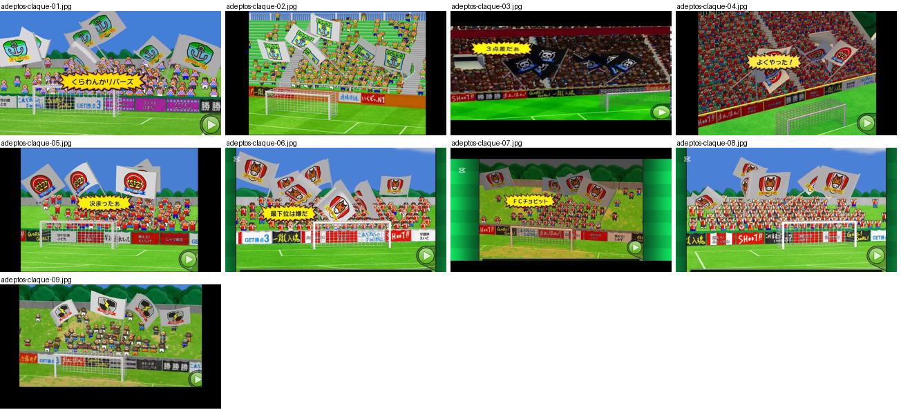
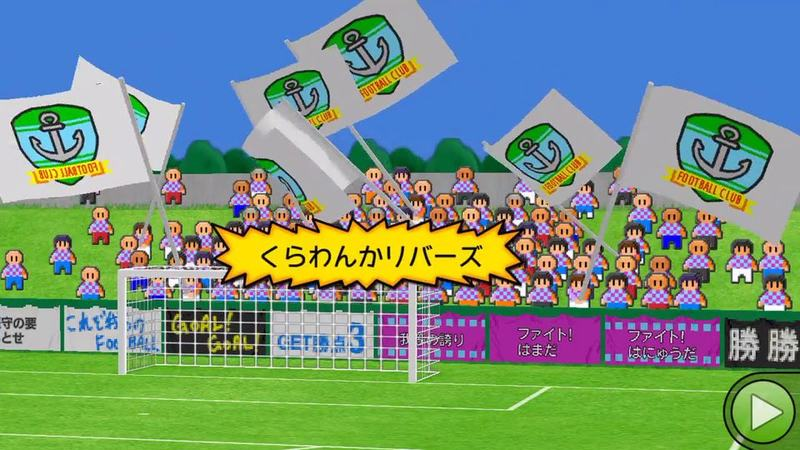
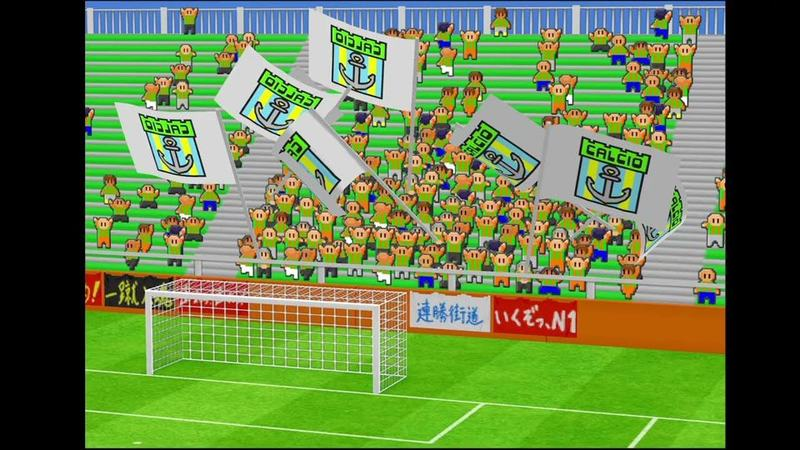
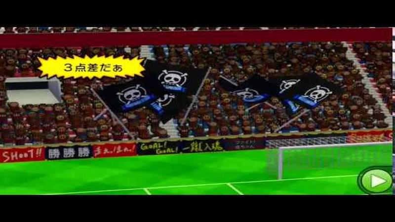
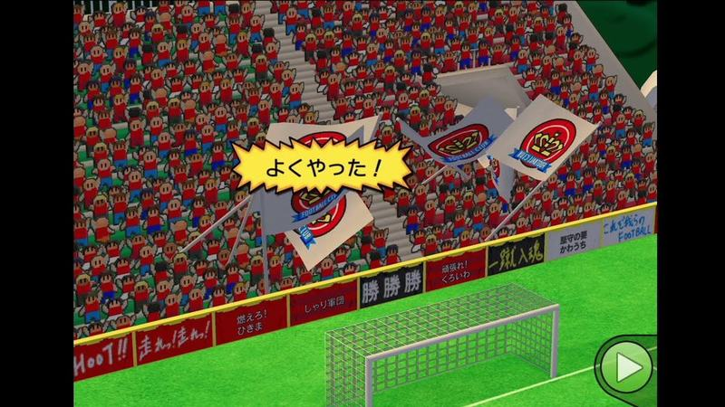
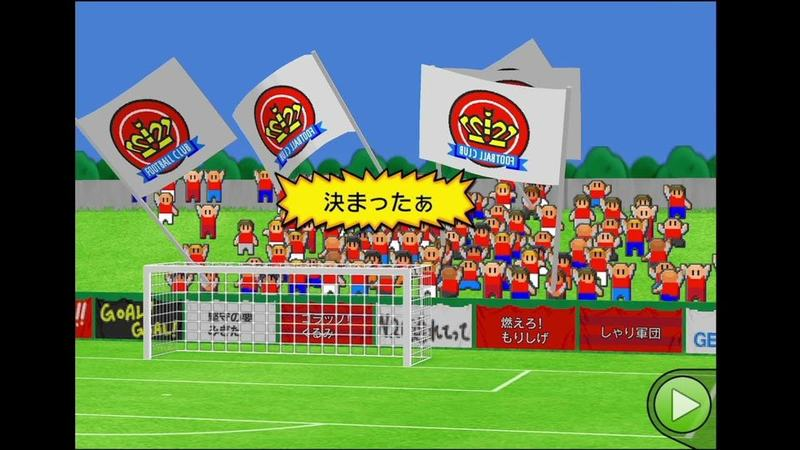
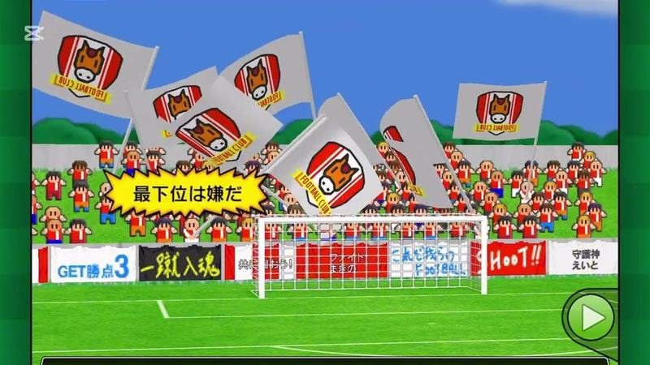
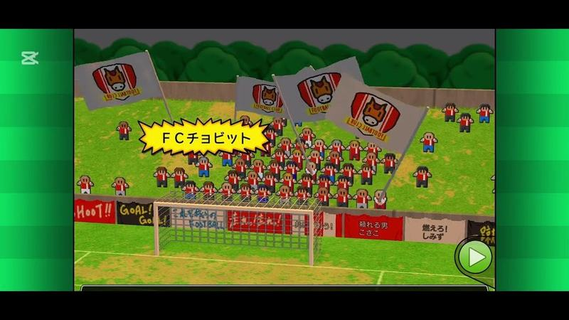
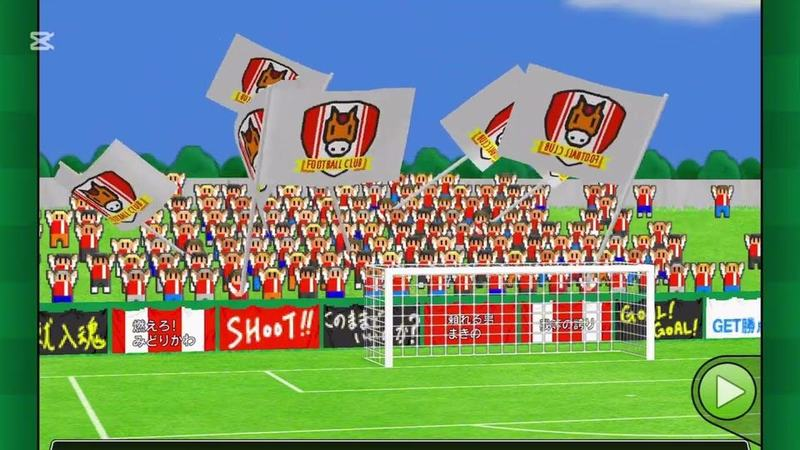
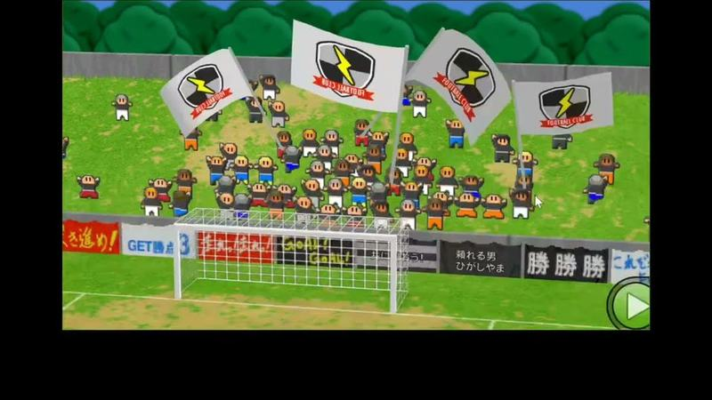

# adeptos-claque

Categoria: Jogo (dentro do campo). 9 imagens. A folha `_folha.jpg` mostra-as todas de uma vez.

## adeptos-claque-01.jpg

Grande plano da bancada com adeptos chibi a agitar bandeiras com o emblema do clube e uma faixa amarela com o nome da equipa; placas de publicidade coloridas em baixo.

- Etiquetas: bancada, bandeiras, emblemas, faixa, publicidade, botao-play
- Qualidade: boa
- Origem: [W1jfBOOc_jc](https://www.youtube.com/watch?v=W1jfBOOc_jc&t=184s) (25%, ~184 s), canal ゲーム動画で行こう! Playing Games.

## adeptos-claque-02.jpg

Bancada atrás da baliza com adeptos a agitar bandeiras brancas com o emblema; placas de publicidade em baixo.

- Etiquetas: bancada, bandeiras, emblemas, baliza, publicidade
- Qualidade: boa
- Origem: [_ghnx6708ZI](https://www.youtube.com/watch?v=_ghnx6708ZI&t=489s) (75%, ~489 s), canal しゃり

## adeptos-claque-03.jpg

Bancada com adeptos a agitar bandeiras pretas com caveira e um balão amarelo de grito («3点差だぁ»); placas de publicidade em baixo.

- Etiquetas: bancada, bandeiras, emblemas, balao-fala, publicidade, botao-play
- Qualidade: boa
- Origem: [ajANYEQm2HY](https://www.youtube.com/watch?v=ajANYEQm2HY) (capa), canal サツマイモ

## adeptos-claque-04.jpg

Bancada atrás da baliza com adeptos de vermelho a agitar bandeiras e balão de grito «よくやった！».

- Etiquetas: bancada, bandeiras, emblemas, balao-fala, baliza, publicidade, botao-play
- Qualidade: boa
- Origem: [ap0inNUV1ZY](https://www.youtube.com/watch?v=ap0inNUV1ZY&t=410s) (75%, ~410 s), canal しゃり

## adeptos-claque-05.jpg

Adeptos atrás da baliza a agitar bandeiras com o emblema do clube e balão amarelo «決まったぁ» depois de golo.

- Etiquetas: bancada, bandeiras, emblemas, balao-fala, baliza, publicidade, botao-play
- Qualidade: boa
- Origem: [cOswRjNtAbo](https://www.youtube.com/watch?v=cOswRjNtAbo&t=425s) (50%, ~425 s), canal NA

## adeptos-claque-06.jpg

Claque com bandeiras do emblema de cavalo atrás da baliza e balão amarelo «最下位は嫌だ»; placas coloridas «GET勝点3» e «SHOOT!».

- Etiquetas: bancada, bandeiras, emblemas, balao-fala, baliza, publicidade, botao-play
- Qualidade: boa
- Origem: [cblD5BR_sfc](https://www.youtube.com/watch?v=cblD5BR_sfc&t=138s) (25%, ~138 s), canal Booby

## adeptos-claque-07.jpg

Claque de vermelho com bandeiras do emblema e balão com o nome do clube; placas de publicidade atrás da baliza.

- Etiquetas: bancada, bandeiras, emblemas, balao-fala, baliza, publicidade, botao-play
- Qualidade: boa
- Origem: [e5reAq1y5pY](https://www.youtube.com/watch?v=e5reAq1y5pY&t=124s) (25%, ~124 s), canal Booby

## adeptos-claque-08.jpg

Claque atrás da baliza com bandeiras brancas do emblema de cavalo e placas «SHOOT!» e «GET».

- Etiquetas: bancada, bandeiras, emblemas, baliza, publicidade, botao-play
- Qualidade: boa
- Origem: [ecma51SSHsI](https://www.youtube.com/watch?v=ecma51SSHsI&t=134s) (25%, ~134 s), canal Booby

## adeptos-claque-09.jpg

Claque atrás da baliza com bandeiras brancas com emblema de raio e placas de publicidade «GET» e «勝勝勝».

- Etiquetas: bancada, bandeiras, emblemas, baliza, publicidade, botao-play
- Qualidade: boa
- Origem: [iSsr7oWiHQ4](https://www.youtube.com/watch?v=iSsr7oWiHQ4&t=440s) (50%, ~440 s), canal 【ゲーム】海苔巻ぷんちゃん
