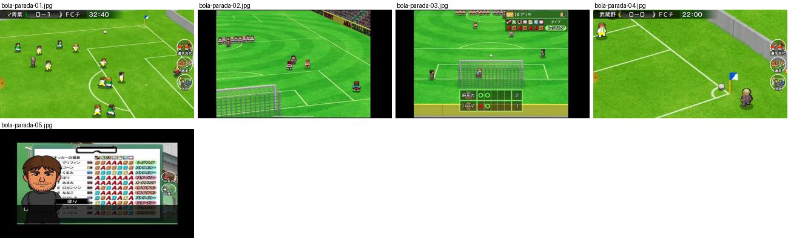
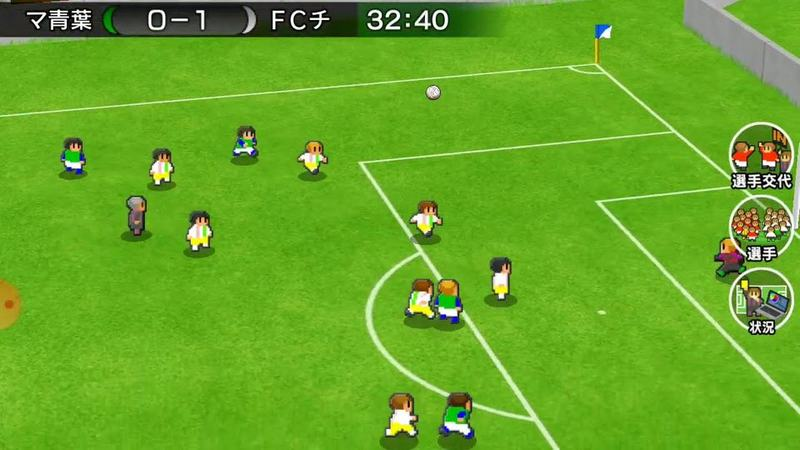
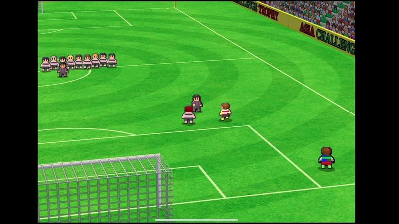
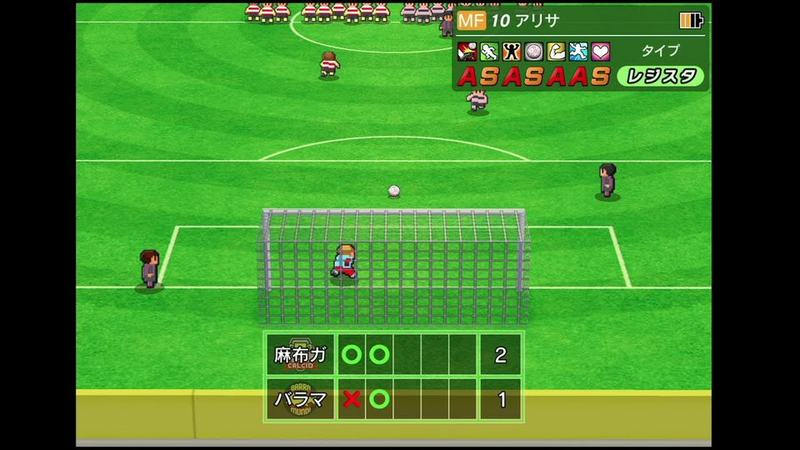
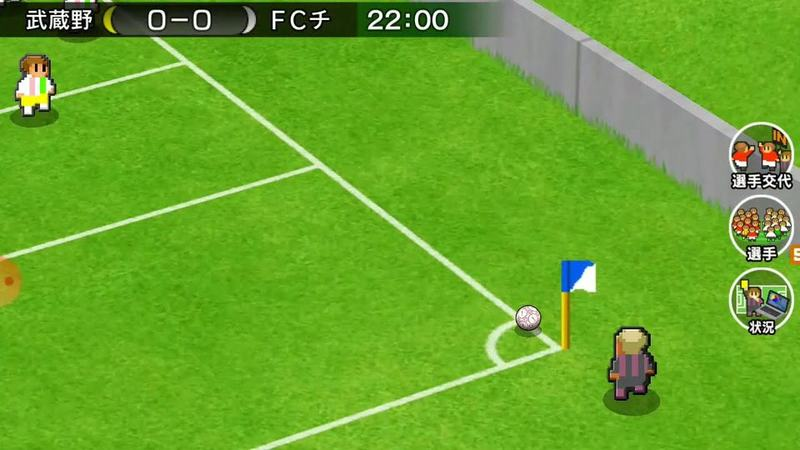
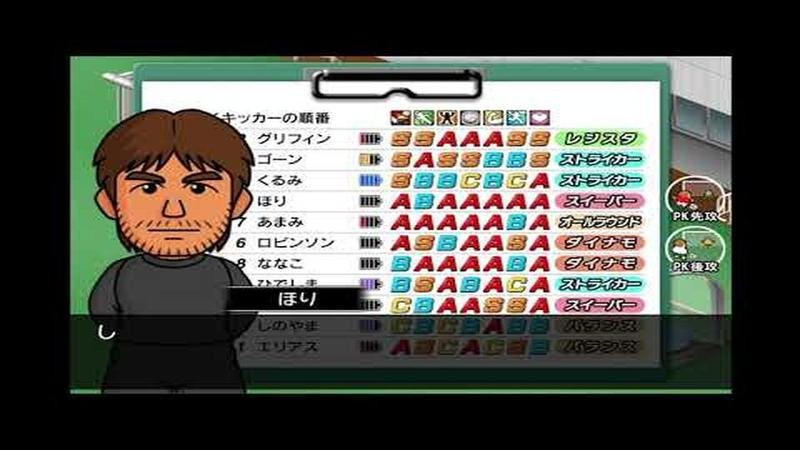

# bola-parada

Categoria: Jogo (dentro do campo). 5 imagens. A folha `_folha.jpg` mostra-as todas de uma vez.

## bola-parada-01.jpg

Canto com jogadores à espera na área, bandeirola no topo e câmara alta em diagonal.

- Etiquetas: canto, bandeirola-canto, area, botoes-redondos, camara-alta
- Qualidade: boa
- Origem: [M41j5mBBUUo](https://www.youtube.com/watch?v=M41j5mBBUUo&t=114s) (50%, ~114 s), canal ゆーげーむず

## bola-parada-02.jpg

Início do desempate por penáltis com as equipas alinhadas no meio-campo e um jogador a caminhar para a área.

- Etiquetas: penaltis, camara-alta, baliza, jogadores-meio-campo, publicidade
- Qualidade: boa
- Origem: [XV5ehg-0xUk](https://www.youtube.com/watch?v=XV5ehg-0xUk&t=49s) (25%, ~49 s), canal NA

## bola-parada-03.jpg

Desempate por penáltis com câmara de frente para a baliza, ficha do rematador em cima (posição, nome, notas, tipo) e tabela de círculos/cruzes com o total em baixo.

- Etiquetas: penaltis, camara-frontal, baliza, tabela-penaltis, ficha-jogador, notas-letras
- Qualidade: boa
- Origem: [XV5ehg-0xUk](https://www.youtube.com/watch?v=XV5ehg-0xUk&t=98s) (50%, ~98 s), canal NA

## bola-parada-04.jpg

Pontapé de canto em plano aproximado: jogador junto à bandeirola azul e bola no arco do canto, muro cinzento ao lado.

- Etiquetas: canto, bandeirola, muro, zoom, botoes-laterais
- Qualidade: boa
- Origem: [geM9U2wSnq0](https://www.youtube.com/watch?v=geM9U2wSnq0&t=106s) (50%, ~106 s), canal ゆーげーむず

## bola-parada-05.jpg

Ordem dos marcadores do desempate por penáltis numa prancheta (nomes, notas e tipos), com o treinador em primeiro plano.

- Etiquetas: penaltis, ordem-marcadores, prancheta, notas-letras, treinador
- Qualidade: boa
- Origem: [uF-3mkCpnrM](https://www.youtube.com/watch?v=uF-3mkCpnrM&t=432s) (75%, ~432 s), canal NA
