# camara-geral

Categoria: Jogo (dentro do campo). 20 imagens. A folha `_folha.jpg` mostra-as todas de uma vez.

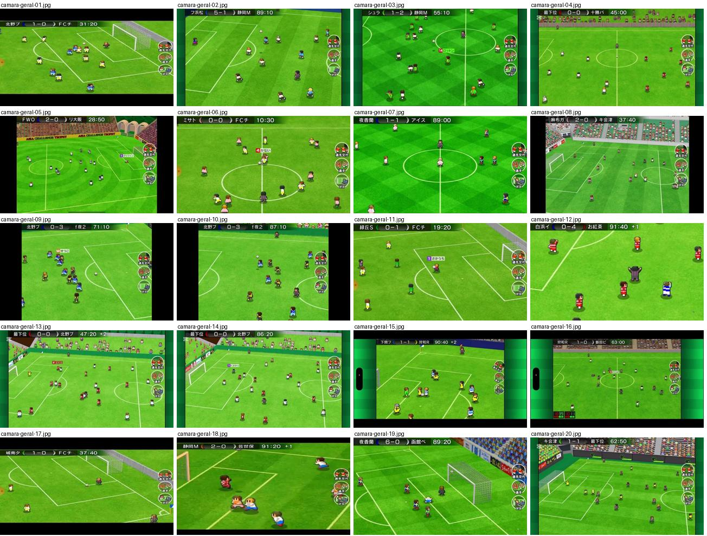

## camara-geral-01.jpg

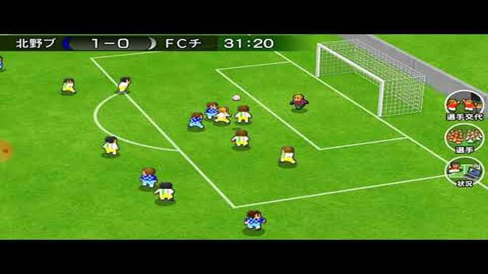

Plano largo diagonal da metade ofensiva com baliza à direita, barra do placar «1-0 31:20» no topo e três botões redondos à direita (substituição, jogador, estado).

- Etiquetas: placar, relogio, camara-alta, diagonal, botoes-laterais, baliza
- Qualidade: boa
- Origem: [-ioBSJjoAtg](https://www.youtube.com/watch?v=-ioBSJjoAtg&t=109s) (50%, ~109 s), canal ゆーげーむず

## camara-geral-02.jpg

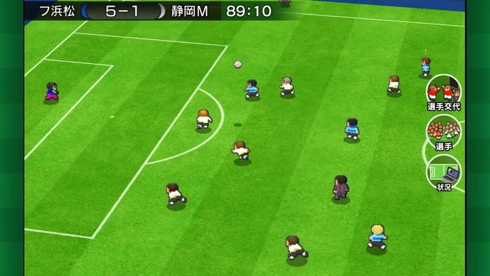

Plano largo diagonal da área esquerda aos 89 minutos com placar «5-1» e botões redondos à direita.

- Etiquetas: placar, relogio, camara-alta, diagonal, botoes-laterais, area
- Qualidade: boa
- Origem: [-tq_uLko5ck](https://www.youtube.com/watch?v=-tq_uLko5ck&t=323s) (75%, ~323 s), canal つばきち【Jリーグ系YouTuber】

## camara-geral-03.jpg

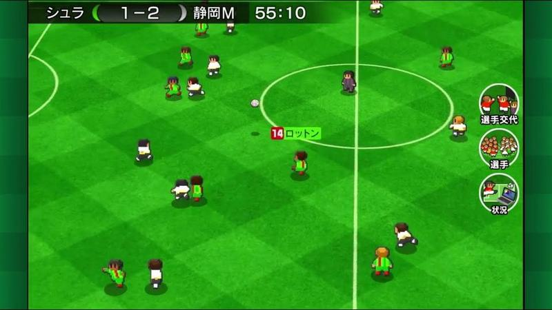

Jogo a decorrer em plano alto no meio-campo, com etiqueta vermelha de nome «14 ロットン» sobre o portador da bola.

- Etiquetas: placar, relogio, camara-alta, xadrez-relvado, nome-jogador, botoes-laterais
- Qualidade: boa
- Origem: [053_tSnSBG8](https://www.youtube.com/watch?v=053_tSnSBG8&t=270s) (50%, ~270 s), canal つばきち【Jリーグ系YouTuber】

## camara-geral-04.jpg

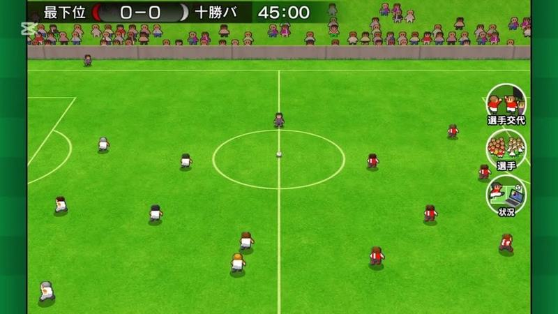

Plano largo lateral do campo inteiro com bancada de adeptos pixel no topo, placar «0-0 45:00» e botões à direita.

- Etiquetas: placar, relogio, camara-lateral, bancada, adeptos, botoes-laterais
- Qualidade: boa
- Origem: [0AWtZz7qiDM](https://www.youtube.com/watch?v=0AWtZz7qiDM&t=264s) (50%, ~264 s), canal Booby

## camara-geral-05.jpg

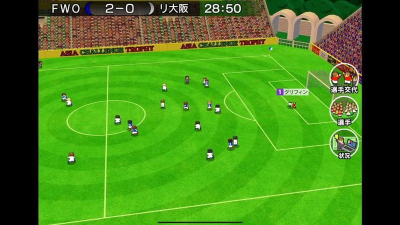

Plano muito largo num estádio de taça asiática com publicidade «ASIA CHALLENGE TROPHY», bancada e arcos, botões à direita.

- Etiquetas: placar, relogio, estadio, bancada, camara-alta, plano-largo, nome-jogador
- Qualidade: boa
- Origem: [0g-UTFIxzD8](https://www.youtube.com/watch?v=0g-UTFIxzD8&t=283s) (50%, ~283 s), canal しゃり

## camara-geral-06.jpg

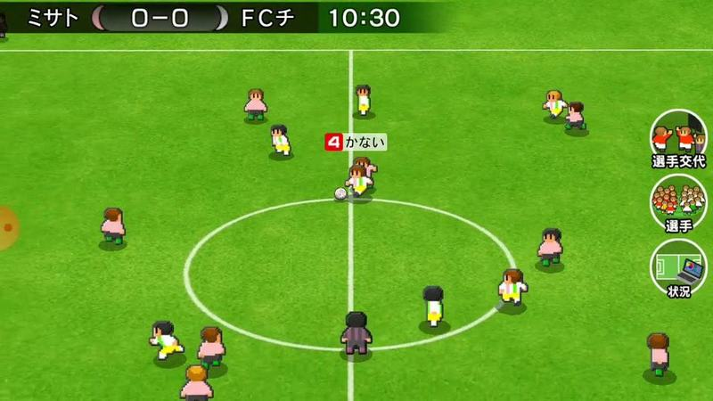

Jogo no meio-campo visto de cima com etiqueta vermelha de nome sobre o portador da bola e botões à direita.

- Etiquetas: placar, relogio, camara-alta, circulo-central, nome-jogador, botoes-laterais
- Qualidade: boa
- Origem: [0kb5xuV3YYM](https://www.youtube.com/watch?v=0kb5xuV3YYM&t=57s) (25%, ~57 s), canal ゆーげーむず

## camara-geral-07.jpg

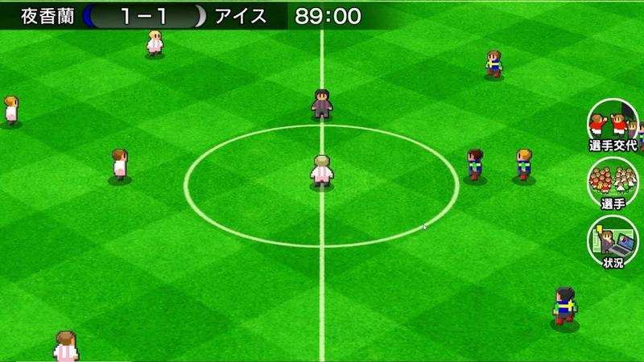

Jogo no meio-campo aos 89 minutos com placar «1-1», plano alto e botões à direita.

- Etiquetas: placar, relogio, camara-alta, circulo-central, botoes-laterais, xadrez-relvado
- Qualidade: boa
- Origem: [1k_Aw8Q4FbE](https://www.youtube.com/watch?v=1k_Aw8Q4FbE&t=496s) (50%, ~496 s), canal いとま 夜香学園

## camara-geral-08.jpg

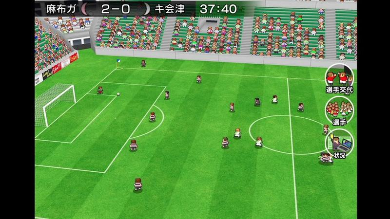

Plano largo diagonal com bancadas verdes cheias e a baliza à esquerda; jogadores pequenos no relvado.

- Etiquetas: placar, relogio, estadio, bancada, plano-largo, camara-alta, botoes-laterais
- Qualidade: boa
- Origem: [1t_1Xq8hjc0](https://www.youtube.com/watch?v=1t_1Xq8hjc0&t=273s) (50%, ~273 s), canal NA

## camara-geral-09.jpg

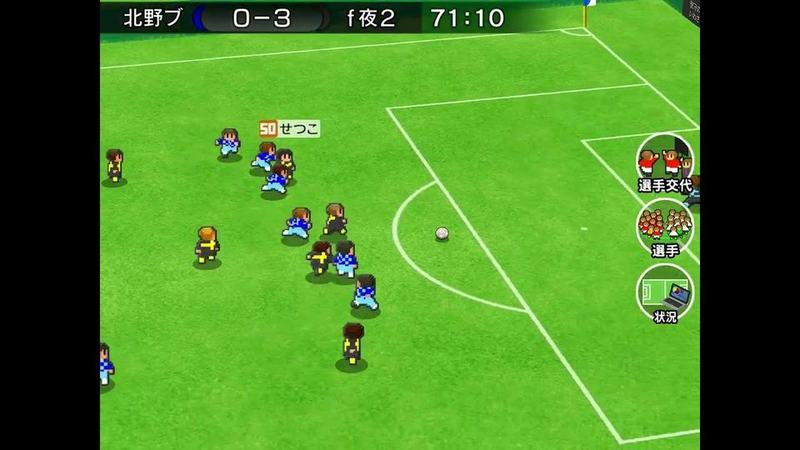

Jogo junto à área direita com etiqueta laranja de nome do jogador e botões à direita.

- Etiquetas: placar, relogio, camara-alta, area, nome-jogador, botoes-laterais
- Qualidade: boa
- Origem: [24L1YY64YFQ](https://www.youtube.com/watch?v=24L1YY64YFQ&t=220s) (50%, ~220 s), canal s

## camara-geral-10.jpg

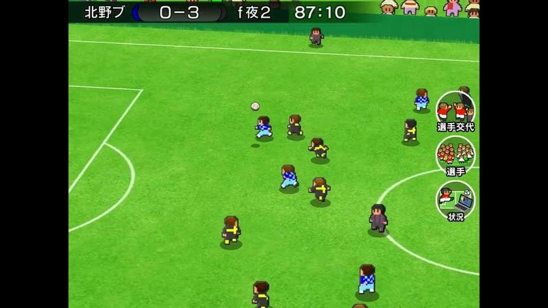

Jogo a meio-campo direito aos 87 minutos, plano alto.

- Etiquetas: placar, relogio, camara-alta, botoes-laterais
- Qualidade: boa
- Origem: [24L1YY64YFQ](https://www.youtube.com/watch?v=24L1YY64YFQ&t=330s) (75%, ~330 s), canal s

## camara-geral-11.jpg

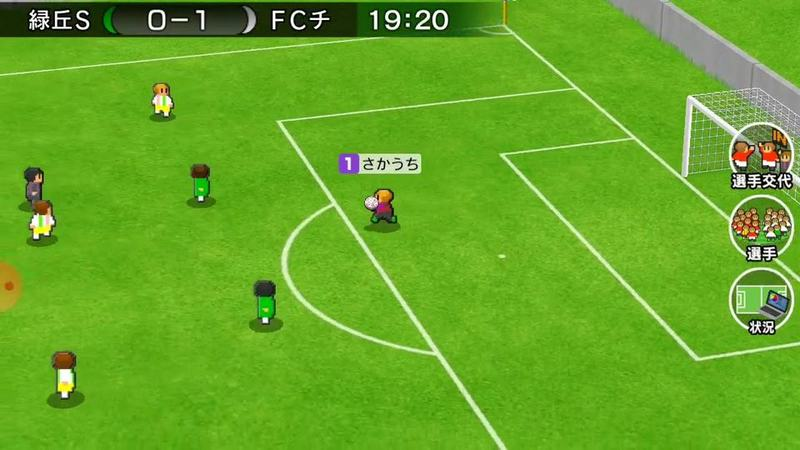

Jogo junto à área direita com etiqueta de nome sobre o jogador com a bola e botões à direita.

- Etiquetas: placar, relogio, camara-alta, area, nome-jogador, botoes-laterais
- Qualidade: boa
- Origem: [2cLbQlYmj1M](https://www.youtube.com/watch?v=2cLbQlYmj1M&t=101s) (50%, ~101 s), canal ゆーげーむず

## camara-geral-12.jpg

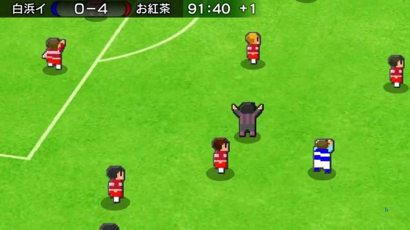

Jogo em plano próximo aos 91:40 com «+1» de descontos e árbitro de braços abertos.

- Etiquetas: placar, relogio, tempo-extra, zoom, arbitro
- Qualidade: boa
- Origem: [2lzwO9cOiAg](https://www.youtube.com/watch?v=2lzwO9cOiAg&t=1109s) (25%, ~1109 s), canal パラオ（おパラ）

## camara-geral-13.jpg

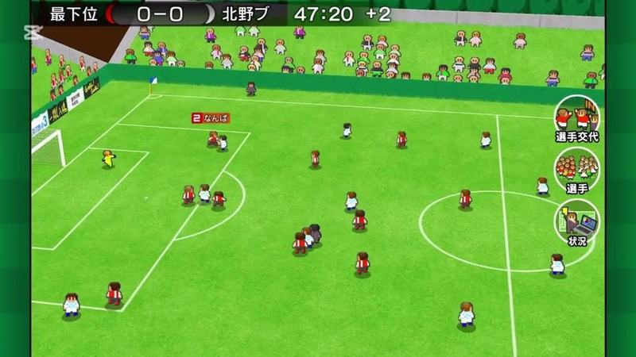

Plano largo diagonal com bancada cheia de adeptos pixel e placar «47:20 +2».

- Etiquetas: placar, relogio, tempo-extra, bancada, adeptos, plano-largo, botoes-laterais
- Qualidade: boa
- Origem: [4ES7FWopuzE](https://www.youtube.com/watch?v=4ES7FWopuzE&t=228s) (50%, ~228 s), canal Booby

## camara-geral-14.jpg

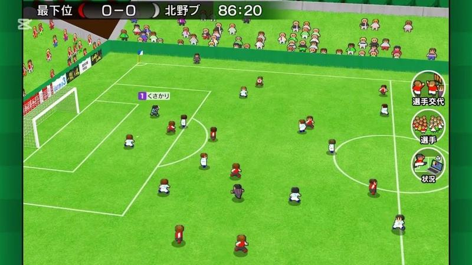

Plano largo do campo com bancada e etiqueta de nome junto à área esquerda.

- Etiquetas: placar, relogio, bancada, adeptos, plano-largo, botoes-laterais
- Qualidade: boa
- Origem: [4ES7FWopuzE](https://www.youtube.com/watch?v=4ES7FWopuzE&t=342s) (75%, ~342 s), canal Booby

## camara-geral-15.jpg

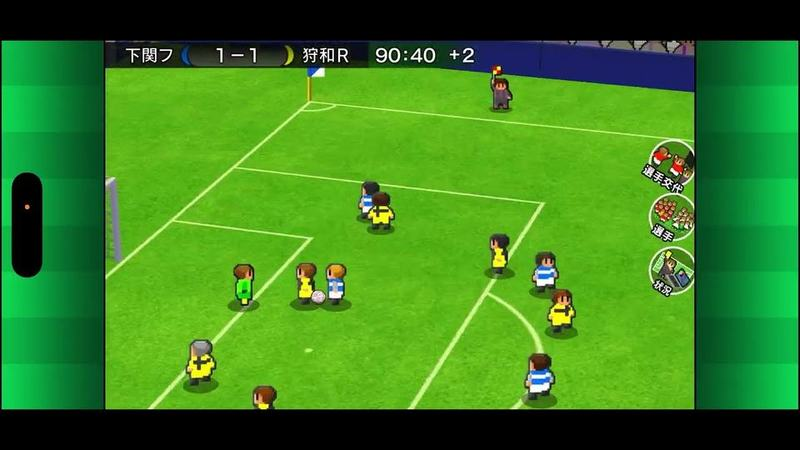

Jogo em plano próximo junto à bandeirola de canto aos 90:40 «+2».

- Etiquetas: placar, relogio, tempo-extra, bandeirola-canto, zoom, botoes-laterais
- Qualidade: boa
- Origem: [4i52fzOIv8k](https://www.youtube.com/watch?v=4i52fzOIv8k&t=2001s) (50%, ~2001 s), canal 【CL福岡26位】ポケカ中級者配信

## camara-geral-16.jpg

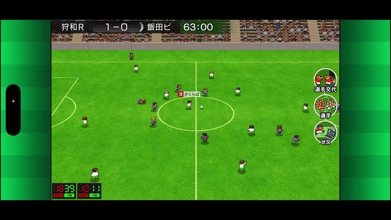

Plano largo do meio-campo com bancada e mostradores digitais de outros resultados no canto inferior esquerdo.

- Etiquetas: placar, relogio, plano-largo, bancada, mostrador-resultados, botoes-laterais
- Qualidade: boa
- Origem: [4i52fzOIv8k](https://www.youtube.com/watch?v=4i52fzOIv8k&t=3002s) (75%, ~3002 s), canal 【CL福岡26位】ポケカ中級者配信

## camara-geral-17.jpg

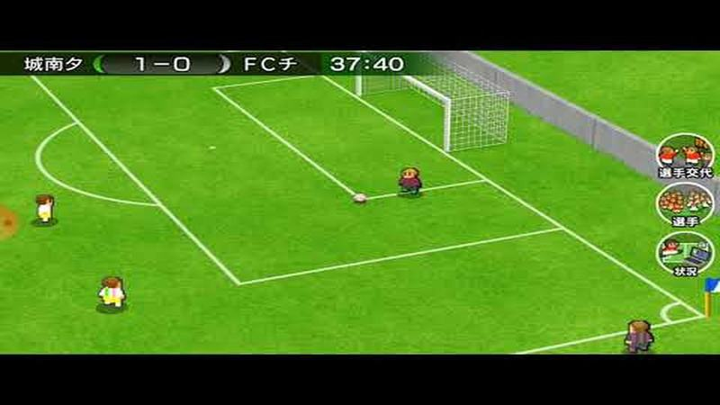

Ataque junto à área direita em plano diagonal com baliza ao fundo.

- Etiquetas: placar, relogio, camara-alta, area, baliza, botoes-laterais
- Qualidade: boa
- Origem: [5R85ux9rdC4](https://www.youtube.com/watch?v=5R85ux9rdC4&t=124s) (50%, ~124 s), canal ゆーげーむず

## camara-geral-18.jpg

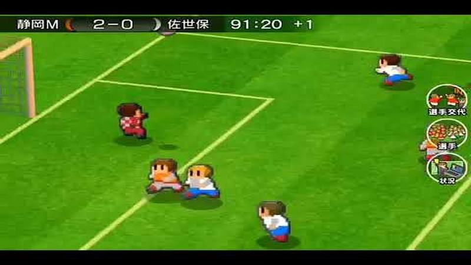

Jogo em zoom dentro da área aos 91:20 «+1», bonecos grandes e detalhados.

- Etiquetas: placar, relogio, tempo-extra, zoom, area, botoes-laterais
- Qualidade: boa
- Origem: [5ZcCqLIN4HA](https://www.youtube.com/watch?v=5ZcCqLIN4HA&t=385s) (75%, ~385 s), canal つばきち【Jリーグ系YouTuber】

## camara-geral-19.jpg

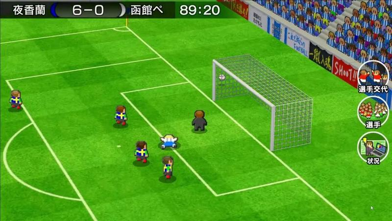

Jogo junto à baliza direita aos 89 minutos com placar «6-0», bancada e publicidade.

- Etiquetas: placar, relogio, baliza, bancada, publicidade, botoes-laterais
- Qualidade: boa
- Origem: [6zIHSeHdXDs](https://www.youtube.com/watch?v=6zIHSeHdXDs&t=2645s) (50%, ~2645 s), canal いとま 夜香学園

## camara-geral-20.jpg

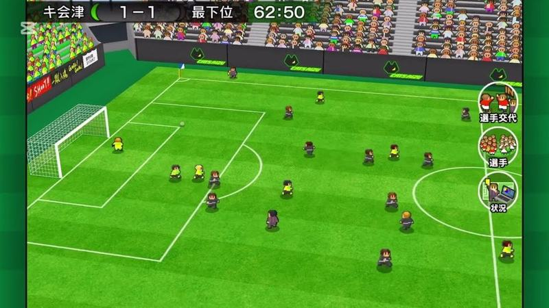

Plano largo diagonal em estádio com bancadas cheias de adeptos amarelos e verdes.

- Etiquetas: placar, relogio, estadio, bancada, plano-largo, botoes-laterais
- Qualidade: boa
- Origem: [78cfUtzUI-o](https://www.youtube.com/watch?v=78cfUtzUI-o&t=270s) (50%, ~270 s), canal Booby
