# entrada-jogadores

Categoria: Jogo (dentro do campo). 12 imagens. A folha `_folha.jpg` mostra-as todas de uma vez.

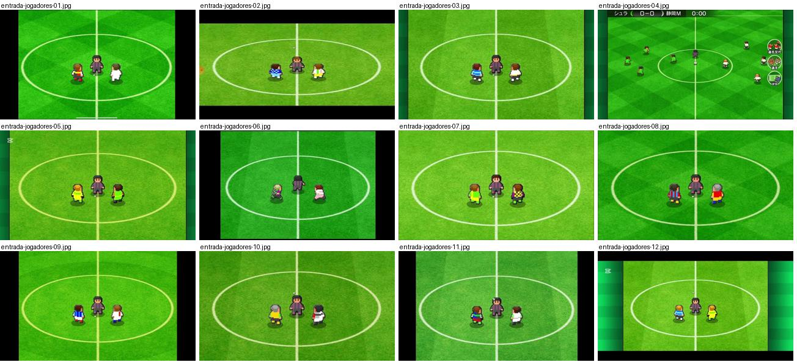

## entrada-jogadores-01.jpg

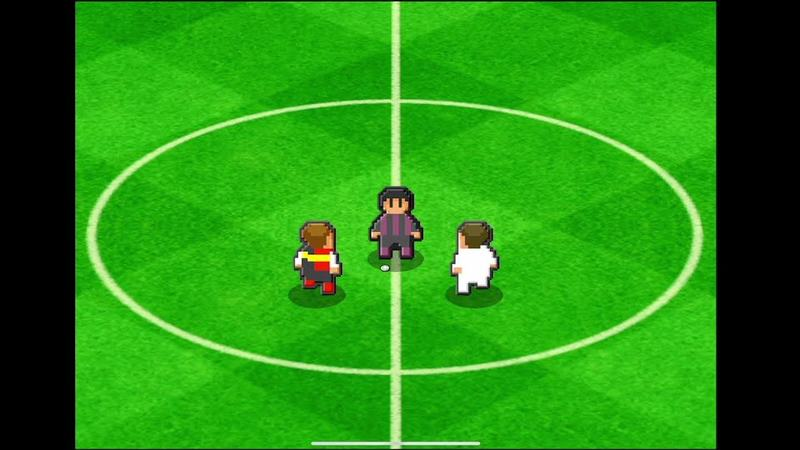

Plano picado sobre o círculo central com três bonecos pixel prontos para o pontapé de saída; relvado com faixas verdes claras e escuras. Bom para a escala dos bonecos face ao campo.

- Etiquetas: camara-alta, circulo-central, relvado-listado, pixel-art, pontape-saida
- Qualidade: boa
- Origem: [-gEREcToc9g](https://www.youtube.com/watch?v=-gEREcToc9g&t=147s) (25%, ~147 s), canal しゃり

## entrada-jogadores-02.jpg

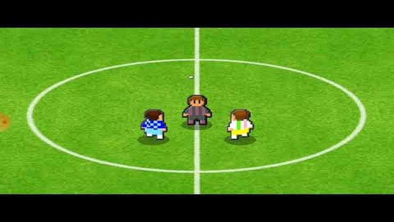

Pontapé de saída visto de cima no círculo central, árbitro e dois jogadores em pixel art; relvado verde uniforme.

- Etiquetas: camara-alta, circulo-central, pontape-saida, pixel-art
- Qualidade: boa
- Origem: [-ioBSJjoAtg](https://www.youtube.com/watch?v=-ioBSJjoAtg&t=54s) (25%, ~54 s), canal ゆーげーむず

## entrada-jogadores-03.jpg

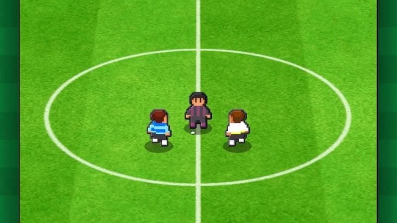

Pontapé de saída no círculo central, plano picado com margens verde-escuras laterais no ecrã largo.

- Etiquetas: camara-alta, circulo-central, pontape-saida, margens-verdes
- Qualidade: boa
- Origem: [-tq_uLko5ck](https://www.youtube.com/watch?v=-tq_uLko5ck&t=107s) (25%, ~107 s), canal つばきち【Jリーグ系YouTuber】

## entrada-jogadores-04.jpg

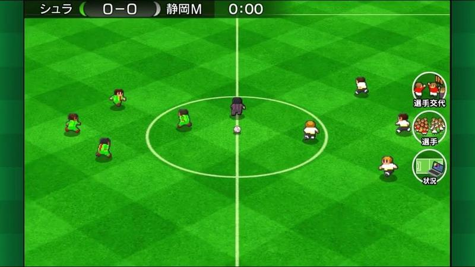

Início do jogo «0-0 0:00» com equipas posicionadas, relvado em xadrez de dois verdes, plano alto quase de topo, botões à direita.

- Etiquetas: placar, relogio, camara-alta, xadrez-relvado, botoes-laterais, pontape-saida
- Qualidade: boa
- Origem: [053_tSnSBG8](https://www.youtube.com/watch?v=053_tSnSBG8&t=135s) (25%, ~135 s), canal つばきち【Jリーグ系YouTuber】

## entrada-jogadores-05.jpg

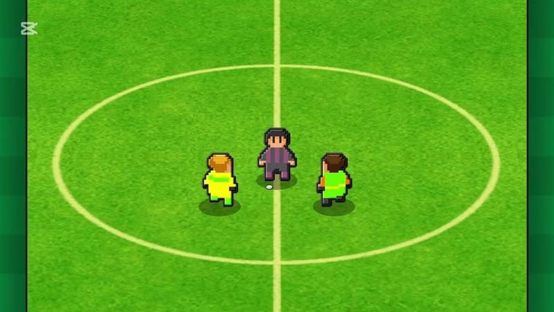

Pontapé de saída em grande plano no círculo central, jogadores de amarelo/verde e árbitro.

- Etiquetas: camara-alta, circulo-central, pontape-saida
- Qualidade: boa
- Origem: [0AWtZz7qiDM](https://www.youtube.com/watch?v=0AWtZz7qiDM&t=132s) (25%, ~132 s), canal Booby

## entrada-jogadores-06.jpg

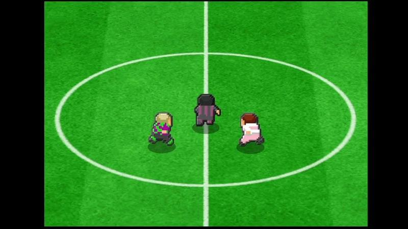

Pontapé de saída no círculo central visto de cima, relvado verde liso.

- Etiquetas: camara-alta, circulo-central, pontape-saida
- Qualidade: boa
- Origem: [0EU-h38vUVQ](https://www.youtube.com/watch?v=0EU-h38vUVQ&t=163s) (25%, ~163 s), canal しゃり

## entrada-jogadores-07.jpg

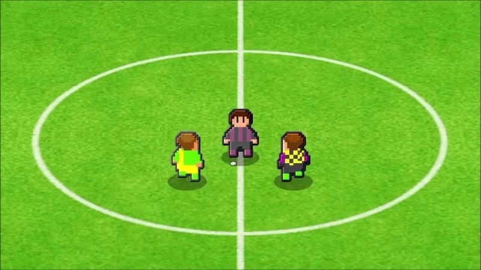

Pontapé de saída no círculo central, plano picado próximo.

- Etiquetas: camara-alta, circulo-central, pontape-saida
- Qualidade: boa
- Origem: [0VoSVCdkdKE](https://www.youtube.com/watch?v=0VoSVCdkdKE&t=390s) (25%, ~390 s), canal ゲーム動画で行こう! Playing Games.

## entrada-jogadores-08.jpg

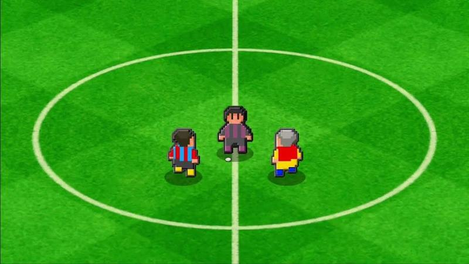

Pontapé de saída com relvado em xadrez de losangos verdes.

- Etiquetas: camara-alta, circulo-central, xadrez-relvado, pontape-saida
- Qualidade: boa
- Origem: [0YPqmfFusNM](https://www.youtube.com/watch?v=0YPqmfFusNM&t=276s) (25%, ~276 s), canal ぼくくんゲーム

## entrada-jogadores-09.jpg

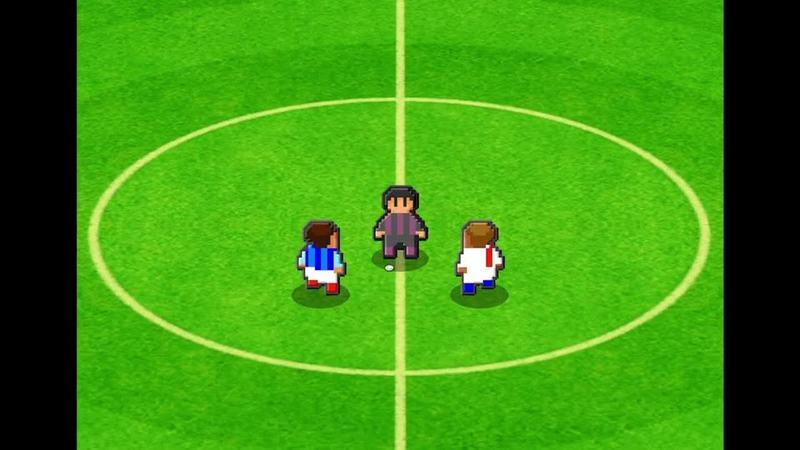

Pontapé de saída no círculo central.

- Etiquetas: camara-alta, circulo-central, pontape-saida
- Qualidade: boa
- Origem: [0g-UTFIxzD8](https://www.youtube.com/watch?v=0g-UTFIxzD8&t=141s) (25%, ~141 s), canal しゃり

## entrada-jogadores-10.jpg

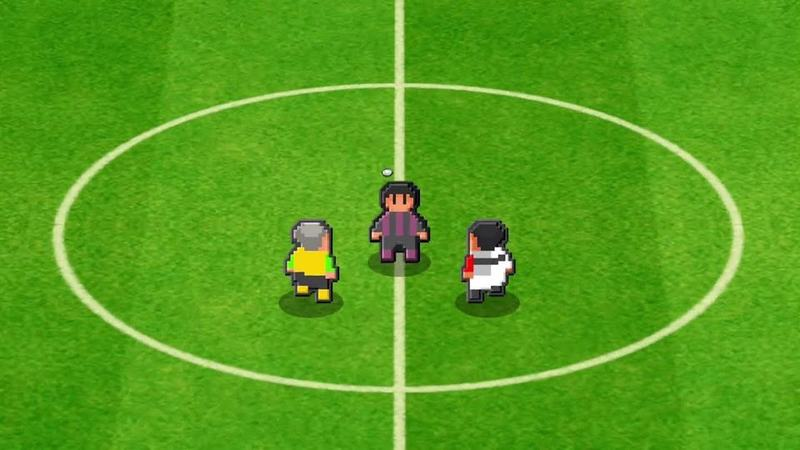

Pontapé de saída no círculo central.

- Etiquetas: camara-alta, circulo-central, pontape-saida
- Qualidade: boa
- Origem: [0z73mtBKuq4](https://www.youtube.com/watch?v=0z73mtBKuq4&t=537s) (50%, ~537 s), canal NA

## entrada-jogadores-11.jpg

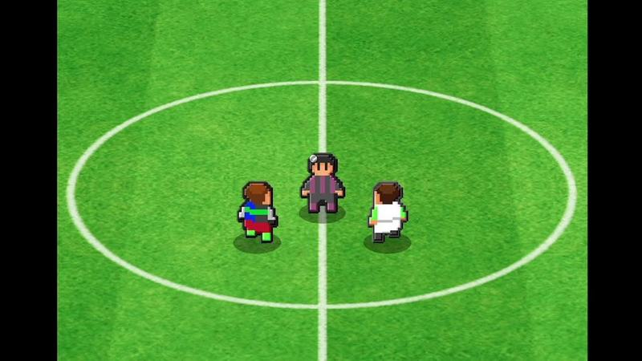

Pontapé de saída no círculo central.

- Etiquetas: camara-alta, circulo-central, pontape-saida
- Qualidade: boa
- Origem: [1t_1Xq8hjc0](https://www.youtube.com/watch?v=1t_1Xq8hjc0&t=136s) (25%, ~136 s), canal NA

## entrada-jogadores-12.jpg

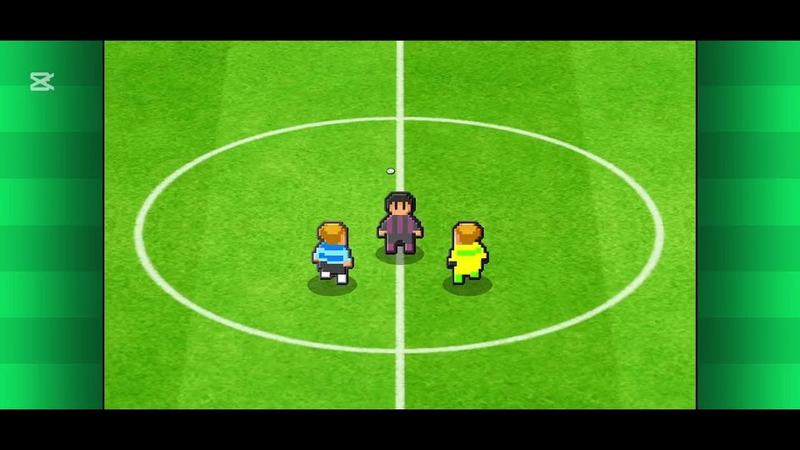

Pontapé de saída no círculo central, com margens verdes laterais.

- Etiquetas: camara-alta, circulo-central, pontape-saida, margens-verdes
- Qualidade: boa
- Origem: [2E0XPxmtEyI](https://www.youtube.com/watch?v=2E0XPxmtEyI&t=153s) (25%, ~153 s), canal Booby
