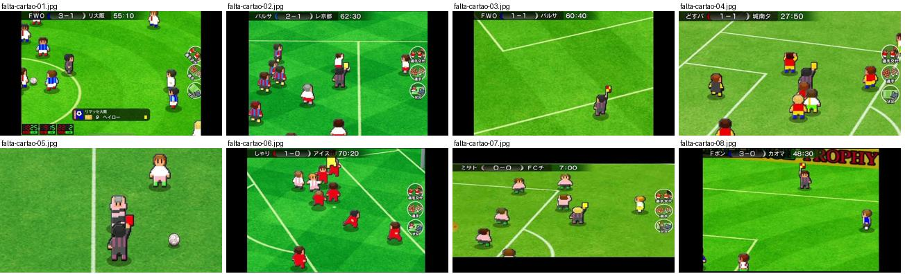
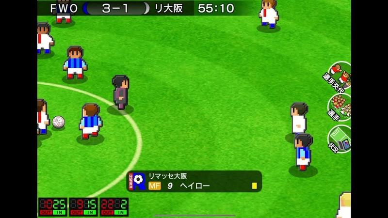
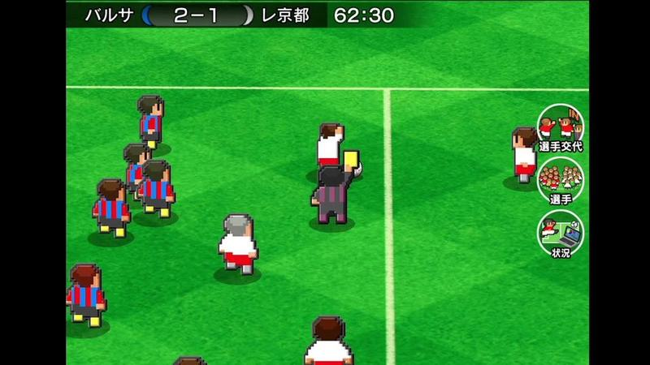
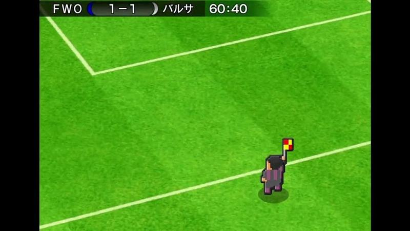
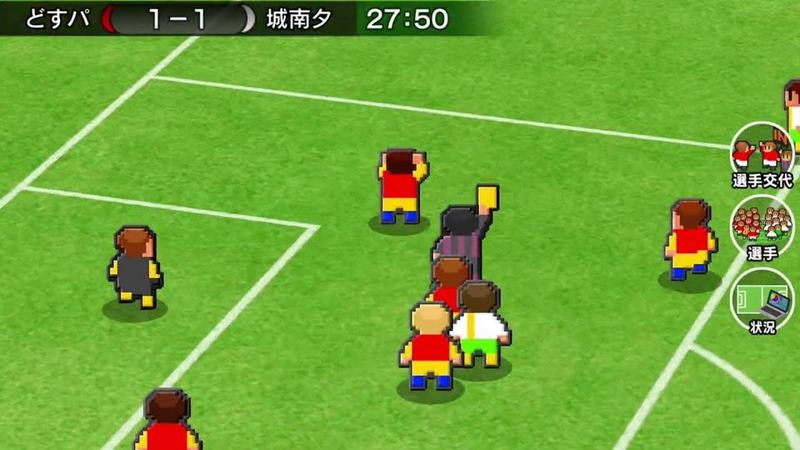
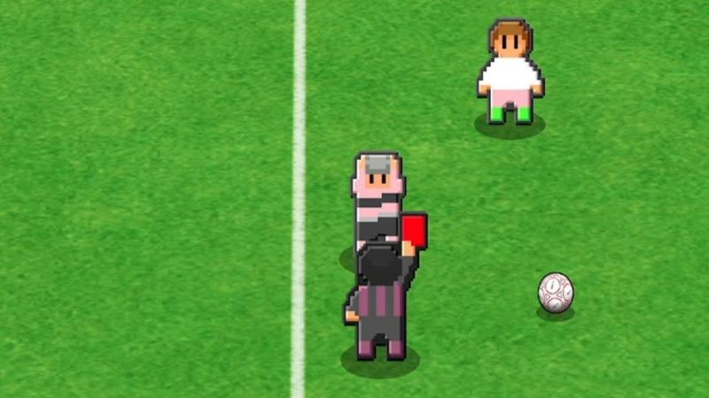
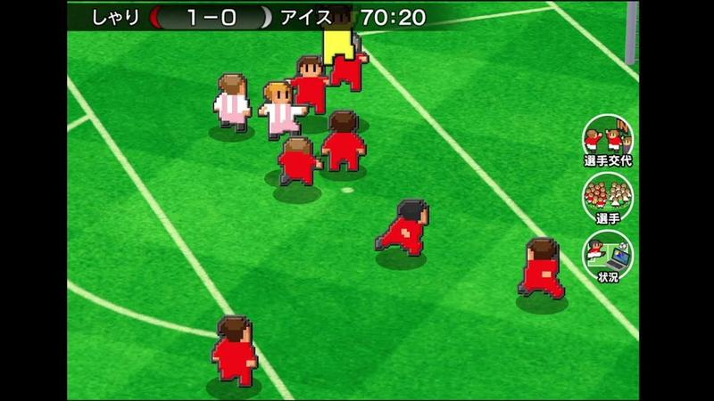
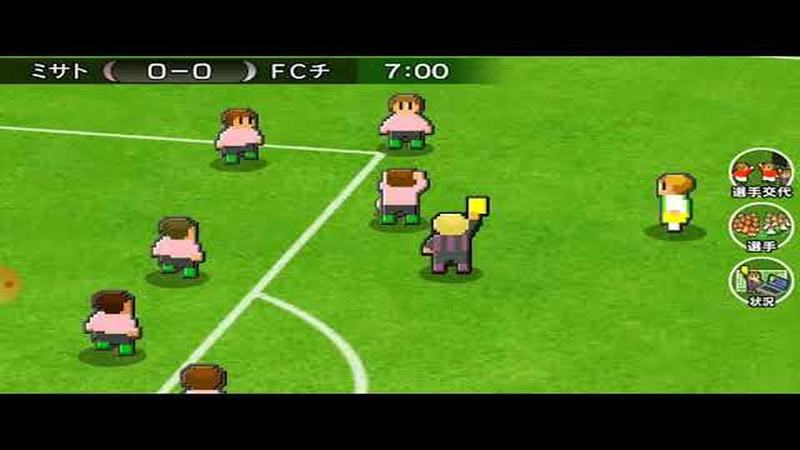
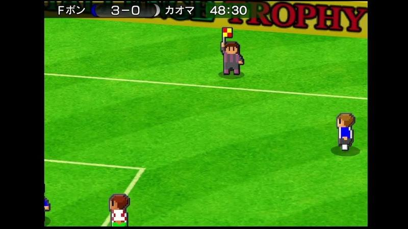

# falta-cartao

Categoria: Jogo (dentro do campo). 8 imagens. A folha `_folha.jpg` mostra-as todas de uma vez.

## falta-cartao-01.jpg

Jogo em zoom próximo com notificação em faixa escura no canto inferior («リマッセ大阪 MF 9 ヘイロー» com cartão amarelo) e pequenos mostradores de resultados de outros jogos em baixo à esquerda.

- Etiquetas: placar, relogio, zoom, notificacao, cartao-amarelo, emblemas, botoes-laterais
- Qualidade: boa
- Origem: [0g-UTFIxzD8](https://www.youtube.com/watch?v=0g-UTFIxzD8&t=424s) (75%, ~424 s), canal しゃり

## falta-cartao-02.jpg

Árbitro a mostrar cartão amarelo com jogadores agrupados à volta, plano alto.

- Etiquetas: placar, relogio, cartao-amarelo, arbitro, camara-alta, botoes-laterais
- Qualidade: boa
- Origem: [15OL8-Bq7Cg](https://www.youtube.com/watch?v=15OL8-Bq7Cg&t=301s) (50%, ~301 s), canal NA

## falta-cartao-03.jpg

Fiscal de linha em zoom a levantar a bandeira (fora de jogo provável), câmara aproximada com linhas do campo em diagonal.

- Etiquetas: fiscal-de-linha, bandeira, fora-de-jogo, placar, relogio, zoom
- Qualidade: boa
- Origem: [E_YQWZ21vP8](https://www.youtube.com/watch?v=E_YQWZ21vP8&t=283s) (50%, ~283 s), canal しゃり

## falta-cartao-04.jpg

Árbitro em zoom a mostrar o cartão amarelo no meio de um grupo de jogadores, câmara aproximada e em diagonal.

- Etiquetas: cartao-amarelo, arbitro, zoom, placar, relogio, botoes-redondos
- Qualidade: boa
- Origem: [P6Ym3R7EtsU](https://www.youtube.com/watch?v=P6Ym3R7EtsU&t=1105s) (75%, ~1105 s), canal NA

## falta-cartao-05.jpg

Grande plano do árbitro a mostrar o cartão vermelho a um jogador, com a bola parada ao lado; câmara muito próxima.

- Etiquetas: cartao-vermelho, arbitro, zoom, expulsao
- Qualidade: boa
- Origem: [SCT6_NOvJDk](https://www.youtube.com/watch?v=SCT6_NOvJDk) (capa), canal しゃり

## falta-cartao-06.jpg

Árbitro a levantar o cartão amarelo no meio de jogadores de vermelho, câmara aproximada e diagonal.

- Etiquetas: cartao-amarelo, arbitro, zoom, placar, botoes-redondos
- Qualidade: boa
- Origem: [SgfhkZ1orZE](https://www.youtube.com/watch?v=SgfhkZ1orZE&t=372s) (50%, ~372 s), canal しゃり

## falta-cartao-07.jpg

Árbitro a mostrar cartão amarelo em plano aproximado, com jogadores à volta; marcador no topo e botões redondos à direita.

- Etiquetas: arbitro, cartao-amarelo, zoom, placar, relogio, botoes-laterais
- Qualidade: boa
- Origem: [YPJMCoFhrRo](https://www.youtube.com/watch?v=YPJMCoFhrRo&t=58s) (25%, ~58 s), canal ゆーげーむず

## falta-cartao-08.jpg

Fiscal de linha com a bandeira levantada (fora de jogo) em plano aproximado; placar no topo.

- Etiquetas: fora-de-jogo, fiscal-linha, bandeira, zoom, placar
- Qualidade: boa
- Origem: [rD8ueWYFnKE](https://www.youtube.com/watch?v=rD8ueWYFnKE&t=235s) (50%, ~235 s), canal しゃり
