# festejo

Categoria: Jogo (dentro do campo). 12 imagens. A folha `_folha.jpg` mostra-as todas de uma vez.

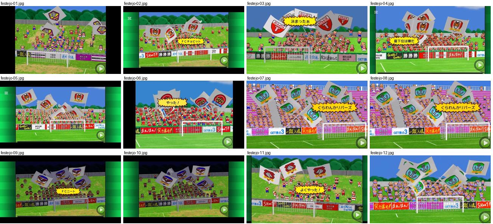

## festejo-01.jpg

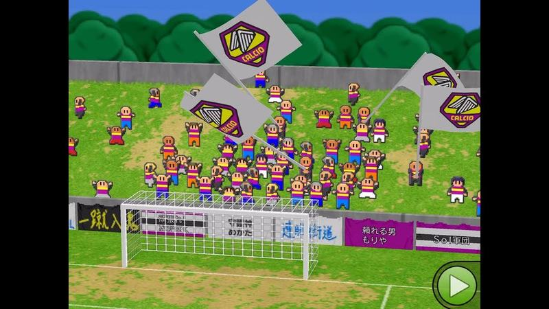

Adeptos pixel art a invadir o relvado com bandeiras do emblema do clube junto à baliza, placas de publicidade em baixo. Botão verde redondo de avançar no canto inferior direito.

- Etiquetas: adeptos, bandeiras, balizas, publicidade, pixel-art, botao-avancar
- Qualidade: boa
- Origem: [--YIWH-vpBg](https://www.youtube.com/watch?v=--YIWH-vpBg&t=315s) (50%, ~315 s), canal Jリーグファン

## festejo-02.jpg

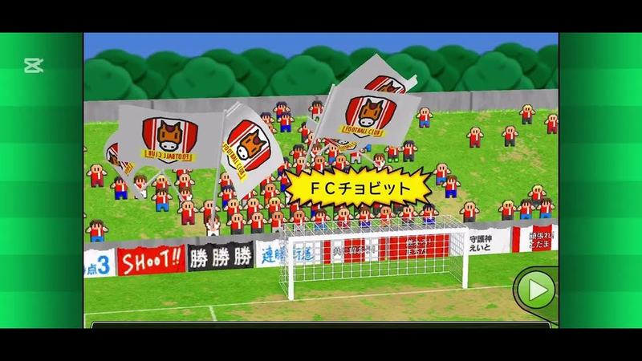

Adeptos pixel a invadir o campo com bandeiras do emblema e faixa amarela «FCチョビット» atrás da baliza; placas de publicidade com texto em baixo.

- Etiquetas: adeptos, bandeiras, baliza, publicidade, botao-avancar
- Qualidade: boa
- Origem: [1fWpSuwQ45I](https://www.youtube.com/watch?v=1fWpSuwQ45I&t=151s) (25%, ~151 s), canal Booby

## festejo-03.jpg

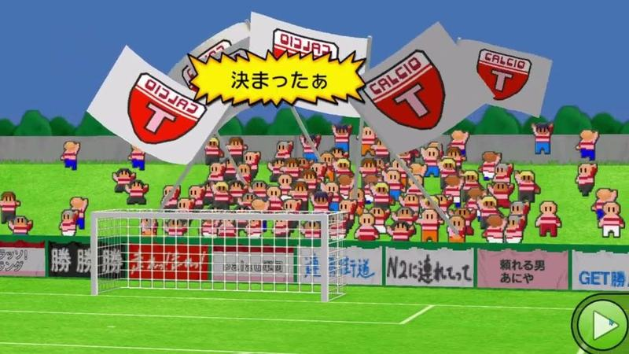

Adeptos pixel a invadir o campo com bandeiras do emblema e balão amarelo explosivo «決まったぁ»; placas de publicidade atrás da baliza.

- Etiquetas: adeptos, bandeiras, balao-texto, baliza, publicidade, botao-avancar
- Qualidade: boa
- Origem: [2lzwO9cOiAg](https://www.youtube.com/watch?v=2lzwO9cOiAg&t=3328s) (75%, ~3328 s), canal パラオ（おパラ）

## festejo-04.jpg

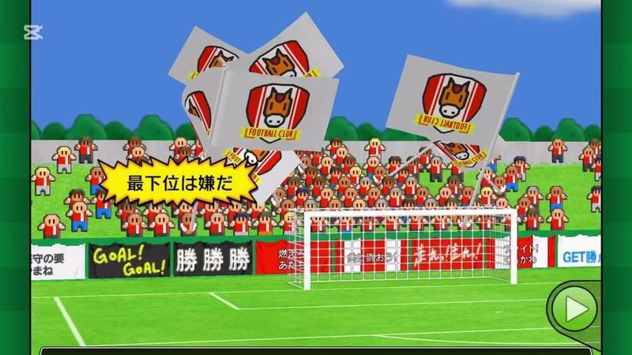

Adeptos com bandeiras do emblema e balão amarelo «最下位は嫌だ» (nome da equipa) a festejar atrás da baliza.

- Etiquetas: adeptos, bandeiras, balao-texto, baliza, publicidade, botao-avancar
- Qualidade: boa
- Origem: [4ES7FWopuzE](https://www.youtube.com/watch?v=4ES7FWopuzE&t=114s) (25%, ~114 s), canal Booby

## festejo-05.jpg

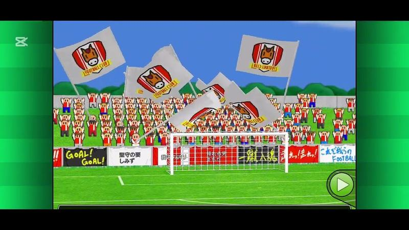

Adeptos a invadir o relvado com bandeiras do emblema (cavalo) atrás da baliza.

- Etiquetas: adeptos, bandeiras, baliza, publicidade, botao-avancar
- Qualidade: boa
- Origem: [6acFTJpxK5A](https://www.youtube.com/watch?v=6acFTJpxK5A&t=148s) (25%, ~148 s), canal Booby

## festejo-06.jpg

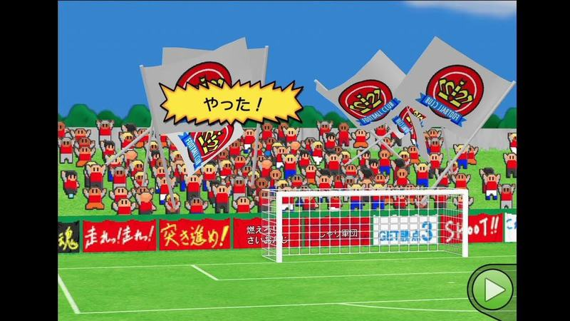

Adeptos vermelhos com bandeiras do emblema (coroa) e balão «やった！» a festejar atrás da baliza.

- Etiquetas: adeptos, bandeiras, balao-texto, baliza, publicidade, botao-avancar
- Qualidade: boa
- Origem: [7WcmrsFwuSs](https://www.youtube.com/watch?v=7WcmrsFwuSs&t=299s) (50%, ~299 s), canal NA

## festejo-07.jpg

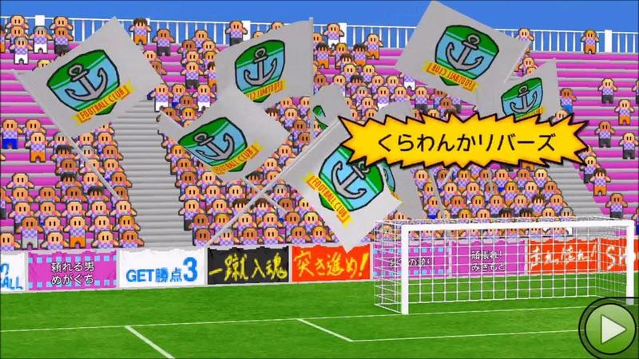

Adeptos com bandeiras do emblema (âncora) numa bancada rosa e balão amarelo com o nome da equipa.

- Etiquetas: adeptos, bandeiras, balao-texto, bancada, baliza, publicidade
- Qualidade: boa
- Origem: [AVQLF2gdLH0](https://www.youtube.com/watch?v=AVQLF2gdLH0&t=243s) (25%, ~243 s), canal ゲーム動画で行こう! Playing Games.

## festejo-08.jpg

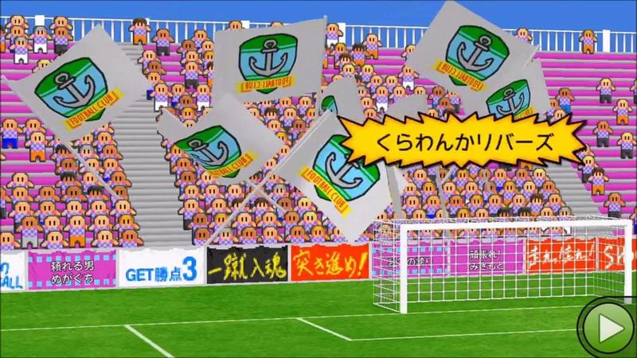

Mesma cena de festejo com bandeiras usada como capa.

- Etiquetas: adeptos, bandeiras, balao-texto, bancada
- Qualidade: boa
- Origem: [AVQLF2gdLH0](https://www.youtube.com/watch?v=AVQLF2gdLH0) (capa), canal ゲーム動画で行こう! Playing Games.

## festejo-09.jpg

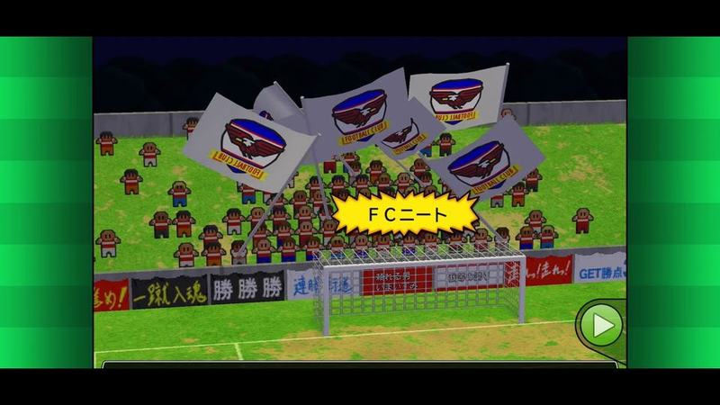

Festejo de adeptos com bandeiras à noite (céu escuro), balão amarelo com o nome da equipa.

- Etiquetas: adeptos, bandeiras, balao-texto, noite, baliza, publicidade
- Qualidade: boa
- Origem: [AcTUowDx0Ts](https://www.youtube.com/watch?v=AcTUowDx0Ts&t=154s) (25%, ~154 s), canal 2-10にーと

## festejo-10.jpg

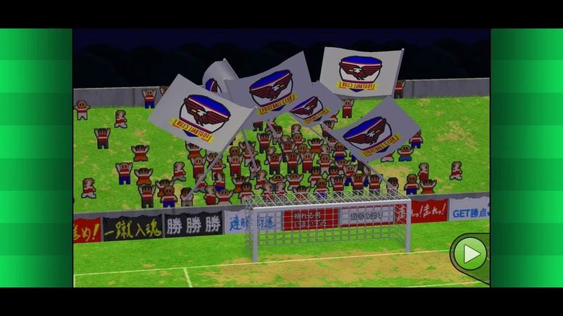

Festejo noturno com bandeiras, sem balão.

- Etiquetas: adeptos, bandeiras, noite, baliza
- Qualidade: boa
- Origem: [AcTUowDx0Ts](https://www.youtube.com/watch?v=AcTUowDx0Ts&t=309s) (50%, ~309 s), canal 2-10にーと

## festejo-11.jpg

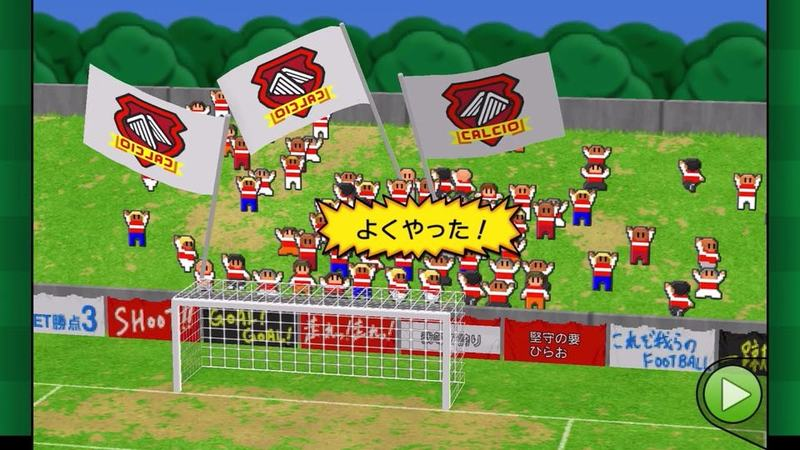

Adeptos a invadir o relvado com bandeiras do emblema e balão «よくやった！».

- Etiquetas: adeptos, bandeiras, balao-texto, baliza, publicidade, botao-avancar
- Qualidade: boa
- Origem: [BZidRWq_qDM](https://www.youtube.com/watch?v=BZidRWq_qDM&t=353s) (50%, ~353 s), canal みらぽす

## festejo-12.jpg

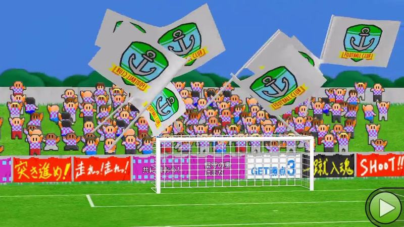

Bancada atrás da baliza com adeptos a agitar grandes bandeiras brancas com o emblema do clube e placas de publicidade coloridas em baixo.

- Etiquetas: adeptos, bandeiras, emblemas, bancada, baliza, publicidade, botao-avancar
- Qualidade: boa
- Origem: [IeoVaNmyB9E](https://www.youtube.com/watch?v=IeoVaNmyB9E&t=468s) (50%, ~468 s), canal ゲーム動画で行こう! Playing Games.
