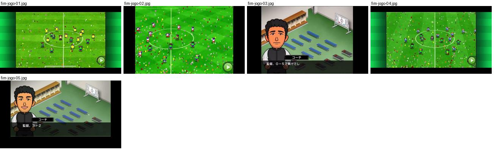
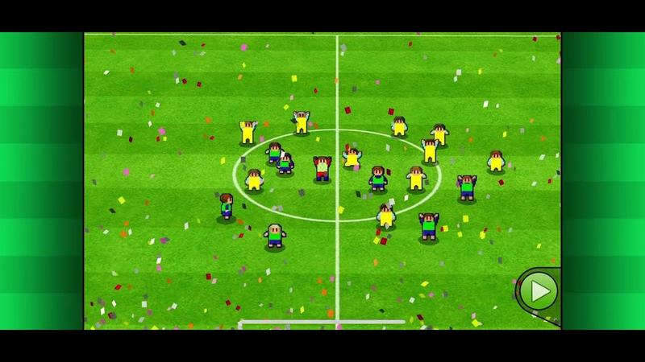
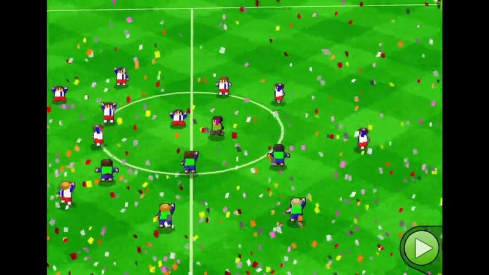
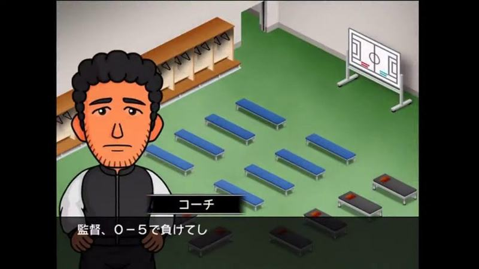
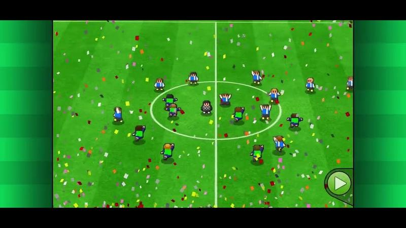
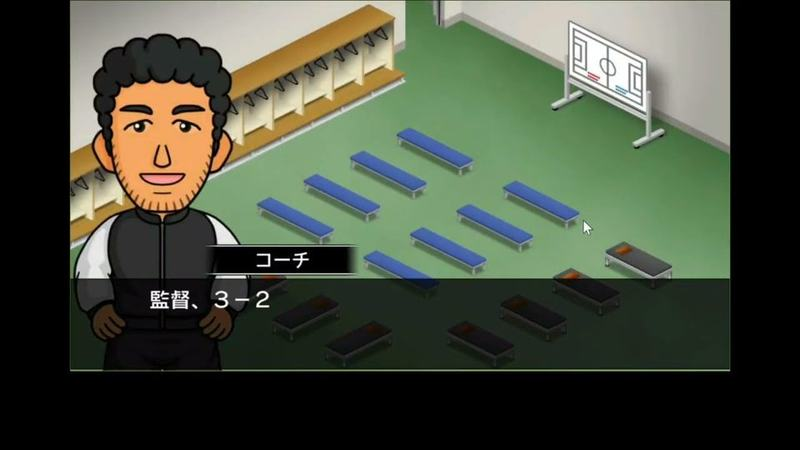

# fim-jogo

Categoria: Jogo (dentro do campo). 5 imagens. A folha `_folha.jpg` mostra-as todas de uma vez.

## fim-jogo-01.jpg

Fim do jogo com confetti a cair sobre o campo e jogadores agrupados no meio-campo, plano alto.

- Etiquetas: confetti, camara-alta, circulo-central, festejo, botao-avancar
- Qualidade: boa
- Origem: [8Q-SGYs9Hi4](https://www.youtube.com/watch?v=8Q-SGYs9Hi4&t=17s) (25%, ~17 s), canal 冥界の番犬・ポポ

## fim-jogo-02.jpg

Fim do jogo com confettis coloridos a cair sobre o campo inteiro e jogadores espalhados; plano alto.

- Etiquetas: confettis, relvado-xadrez, camara-alta, festejo, botao-avancar
- Qualidade: boa
- Origem: [PtinHD_wmvQ](https://www.youtube.com/watch?v=PtinHD_wmvQ&t=555s) (75%, ~555 s), canal しゃり

## fim-jogo-03.jpg

Balneário isométrico depois do jogo com o adjunto a comentar a derrota numa caixa de diálogo escura.

- Etiquetas: balneario, treinador, dialogo, isometrico, bancos, quadro-tatico
- Qualidade: boa
- Origem: [ZDyxv_ROYWQ](https://www.youtube.com/watch?v=ZDyxv_ROYWQ&t=2971s) (50%, ~2971 s), canal NA

## fim-jogo-04.jpg

Fim do jogo com chuva de papelinhos coloridos sobre o campo e os jogadores a festejar no meio-campo; câmara alta.

- Etiquetas: confetis, festejo, camara-alta, circulo-central, botao-play
- Qualidade: boa
- Origem: [aUptG4lwG1Q](https://www.youtube.com/watch?v=aUptG4lwG1Q&t=17s) (25%, ~17 s), canal 黄金のかにたま

## fim-jogo-05.jpg

Balneário depois do jogo com o adjunto a dizer o resultado (3-2) numa caixa de diálogo escura.

- Etiquetas: balneario, treinador, dialogo, isometrico, bancos
- Qualidade: boa
- Origem: [iSsr7oWiHQ4](https://www.youtube.com/watch?v=iSsr7oWiHQ4&t=660s) (75%, ~660 s), canal 【ゲーム】海苔巻ぷんちゃん
