# golo

Categoria: Jogo (dentro do campo). 15 imagens. A folha `_folha.jpg` mostra-as todas de uma vez.

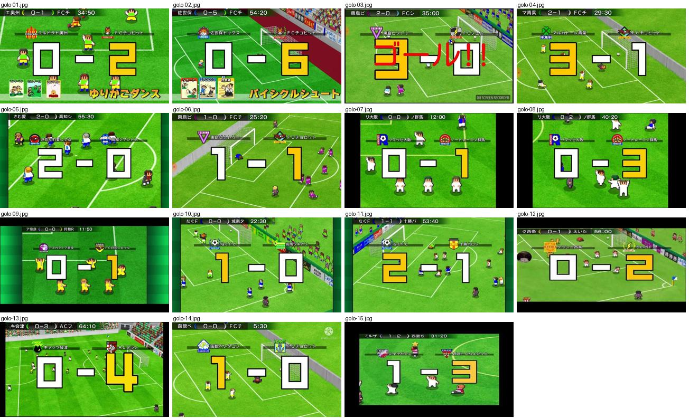

## golo-01.jpg

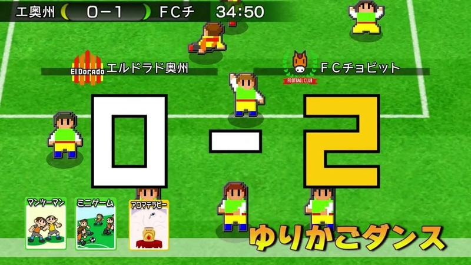

Golo marcado com combo: marcador grande «0-2» por cima e as cartas e nome do combo ainda visíveis em baixo.

- Etiquetas: placar, numeros-grandes, emblemas, cartas-habilidades, nome-combo, festejo
- Qualidade: boa
- Origem: [7MuwIEUUVRY](https://www.youtube.com/watch?v=7MuwIEUUVRY&t=5s) (50%, ~5 s), canal ゲームアディクト

## golo-02.jpg

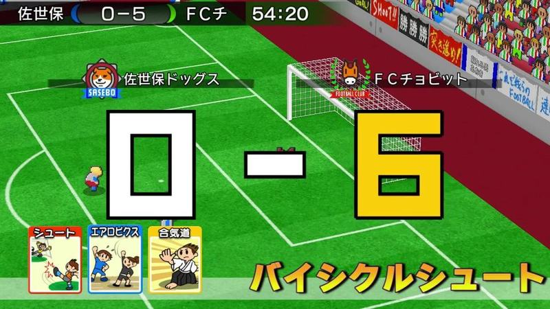

Golo de combo: marcador «0-6» com 6 amarelo por cima e as cartas e nome do combo em baixo.

- Etiquetas: placar, numeros-grandes, emblemas, cartas-habilidades, nome-combo
- Qualidade: boa
- Origem: [BkdBKrKoW-g](https://www.youtube.com/watch?v=BkdBKrKoW-g&t=8s) (50%, ~8 s), canal ゲームアディクト

## golo-03.jpg

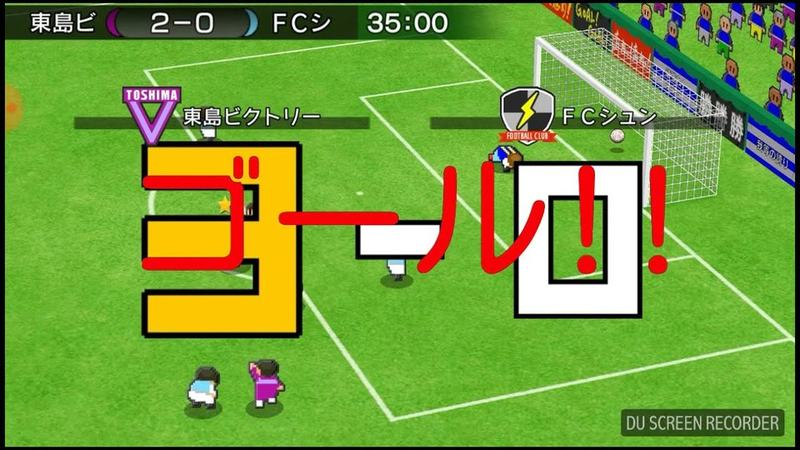

Golo: marcador grande «3-0» a aparecer com a palavra «ゴール!!» em vermelho e branco por cima; emblemas das equipas. O «ゴール!!» é uma legenda do youtuber, não do jogo (ver [camara-e-estilo.md](../../camara-e-estilo.md)).

- Etiquetas: placar, relogio, emblemas, numeros-grandes, texto-golo
- Qualidade: boa
- Origem: [CtR9CmLxZ9I](https://www.youtube.com/watch?v=CtR9CmLxZ9I&t=399s) (50%, ~399 s), canal シュンTV駿「駿猫」【ゲーム実況】

## golo-04.jpg

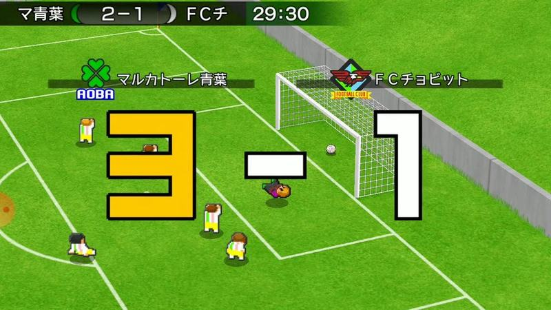

Golo com o resultado 3-1 em números enormes amarelos e brancos de contorno preto, emblemas e nomes das equipas por cima, junto à baliza.

- Etiquetas: placar, numeros-grandes, emblemas, nomes-equipas, baliza, camara-alta
- Qualidade: boa
- Origem: [D8MhtKiqDYw](https://www.youtube.com/watch?v=D8MhtKiqDYw&t=132s) (50%, ~132 s), canal ゆーげーむず

## golo-05.jpg

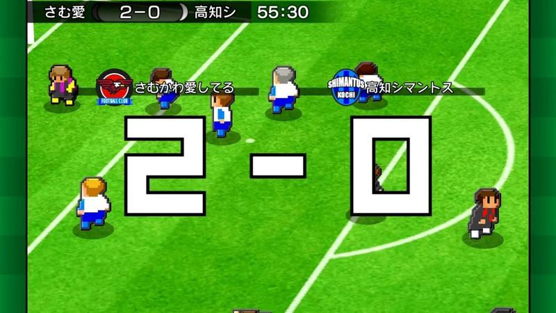

Resultado 2-0 em números brancos gigantes de contorno preto sobre o relvado, com emblemas e nomes das equipas por cima e barra de resultado e relógio no topo.

- Etiquetas: placar, numeros-grandes, emblemas, nomes-equipas, relogio, camara-alta
- Qualidade: boa
- Origem: [DFQ-K6NbaZE](https://www.youtube.com/watch?v=DFQ-K6NbaZE&t=113s) (25%, ~113 s), canal のうきん(Nokin)

## golo-06.jpg

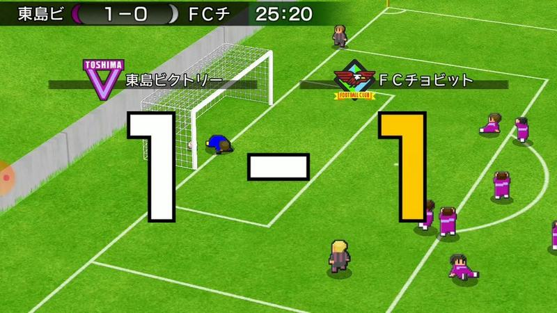

Golo do empate 1-1 com números gigantes (o 1 amarelo da equipa que marcou), emblemas por cima e guarda-redes caído junto à baliza.

- Etiquetas: placar, numeros-grandes, emblemas, baliza, guarda-redes-caido, camara-alta
- Qualidade: boa
- Origem: [DQJAp_Avlbg](https://www.youtube.com/watch?v=DQJAp_Avlbg&t=123s) (50%, ~123 s), canal ゆーげーむず

## golo-07.jpg

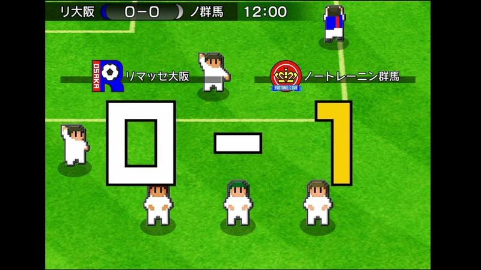

Golo 0-1 com números gigantes branco/amarelo e faixas com emblema e nome das equipas, jogadores de branco à volta.

- Etiquetas: placar, numeros-grandes, emblemas, nomes-equipas, relogio
- Qualidade: boa
- Origem: [DYRnbrZw1O4](https://www.youtube.com/watch?v=DYRnbrZw1O4&t=137s) (25%, ~137 s), canal しゃり

## golo-08.jpg

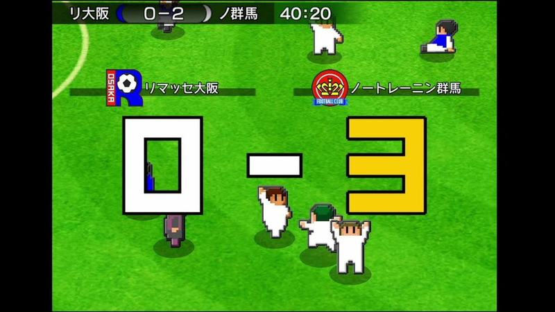

Golo 0-3 com a mesma composição de números gigantes; jogadores a festejar em grupo por baixo do número.

- Etiquetas: placar, numeros-grandes, emblemas, festejo
- Qualidade: boa
- Origem: [DYRnbrZw1O4](https://www.youtube.com/watch?v=DYRnbrZw1O4&t=274s) (50%, ~274 s), canal しゃり

## golo-09.jpg

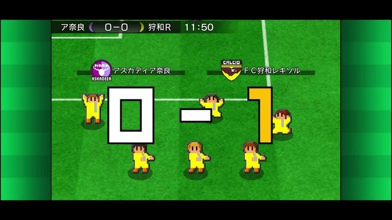

Golo 0-1 com números gigantes e jogadores de amarelo a festejar de braços no ar à volta.

- Etiquetas: placar, numeros-grandes, emblemas, festejo
- Qualidade: boa
- Origem: [ElRHOhrxqvo](https://www.youtube.com/watch?v=ElRHOhrxqvo&t=7756s) (75%, ~7756 s), canal 【CL福岡26位】ポケカ中級者配信

## golo-10.jpg

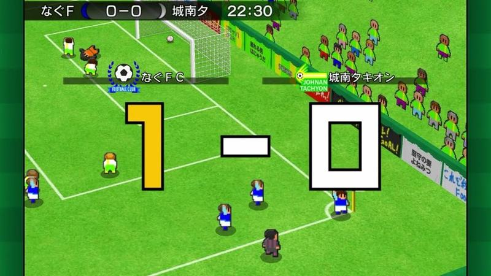

Golo 1-0 com números gigantes e emblemas, bancada lateral com adeptos e placas publicitárias em diagonal.

- Etiquetas: placar, numeros-grandes, emblemas, bancada, adeptos, publicidade
- Qualidade: boa
- Origem: [Gj2IxA6IhNg](https://www.youtube.com/watch?v=Gj2IxA6IhNg&t=157s) (25%, ~157 s), canal なぐ

## golo-11.jpg

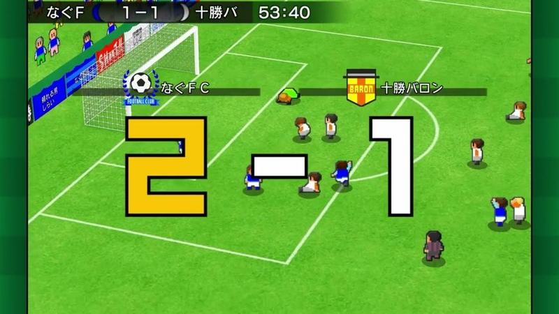

Golo 2-1 com o 2 amarelo gigante, emblemas e nomes das equipas junto à baliza com bancada ao fundo.

- Etiquetas: placar, numeros-grandes, emblemas, bancada, publicidade
- Qualidade: boa
- Origem: [Gj2IxA6IhNg](https://www.youtube.com/watch?v=Gj2IxA6IhNg&t=472s) (75%, ~472 s), canal なぐ

## golo-12.jpg

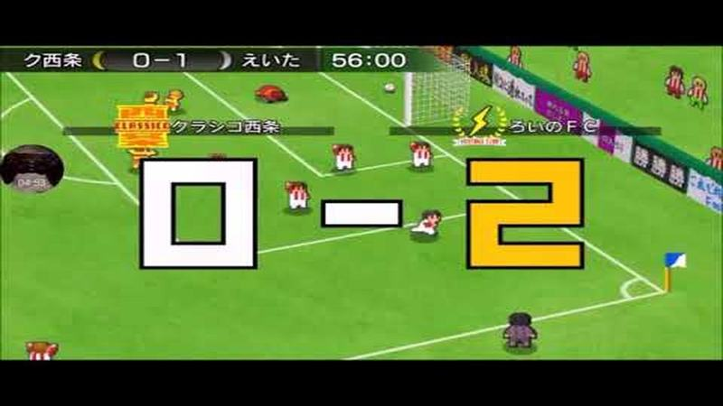

Golo 0-2 com números gigantes e emblemas das equipas, perto da bandeirola de canto e placas de publicidade.

- Etiquetas: placar, numeros-grandes, emblemas, bandeirola-canto, publicidade
- Qualidade: boa
- Origem: [Ho1F1CpLh5g](https://www.youtube.com/watch?v=Ho1F1CpLh5g&t=296s) (50%, ~296 s), canal ろいのえい

## golo-13.jpg

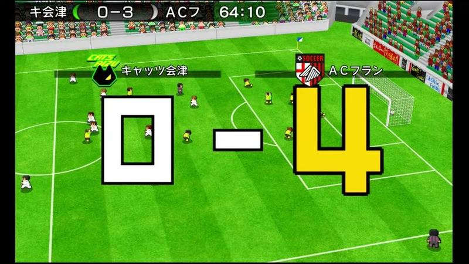

Golo 0-4 com o 4 amarelo gigante, emblemas e nomes das equipas e bancada verde ao fundo.

- Etiquetas: placar, numeros-grandes, emblemas, bancada, camara-alta
- Qualidade: boa
- Origem: [IEMG9XhGBtI](https://www.youtube.com/watch?v=IEMG9XhGBtI&t=4042s) (50%, ~4042 s), canal フラメンコ

## golo-14.jpg

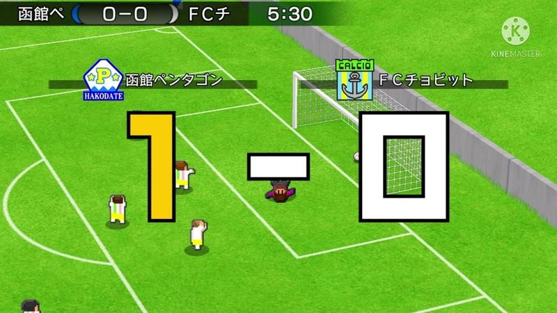

Golo 1-0 com números gigantes e emblemas junto à baliza, plano alto em diagonal; marca d'água de editor de vídeo no canto.

- Etiquetas: placar, numeros-grandes, emblemas, baliza, camara-alta
- Qualidade: boa
- Origem: [JFQ9eIcbgic](https://www.youtube.com/watch?v=JFQ9eIcbgic&t=169s) (50%, ~169 s), canal かなた。

## golo-15.jpg

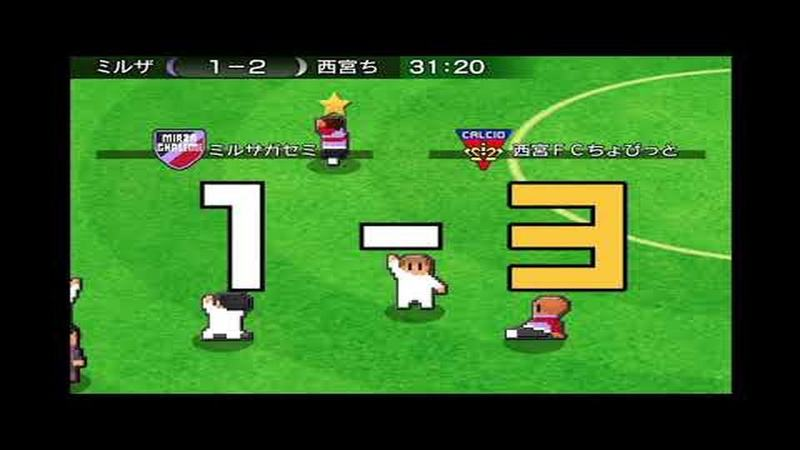

Golo 1-3 com números gigantes, emblemas e uma estrela sobre o marcador do golo.

- Etiquetas: placar, numeros-grandes, emblemas, estrela
- Qualidade: boa
- Origem: [JVcncYc4FVE](https://www.youtube.com/watch?v=JVcncYc4FVE&t=298s) (50%, ~298 s), canal しゃり
