# habilidade-especial

Categoria: Jogo (dentro do campo). 12 imagens. A folha `_folha.jpg` mostra-as todas de uma vez.

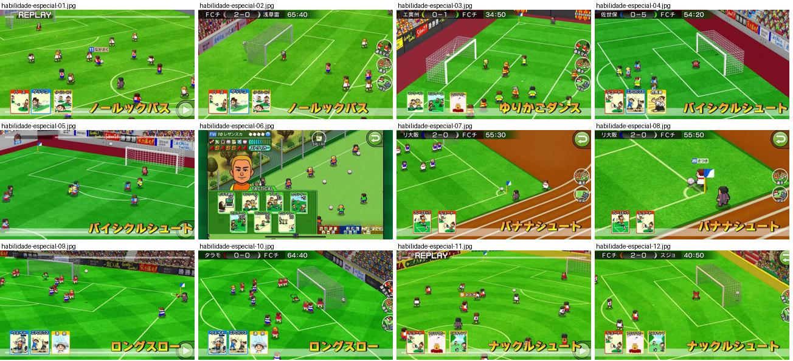

## habilidade-especial-01.jpg

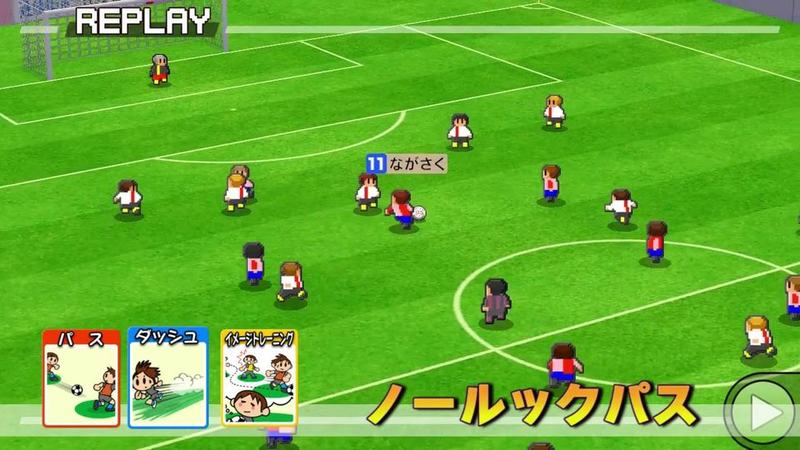

Repetição de um combo: três cartas com ilustração («パス», «ダッシュ», «イメージトレーニング») no canto inferior esquerdo e o nome do combo «ノールックパス» em letras amarelas grandes.

- Etiquetas: replay, cartas-habilidades, nome-combo, nome-jogador, botao-avancar
- Qualidade: boa
- Origem: [1LncqbqLma0](https://www.youtube.com/watch?v=1LncqbqLma0&t=4s) (25%, ~4 s), canal ゲームアディクト

## habilidade-especial-02.jpg

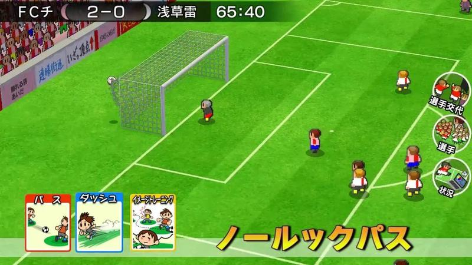

Combo ativado durante o jogo: três cartas em baixo e nome do combo em amarelo com contorno, baliza à esquerda.

- Etiquetas: placar, relogio, cartas-habilidades, nome-combo, baliza, botoes-laterais
- Qualidade: boa
- Origem: [1LncqbqLma0](https://www.youtube.com/watch?v=1LncqbqLma0&t=8s) (50%, ~8 s), canal ゲームアディクト

## habilidade-especial-03.jpg

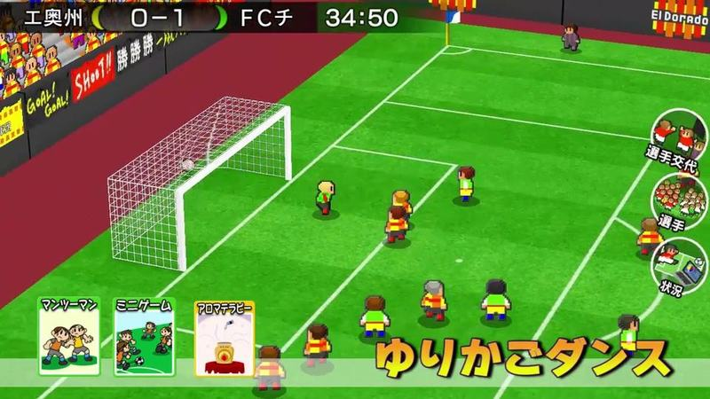

Combo «ゆりかごダンス» com três cartas ilustradas no canto inferior esquerdo e nome em amarelo, durante o jogo junto à baliza.

- Etiquetas: placar, relogio, cartas-habilidades, nome-combo, baliza, botoes-laterais
- Qualidade: boa
- Origem: [7MuwIEUUVRY](https://www.youtube.com/watch?v=7MuwIEUUVRY&t=2s) (25%, ~2 s), canal ゲームアディクト

## habilidade-especial-04.jpg

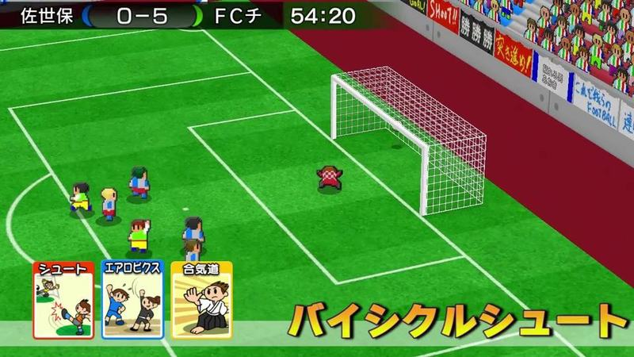

Combo «バイシクルシュート» com três cartas («シュート», «エアロビクス», «合気道») e nome em amarelo; baliza e pista vermelha ao fundo.

- Etiquetas: cartas-habilidades, nome-combo, baliza, placar, relogio
- Qualidade: boa
- Origem: [BkdBKrKoW-g](https://www.youtube.com/watch?v=BkdBKrKoW-g&t=4s) (25%, ~4 s), canal ゲームアディクト

## habilidade-especial-05.jpg

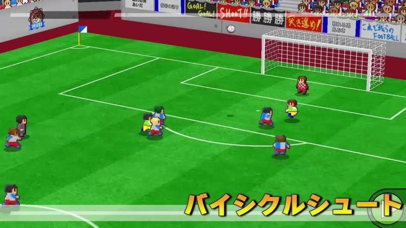

Nome do combo «バイシクルシュート» sobre lance junto à baliza, sem cartas nem placar (repetição).

- Etiquetas: nome-combo, baliza, bancada, publicidade, sem-placar
- Qualidade: boa
- Origem: [BkdBKrKoW-g](https://www.youtube.com/watch?v=BkdBKrKoW-g&t=12s) (75%, ~12 s), canal ゲームアディクト

## habilidade-especial-06.jpg

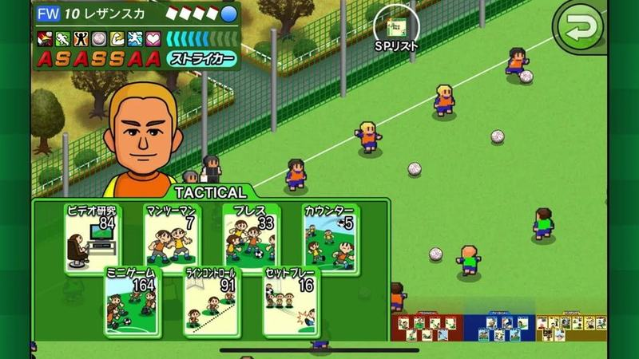

Durante o jogo abre-se o painel TACTICAL com cartas de tática verdes (cada uma com desenho e número) e o retrato do avançado com notas em letras por cima do campo.

- Etiquetas: cartas, tatica, retrato, camara-alta, botao-voltar, relvado
- Qualidade: boa
- Origem: [DEmYbvCV-mA](https://www.youtube.com/watch?v=DEmYbvCV-mA&t=83s) (25%, ~83 s), canal つばきち【Jリーグ系YouTuber】

## habilidade-especial-07.jpg

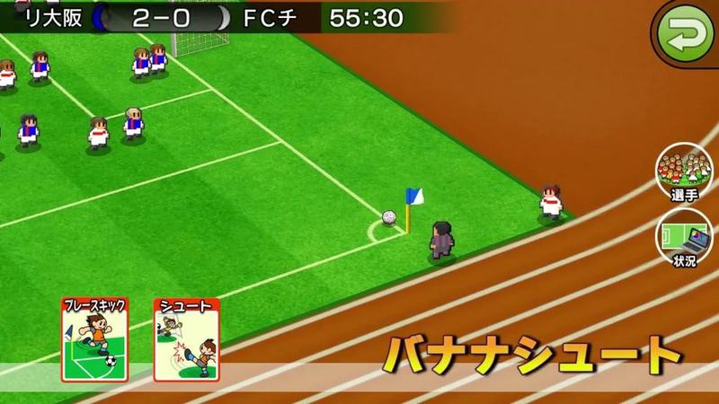

Canto com duas cartas de habilidade no canto inferior esquerdo e o nome da jogada «バナナシュート» em letras amarelas itálicas de contorno; pista de atletismo castanha à volta do campo.

- Etiquetas: canto, bandeirola-canto, cartas, nome-habilidade, pista-atletismo, botao-voltar, botoes-redondos
- Qualidade: boa
- Origem: [JQIQI4kchQE](https://www.youtube.com/watch?v=JQIQI4kchQE&t=5s) (25%, ~5 s), canal ゲームアディクト

## habilidade-especial-08.jpg

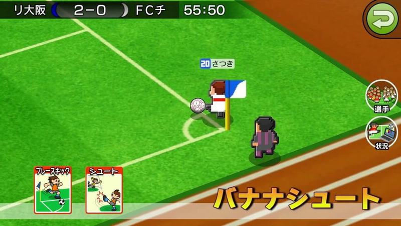

Mesmo canto em zoom com o marcador junto à bandeirola, etiqueta azul de nome, cartas de habilidade e nome da habilidade em amarelo.

- Etiquetas: canto, bandeirola-canto, cartas, nome-habilidade, nome-jogador, zoom
- Qualidade: boa
- Origem: [JQIQI4kchQE](https://www.youtube.com/watch?v=JQIQI4kchQE&t=10s) (50%, ~10 s), canal ゲームアディクト

## habilidade-especial-09.jpg

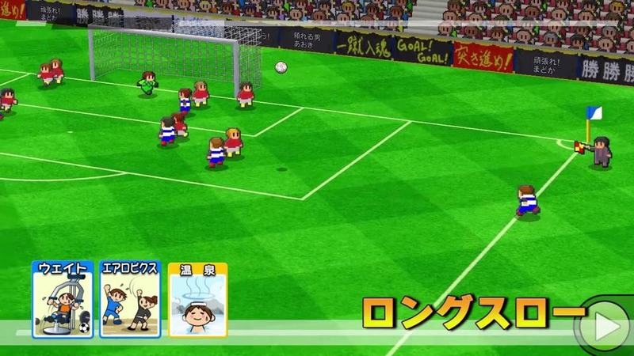

Jogo junto à baliza com três cartas pequenas no canto inferior esquerdo e o nome da habilidade («ロングスロー») em letras amarelas no canto inferior direito. Faixas de adeptos na bancada.

- Etiquetas: cartas, nome-habilidade, baliza, bancada, faixas, camara-alta, diagonal
- Qualidade: boa
- Origem: [ktqSs_8pJx8](https://www.youtube.com/watch?v=ktqSs_8pJx8&t=4s) (25%, ~4 s), canal ゲームアディクト

## habilidade-especial-10.jpg

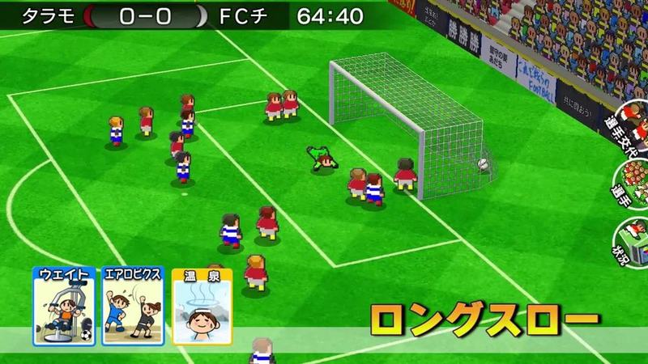

Mesma habilidade de lançamento longo, com placar no topo e cartas ativas em baixo; câmara em diagonal sobre a área.

- Etiquetas: cartas, nome-habilidade, placar, relogio, baliza, diagonal
- Qualidade: boa
- Origem: [ktqSs_8pJx8](https://www.youtube.com/watch?v=ktqSs_8pJx8&t=9s) (50%, ~9 s), canal ゲームアディクト

## habilidade-especial-11.jpg

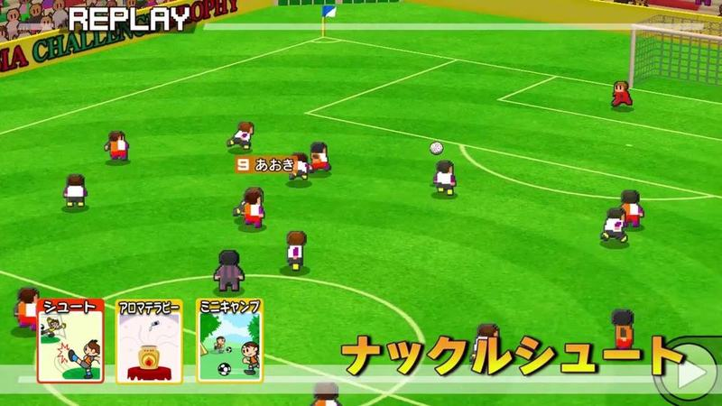

Repetição com três cartas ativas em baixo à esquerda e o nome da habilidade de remate em letras amarelas à direita.

- Etiquetas: replay, cartas, nome-habilidade, nome-jogador
- Qualidade: boa
- Origem: [rzKDIg5IKFo](https://www.youtube.com/watch?v=rzKDIg5IKFo&t=3s) (25%, ~3 s), canal ゲームアディクト

## habilidade-especial-12.jpg

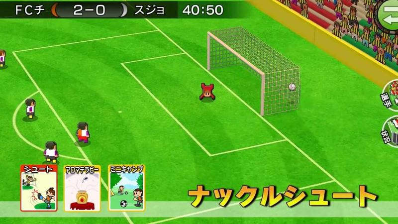

Remate especial junto à baliza com as cartas e o nome da habilidade em baixo; placar no topo.

- Etiquetas: cartas, nome-habilidade, placar, baliza, diagonal
- Qualidade: boa
- Origem: [rzKDIg5IKFo](https://www.youtube.com/watch?v=rzKDIg5IKFo&t=7s) (50%, ~7 s), canal ゲームアディクト
