# interface-durante-jogo

Categoria: Jogo (dentro do campo). 12 imagens. A folha `_folha.jpg` mostra-as todas de uma vez.

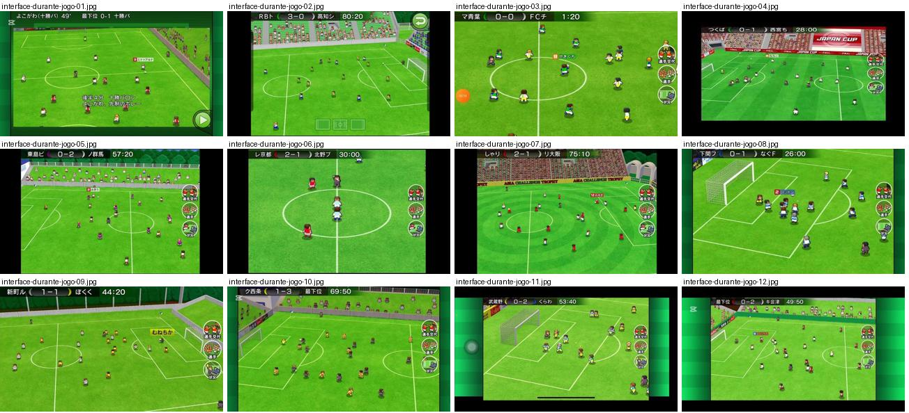

## interface-durante-jogo-01.jpg

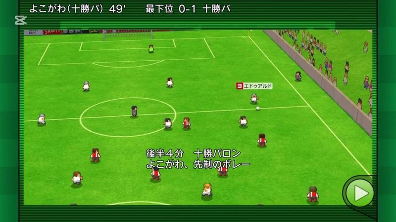

Resumo de lance com texto de relato sobre o campo («後半4分 十勝バロン よこかわ、先制のボレー») e linha de marcador com minuto do golo no topo.

- Etiquetas: comentario-texto, camara-alta, diagonal, bancada, botao-avancar, marcador-golo
- Qualidade: boa
- Origem: [0AWtZz7qiDM](https://www.youtube.com/watch?v=0AWtZz7qiDM&t=396s) (75%, ~396 s), canal Booby

## interface-durante-jogo-02.jpg

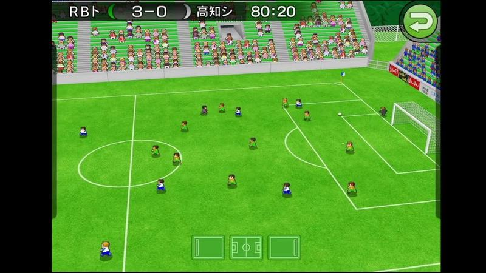

Jogo em plano largo com botão verde de voltar e três ícones de campo em baixo (escolha de vista), sem os botões de treinador.

- Etiquetas: placar, relogio, plano-largo, bancada, botao-voltar, icones-campo
- Qualidade: boa
- Origem: [5az1LSDE5K0](https://www.youtube.com/watch?v=5az1LSDE5K0&t=383s) (75%, ~383 s), canal しゃり

## interface-durante-jogo-03.jpg

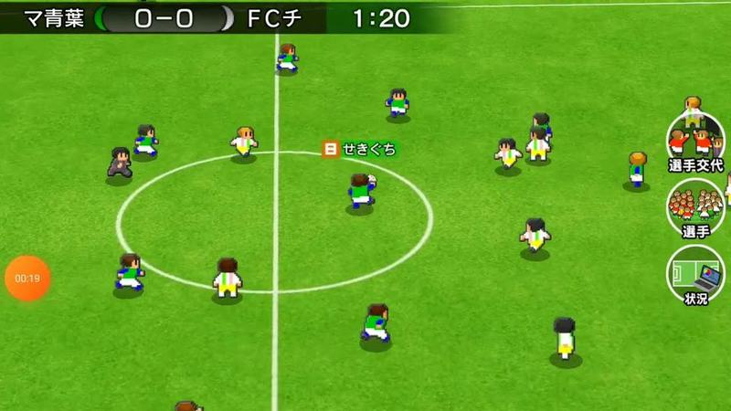

Jogo em plano largo visto de cima ligeiramente inclinado, círculo central visível; barra de resultado no topo e três botões redondos à direita (substituição, jogadores, situação).

- Etiquetas: placar, relogio, camara-alta, relvado, botoes-redondos, nome-jogador, dia
- Qualidade: boa
- Origem: [D8MhtKiqDYw](https://www.youtube.com/watch?v=D8MhtKiqDYw&t=66s) (25%, ~66 s), canal ゆーげーむず

## interface-durante-jogo-04.jpg

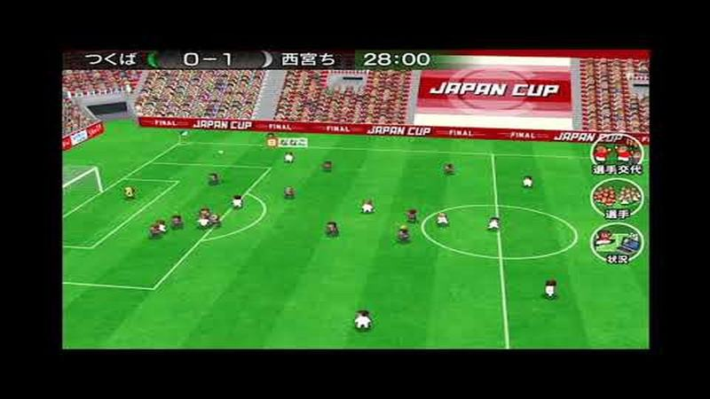

Final da Japan Cup em plano largo com bancada vermelha e placas «JAPAN CUP FINAL»; barra de resultado e botões redondos à direita.

- Etiquetas: placar, relogio, bancada, publicidade, botoes-redondos, camara-alta, final
- Qualidade: boa
- Origem: [E2cN6av4rx8](https://www.youtube.com/watch?v=E2cN6av4rx8&t=234s) (50%, ~234 s), canal NA

## interface-durante-jogo-05.jpg

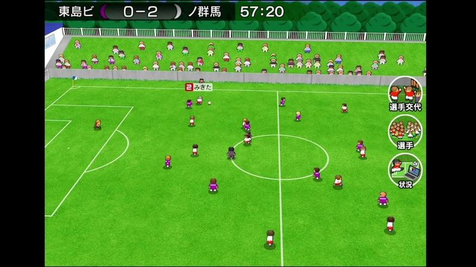

Plano largo com bancada lateral de adeptos atrás de uma rede, barra de resultado 0-2 e botões redondos de substituição, jogadores e situação.

- Etiquetas: placar, relogio, bancada, adeptos, botoes-redondos, camara-alta
- Qualidade: boa
- Origem: [EHX789sBnqo](https://www.youtube.com/watch?v=EHX789sBnqo&t=302s) (50%, ~302 s), canal しゃり

## interface-durante-jogo-06.jpg

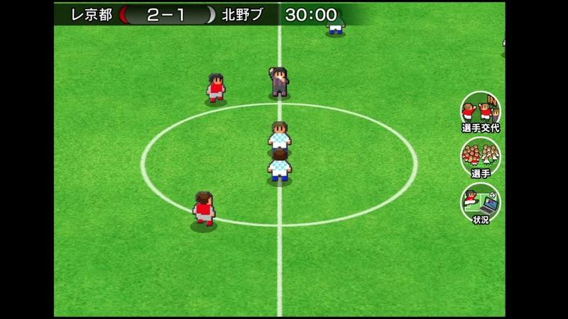

Reinício no círculo central com barra de resultado 2-1 e os três botões redondos à direita.

- Etiquetas: placar, relogio, botoes-redondos, circulo-central, camara-alta
- Qualidade: boa
- Origem: [Eeme73sMpn0](https://www.youtube.com/watch?v=Eeme73sMpn0&t=308s) (50%, ~308 s), canal しゃり

## interface-durante-jogo-07.jpg

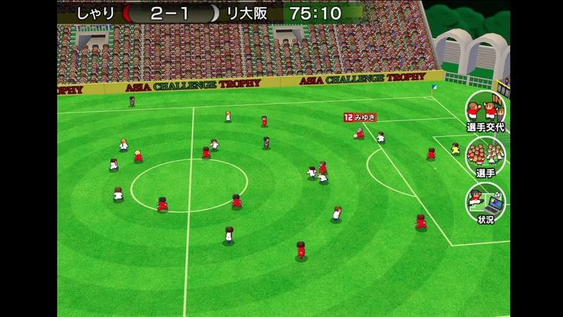

Plano largo e alto no estádio da taça asiática com bancadas vermelhas e verdes; barra de resultado e botões redondos à direita.

- Etiquetas: placar, relogio, estadio, bancada, botoes-redondos, camara-alta, relvado-listrado
- Qualidade: boa
- Origem: [FOJYw8-TQ7I](https://www.youtube.com/watch?v=FOJYw8-TQ7I&t=288s) (50%, ~288 s), canal しゃり

## interface-durante-jogo-08.jpg

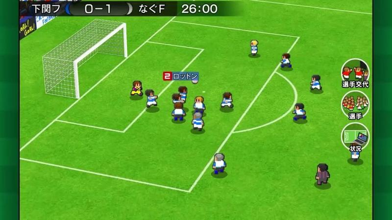

Ataque perto da área em plano alto e diagonal, etiqueta vermelha com o nome do jogador com bola e botões redondos à direita.

- Etiquetas: placar, relogio, botoes-redondos, nome-jogador, camara-alta, area
- Qualidade: boa
- Origem: [HRrnkEMkVqQ](https://www.youtube.com/watch?v=HRrnkEMkVqQ&t=123s) (25%, ~123 s), canal なぐ

## interface-durante-jogo-09.jpg

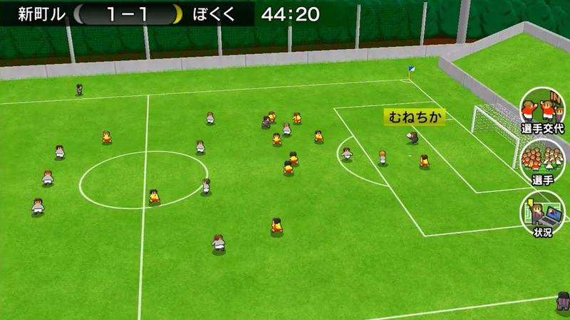

Plano largo e alto do meio-campo e área, bancada ao fundo; etiqueta de nome sobre um jogador e botões redondos à direita.

- Etiquetas: placar, relogio, botoes-redondos, nome-jogador, camara-alta, bancada
- Qualidade: boa
- Origem: [IlpszHPk2qc](https://www.youtube.com/watch?v=IlpszHPk2qc&t=680s) (75%, ~680 s), canal ぼくくんゲーム

## interface-durante-jogo-10.jpg

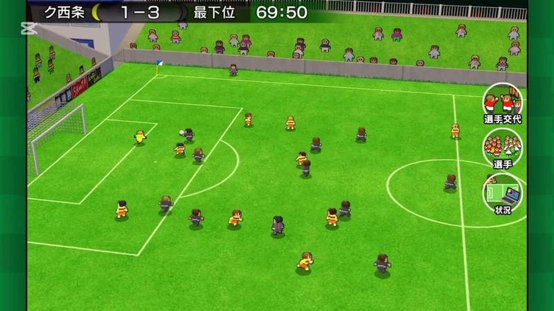

Plano largo e alto com bancada de adeptos ao longo da linha lateral, barra de resultado e botões redondos.

- Etiquetas: placar, relogio, botoes-redondos, bancada, adeptos, camara-alta
- Qualidade: boa
- Origem: [JXMmhBgYwTE](https://www.youtube.com/watch?v=JXMmhBgYwTE&t=334s) (50%, ~334 s), canal Booby

## interface-durante-jogo-11.jpg

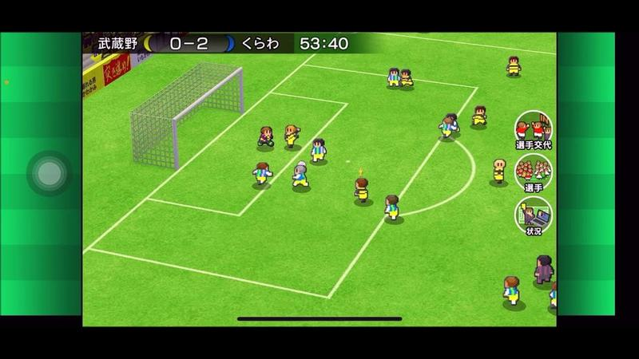

Plano largo e alto junto à baliza com jogadores de amarelo e azul, barra de resultado e botões redondos.

- Etiquetas: placar, relogio, botoes-redondos, baliza, camara-alta
- Qualidade: boa
- Origem: [KkhTLoSkBJE](https://www.youtube.com/watch?v=KkhTLoSkBJE&t=432s) (50%, ~432 s), canal ゲーム動画で行こう! Playing Games.

## interface-durante-jogo-12.jpg

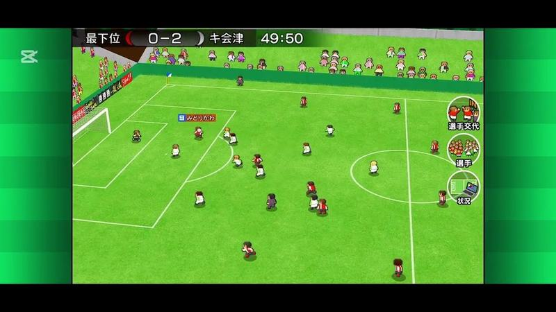

Plano muito largo e alto com bancada de adeptos ao longo da linha, barra de resultado e botões redondos.

- Etiquetas: placar, relogio, botoes-redondos, bancada, adeptos, camara-alta
- Qualidade: boa
- Origem: [Ll7q5Gu8lQw](https://www.youtube.com/watch?v=Ll7q5Gu8lQw&t=271s) (50%, ~271 s), canal Booby
