# intervalo

Categoria: Jogo (dentro do campo). 12 imagens. A folha `_folha.jpg` mostra-as todas de uma vez.

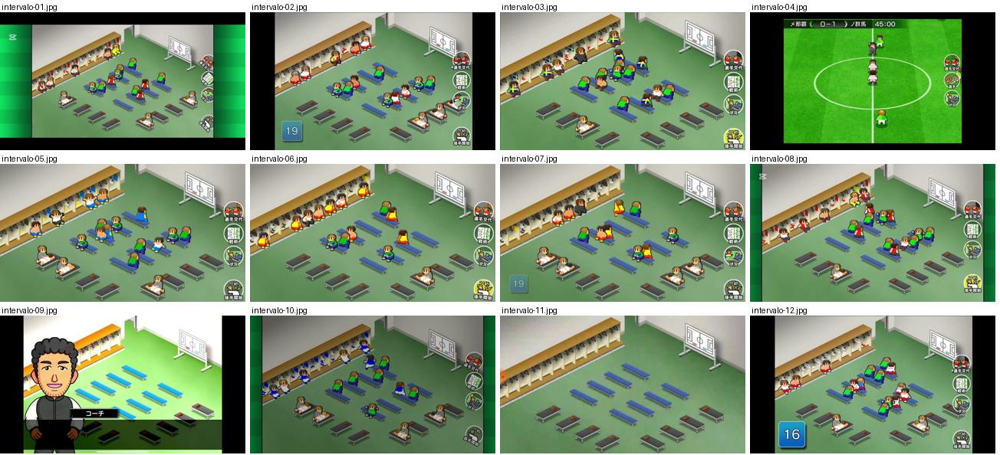

## intervalo-01.jpg

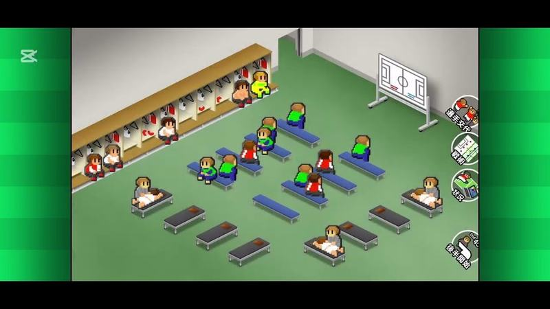

Balneário ao intervalo com jogadores sentados e botões redondos verticais à direita.

- Etiquetas: balneario, isometrico, jogadores-sentados, botoes-laterais
- Qualidade: boa
- Origem: [1fWpSuwQ45I](https://www.youtube.com/watch?v=1fWpSuwQ45I&t=303s) (50%, ~303 s), canal Booby

## intervalo-02.jpg

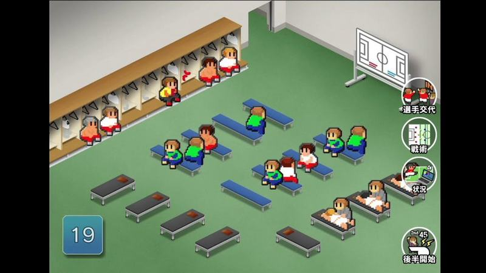

Balneário ao intervalo com jogadores sentados e botões à direita (troca, tática, estado, «後半開始»); número 19 em caixa no canto.

- Etiquetas: balneario, isometrico, jogadores-sentados, botoes-laterais, numero
- Qualidade: boa
- Origem: [2NBCTNPjJlM](https://www.youtube.com/watch?v=2NBCTNPjJlM&t=336s) (50%, ~336 s), canal しゃり

## intervalo-03.jpg

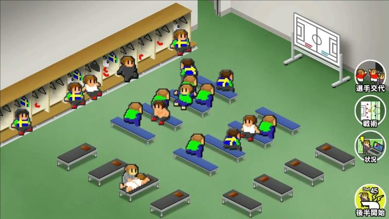

Balneário ao intervalo com jogadores pixel deitados e sentados; botões troca, tática, estado e «後半開始».

- Etiquetas: balneario, isometrico, jogadores-sentados, botoes-laterais
- Qualidade: boa
- Origem: [6zIHSeHdXDs](https://www.youtube.com/watch?v=6zIHSeHdXDs&t=3968s) (75%, ~3968 s), canal いとま 夜香学園

## intervalo-04.jpg

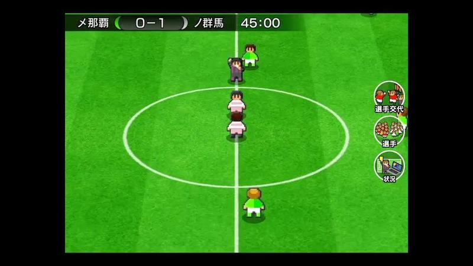

Aos 45:00, jogadores a sair em fila pelo meio do campo (fim da primeira parte), plano alto.

- Etiquetas: placar, relogio, circulo-central, camara-alta, botoes-laterais
- Qualidade: boa
- Origem: [8ogmIZH7WjE](https://www.youtube.com/watch?v=8ogmIZH7WjE&t=395s) (50%, ~395 s), canal しゃり

## intervalo-05.jpg

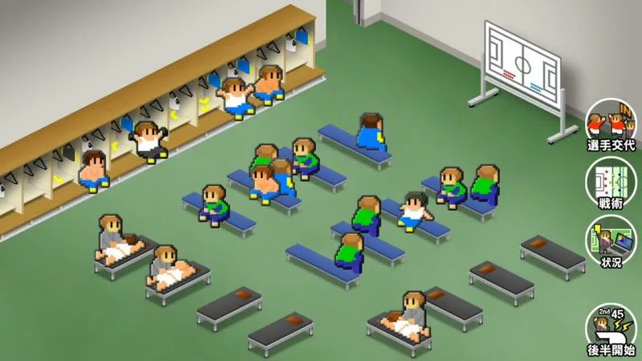

Intervalo no balneário isométrico com os jogadores sentados nos bancos e a receber massagem; ícones redondos à direita (substituição, tática, situação, começar 2.ª parte).

- Etiquetas: balneario, jogadores-sentados, isometrico, icones-laterais, segunda-parte
- Qualidade: boa
- Origem: [KbPiy1_7C58](https://www.youtube.com/watch?v=KbPiy1_7C58&t=359s) (50%, ~359 s), canal nakanaka

## intervalo-06.jpg

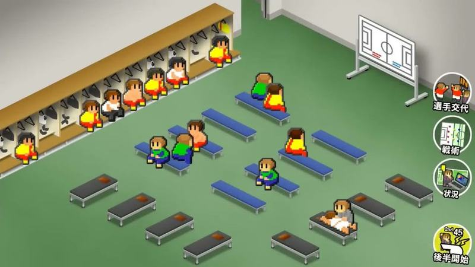

Intervalo no balneário com jogadores de amarelo e vermelho sentados e um a receber massagem; ícones redondos à direita para substituição, tática, situação e começar 2.ª parte.

- Etiquetas: balneario, jogadores-sentados, isometrico, icones-laterais, segunda-parte
- Qualidade: boa
- Origem: [S5j2j-O6g-Y](https://www.youtube.com/watch?v=S5j2j-O6g-Y&t=368s) (50%, ~368 s), canal ぼくくんゲーム

## intervalo-07.jpg

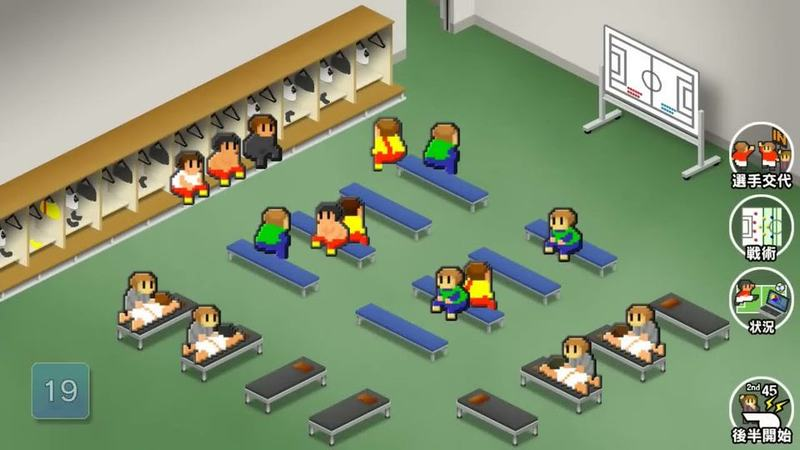

Balneário isométrico ao intervalo com os jogadores sentados em bancos azuis e quadro tático; coluna de botões redondos à direita (選手交代, 戦術, 状況, 後半開始). Excelente referência do ecrã de intervalo.

- Etiquetas: balneario, isometrico, bancos, botoes-laterais, quadro-tatico, substituicao
- Qualidade: boa
- Origem: [UN9g62Rw7M4](https://www.youtube.com/watch?v=UN9g62Rw7M4&t=484s) (50%, ~484 s), canal ぼくくんゲーム

## intervalo-08.jpg

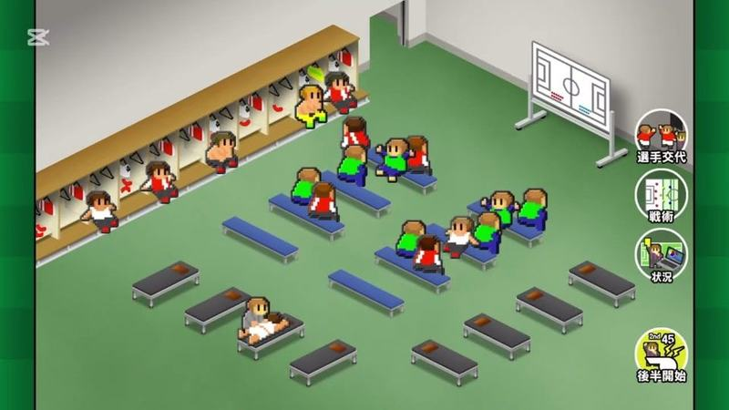

Balneário isométrico ao intervalo com jogadores sentados, um deitado na marquesa, e botões redondos à direita incluindo «後半開始».

- Etiquetas: balneario, isometrico, bancos, botoes-laterais, quadro-tatico
- Qualidade: boa
- Origem: [cblD5BR_sfc](https://www.youtube.com/watch?v=cblD5BR_sfc&t=277s) (50%, ~277 s), canal Booby

## intervalo-09.jpg

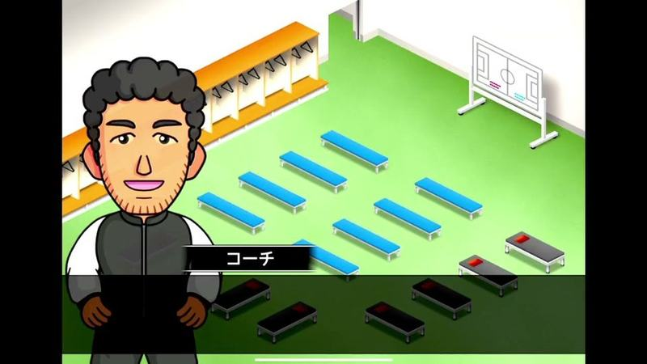

Adjunto em primeiro plano no balneário de bancos azul claro antes de falar.

- Etiquetas: balneario, treinador, isometrico, bancos
- Qualidade: boa
- Origem: [cjeZ7VtemS4](https://www.youtube.com/watch?v=cjeZ7VtemS4&t=480s) (75%, ~480 s), canal しゃり

## intervalo-10.jpg

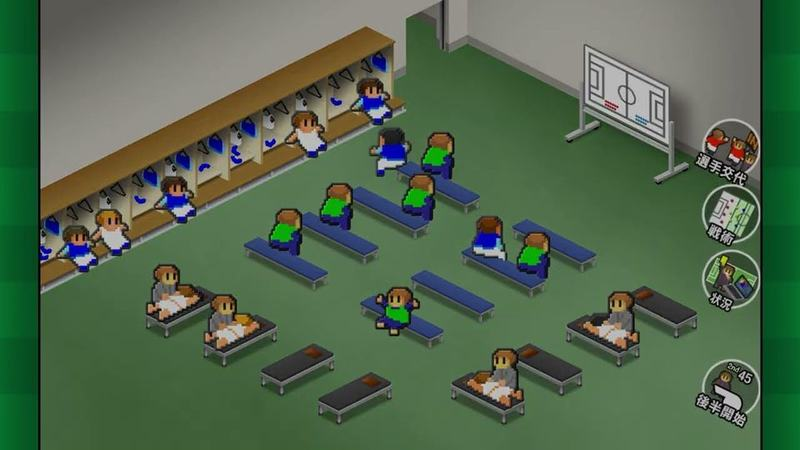

Balneário isométrico ao intervalo com os jogadores de azul sentados e botões redondos à direita.

- Etiquetas: balneario, isometrico, bancos, botoes-laterais, quadro-tatico
- Qualidade: boa
- Origem: [i57lBOMUCDE](https://www.youtube.com/watch?v=i57lBOMUCDE&t=448s) (75%, ~448 s), canal なぐ

## intervalo-11.jpg

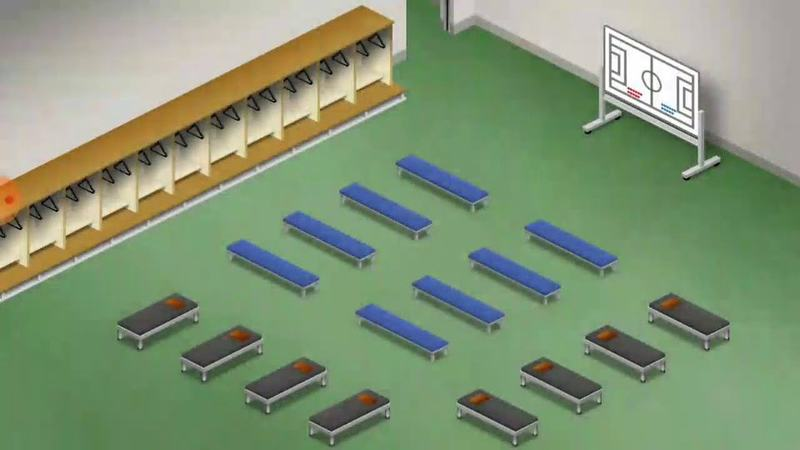

Balneário vazio em vista isométrica com bancos, cacifos e quadro tático; cenário típico de intervalo.

- Etiquetas: balneario, isometrico, quadro-tatico, bancos
- Qualidade: boa
- Origem: [mVi35eSvnH4](https://www.youtube.com/watch?v=mVi35eSvnH4&t=156s) (75%, ~156 s), canal ゆーげーむず

## intervalo-12.jpg

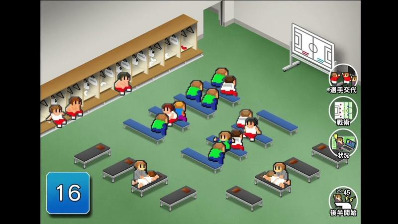

Intervalo no balneário isométrico com os jogadores sentados nos bancos, contador azul no canto e coluna de botões à direita (substituição, tática, situação, começar a segunda parte). Muito útil para o ecrã de intervalo.

- Etiquetas: balneario, isometrico, jogadores-sentados, botoes-redondos, segunda-parte, contador
- Qualidade: boa
- Origem: [r4vIS3cnJaQ](https://www.youtube.com/watch?v=r4vIS3cnJaQ&t=251s) (75%, ~251 s), canal NA
