# placar-resultado

Categoria: Jogo (dentro do campo). 10 imagens. A folha `_folha.jpg` mostra-as todas de uma vez.

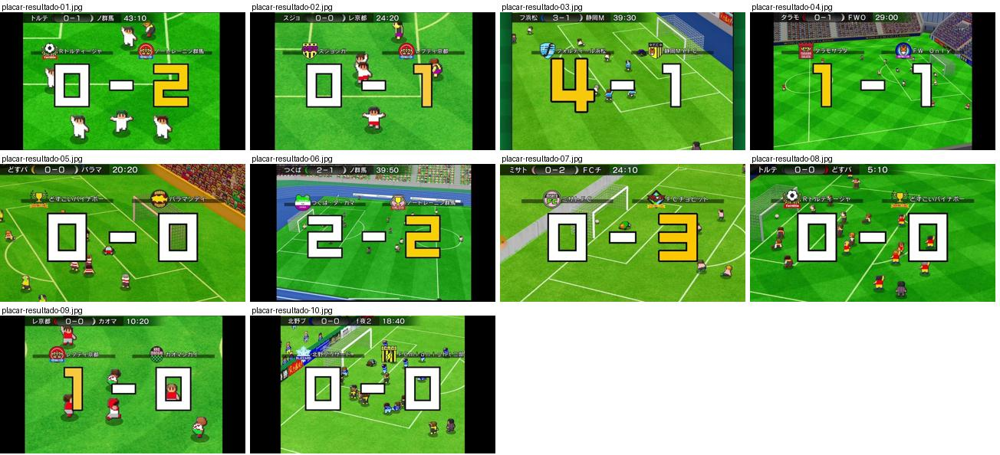

## placar-resultado-01.jpg

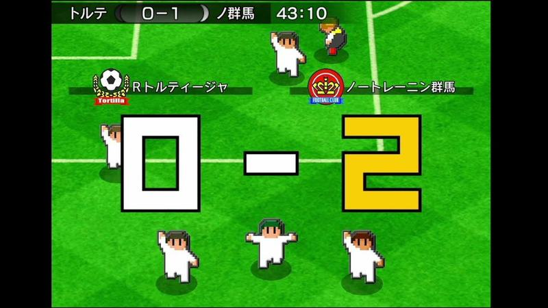

Marcador grande «0-2» em números pixel brancos e amarelos com contorno preto ao centro, emblemas e nomes das equipas por cima, barra do placar e relógio no topo; jogadores a festejar.

- Etiquetas: placar, relogio, emblemas, nomes-equipas, numeros-grandes, festejo
- Qualidade: boa
- Origem: [-gEREcToc9g](https://www.youtube.com/watch?v=-gEREcToc9g&t=295s) (50%, ~295 s), canal しゃり

## placar-resultado-02.jpg

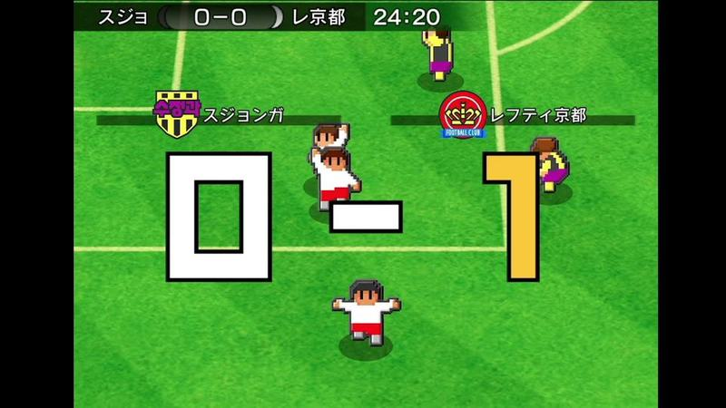

Marcador grande «0-1» sobre o jogo, com emblemas e nomes das equipas em faixas escuras; o número da equipa que marcou fica amarelo. Barra de placar com abreviaturas e relógio no topo.

- Etiquetas: placar, relogio, emblemas, nomes-equipas, numeros-grandes
- Qualidade: boa
- Origem: [-hBRMSKGUcM](https://www.youtube.com/watch?v=-hBRMSKGUcM&t=170s) (25%, ~170 s), canal しゃり

## placar-resultado-03.jpg

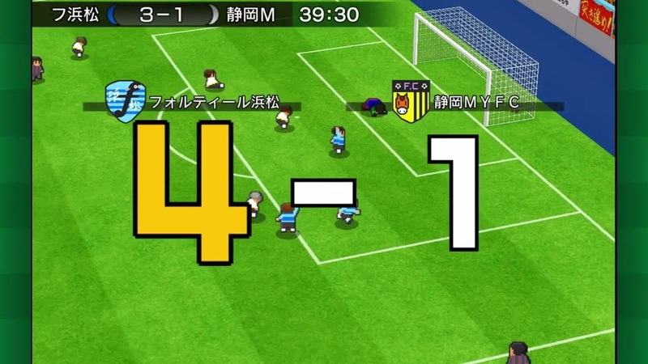

Marcador grande «4-1» com o 4 amarelo, emblemas e nomes completos das equipas por cima; barra do placar «3-1 39:30» no topo.

- Etiquetas: placar, relogio, emblemas, numeros-grandes, nomes-equipas
- Qualidade: boa
- Origem: [-tq_uLko5ck](https://www.youtube.com/watch?v=-tq_uLko5ck&t=215s) (50%, ~215 s), canal つばきち【Jリーグ系YouTuber】

## placar-resultado-04.jpg

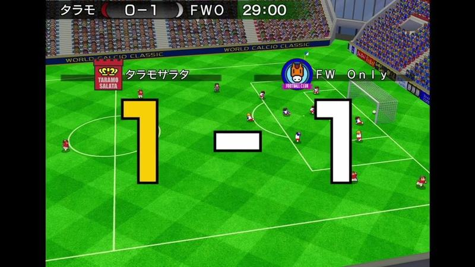

Marcador grande «1-1» num estádio grande com bancadas cheias (World Calcio Classic), emblemas das equipas por cima dos números.

- Etiquetas: placar, relogio, emblemas, numeros-grandes, estadio, bancada
- Qualidade: boa
- Origem: [0AMI0PKjwEM](https://www.youtube.com/watch?v=0AMI0PKjwEM&t=251s) (50%, ~251 s), canal しゃり

## placar-resultado-05.jpg

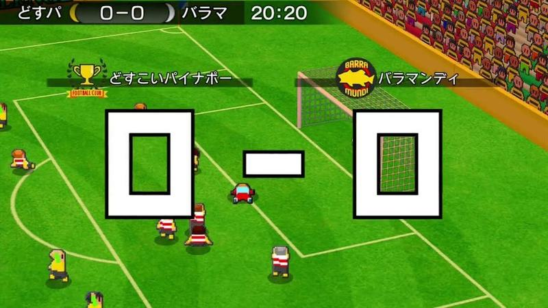

Marcador grande «0-0» em brancos com contorno preto e emblemas das equipas por cima.

- Etiquetas: placar, relogio, emblemas, numeros-grandes
- Qualidade: boa
- Origem: [0C2OgZnNvSI](https://www.youtube.com/watch?v=0C2OgZnNvSI&t=408s) (50%, ~408 s), canal NA

## placar-resultado-06.jpg

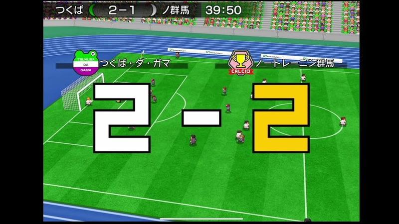

Marcador grande «2-2» num estádio com pista de atletismo azul, emblemas e nomes das equipas por cima.

- Etiquetas: placar, relogio, emblemas, numeros-grandes, pista-atletismo
- Qualidade: boa
- Origem: [0EU-h38vUVQ](https://www.youtube.com/watch?v=0EU-h38vUVQ&t=327s) (50%, ~327 s), canal しゃり

## placar-resultado-07.jpg

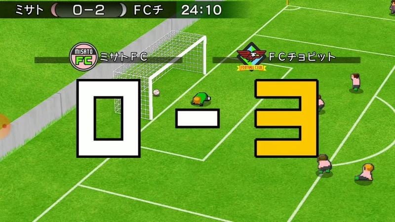

Marcador grande «0-3» junto à baliza, emblemas por cima dos nomes das equipas.

- Etiquetas: placar, relogio, emblemas, numeros-grandes, baliza
- Qualidade: boa
- Origem: [0kb5xuV3YYM](https://www.youtube.com/watch?v=0kb5xuV3YYM&t=114s) (50%, ~114 s), canal ゆーげーむず

## placar-resultado-08.jpg

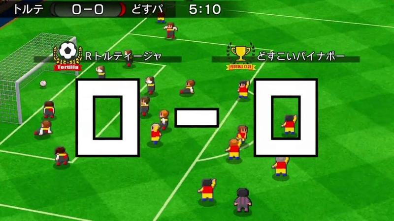

Marcador «0-0» grande aos 5 minutos com emblemas das equipas.

- Etiquetas: placar, relogio, emblemas, numeros-grandes
- Qualidade: boa
- Origem: [0z73mtBKuq4](https://www.youtube.com/watch?v=0z73mtBKuq4&t=268s) (25%, ~268 s), canal NA

## placar-resultado-09.jpg

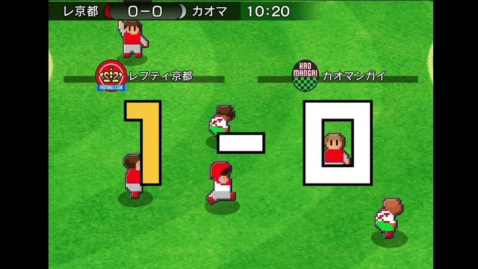

Marcador grande «1-0» com 1 amarelo e emblemas por cima.

- Etiquetas: placar, relogio, emblemas, numeros-grandes
- Qualidade: boa
- Origem: [1IGY8CF_3jA](https://www.youtube.com/watch?v=1IGY8CF_3jA&t=164s) (25%, ~164 s), canal しゃり

## placar-resultado-10.jpg

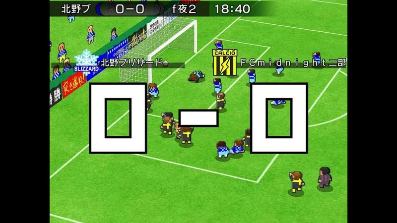

Marcador grande «0-0» junto à baliza com emblema de floco de neve e emblema amarelo e preto.

- Etiquetas: placar, relogio, emblemas, numeros-grandes, baliza
- Qualidade: boa
- Origem: [24L1YY64YFQ](https://www.youtube.com/watch?v=24L1YY64YFQ&t=110s) (25%, ~110 s), canal s
