# replay

Categoria: Jogo (dentro do campo). 10 imagens. A folha `_folha.jpg` mostra-as todas de uma vez.

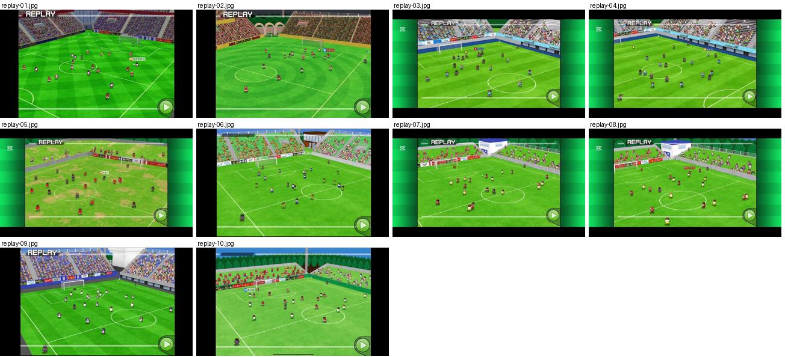

## replay-01.jpg

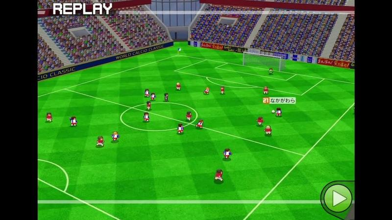

Repetição com etiqueta «REPLAY» branca no canto superior esquerdo, plano muito largo do estádio com bancadas; botão verde de avançar.

- Etiquetas: replay, estadio, bancada, camara-alta, plano-largo, botao-avancar
- Qualidade: boa
- Origem: [0AMI0PKjwEM](https://www.youtube.com/watch?v=0AMI0PKjwEM&t=376s) (75%, ~376 s), canal しゃり

## replay-02.jpg

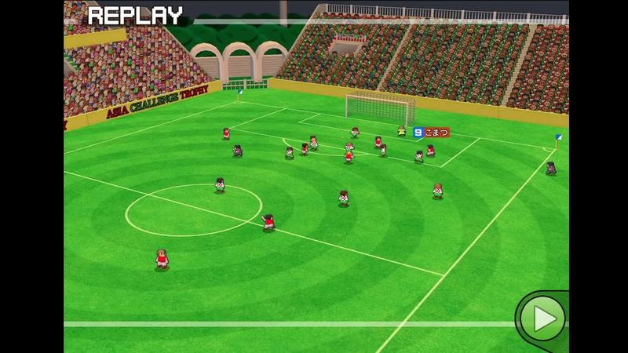

Repetição em plano largo num estádio com bancadas e arcos, «REPLAY» no canto superior esquerdo.

- Etiquetas: replay, estadio, bancada, arcos, plano-largo, botao-avancar
- Qualidade: boa
- Origem: [1IGY8CF_3jA](https://www.youtube.com/watch?v=1IGY8CF_3jA&t=328s) (50%, ~328 s), canal しゃり

## replay-03.jpg

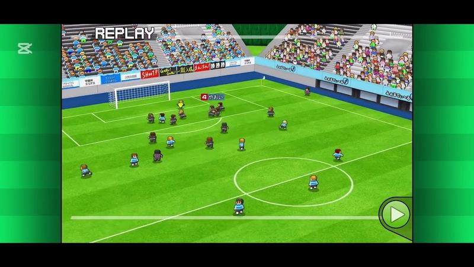

Repetição em plano largo com bancadas altas cheias e publicidade, «REPLAY» no canto.

- Etiquetas: replay, estadio, bancada, plano-largo, nome-jogador, botao-avancar
- Qualidade: boa
- Origem: [2E0XPxmtEyI](https://www.youtube.com/watch?v=2E0XPxmtEyI&t=307s) (50%, ~307 s), canal Booby

## replay-04.jpg

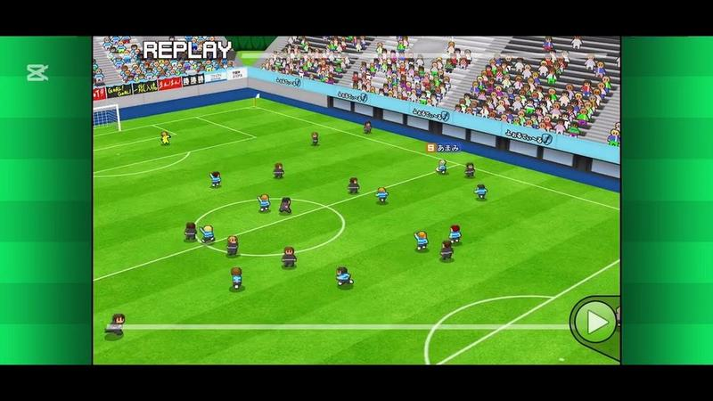

Repetição em plano largo do meio-campo com bancadas e publicidade.

- Etiquetas: replay, estadio, bancada, plano-largo, botao-avancar
- Qualidade: boa
- Origem: [2E0XPxmtEyI](https://www.youtube.com/watch?v=2E0XPxmtEyI&t=461s) (75%, ~461 s), canal Booby

## replay-05.jpg

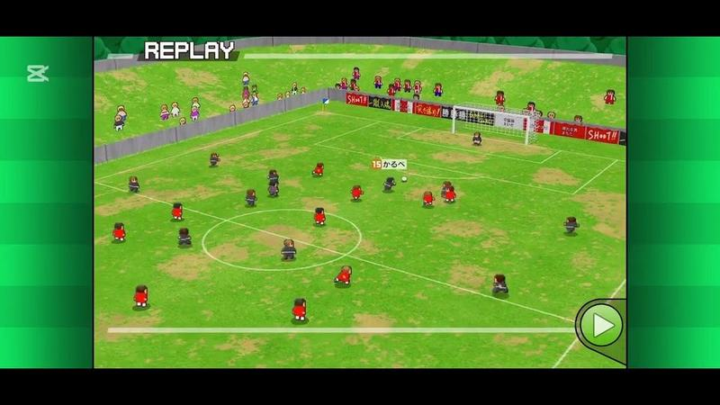

Repetição em plano largo num campo com relva gasta (manchas de terra), bancada baixa e publicidade.

- Etiquetas: replay, plano-largo, bancada, relvado-gasto, botao-avancar
- Qualidade: boa
- Origem: [3JsWO4fyh7U](https://www.youtube.com/watch?v=3JsWO4fyh7U&t=452s) (75%, ~452 s), canal Booby

## replay-06.jpg

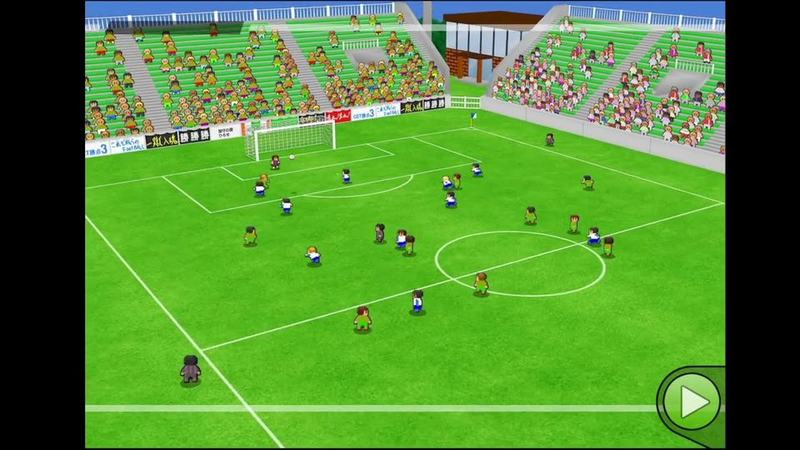

Plano muito largo de estádio com bancadas verdes e edifício atrás, sem placar; botão de avançar (repetição/resumo).

- Etiquetas: estadio, bancada, plano-largo, botao-avancar
- Qualidade: boa
- Origem: [5az1LSDE5K0](https://www.youtube.com/watch?v=5az1LSDE5K0&t=255s) (50%, ~255 s), canal しゃり

## replay-07.jpg

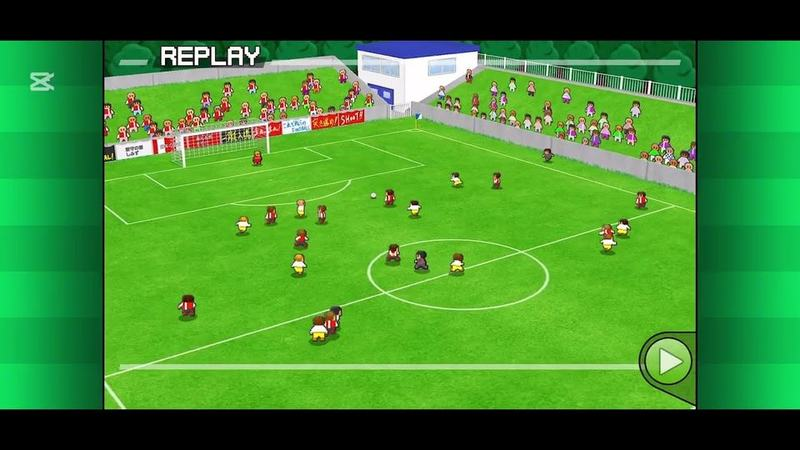

Repetição em plano largo com bancadas e edifício branco atrás.

- Etiquetas: replay, plano-largo, bancada, botao-avancar
- Qualidade: boa
- Origem: [6acFTJpxK5A](https://www.youtube.com/watch?v=6acFTJpxK5A&t=296s) (50%, ~296 s), canal Booby

## replay-08.jpg

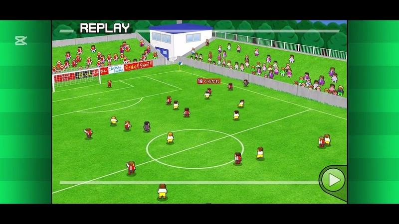

Repetição em plano largo com etiqueta de nome sobre jogador.

- Etiquetas: replay, plano-largo, bancada, nome-jogador, botao-avancar
- Qualidade: boa
- Origem: [6acFTJpxK5A](https://www.youtube.com/watch?v=6acFTJpxK5A&t=444s) (75%, ~444 s), canal Booby

## replay-09.jpg

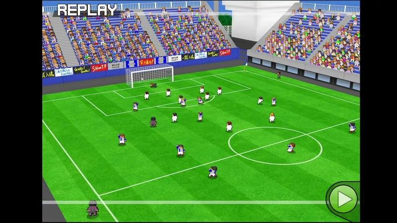

Repetição em estádio grande com bancadas azuis e brancas cheias.

- Etiquetas: replay, estadio, bancada, plano-largo, botao-avancar
- Qualidade: boa
- Origem: [6bJILLosWo8](https://www.youtube.com/watch?v=6bJILLosWo8&t=579s) (75%, ~579 s), canal しゃり

## replay-10.jpg

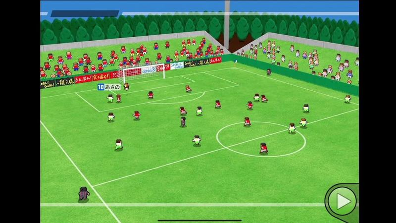

Plano largo de um campo pequeno com bancada e árvores atrás, sem placar; botão de avançar (repetição/resumo).

- Etiquetas: plano-largo, bancada, arvores, botao-avancar
- Qualidade: boa
- Origem: [7WcmrsFwuSs](https://www.youtube.com/watch?v=7WcmrsFwuSs&t=149s) (25%, ~149 s), canal NA
