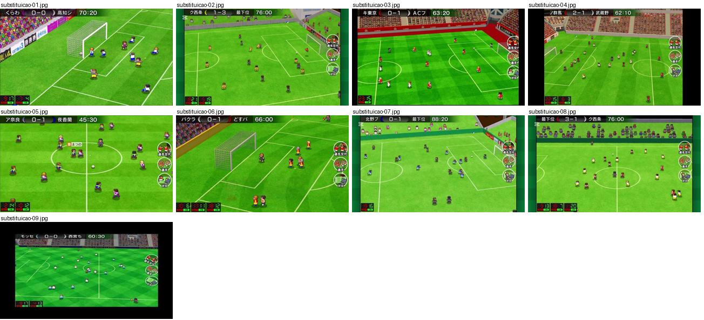
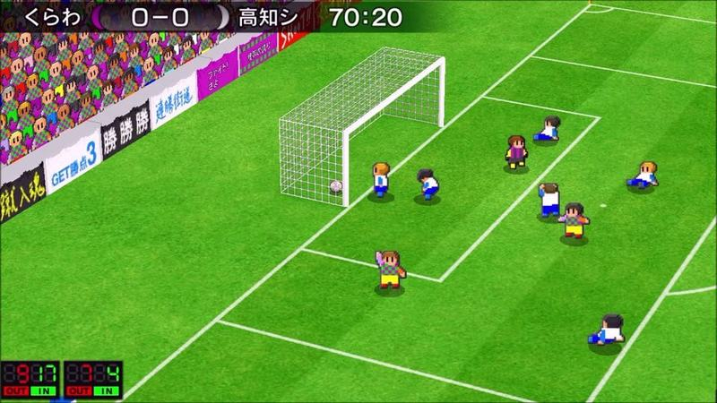
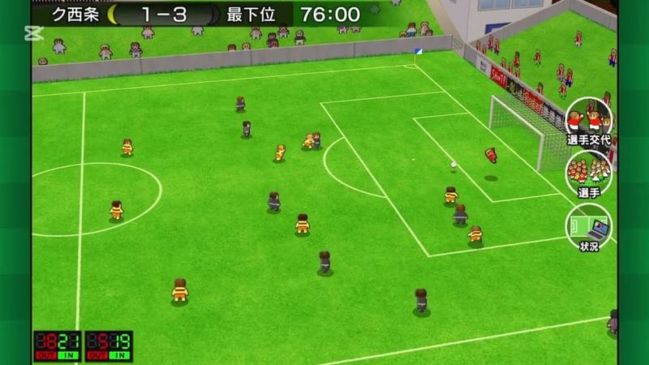
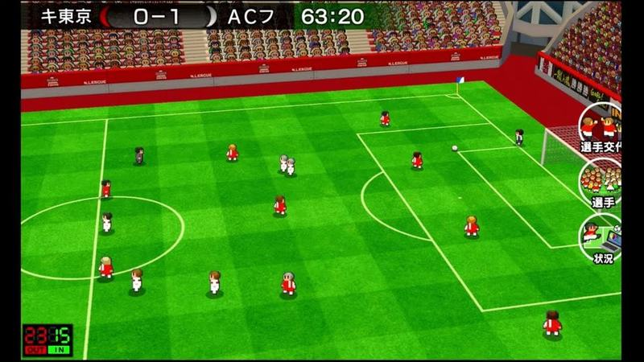
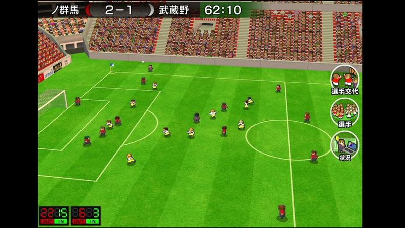
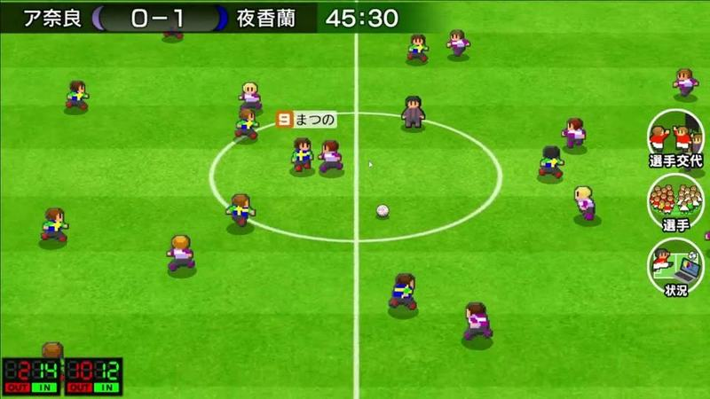
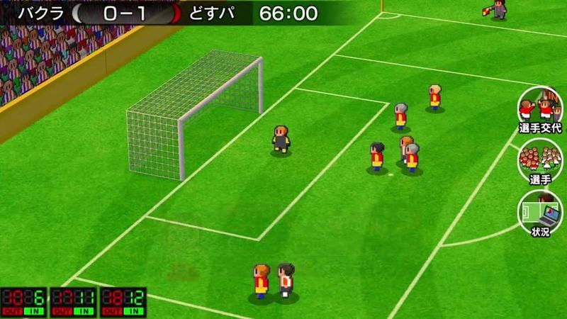
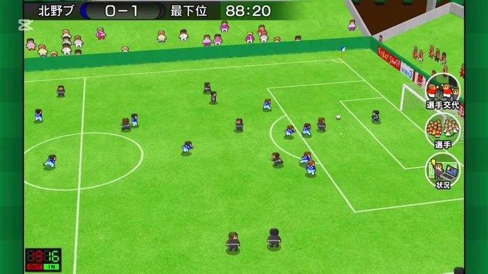
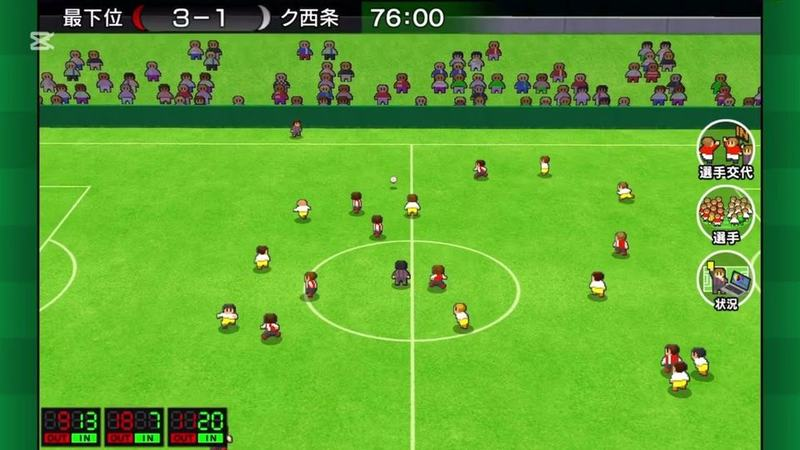
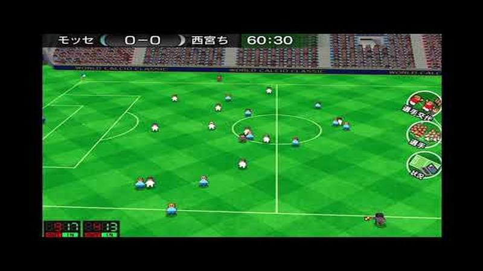

# substituicao

Categoria: Jogo (dentro do campo). 9 imagens. A folha `_folha.jpg` mostra-as todas de uma vez.

## substituicao-01.jpg

Jogo perto da baliza com bancada e placas de publicidade em diagonal; no canto inferior esquerdo aparece o quadro eletrónico de substituição com números vermelhos e verdes OUT/IN.

- Etiquetas: placar, relogio, quadro-substituicao, bancada, publicidade, baliza, camara-alta
- Qualidade: boa
- Origem: [EX_Y0XPJOvA](https://www.youtube.com/watch?v=EX_Y0XPJOvA&t=386s) (50%, ~386 s), canal ゲーム動画で行こう! Playing Games.

## substituicao-02.jpg

Plano largo do campo com o quadro eletrónico de substituição (números vermelho e verde OUT/IN) no canto inferior esquerdo.

- Etiquetas: quadro-substituicao, placar, relogio, bancada, camara-alta
- Qualidade: boa
- Origem: [JXMmhBgYwTE](https://www.youtube.com/watch?v=JXMmhBgYwTE&t=501s) (75%, ~501 s), canal Booby

## substituicao-03.jpg

Estádio grande com bancadas vermelhas em plano largo e alto; quadro eletrónico de substituição com números no canto inferior esquerdo.

- Etiquetas: quadro-substituicao, placar, relogio, estadio, bancada, camara-alta
- Qualidade: boa
- Origem: [LGye44A3hl8](https://www.youtube.com/watch?v=LGye44A3hl8&t=3924s) (50%, ~3924 s), canal フラメンコ

## substituicao-04.jpg

Plano largo com bancada cheia e quadro eletrónico de substituição (números vermelho e verde) no canto inferior esquerdo.

- Etiquetas: quadro-substituicao, placar, relogio, bancada, botoes-redondos, camara-alta
- Qualidade: boa
- Origem: [Nn-ROvXoQ5M](https://www.youtube.com/watch?v=Nn-ROvXoQ5M&t=301s) (50%, ~301 s), canal しゃり

## substituicao-05.jpg

Meio-campo com etiqueta de nome e o quadro eletrónico de substituição (números vermelho e verde) no canto inferior esquerdo.

- Etiquetas: quadro-substituicao, placar, relogio, nome-jogador, botoes-redondos
- Qualidade: boa
- Origem: [TLUvSJOQjRE](https://www.youtube.com/watch?v=TLUvSJOQjRE&t=4478s) (50%, ~4478 s), canal いとま 夜香学園

## substituicao-06.jpg

Jogo junto à baliza com três placas LED vermelhas e verdes de substituição (OUT/IN) no canto inferior esquerdo.

- Etiquetas: placa-substituicao, numeros-led, area, baliza, placar, relogio, botoes-laterais
- Qualidade: boa
- Origem: [ZgEcyoLum20](https://www.youtube.com/watch?v=ZgEcyoLum20&t=379s) (50%, ~379 s), canal NA

## substituicao-07.jpg

Plano largo com uma placa LED de substituição (OUT/IN) no canto inferior esquerdo.

- Etiquetas: placa-substituicao, numeros-led, camara-alta, plano-largo, botoes-laterais
- Qualidade: boa
- Origem: [fyt3kCF3RP0](https://www.youtube.com/watch?v=fyt3kCF3RP0&t=342s) (75%, ~342 s), canal Booby

## substituicao-08.jpg

Jogo em plano largo com três placas digitais vermelhas no canto inferior esquerdo a mostrar os números de quem sai e entra. Boa referência para mostrar substituições sem parar o jogo.

- Etiquetas: placas-substituicao, numeros-led, placar, camara-alta, botoes-redondos
- Qualidade: boa
- Origem: [tVh97f5JfZA](https://www.youtube.com/watch?v=tVh97f5JfZA&t=441s) (75%, ~441 s), canal Booby

## substituicao-09.jpg

Plano largo num estádio do torneio mundial com relvado aos quadrados e placas digitais de substituição no canto inferior esquerdo.

- Etiquetas: placas-substituicao, numeros-led, relvado-xadrez, camara-alta, publicidade, botoes-redondos
- Qualidade: boa
- Origem: [uF-3mkCpnrM](https://www.youtube.com/watch?v=uF-3mkCpnrM&t=288s) (50%, ~288 s), canal NA
