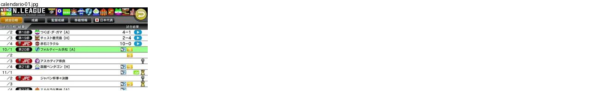
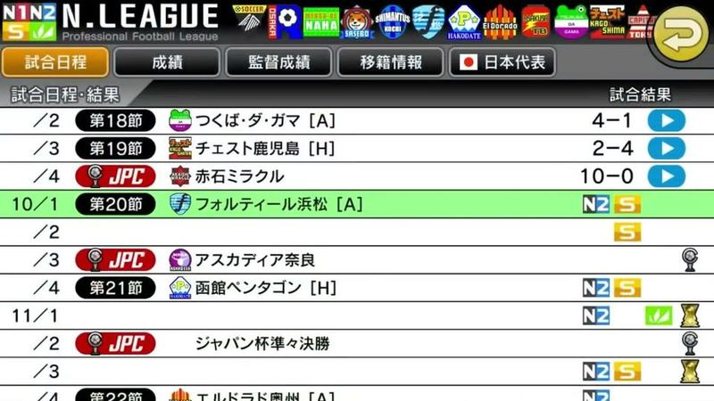

# calendario

Categoria: Menus e ecrãs de gestão. 1 imagens. A folha `_folha.jpg` mostra-as todas de uma vez.

## calendario-01.jpg

Calendário da N.LEAGUE com datas, jornada, adversário com emblema e [H]/[A], resultado e setas azuis; jornada atual destacada a verde e jogos da taça com etiqueta vermelha JPC.

- Etiquetas: lista, jornadas, resultados, emblemas, separadores, casa-fora
- Qualidade: boa
- Origem: [DbyXlZlka5I](https://www.youtube.com/watch?v=DbyXlZlka5I&t=44s) (25%, ~44 s), canal トルトル
