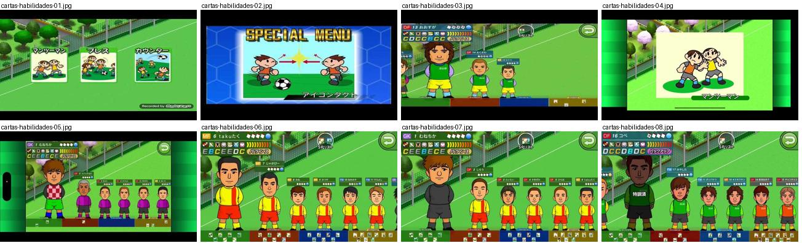
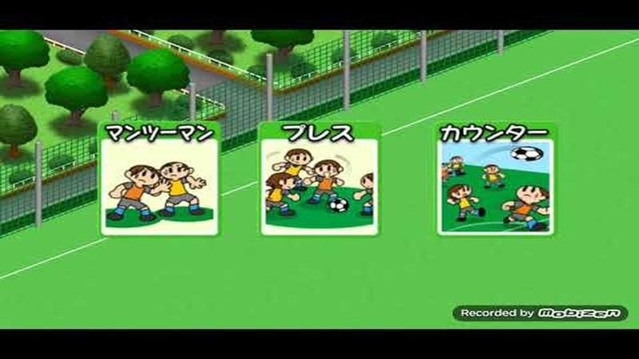
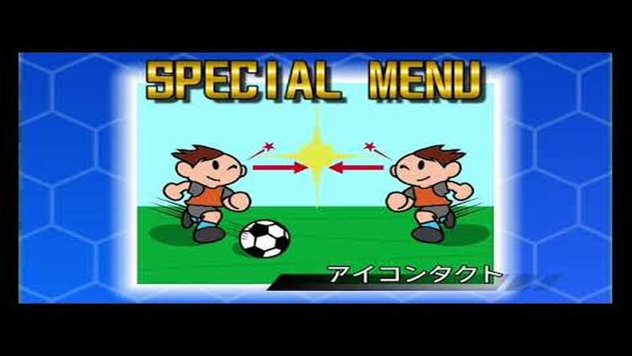
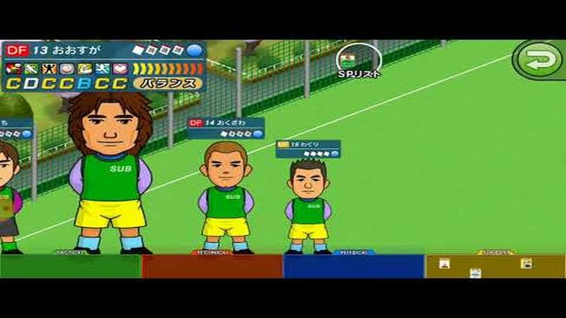
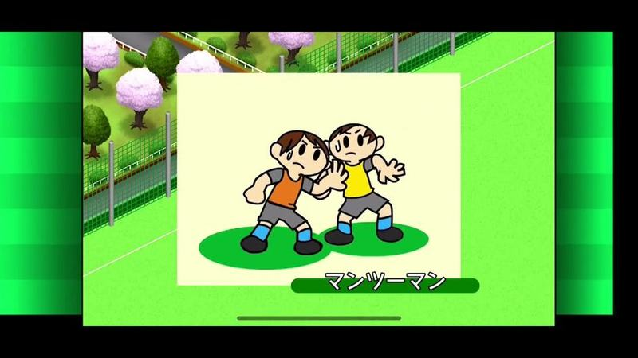
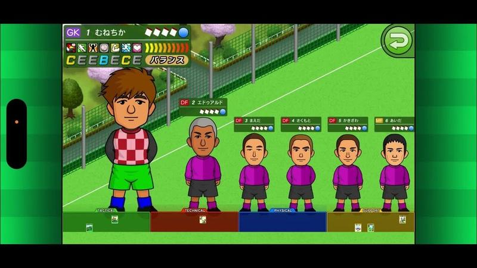
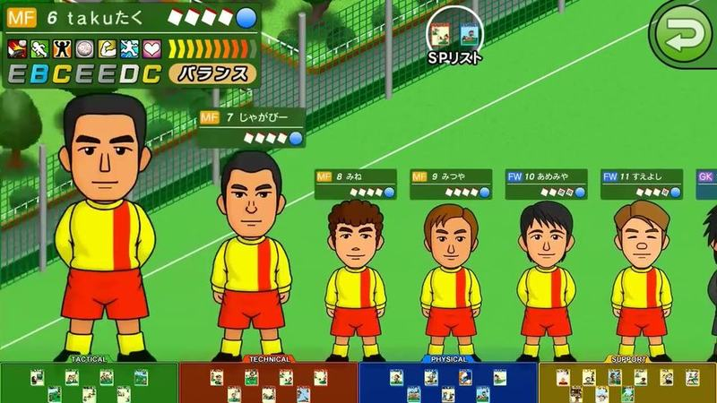
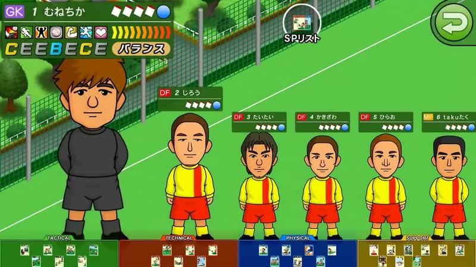
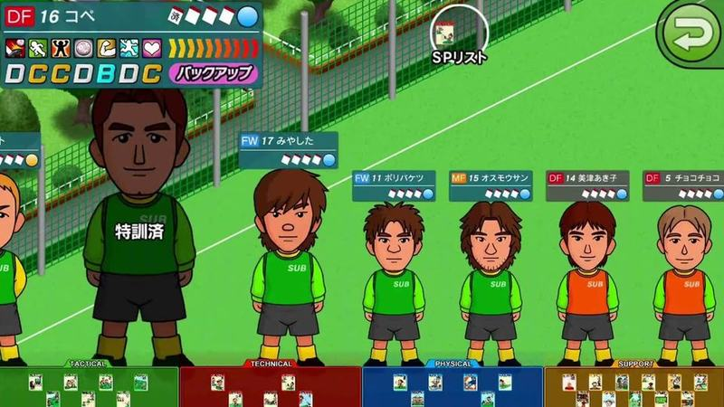

# cartas-habilidades

Categoria: Menus e ecrãs de gestão. 8 imagens. A folha `_folha.jpg` mostra-as todas de uma vez.

## cartas-habilidades-01.jpg

Três cartas de tática ilustradas (marcação individual, pressão, contra-ataque) com título em cima e bonecos desenhados, sobre o campo de treino isométrico; marca d'água de gravador.

- Etiquetas: cartas, tatica, campo-treino, ilustracoes
- Qualidade: boa
- Origem: [PiWp6WVzqQA](https://www.youtube.com/watch?v=PiWp6WVzqQA&t=196s) (25%, ~196 s), canal エビゼト.

## cartas-habilidades-02.jpg

Carta especial desbloqueada: título «SPECIAL MENU», ilustração de dois jogadores a trocar um olhar com faíscas e o nome da carta em baixo, sobre fundo azul hexagonal.

- Etiquetas: menu-especial, ilustracao, combo, fundo-hexagonal, nome-habilidade
- Qualidade: boa
- Origem: [oTjd5szjM94](https://www.youtube.com/watch?v=oTjd5szjM94&t=726s) (75%, ~726 s), canal ぼくくんゲーム

## cartas-habilidades-03.jpg

Ecrã de uso de cartas: jogadores de pé em fila, de corpo inteiro e de tamanho decrescente, com mini-ficha por cima; em baixo quatro gavetas coloridas de cartas (Tactical verde, Technical vermelho, Physical azul, Support amarelo).

- Etiquetas: fila-jogadores, retratos-corpo-inteiro, notas-letras, categorias-cartas, cansaco, botao-voltar
- Qualidade: boa
- Origem: [ryB564MQzuc](https://www.youtube.com/watch?v=ryB564MQzuc&t=223s) (75%, ~223 s), canal ゆーげーむず

## cartas-habilidades-04.jpg

Cartão ilustrado de uma instrução tática (marcação individual): dois jogadores desenhados encostados, fundo creme e nome numa barra verde em baixo.

- Etiquetas: ilustracao, tatica, marcacao-individual, cartao, cerejeiras
- Qualidade: boa
- Origem: [t8T0hRYc-r4](https://www.youtube.com/watch?v=t8T0hRYc-r4&t=1140s) (50%, ~1140 s), canal Zoo Suu

## cartas-habilidades-05.jpg

Ecrã de uso de cartas: jogadores de pé em fila no campo de treino com mini-fichas por cima (posição, número, cansaço); o selecionado mostra notas e tipo. Em baixo quatro gavetas de cartas: Tactical, Technical, Physical e Support.

- Etiquetas: fila-jogadores, retratos-corpo-inteiro, notas-letras, categorias-cartas, cansaco, botao-voltar
- Qualidade: boa
- Origem: [wJw_usy-hXo](https://www.youtube.com/watch?v=wJw_usy-hXo&t=1072s) (50%, ~1072 s), canal プーレグ

## cartas-habilidades-06.jpg

Ecrã de uso de cartas com a fila de médios e avançados de pé, mini-fichas por cima e gavetas coloridas de cartas em baixo; botão para a lista de treinos especiais no topo.

- Etiquetas: fila-jogadores, retratos-corpo-inteiro, notas-letras, categorias-cartas, lista-especiais, botao-voltar
- Qualidade: boa
- Origem: [xXgfijfjkec](https://www.youtube.com/watch?v=xXgfijfjkec&t=203s) (25%, ~203 s), canal ぼくくんゲーム

## cartas-habilidades-07.jpg

Ecrã de uso de cartas começando pelo guarda-redes em primeiro plano e os defesas em fila; gavetas de cartas coloridas em baixo.

- Etiquetas: fila-jogadores, retratos-corpo-inteiro, guarda-redes, notas-letras, categorias-cartas
- Qualidade: boa
- Origem: [xXgfijfjkec](https://www.youtube.com/watch?v=xXgfijfjkec&t=610s) (75%, ~610 s), canal ぼくくんゲーム

## cartas-habilidades-08.jpg

Ecrã de uso de cartas com suplentes de colete em fila; um jogador marcado como já treinado. Gavetas de cartas coloridas em baixo.

- Etiquetas: fila-jogadores, retratos-corpo-inteiro, notas-letras, categorias-cartas, treino-feito, suplentes
- Qualidade: boa
- Origem: [zXqXsKYj6qw](https://www.youtube.com/watch?v=zXqXsKYj6qw&t=641s) (50%, ~641 s), canal ぼくくんゲーム
