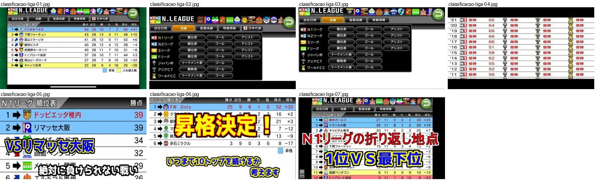
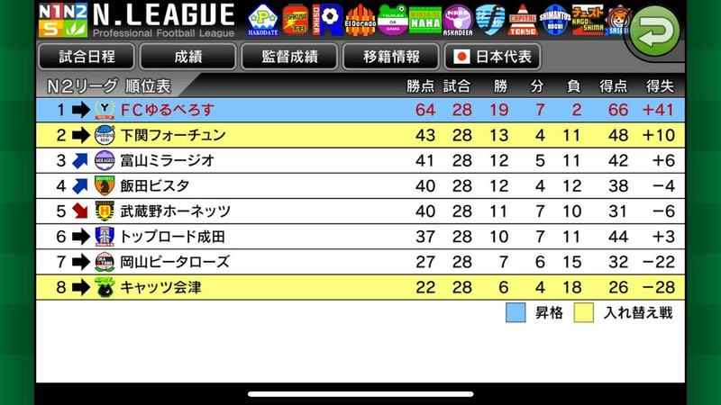
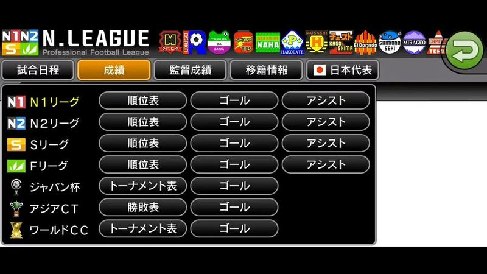
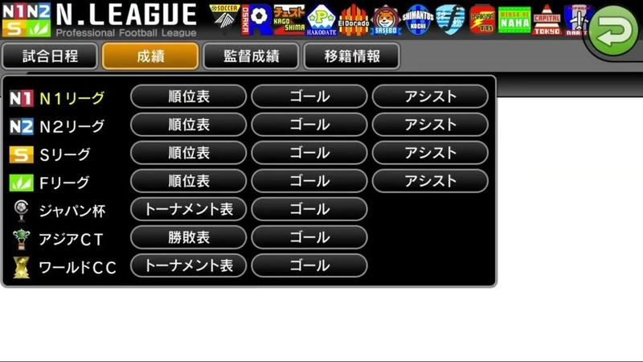
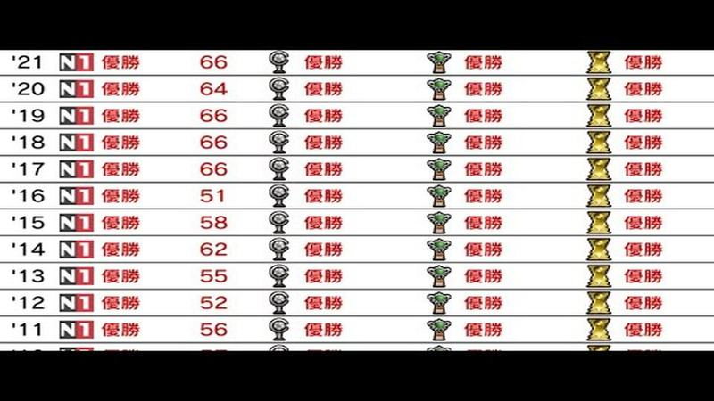
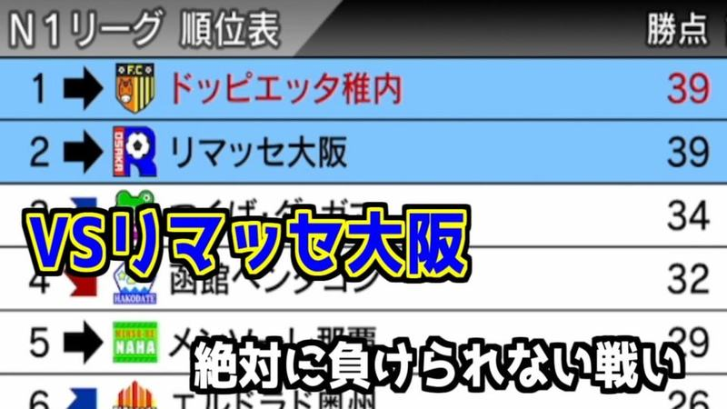
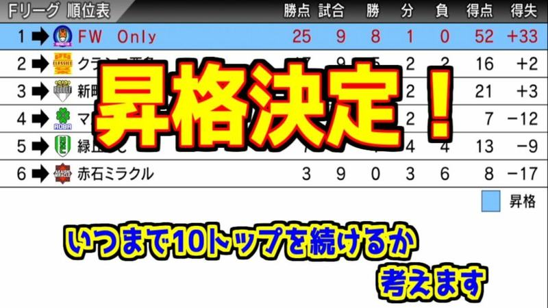
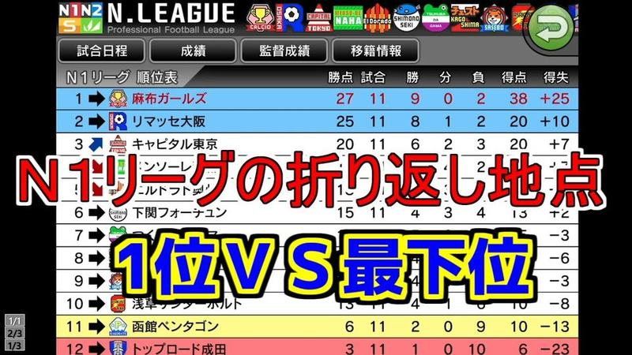

# classificacao-liga

Categoria: Menus e ecrãs de gestão. 7 imagens. A folha `_folha.jpg` mostra-as todas de uma vez.

## classificacao-liga-01.jpg

Tabela «N2リーグ 順位表» com barra «N.LEAGUE» de emblemas e separadores (calendário, resultados, treinador, transferências, seleção); linhas azuis para subida e amarelas para play-off, colunas de pontos, jogos, V/E/D e golos.

- Etiquetas: classificacao, emblemas, separadores, pontos, promocao, liga
- Qualidade: boa
- Origem: [8Q-SGYs9Hi4](https://www.youtube.com/watch?v=8Q-SGYs9Hi4) (capa), canal 冥界の番犬・ポポ

## classificacao-liga-02.jpg

Menu da N.LEAGUE com faixa de emblemas no topo, separadores (calendário, resultados, treinador, transferências, seleção) e grelha de botões por liga: classificação, golos, assistências, quadro de torneio.

- Etiquetas: separadores, emblemas, botoes, ligas, botao-voltar
- Qualidade: boa
- Origem: [DID-HIF-aq4](https://www.youtube.com/watch?v=DID-HIF-aq4&t=8s) (25%, ~8 s), canal s

## classificacao-liga-03.jpg

Separador de resultados da N.LEAGUE com grelha de botões por competição (classificação, golos, assistências, quadro de torneio) sobre painel preto.

- Etiquetas: separadores, botoes, ligas, emblemas, botao-voltar
- Qualidade: boa
- Origem: [DbyXlZlka5I](https://www.youtube.com/watch?v=DbyXlZlka5I&t=89s) (50%, ~89 s), canal トルトル

## classificacao-liga-04.jpg

Tabela de histórico do clube por época ('11 a '21) com ícone da liga N1, pontos e ícones de taças com «優勝» em vermelho em todas as colunas; linhas brancas alternadas, tipografia simples.

- Etiquetas: historico, titulos, trofeus, lista, epocas
- Qualidade: ok
- Origem: [DEmYbvCV-mA](https://www.youtube.com/watch?v=DEmYbvCV-mA) (capa), canal つばきち【Jリーグ系YouTuber】

## classificacao-liga-05.jpg

Classificação da liga N1 com posição, seta de tendência, emblema, nome em vermelho e pontos; os dois primeiros destacados a azul claro; texto do youtuber por cima.

- Etiquetas: tabela, emblemas, setas, pontos, texto-grande
- Qualidade: ok · tem texto do youtuber por cima
- Origem: [P3uQ5oJxkaQ](https://www.youtube.com/watch?v=P3uQ5oJxkaQ) (capa), canal しゃり

## classificacao-liga-06.jpg

Classificação da liga F com colunas de pontos, jogos, vitórias, empates, derrotas, golos e diferença; 1.º lugar destacado a azul (subida). Texto do youtuber por cima.

- Etiquetas: tabela, emblemas, setas, pontos, subida, texto-grande
- Qualidade: ok · tem texto do youtuber por cima
- Origem: [Q0FPoYK9FLI](https://www.youtube.com/watch?v=Q0FPoYK9FLI) (capa), canal しゃり

## classificacao-liga-07.jpg

Classificação da N1 com separadores da N.LEAGUE no topo, 1.º e 2.º a azul, 11.º a amarelo e 12.º a vermelho (zonas de subida/descida); texto vermelho e azul do youtuber por cima.

- Etiquetas: tabela, emblemas, setas, pontos, subida-descida, separadores, texto-grande
- Qualidade: ok · tem texto do youtuber por cima
- Origem: [SAcQktm1ZT4](https://www.youtube.com/watch?v=SAcQktm1ZT4) (capa), canal しゃり
