# dialogo-mensagem

Categoria: Menus e ecrãs de gestão. 25 imagens. A folha `_folha.jpg` mostra-as todas de uma vez.

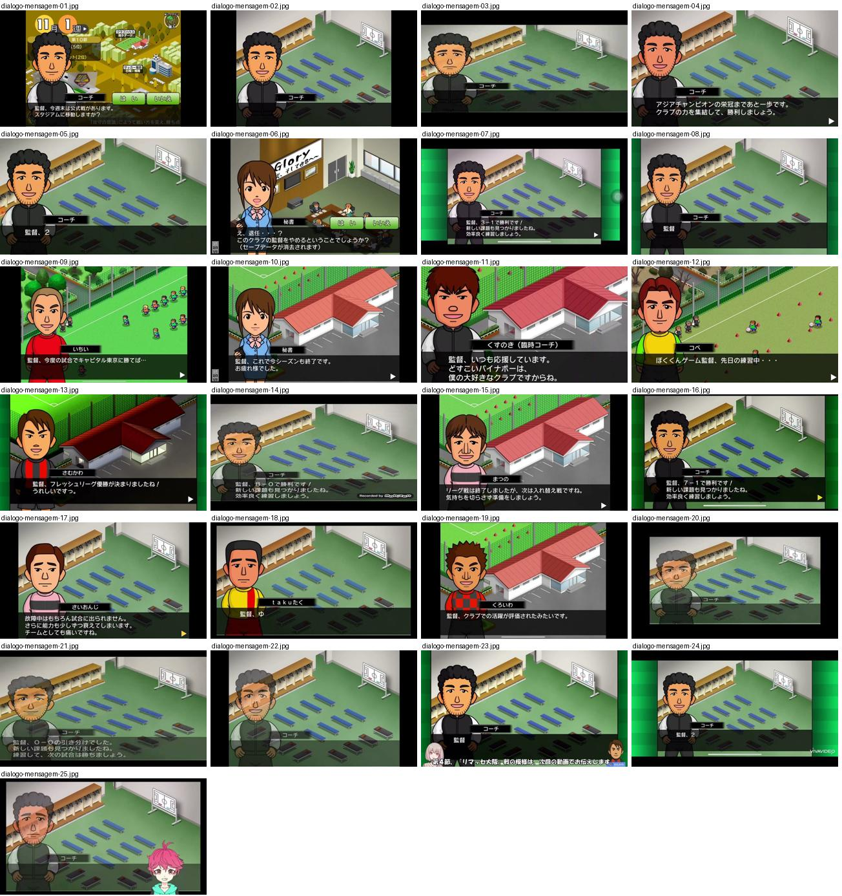

## dialogo-mensagem-01.jpg

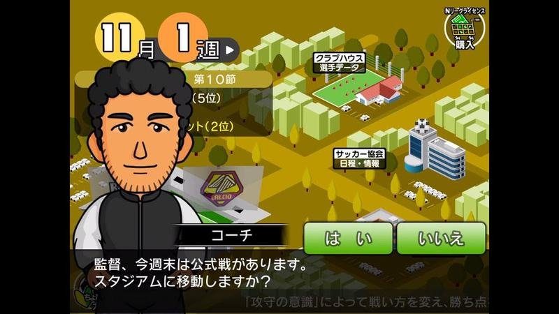

Ecrã principal com mapa isométrico da cidade do clube (outono, tons dourados) e o adjunto em retrato grande a perguntar se vai para o estádio; caixa de diálogo preta em baixo com botões verdes «はい/いいえ». Data «11月 1週» em círculos laranja no canto superior esquerdo.

- Etiquetas: mapa-cidade, treinador-adjunto, caixa-dialogo, botoes-sim-nao, data-semana, isometrico
- Qualidade: boa
- Origem: [--YIWH-vpBg](https://www.youtube.com/watch?v=--YIWH-vpBg&t=157s) (25%, ~157 s), canal Jリーグファン

## dialogo-mensagem-02.jpg

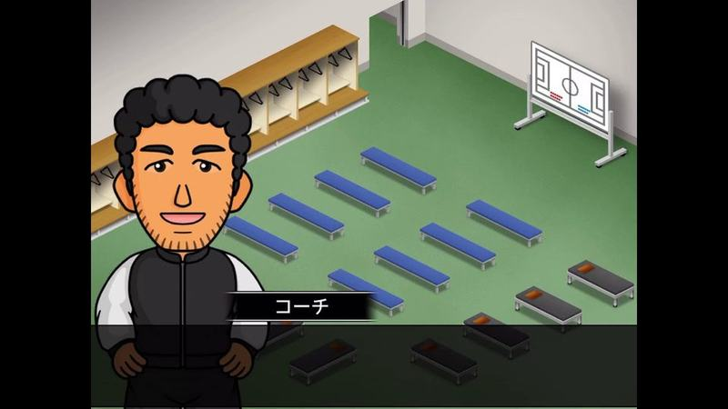

Balneário isométrico vazio (bancos azuis, cacifos de madeira, quadro tático) com o retrato do adjunto e etiqueta «コーチ». Bom exemplo de cena interior em perspetiva isométrica limpa.

- Etiquetas: balneario, treinador-adjunto, isometrico, quadro-tatico, bancos
- Qualidade: boa
- Origem: [--YIWH-vpBg](https://www.youtube.com/watch?v=--YIWH-vpBg&t=472s) (75%, ~472 s), canal Jリーグファン

## dialogo-mensagem-03.jpg

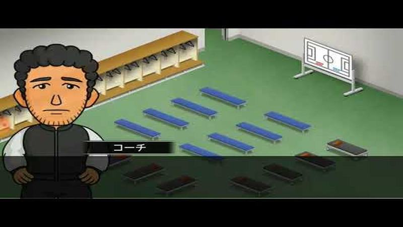

Balneário isométrico com o adjunto de expressão séria e etiqueta «コーチ», caixa de texto vazia.

- Etiquetas: balneario, treinador-adjunto, isometrico
- Qualidade: boa
- Origem: [-ioBSJjoAtg](https://www.youtube.com/watch?v=-ioBSJjoAtg&t=163s) (75%, ~163 s), canal ゆーげーむず

## dialogo-mensagem-04.jpg

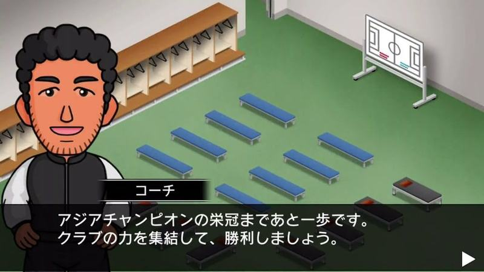

Adjunto no balneário antes do jogo a motivar para o título asiático; texto branco em caixa translúcida escura.

- Etiquetas: balneario, treinador-adjunto, caixa-dialogo, seta-avancar
- Qualidade: boa
- Origem: [0C2OgZnNvSI](https://www.youtube.com/watch?v=0C2OgZnNvSI&t=612s) (75%, ~612 s), canal NA

## dialogo-mensagem-05.jpg

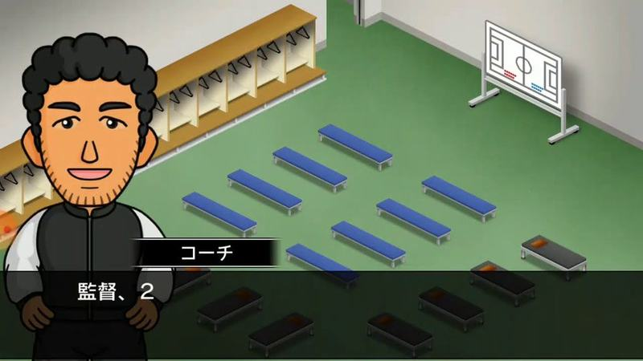

Adjunto sorridente no balneário a começar uma frase («監督、2»).

- Etiquetas: balneario, treinador-adjunto, caixa-dialogo
- Qualidade: boa
- Origem: [2cLbQlYmj1M](https://www.youtube.com/watch?v=2cLbQlYmj1M&t=151s) (75%, ~151 s), canal ゆーげーむず

## dialogo-mensagem-06.jpg

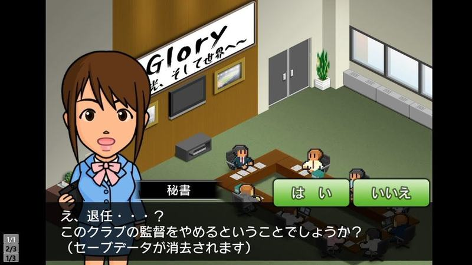

Secretária no escritório do clube a confirmar a demissão do treinador (apaga a gravação) com botões verdes «はい/いいえ».

- Etiquetas: secretaria, escritorio, isometrico, botoes-sim-nao, caixa-dialogo
- Qualidade: boa
- Origem: [AfaBwlMWrgE](https://www.youtube.com/watch?v=AfaBwlMWrgE) (capa), canal しゃり

## dialogo-mensagem-07.jpg

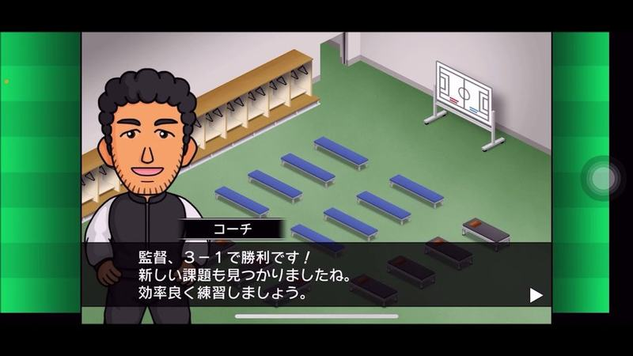

Balneário em vista isométrica com bancos azuis e quadro tático; o treinador-adjunto em retrato comenta a vitória por 3-1 numa caixa de texto escura em baixo.

- Etiquetas: balneario, treinador, caixa-texto, retrato, quadro-tatico
- Qualidade: boa
- Origem: [D1ELMuK5FIM](https://www.youtube.com/watch?v=D1ELMuK5FIM&t=813s) (75%, ~813 s), canal ゲーム動画で行こう! Playing Games.

## dialogo-mensagem-08.jpg

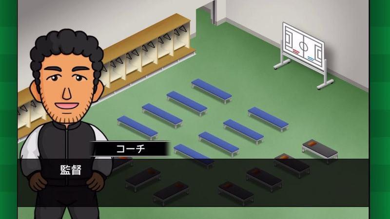

Balneário isométrico vazio com bancos azuis e quadro tático; adjunto em retrato à esquerda e caixa de texto ainda vazia.

- Etiquetas: balneario, treinador, caixa-texto, isometrico
- Qualidade: boa
- Origem: [FAej4GXXc-g](https://www.youtube.com/watch?v=FAej4GXXc-g&t=527s) (50%, ~527 s), canal NA

## dialogo-mensagem-09.jpg

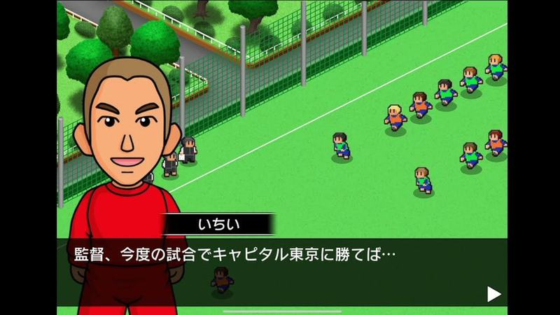

Jogador em retrato a falar com o mister sobre o próximo jogo, com o campo de treino visto de cima e jogadores a correr ao fundo.

- Etiquetas: jogador, retrato, campo-treino, caixa-texto
- Qualidade: boa
- Origem: [FOJYw8-TQ7I](https://www.youtube.com/watch?v=FOJYw8-TQ7I&t=432s) (75%, ~432 s), canal しゃり

## dialogo-mensagem-10.jpg

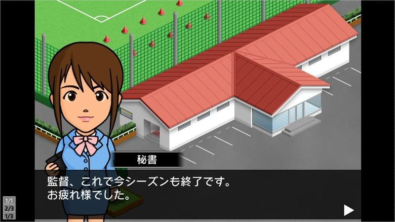

Secretária do clube em retrato à frente do edifício isométrico de telhado vermelho, a anunciar o fim da época; caixa de texto escura com seta de avançar.

- Etiquetas: secretaria, retrato, edificio, caixa-texto, fim-epoca
- Qualidade: boa
- Origem: [HiNIxKn0wx8](https://www.youtube.com/watch?v=HiNIxKn0wx8) (capa), canal しゃり

## dialogo-mensagem-11.jpg

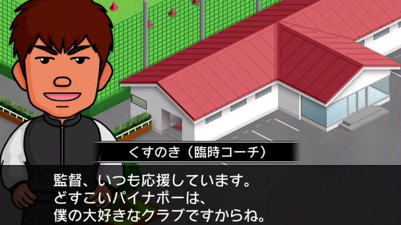

Treinador interino em retrato à frente do edifício do clube, com nome e cargo numa etiqueta escura e caixa de texto em baixo.

- Etiquetas: treinador-interino, retrato, edificio, caixa-texto
- Qualidade: boa
- Origem: [Iyaub2qAeGU](https://www.youtube.com/watch?v=Iyaub2qAeGU&t=446s) (50%, ~446 s), canal ぼくくんゲーム

## dialogo-mensagem-12.jpg

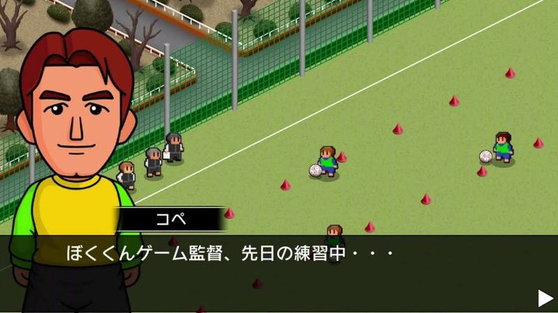

Jogador em retrato a falar sobre o treino, com o campo de treino isométrico, cones vermelhos e jogadores a treinar ao fundo.

- Etiquetas: jogador, retrato, campo-treino, cones, caixa-texto
- Qualidade: boa
- Origem: [Iyaub2qAeGU](https://www.youtube.com/watch?v=Iyaub2qAeGU&t=669s) (75%, ~669 s), canal ぼくくんゲーム

## dialogo-mensagem-13.jpg

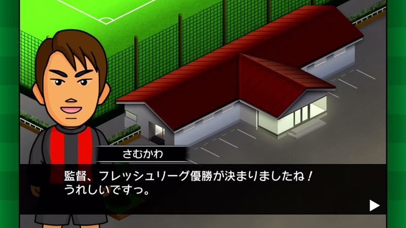

Jogador em retrato à frente do edifício do clube ao anoitecer, a festejar o título da liga numa caixa de texto escura.

- Etiquetas: jogador, retrato, edificio, noite, caixa-texto, titulo-liga
- Qualidade: boa
- Origem: [N57VLnEmGeY](https://www.youtube.com/watch?v=N57VLnEmGeY&t=200s) (25%, ~200 s), canal のうきん(Nokin)

## dialogo-mensagem-14.jpg

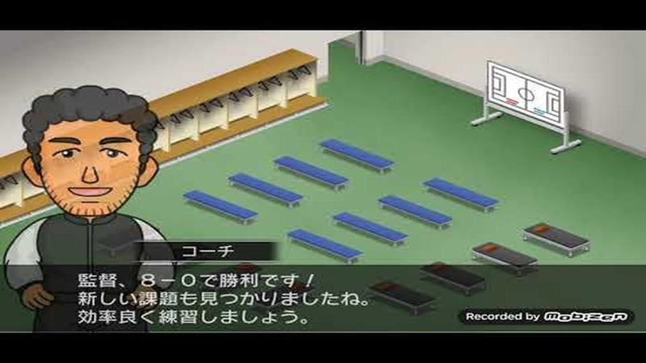

Balneário isométrico, o adjunto anuncia a vitória por 8-0 e sugere treinar; caixa de texto escura translúcida.

- Etiquetas: balneario, treinador, caixa-texto, pos-jogo
- Qualidade: boa
- Origem: [PiWp6WVzqQA](https://www.youtube.com/watch?v=PiWp6WVzqQA&t=590s) (75%, ~590 s), canal エビゼト.

## dialogo-mensagem-15.jpg

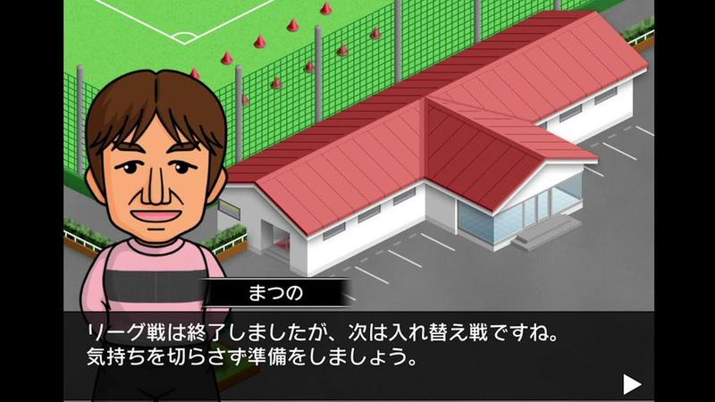

Jogador em retrato à frente do edifício do clube a avisar que vem o play-off de subida/descida; caixa de texto escura com seta.

- Etiquetas: jogador, retrato, edificio, caixa-texto, fim-liga
- Qualidade: boa
- Origem: [SCT6_NOvJDk](https://www.youtube.com/watch?v=SCT6_NOvJDk&t=381s) (75%, ~381 s), canal しゃり

## dialogo-mensagem-16.jpg

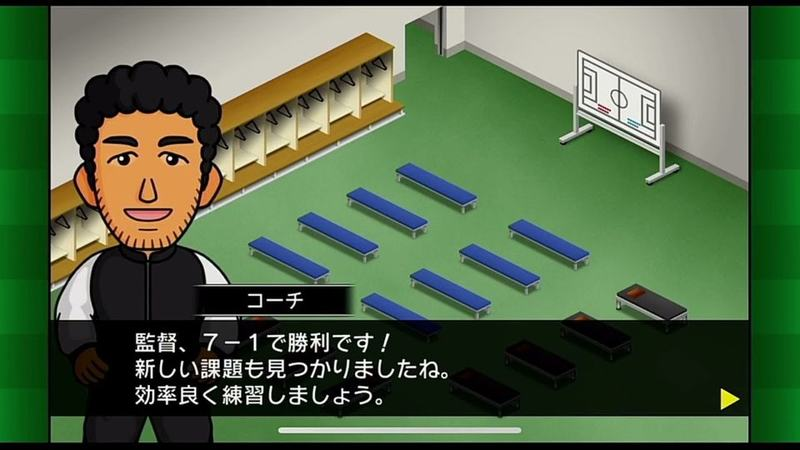

Balneário isométrico, o adjunto anuncia a vitória por 7-1 e sugere treinar; seta amarela de avançar na caixa de texto.

- Etiquetas: balneario, treinador, caixa-texto, pos-jogo
- Qualidade: boa
- Origem: [TKL9d779b7k](https://www.youtube.com/watch?v=TKL9d779b7k&t=275s) (50%, ~275 s), canal けんじのゲーム日記

## dialogo-mensagem-17.jpg

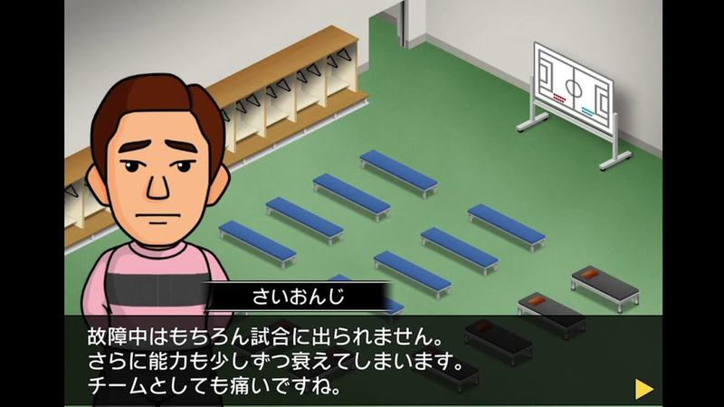

Jogador no balneário a explicar que está lesionado e vai perder capacidades, numa caixa de diálogo com o nome por cima.

- Etiquetas: lesao, jogador, dialogo, balneario, isometrico
- Qualidade: boa
- Origem: [mtaI7yx9UXk](https://www.youtube.com/watch?v=mtaI7yx9UXk&t=117s) (25%, ~117 s), canal NA

## dialogo-mensagem-18.jpg

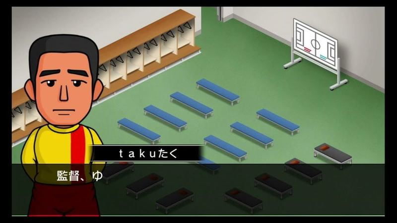

Jogador em primeiro plano no balneário isométrico, a começar a falar numa caixa de diálogo com o nome por cima.

- Etiquetas: jogador, dialogo, balneario, isometrico
- Qualidade: boa
- Origem: [sqz0eYHzxJM](https://www.youtube.com/watch?v=sqz0eYHzxJM&t=642s) (75%, ~642 s), canal ぼくくんゲーム

## dialogo-mensagem-19.jpg

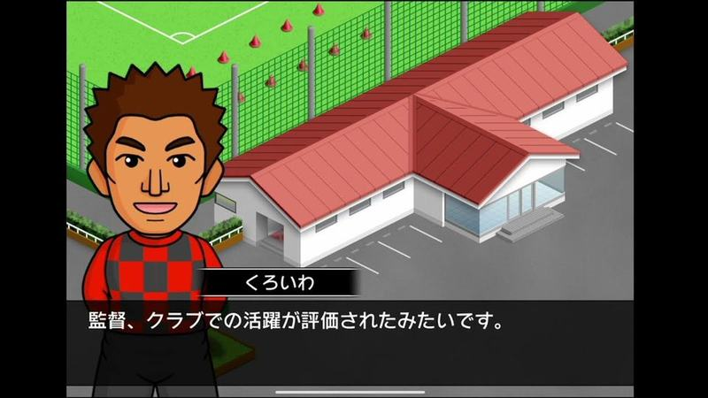

Jogador diante do edifício isométrico a avisar que foi chamado pela qualidade no clube; caixa de diálogo escura.

- Etiquetas: jogador, dialogo, edificio, isometrico, selecao
- Qualidade: boa
- Origem: [vkD8fduA0ME](https://www.youtube.com/watch?v=vkD8fduA0ME&t=411s) (75%, ~411 s), canal しゃり

## dialogo-mensagem-20.jpg

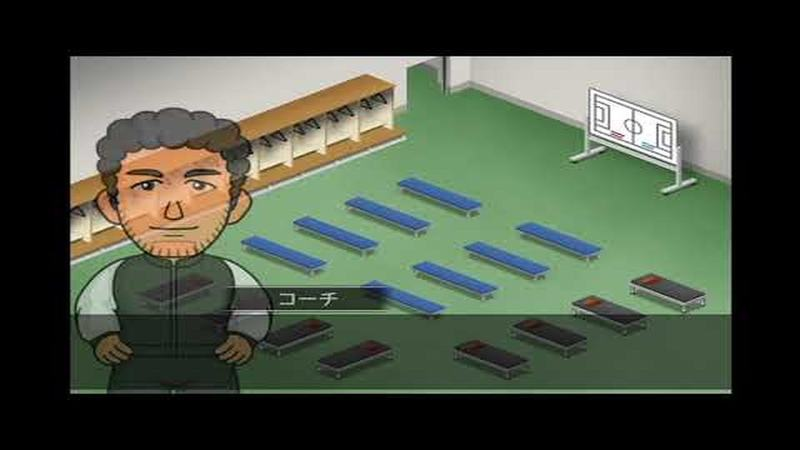

Balneário escurecido com o adjunto em tons apagados, como transição.

- Etiquetas: balneario, treinador-adjunto, escurecido
- Qualidade: ok
- Origem: [7a1xcp4xAi8](https://www.youtube.com/watch?v=7a1xcp4xAi8&t=477s) (75%, ~477 s), canal しゃり

## dialogo-mensagem-21.jpg

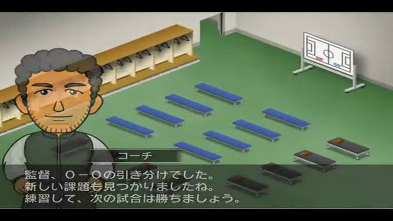

Balneário isométrico após empate 0-0, adjunto em retrato com caixa de texto translúcida em baixo; imagem a meio de esbatimento.

- Etiquetas: balneario, treinador, caixa-texto, pos-jogo
- Qualidade: ok
- Origem: [DKhDqBiMmng](https://www.youtube.com/watch?v=DKhDqBiMmng&t=339s) (75%, ~339 s), canal つばきち【Jリーグ系YouTuber】

## dialogo-mensagem-22.jpg

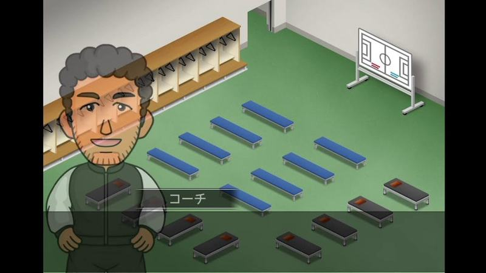

Balneário isométrico com o adjunto, apanhado a meio de um esbatimento para escuro.

- Etiquetas: balneario, treinador, caixa-texto, transicao
- Qualidade: ok
- Origem: [R1lwXH0fAp0](https://www.youtube.com/watch?v=R1lwXH0fAp0&t=391s) (75%, ~391 s), canal NA

## dialogo-mensagem-23.jpg

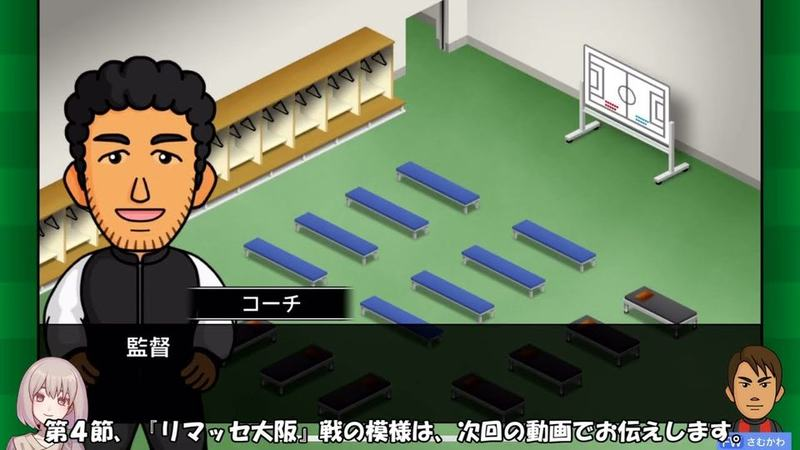

Balneário com adjunto e caixa «監督»; legenda e avatares do youtuber em baixo.

- Etiquetas: balneario, treinador-adjunto, avatar-youtuber, legenda
- Qualidade: ok · tem texto do youtuber por cima
- Origem: [1fCuZhbNzHc](https://www.youtube.com/watch?v=1fCuZhbNzHc&t=474s) (75%, ~474 s), canal NA

## dialogo-mensagem-24.jpg

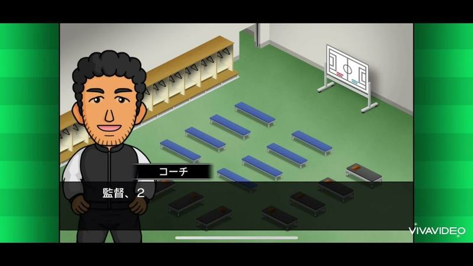

Adjunto no balneário a falar ao treinador.

- Etiquetas: balneario, treinador-adjunto
- Qualidade: ok · tem texto do youtuber por cima
- Origem: [3NYUIwSlklY](https://www.youtube.com/watch?v=3NYUIwSlklY&t=327s) (75%, ~327 s), canal misomiso

## dialogo-mensagem-25.jpg

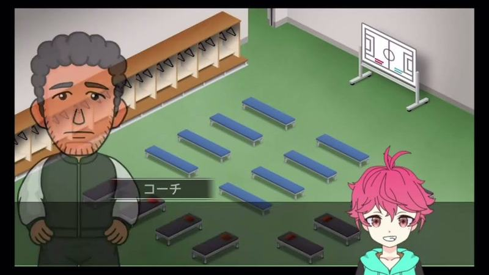

Transição em fundido entre hub e balneário com o adjunto; avatar do youtuber.

- Etiquetas: balneario, treinador-adjunto, transicao, avatar-youtuber
- Qualidade: ok · tem texto do youtuber por cima
- Origem: [CB8bYVHUjsM](https://www.youtube.com/watch?v=CB8bYVHUjsM&t=418s) (50%, ~418 s), canal こじりぬ
