# emblema-equipamento

Categoria: Menus e ecrãs de gestão. 10 imagens. A folha `_folha.jpg` mostra-as todas de uma vez.

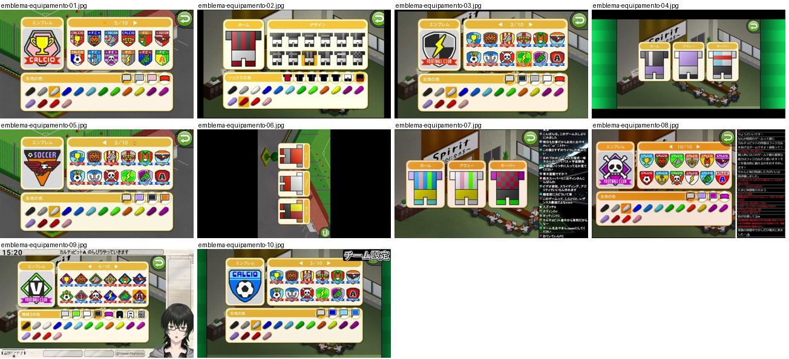

## emblema-equipamento-01.jpg

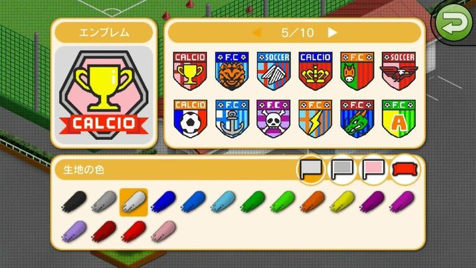

Editor de emblema com pré-visualização grande (taça com faixa CALCIO), grelha de 12 escudos com paginação 5/10 e paleta de cores em pinceladas; molduras laranja de cantos redondos.

- Etiquetas: emblemas, paleta-cores, paginacao, botao-voltar, taca
- Qualidade: boa
- Origem: [IlpszHPk2qc](https://www.youtube.com/watch?v=IlpszHPk2qc&t=453s) (50%, ~453 s), canal ぼくくんゲーム

## emblema-equipamento-02.jpg

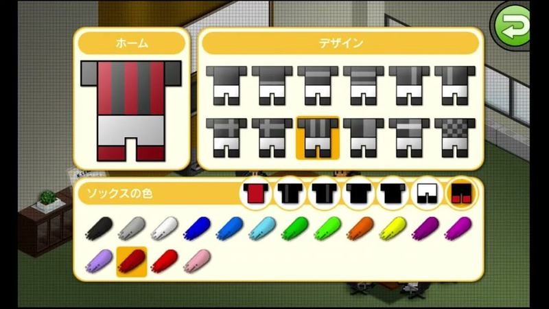

Editor de equipamento: pré-visualização da camisola às riscas vermelhas e pretas, grelha de 12 padrões em cinzento e paleta de cores das meias em pinceladas.

- Etiquetas: equipamentos, padroes, paleta-cores, botao-voltar
- Qualidade: boa
- Origem: [MwXhXDaIr88](https://www.youtube.com/watch?v=MwXhXDaIr88&t=1894s) (25%, ~1894 s), canal フラメンコ

## emblema-equipamento-03.jpg

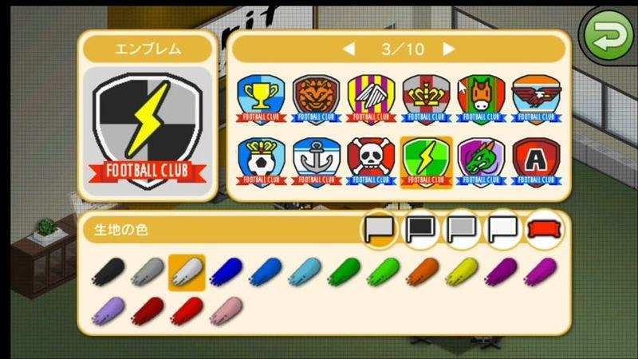

Editor de emblema: pré-visualização grande à esquerda, grelha de emblemas em 3/10 páginas e paleta de cores em pincéis em baixo; molduras creme com cantos arredondados.

- Etiquetas: emblemas, paleta-cores, grelha, paginas, botao-voltar
- Qualidade: boa
- Origem: [Z8y6PozfdiY](https://www.youtube.com/watch?v=Z8y6PozfdiY&t=209s) (25%, ~209 s), canal 【ゲーム】海苔巻ぷんちゃん

## emblema-equipamento-04.jpg

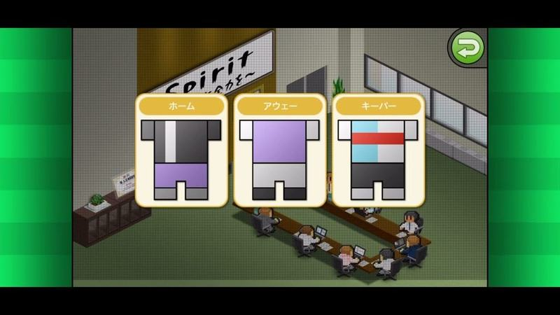

Escolha de equipamentos sobre o escritório isométrico: três cartões com camisola e calções (casa, fora, guarda-redes) com cabeçalho laranja.

- Etiquetas: equipamento, casa-fora-guarda-redes, cartoes, escritorio-isometrico, botao-voltar
- Qualidade: boa
- Origem: [uDUMcbci3wI](https://www.youtube.com/watch?v=uDUMcbci3wI&t=281s) (75%, ~281 s), canal よつや

## emblema-equipamento-05.jpg

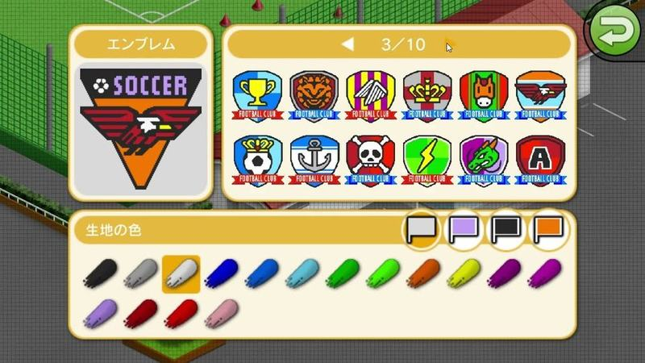

Editor de emblema: pré-visualização grande à esquerda, grelha de 12 emblemas com paginação (3/10) e paleta de cores do fundo em forma de pincéis. Ótima referência para emblemas originais.

- Etiquetas: emblemas, editor, paleta-cores, paginacao, botao-voltar
- Qualidade: boa
- Origem: [v58l_A9n9bk](https://www.youtube.com/watch?v=v58l_A9n9bk&t=120s) (50%, ~120 s), canal ゲームアディクト

## emblema-equipamento-06.jpg

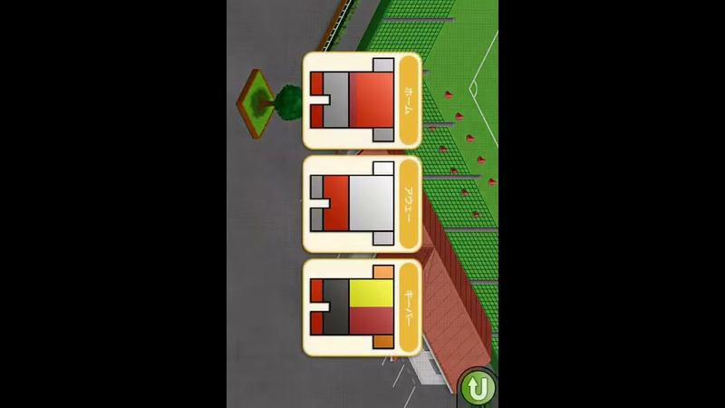

Escolha de equipamento gravada com o telemóvel na vertical (imagem rodada): três cartões com camisola e calções, casa, fora e alternativo.

- Etiquetas: equipamento, vertical, casa-fora-alternativo, cartoes
- Qualidade: ok
- Origem: [sL3WQTTf8Js](https://www.youtube.com/watch?v=sL3WQTTf8Js&t=99s) (25%, ~99 s), canal つばきち【Jリーグ系YouTuber】

## emblema-equipamento-07.jpg

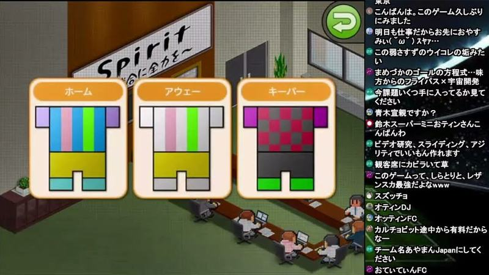

Escolha de equipamentos com três cartões de molduras laranja (casa, fora, guarda-redes) mostrando camisola e calções em padrões de riscas e xadrez sobre o escritório do clube.

- Etiquetas: equipamentos, casa-fora, guarda-redes, escritorio, botao-voltar, chat
- Qualidade: ok · tem texto do youtuber por cima
- Origem: [DzNR3DlbxeE](https://www.youtube.com/watch?v=DzNR3DlbxeE&t=8250s) (75%, ~8250 s), canal NA

## emblema-equipamento-08.jpg

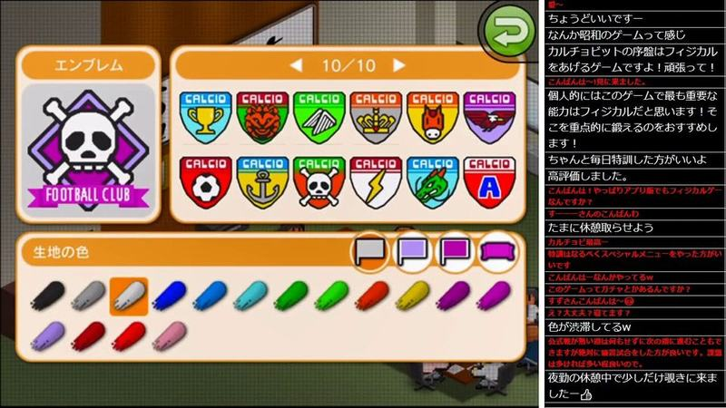

Editor de emblema: pré-visualização do emblema (caveira com faixa FOOTBALL CLUB) à esquerda, grelha de 12 formas de escudo com paginação 10/10 e paleta de cores em pinceladas por baixo; molduras laranja arredondadas.

- Etiquetas: emblemas, paleta-cores, paginacao, botao-voltar, chat
- Qualidade: ok · tem texto do youtuber por cima
- Origem: [HHa2CBK3ik4](https://www.youtube.com/watch?v=HHa2CBK3ik4&t=2210s) (50%, ~2210 s), canal NA

## emblema-equipamento-09.jpg

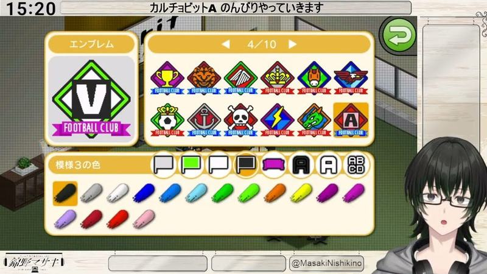

Editor de emblema (pré-visualização, grelha 4/10, paleta de cores do padrão) dentro da moldura do vtuber.

- Etiquetas: emblemas, paleta-cores, grelha, paginas, moldura-stream, personagem-youtuber
- Qualidade: ok · tem texto do youtuber por cima
- Origem: [h8lCOyO2uxY](https://www.youtube.com/watch?v=h8lCOyO2uxY&t=15653s) (75%, ~15653 s), canal 錦野マサキ

## emblema-equipamento-10.jpg

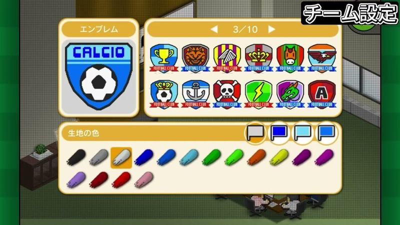

Editor de emblema com pré-visualização, grelha 3/10 e paleta de cores em pincéis; rótulo do youtuber no canto superior direito.

- Etiquetas: emblemas, paleta-cores, grelha, paginas, texto-youtuber
- Qualidade: ok · tem texto do youtuber por cima
- Origem: [i57lBOMUCDE](https://www.youtube.com/watch?v=i57lBOMUCDE&t=149s) (25%, ~149 s), canal なぐ
