# escritorio-clube

Categoria: Menus e ecrãs de gestão. 25 imagens. A folha `_folha.jpg` mostra-as todas de uma vez.

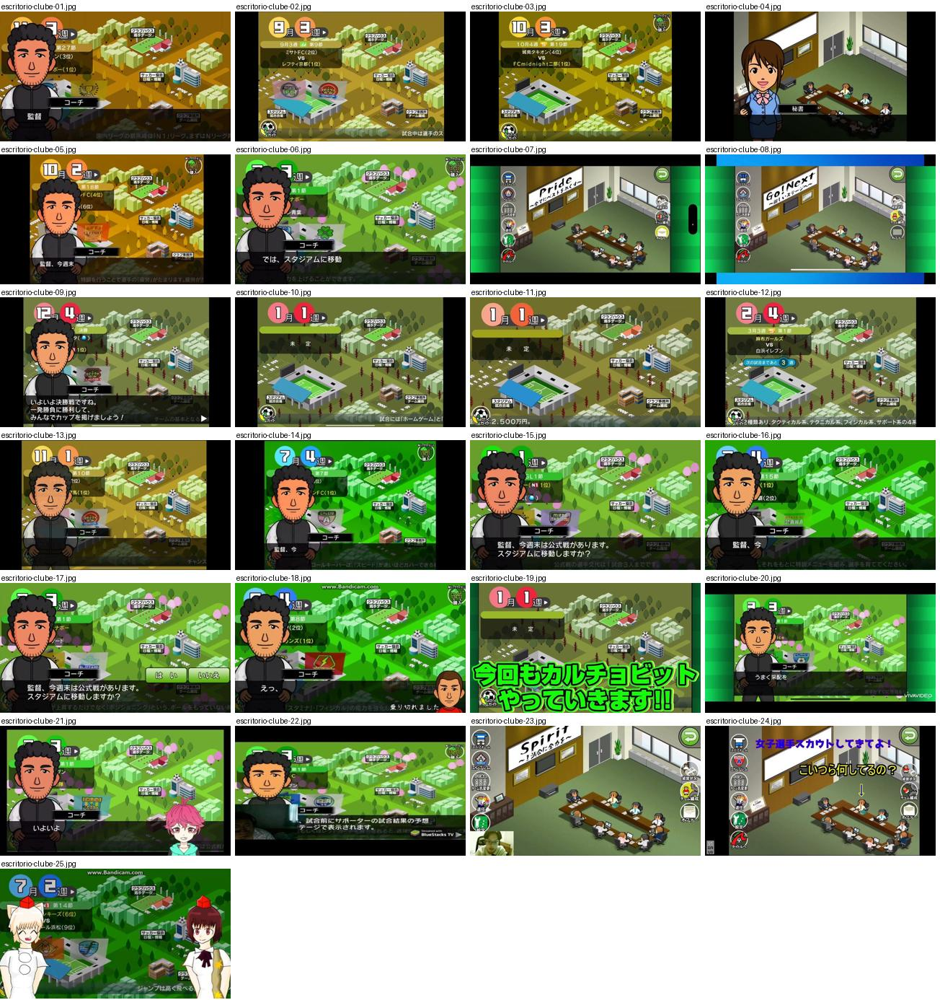

## escritorio-clube-01.jpg

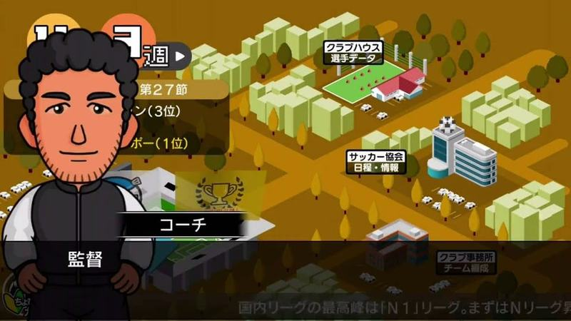

Hub isométrico outonal com adjunto a falar ao «監督», troféu dourado no mapa e painel de jornada e posições à esquerda.

- Etiquetas: mapa-cidade, isometrico, outono, treinador-adjunto, trofeu
- Qualidade: boa
- Origem: [0USJUmqAIDQ](https://www.youtube.com/watch?v=0USJUmqAIDQ&t=272s) (25%, ~272 s), canal ぼくくんゲーム

## escritorio-clube-02.jpg

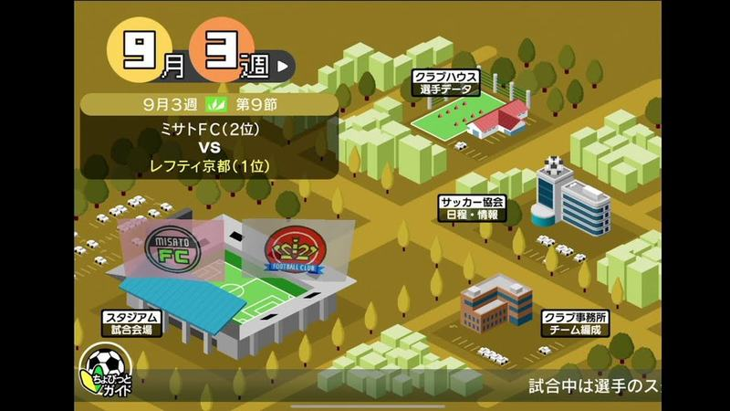

Hub isométrico outonal: data «9月 3週», painel do próximo jogo com posições, estádio com dois emblemas, clubhouse, associação e escritório; ícone de guia em baixo.

- Etiquetas: mapa-cidade, isometrico, outono, data-semana, proximo-jogo, estadio, emblemas
- Qualidade: boa
- Origem: [2NBCTNPjJlM](https://www.youtube.com/watch?v=2NBCTNPjJlM&t=168s) (25%, ~168 s), canal しゃり

## escritorio-clube-03.jpg

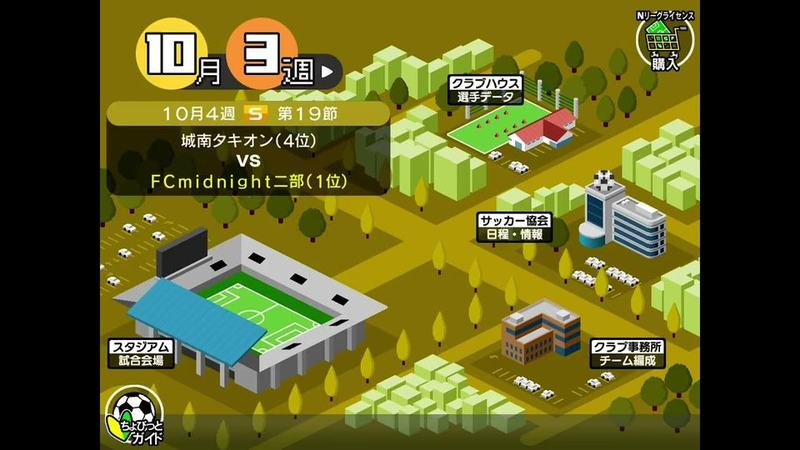

Hub outonal com data «10月 3週», painel de próximo jogo com posições e estádio azul isométrico no mapa.

- Etiquetas: mapa-cidade, isometrico, outono, data-semana, proximo-jogo, estadio
- Qualidade: boa
- Origem: [4NhscqLQl5U](https://www.youtube.com/watch?v=4NhscqLQl5U&t=46s) (50%, ~46 s), canal s

## escritorio-clube-04.jpg

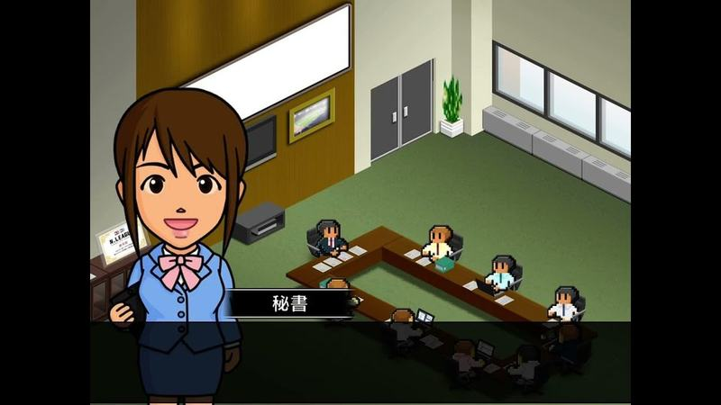

Escritório do clube em isométrico com mesa de reuniões e funcionários, secretária em retrato com etiqueta «秘書».

- Etiquetas: secretaria, escritorio, isometrico, mesa-reunioes
- Qualidade: boa
- Origem: [74Txl47iI4s](https://www.youtube.com/watch?v=74Txl47iI4s&t=52s) (75%, ~52 s), canal ボブサップ

## escritorio-clube-05.jpg

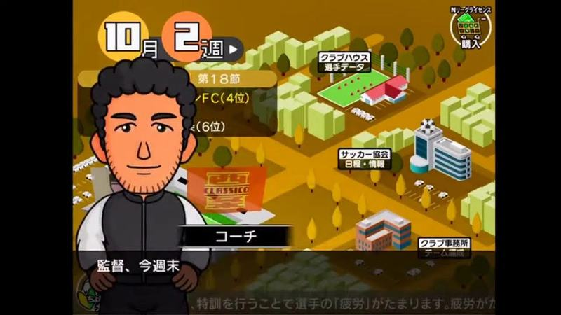

Hub outonal com data «10月 2週» e adjunto a anunciar o jogo; linha de dica em texto pequeno no rodapé.

- Etiquetas: mapa-cidade, isometrico, outono, treinador-adjunto, data-semana, dica
- Qualidade: boa
- Origem: [82ITuK9RU-I](https://www.youtube.com/watch?v=82ITuK9RU-I&t=640s) (25%, ~640 s), canal NA

## escritorio-clube-06.jpg

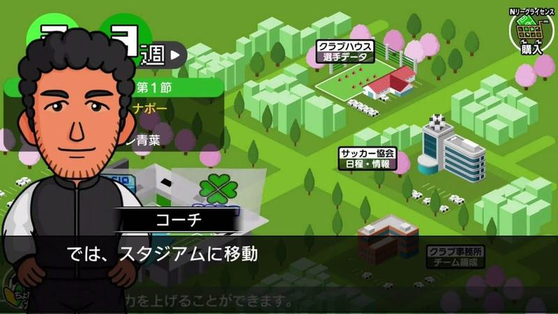

Hub da cidade na primavera com o adjunto a dizer «では、スタジアムに移動», trevo verde no mapa.

- Etiquetas: mapa-cidade, isometrico, primavera, treinador-adjunto, trevo
- Qualidade: boa
- Origem: [Ap9XgpNAvMQ](https://www.youtube.com/watch?v=Ap9XgpNAvMQ&t=604s) (50%, ~604 s), canal ぼくくんゲーム

## escritorio-clube-07.jpg

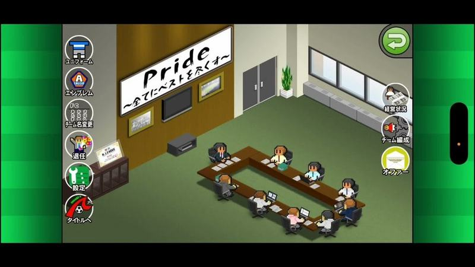

Escritório do clube em vista isométrica com mesa de reuniões e cartaz «Pride»; coluna de ícones redondos à esquerda e mais ícones à direita para os submenus.

- Etiquetas: escritorio, isometrico, icones-laterais, sala-reunioes, botao-voltar
- Qualidade: boa
- Origem: [FLGYcdqNFWo](https://www.youtube.com/watch?v=FLGYcdqNFWo&t=1652s) (50%, ~1652 s), canal NA

## escritorio-clube-08.jpg

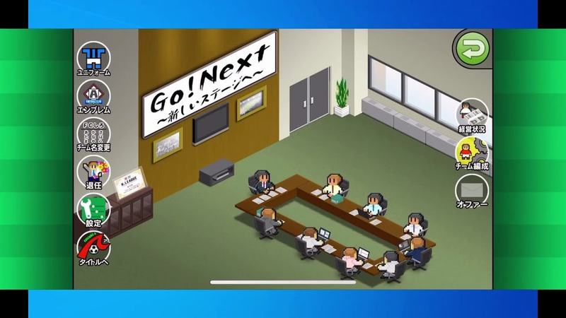

Escritório do clube isométrico com lema «Go! Next» na parede e coluna de botões redondos à esquerda (equipamento, emblema, nome, sair, definições, voltar ao título) e à direita (finanças, plantel, ofertas).

- Etiquetas: escritorio, isometrico, mesa-reunioes, botoes-laterais, lema-parede, botao-voltar
- Qualidade: boa
- Origem: [hj6xGzeQmqI](https://www.youtube.com/watch?v=hj6xGzeQmqI&t=480s) (50%, ~480 s), canal もーりー【MG部】

## escritorio-clube-09.jpg

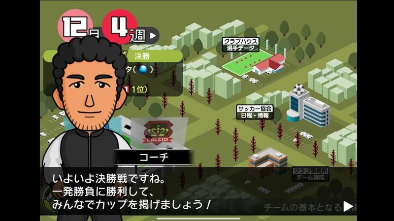

Hub com mapa isométrico da cidade (clubhouse, federação, estádio) com etiquetas, data em círculos vermelhos (mês/semana) e o treinador a falar numa caixa de diálogo em baixo.

- Etiquetas: cidade-isometrica, calendario, treinador, dialogo, edificios, semana
- Qualidade: boa
- Origem: [joGeiEoJvtI](https://www.youtube.com/watch?v=joGeiEoJvtI&t=180s) (25%, ~180 s), canal しゃり

## escritorio-clube-10.jpg

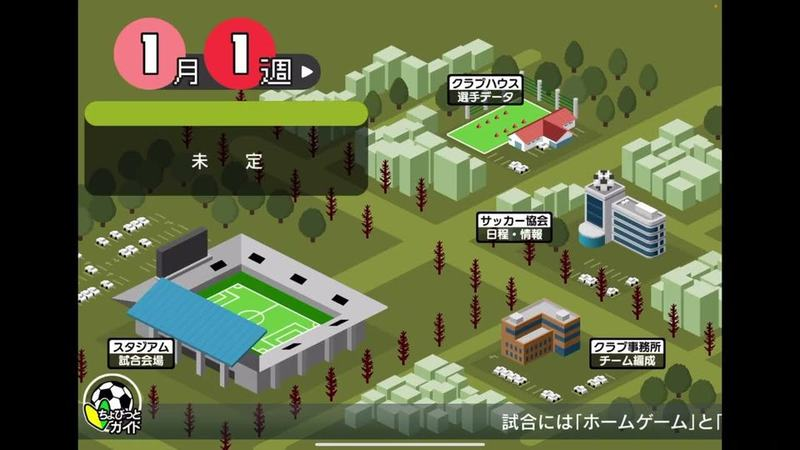

Hub isométrico no início do ano (1.º mês, 1.ª semana): estádio, clubhouse, federação e escritório do clube com etiquetas. Painel de agenda à esquerda e dica em baixo.

- Etiquetas: cidade-isometrica, calendario, estadio, edificios, semana, etiquetas-edificios
- Qualidade: boa
- Origem: [jxVR8MH_m4c](https://www.youtube.com/watch?v=jxVR8MH_m4c&t=471s) (75%, ~471 s), canal 𝒮𝒶𝒸𝒸𝒽𝒶𝓃

## escritorio-clube-11.jpg

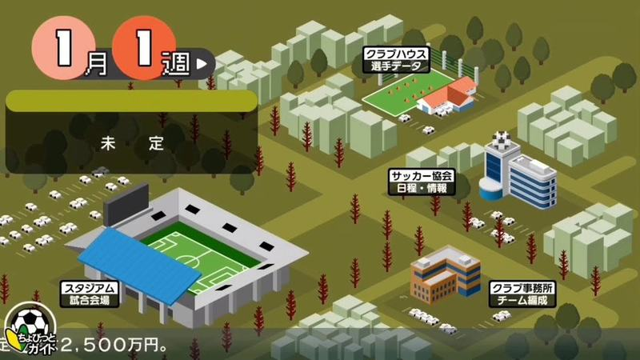

Hub isométrico no 1.º mês, 1.ª semana, com estádio, clubhouse, federação e escritório; saldo em dinheiro no canto inferior esquerdo e ícone de guia.

- Etiquetas: cidade-isometrica, calendario, estadio, dinheiro, edificios, semana
- Qualidade: boa
- Origem: [lpYMJMb7PPA](https://www.youtube.com/watch?v=lpYMJMb7PPA&t=72s) (25%, ~72 s), canal つばきち【Jリーグ系YouTuber】

## escritorio-clube-12.jpg

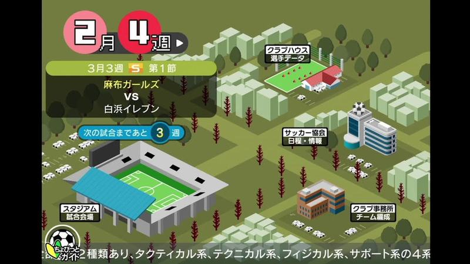

Hub isométrico com data (2.º mês, 4.ª semana) e painel do próximo jogo: jornada, adversários e contador de semanas até ao jogo; dica de guia em baixo.

- Etiquetas: cidade-isometrica, calendario, proximo-jogo, semanas-restantes, edificios
- Qualidade: boa
- Origem: [mtaI7yx9UXk](https://www.youtube.com/watch?v=mtaI7yx9UXk&t=235s) (50%, ~235 s), canal NA

## escritorio-clube-13.jpg

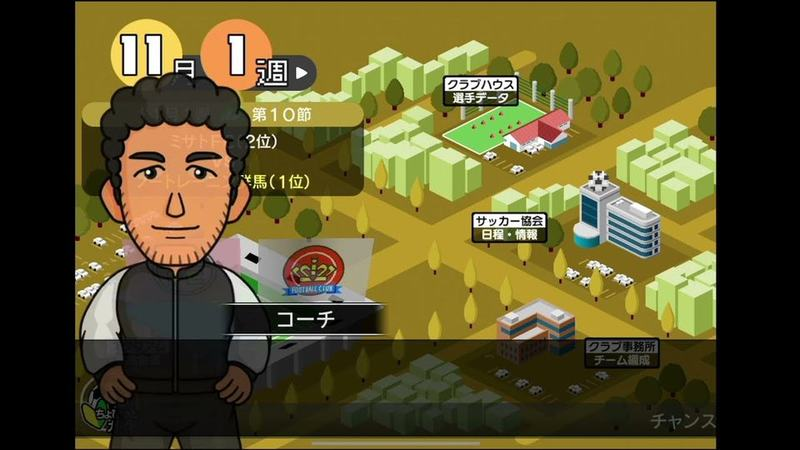

Hub isométrico em tons de outono (árvores amarelas), com o treinador em primeiro plano e o painel do próximo jogo atrás.

- Etiquetas: cidade-isometrica, calendario, treinador, outono, edificios
- Qualidade: boa
- Origem: [nGYb-1QUDIU](https://www.youtube.com/watch?v=nGYb-1QUDIU&t=159s) (25%, ~159 s), canal しゃり

## escritorio-clube-14.jpg

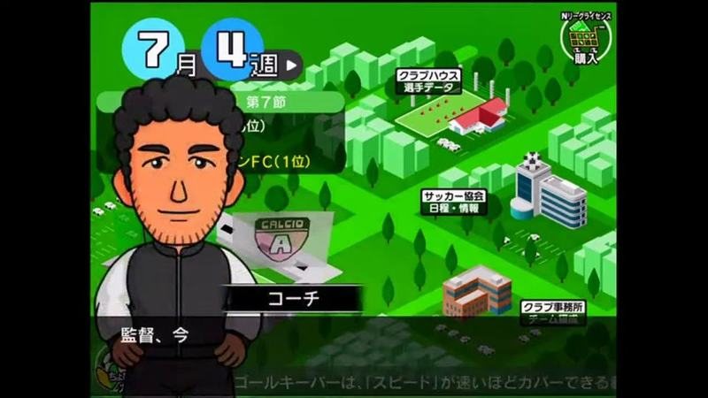

Hub isométrico (7.º mês, 4.ª semana) com o treinador em primeiro plano a falar e dica do guia em baixo.

- Etiquetas: cidade-isometrica, calendario, treinador, dialogo, edificios
- Qualidade: boa
- Origem: [qYU_nKFSJ3I](https://www.youtube.com/watch?v=qYU_nKFSJ3I&t=2374s) (75%, ~2374 s), canal NA

## escritorio-clube-15.jpg

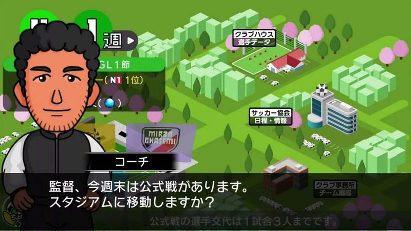

Hub isométrico na primavera (cerejeiras) com o treinador a perguntar se quer ir para o estádio para o jogo oficial; fluxo do hub para o pré-jogo.

- Etiquetas: cidade-isometrica, treinador, dialogo, proximo-jogo, cerejeiras
- Qualidade: boa
- Origem: [qc6uUNoEzXo](https://www.youtube.com/watch?v=qc6uUNoEzXo&t=193s) (25%, ~193 s), canal ぼくくんゲーム

## escritorio-clube-16.jpg

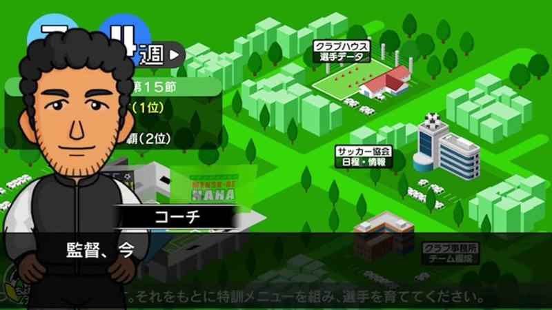

Hub isométrico com o treinador em primeiro plano a começar a falar e o painel do próximo jogo atrás.

- Etiquetas: cidade-isometrica, treinador, dialogo, proximo-jogo, edificios
- Qualidade: boa
- Origem: [xarBwiROByo](https://www.youtube.com/watch?v=xarBwiROByo&t=164s) (25%, ~164 s), canal つばきち【Jリーグ系YouTuber】

## escritorio-clube-17.jpg

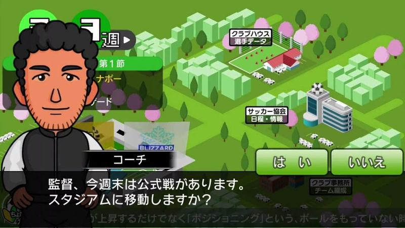

Hub isométrico com o treinador a perguntar se quer ir para o estádio para o jogo oficial e dois botões verdes «sim» e «não» sobre a caixa de diálogo.

- Etiquetas: cidade-isometrica, treinador, dialogo, sim-nao, proximo-jogo
- Qualidade: boa
- Origem: [zbuzyZBhp_c](https://www.youtube.com/watch?v=zbuzyZBhp_c&t=367s) (25%, ~367 s), canal ぼくくんゲーム

## escritorio-clube-18.jpg

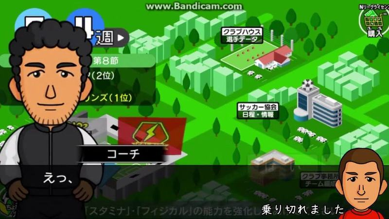

Hub da cidade isométrica verde (clubhouse, associação de futebol, prédios) com o adjunto a falar e retrato pequeno de um jogador no canto. Marca de água Bandicam no topo.

- Etiquetas: mapa-cidade, isometrico, treinador-adjunto, data-semana, caixa-dialogo, bandicam
- Qualidade: ok · tem texto do youtuber por cima
- Origem: [-ap3f0EASSE](https://www.youtube.com/watch?v=-ap3f0EASSE&t=127s) (25%, ~127 s), canal こやざる

## escritorio-clube-19.jpg

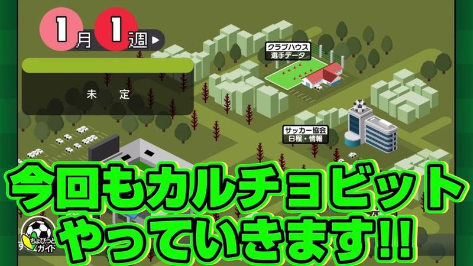

Hub da cidade isométrica com data «1月 1週» e painel de próximo jogo «未定»; texto verde grande do youtuber em baixo.

- Etiquetas: mapa-cidade, isometrico, data-semana, texto-youtuber
- Qualidade: ok · tem texto do youtuber por cima
- Origem: [0LZjCg4Uo3M](https://www.youtube.com/watch?v=0LZjCg4Uo3M&t=80s) (25%, ~80 s), canal つばきち【Jリーグ系YouTuber】

## escritorio-clube-20.jpg

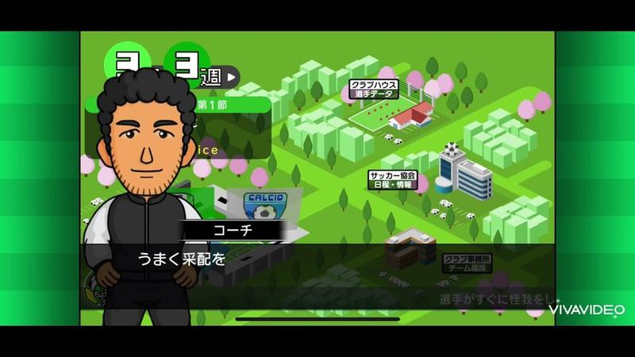

Hub da cidade na primavera com cerejeiras cor-de-rosa e o adjunto a falar; marca de água VivaVideo.

- Etiquetas: mapa-cidade, isometrico, primavera, cerejeiras, treinador-adjunto, data-semana
- Qualidade: ok · tem texto do youtuber por cima
- Origem: [3NYUIwSlklY](https://www.youtube.com/watch?v=3NYUIwSlklY&t=109s) (25%, ~109 s), canal misomiso

## escritorio-clube-21.jpg

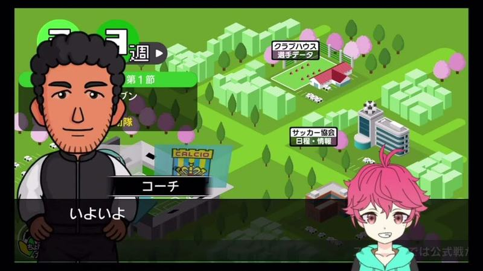

Hub da cidade na primavera com o adjunto; avatar do youtuber no canto.

- Etiquetas: mapa-cidade, isometrico, primavera, treinador-adjunto, avatar-youtuber
- Qualidade: ok · tem texto do youtuber por cima
- Origem: [CB8bYVHUjsM](https://www.youtube.com/watch?v=CB8bYVHUjsM&t=209s) (25%, ~209 s), canal こじりぬ

## escritorio-clube-22.jpg

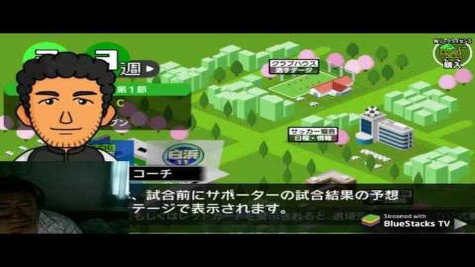

Hub da cidade com o adjunto a explicar a previsão dos adeptos antes do jogo; webcam por cima.

- Etiquetas: mapa-cidade, isometrico, treinador-adjunto, dica, webcam
- Qualidade: ok · tem texto do youtuber por cima
- Origem: [CbFU3oY9Al0](https://www.youtube.com/watch?v=CbFU3oY9Al0) (capa), canal YS Studio 製作

## escritorio-clube-23.jpg

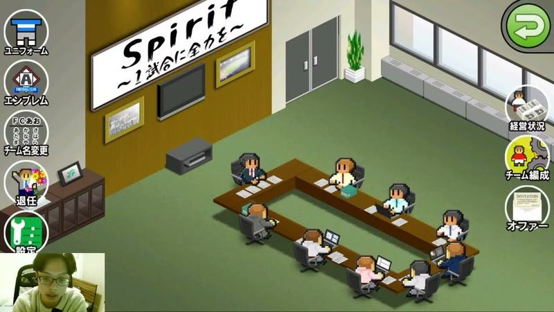

Escritório do clube isométrico (mesa de reuniões, lema na parede, televisão) com coluna de botões redondos à esquerda (ユニフォーム, エンブレム, チーム名変更, 退任, 設定) e à direita (経営状況, チーム編成, オファー) e botão verde de voltar; webcam no canto.

- Etiquetas: escritorio, isometrico, mesa-reunioes, botoes-laterais, equipamento, emblema, nome-equipa, definicoes, ofertas, financas, webcam
- Qualidade: ok · tem texto do youtuber por cima
- Origem: [hTnqRuNb0dE](https://www.youtube.com/watch?v=hTnqRuNb0dE&t=4813s) (50%, ~4813 s), canal ラ王しょーりんじ

## escritorio-clube-24.jpg

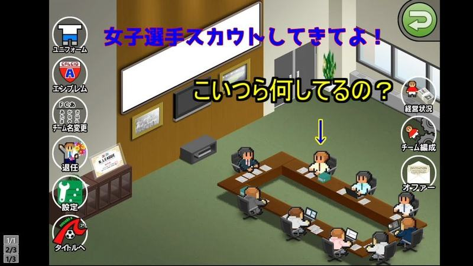

Escritório do clube isométrico com coluna de botões redondos à esquerda (equipamento, emblema, nome, retirar, definições, título) e à direita (finanças, plantel, ofertas); texto do youtuber por cima.

- Etiquetas: escritorio-isometrico, botoes-redondos, equipamento, emblema, definicoes, texto-grande
- Qualidade: ok · tem texto do youtuber por cima
- Origem: [mtaI7yx9UXk](https://www.youtube.com/watch?v=mtaI7yx9UXk) (capa), canal NA

## escritorio-clube-25.jpg

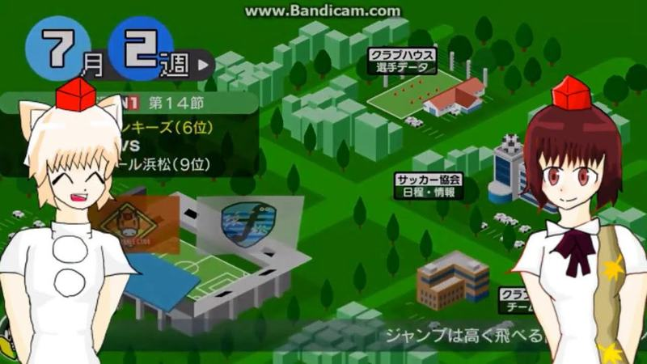

Hub isométrico (7.º mês, 2.ª semana) com painel do próximo jogo, tapado em parte por duas personagens do youtuber; marca de água de gravação no topo.

- Etiquetas: cidade-isometrica, calendario, proximo-jogo, personagem-youtuber, edificios
- Qualidade: ok · tem texto do youtuber por cima
- Origem: [qD1HSmfayo4](https://www.youtube.com/watch?v=qD1HSmfayo4&t=138s) (25%, ~138 s), canal こやざる
