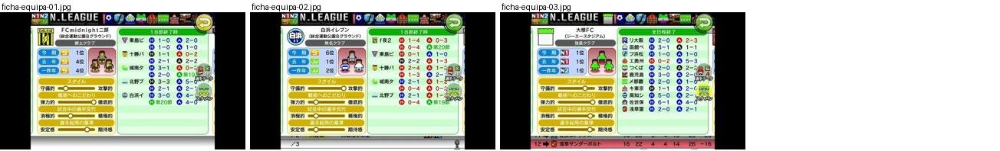
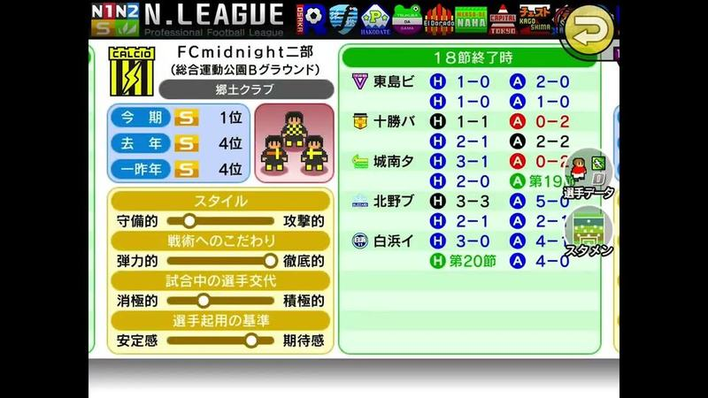
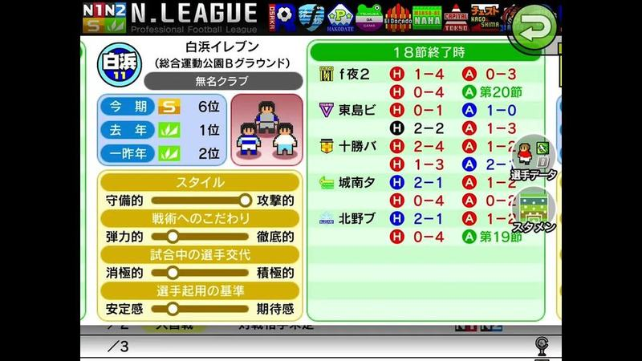
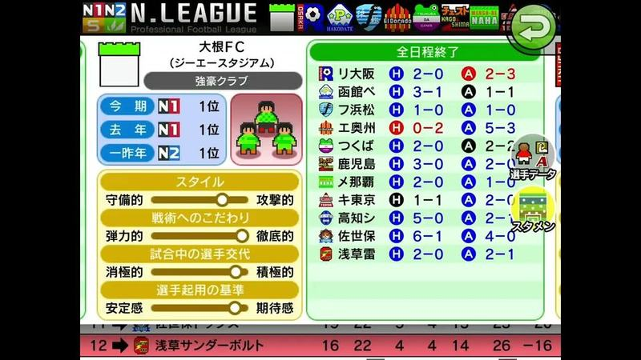

# ficha-equipa

Categoria: Menus e ecrãs de gestão. 3 imagens. A folha `_folha.jpg` mostra-as todas de uma vez.

## ficha-equipa-01.jpg

Ficha de um clube rival com barra «N.LEAGUE» de emblemas, posições nas últimas épocas, sliders de estilo (defensivo/ofensivo, substituições) e grelha de resultados H/A por equipa.

- Etiquetas: liga, emblemas, estilo-jogo, sliders, resultados, forma
- Qualidade: boa
- Origem: [4NhscqLQl5U](https://www.youtube.com/watch?v=4NhscqLQl5U&t=23s) (25%, ~23 s), canal s

## ficha-equipa-02.jpg

Ficha de clube rival «白浜イレブン»: emblema redondo, posições nas três últimas épocas, sliders de estilo em amarelo e grelha de resultados H/A em verde; botões de dados de jogadores e onze inicial à direita.

- Etiquetas: liga, emblemas, estilo-jogo, sliders, resultados, posicao-liga
- Qualidade: boa
- Origem: [4NhscqLQl5U](https://www.youtube.com/watch?v=4NhscqLQl5U&t=69s) (75%, ~69 s), canal s

## ficha-equipa-03.jpg

Ficha de clube rival «大根FC» com posições por época (N1/N2), sliders de estilo e grelha completa de resultados H/A; linha da classificação no rodapé.

- Etiquetas: liga, emblemas, estilo-jogo, sliders, resultados, classificacao
- Qualidade: boa
- Origem: [74Txl47iI4s](https://www.youtube.com/watch?v=74Txl47iI4s&t=17s) (25%, ~17 s), canal ボブサップ
