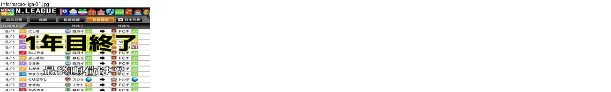
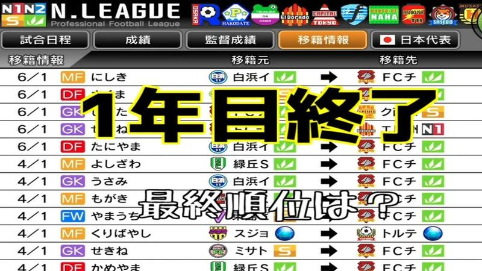

# informacao-liga

Categoria: Menus e ecrãs de gestão. 1 imagens. A folha `_folha.jpg` mostra-as todas de uma vez.

## informacao-liga-01.jpg

Ecrã de informação da liga com emblemas de todos os clubes no topo e separadores (calendário, resultados, registo do treinador, transferências, seleção); lista de transferências com setas entre clubes. Texto do youtuber por cima.

- Etiquetas: separadores, transferencias, emblemas, setas, texto-grande
- Qualidade: ok · tem texto do youtuber por cima
- Origem: [v3waQj1BvGw](https://www.youtube.com/watch?v=v3waQj1BvGw) (capa), canal しゃり
