# jogador-ficha

Categoria: Menus e ecrãs de gestão. 25 imagens. A folha `_folha.jpg` mostra-as todas de uma vez.

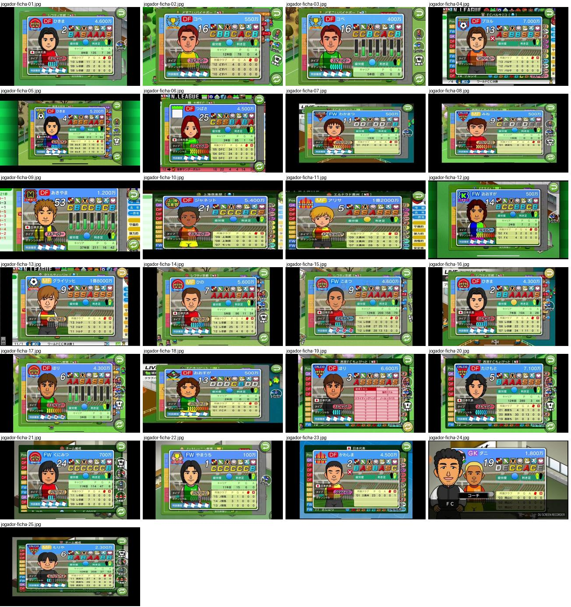

## jogador-ficha-01.jpg

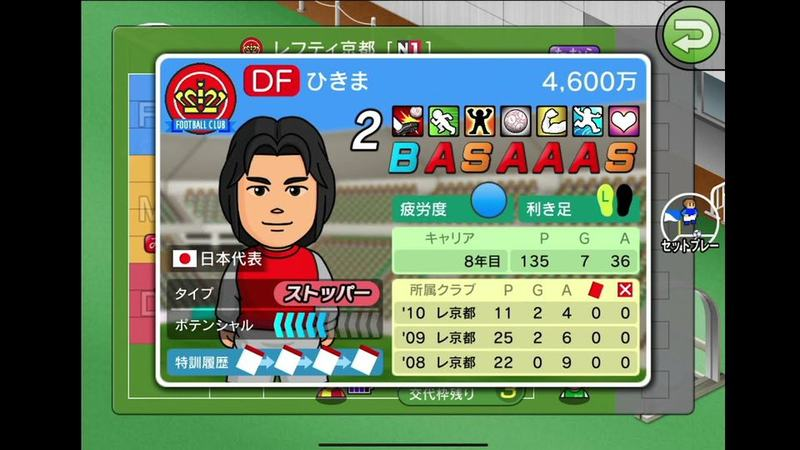

Ficha de jogador em cartão de moldura verde/azul: retrato, posição «DF» em etiqueta vermelha, valor «4,600万», fila de ícones de habilidades, notas por letra coloridas «BASAAAS», cansaço, pé preferido, carreira e tabela de clubes por época.

- Etiquetas: retrato, notas-letras, icones-habilidades, barra-cansaco, pe-preferido, historico, valor, posicao
- Qualidade: boa
- Origem: [-hBRMSKGUcM](https://www.youtube.com/watch?v=-hBRMSKGUcM&t=340s) (50%, ~340 s), canal しゃり

## jogador-ficha-02.jpg

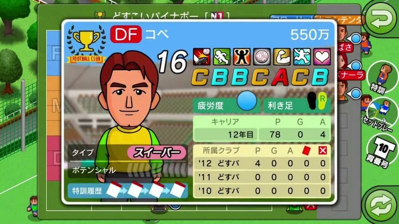

Ficha de jogador com fundo azul claro, posição DF, valor «550万», notas «CBBCACB», ícones de habilidades, carreira e clubes; botões de voltar e treino especial à direita.

- Etiquetas: retrato, notas-letras, icones-habilidades, barra-cansaco, historico, valor, posicao
- Qualidade: boa
- Origem: [0C2OgZnNvSI](https://www.youtube.com/watch?v=0C2OgZnNvSI&t=204s) (25%, ~204 s), canal NA

## jogador-ficha-03.jpg

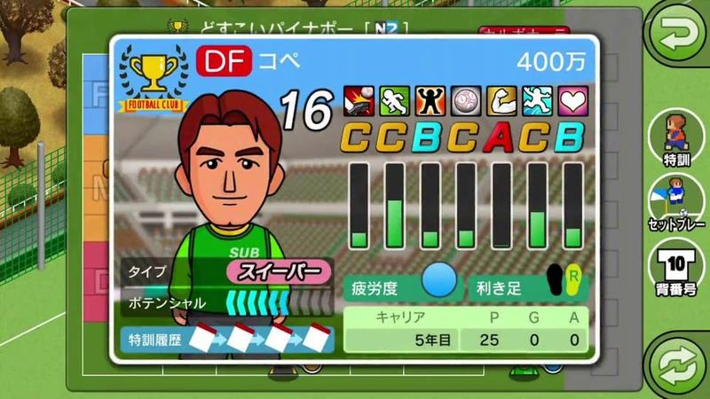

Ficha com barras verticais de atributos por baixo das letras de nota, barra de potencial e histórico de treinos; botões redondos à direita (treino, bola parada, número).

- Etiquetas: retrato, notas-letras, barras-atributos, potencial, valor, botoes-laterais
- Qualidade: boa
- Origem: [0USJUmqAIDQ](https://www.youtube.com/watch?v=0USJUmqAIDQ&t=818s) (75%, ~818 s), canal ぼくくんゲーム

## jogador-ficha-04.jpg

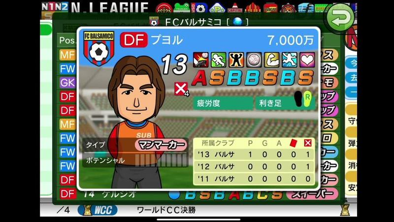

Ficha de jogador de um clube rival sobre a lista do plantel, com barra «N.LEAGUE» de emblemas no topo e marcador de lesão.

- Etiquetas: retrato, notas-letras, icones-habilidades, valor, lesao, liga, emblemas
- Qualidade: boa
- Origem: [15OL8-Bq7Cg](https://www.youtube.com/watch?v=15OL8-Bq7Cg&t=150s) (25%, ~150 s), canal NA

## jogador-ficha-05.jpg

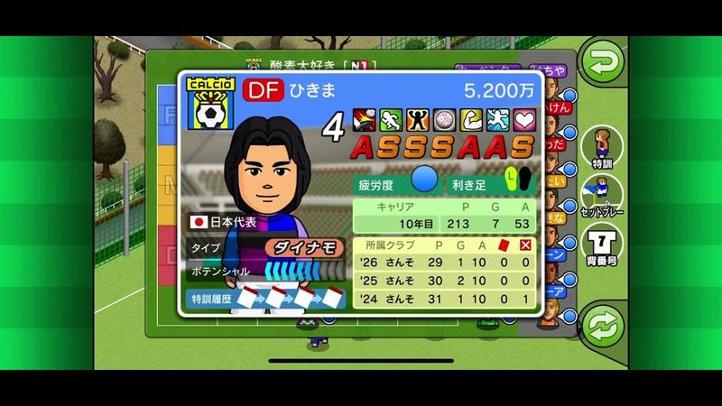

Ficha de jogador internacional (bandeira do Japão) com notas «ASSSAAS», carreira e clubes por época; botões redondos verdes à direita.

- Etiquetas: retrato, notas-letras, icones-habilidades, valor, seleccao, historico, botoes-laterais
- Qualidade: boa
- Origem: [2tN0FtTouhk](https://www.youtube.com/watch?v=2tN0FtTouhk&t=11s) (25%, ~11 s), canal ダンボール

## jogador-ficha-06.jpg

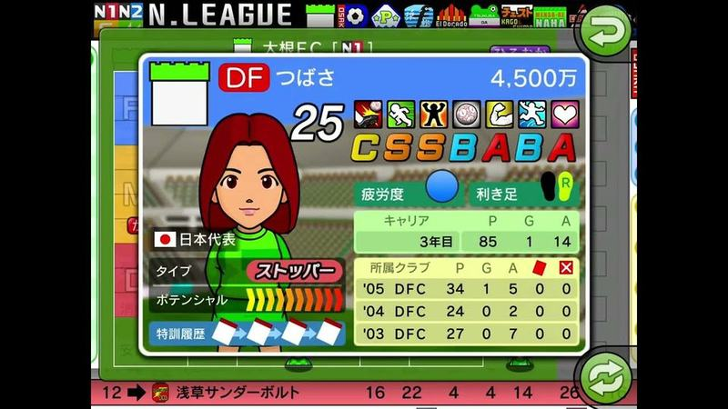

Ficha de jogadora DF de clube rival com retrato, notas «CSSBABA», seleção nacional, potencial em setas e histórico por época.

- Etiquetas: retrato, notas-letras, icones-habilidades, valor, seleccao, potencial, historico
- Qualidade: boa
- Origem: [74Txl47iI4s](https://www.youtube.com/watch?v=74Txl47iI4s&t=35s) (50%, ~35 s), canal ボブサップ

## jogador-ficha-07.jpg

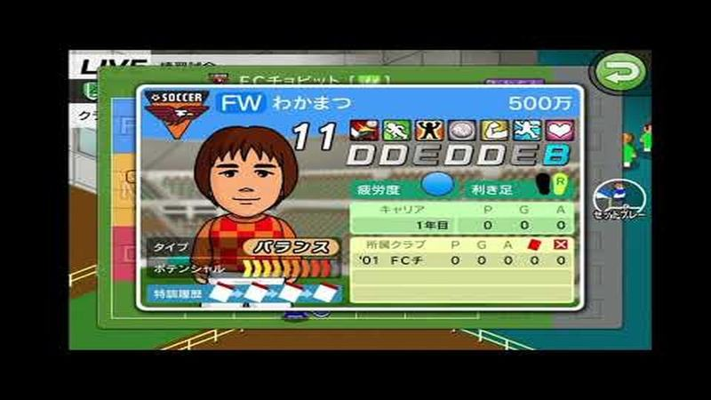

Ficha de jogador FW novo com notas «DDEDDEB», valor 500万 e histórico curto.

- Etiquetas: retrato, notas-letras, icones-habilidades, valor, potencial
- Qualidade: boa
- Origem: [AfaBwlMWrgE](https://www.youtube.com/watch?v=AfaBwlMWrgE&t=310s) (25%, ~310 s), canal しゃり

## jogador-ficha-08.jpg

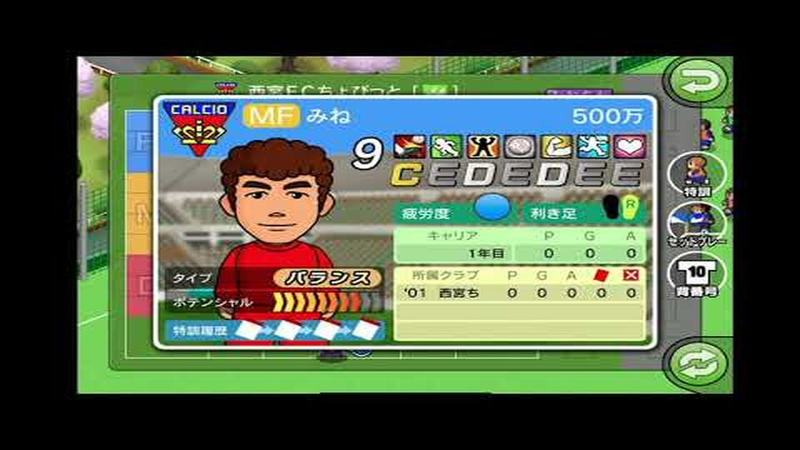

Ficha de jogador MF com notas «CEDEDEE» e botões redondos à direita (treino, bola parada, número).

- Etiquetas: retrato, notas-letras, icones-habilidades, valor, botoes-laterais
- Qualidade: boa
- Origem: [AfaBwlMWrgE](https://www.youtube.com/watch?v=AfaBwlMWrgE&t=621s) (50%, ~621 s), canal しゃり

## jogador-ficha-09.jpg

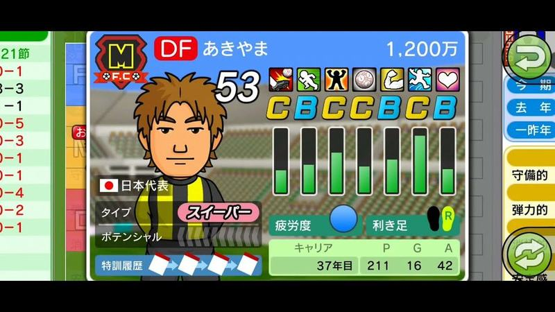

Ficha de defesa com notas em letras e barras verticais verdes por atributo, tipo «スイーパー», bandeira da seleção, cansaço, pé e estatísticas de carreira; moldura azul arredondada.

- Etiquetas: ficha, notas-letras, barras, retrato, bandeira, carreira, icones-habilidades
- Qualidade: boa
- Origem: [DID-HIF-aq4](https://www.youtube.com/watch?v=DID-HIF-aq4&t=16s) (50%, ~16 s), canal s

## jogador-ficha-10.jpg

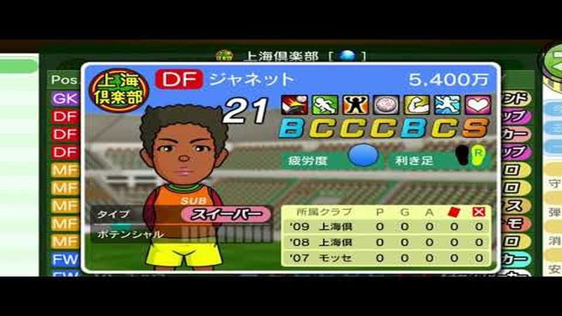

Ficha de defesa de outro clube com etiqueta SUB, tipo «スイーパー» e histórico de três épocas; mesma moldura azul.

- Etiquetas: ficha, notas-letras, outro-clube, emblemas, historico
- Qualidade: boa
- Origem: [G7g_Ue3pMxQ](https://www.youtube.com/watch?v=G7g_Ue3pMxQ&t=129s) (50%, ~129 s), canal wootan

## jogador-ficha-11.jpg

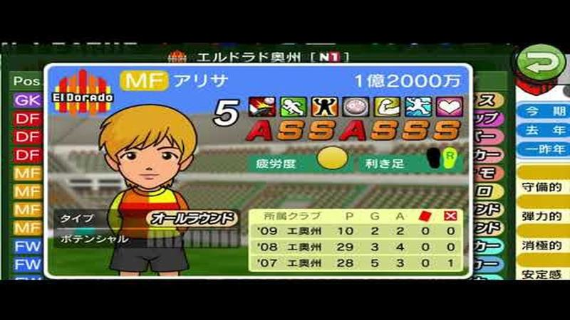

Ficha de médio de outro clube com notas A e S, preço de 1億2000万 e tipo «オールラウンド»; separadores de época à direita.

- Etiquetas: ficha, notas-letras, outro-clube, emblemas, historico, botao-voltar
- Qualidade: boa
- Origem: [G7g_Ue3pMxQ](https://www.youtube.com/watch?v=G7g_Ue3pMxQ&t=194s) (75%, ~194 s), canal wootan

## jogador-ficha-12.jpg

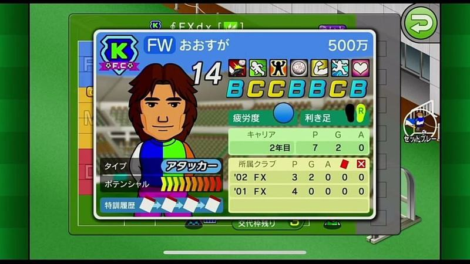

Ficha de avançado com preço, notas B/C, barra de potencial em degradé e histórico de treino; moldura azul sobre o ecrã da equipa.

- Etiquetas: ficha, notas-letras, potencial, carreira, historico, botao-voltar
- Qualidade: boa
- Origem: [TKL9d779b7k](https://www.youtube.com/watch?v=TKL9d779b7k&t=137s) (25%, ~137 s), canal けんじのゲーム日記

## jogador-ficha-13.jpg

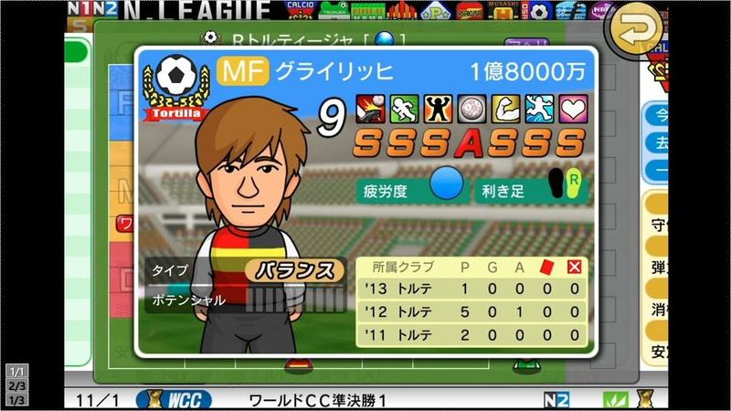

Ficha de jogador em janela com moldura verde: posição, nome, preço, número grande, ícones de atributos, notas SSSASSS em letras laranja, cansaço, pé, tipo e histórico por época; por trás vê-se o escritório com a faixa da liga.

- Etiquetas: ficha, notas-letras, emblemas, preco, estatisticas, tipo-jogador, cartas
- Qualidade: boa
- Origem: [V2-_Jn3VdAM](https://www.youtube.com/watch?v=V2-_Jn3VdAM) (capa), canal しゃり

## jogador-ficha-14.jpg

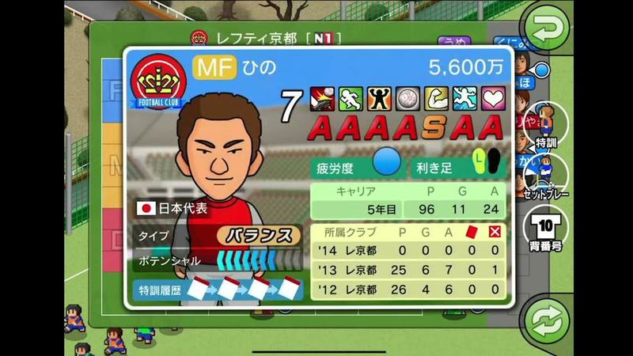

Ficha de jogador com emblema do clube, posição MF, preço, número, notas AAAASAA, carreira (anos, jogos, golos, assistências), selo da seleção do Japão, tipo, potencial e histórico de treinos especiais; botões laterais para trocar de jogador.

- Etiquetas: ficha, notas-letras, emblemas, preco, carreira, selecao, historico-treino, botoes-laterais
- Qualidade: boa
- Origem: [Y8W3itWOmO4](https://www.youtube.com/watch?v=Y8W3itWOmO4&t=116s) (25%, ~116 s), canal しゃり

## jogador-ficha-15.jpg

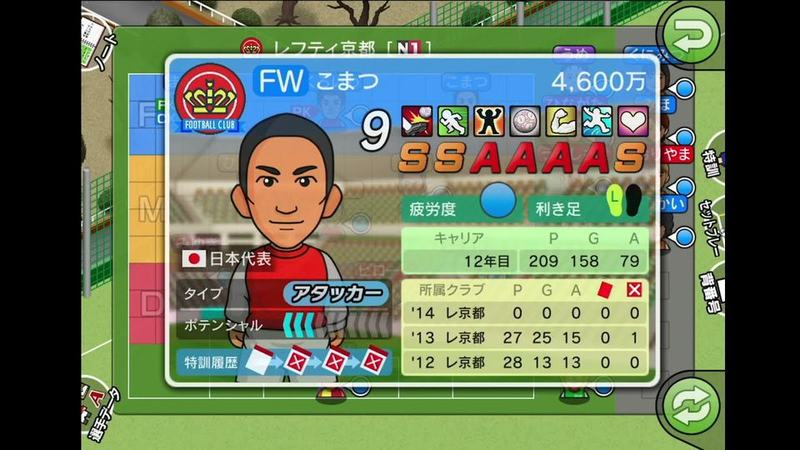

Mesmo ecrã de ficha com um avançado (FW, notas SSAAAAS); bom exemplo da hierarquia de informação.

- Etiquetas: ficha, notas-letras, emblemas, preco, carreira, selecao, historico-treino
- Qualidade: boa
- Origem: [Y8W3itWOmO4](https://www.youtube.com/watch?v=Y8W3itWOmO4&t=233s) (50%, ~233 s), canal しゃり

## jogador-ficha-16.jpg

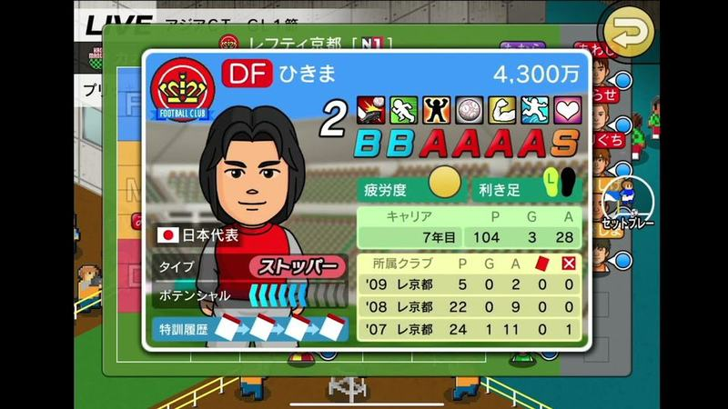

Ficha de defesa (DF, notas BBAAAAS) com emblema, carreira, selo da seleção e histórico; por trás, ecrã de pré-jogo com faixa «LIVE».

- Etiquetas: ficha, notas-letras, emblemas, preco, carreira, selecao, historico-treino, live
- Qualidade: boa
- Origem: [apgGHKg_r18](https://www.youtube.com/watch?v=apgGHKg_r18&t=115s) (25%, ~115 s), canal しゃり

## jogador-ficha-17.jpg

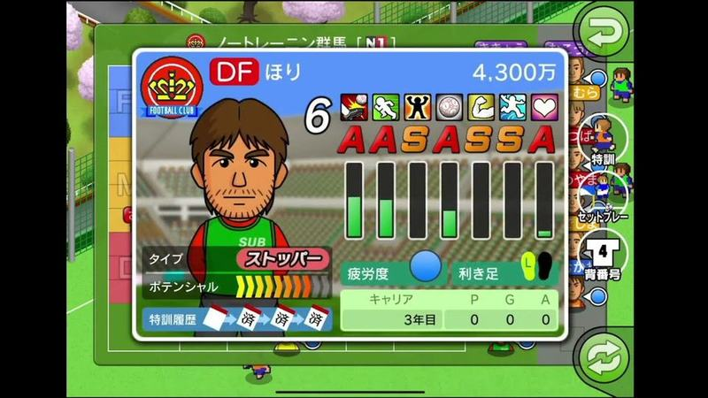

Ficha de jogador com sete barras verticais verdes por baixo das notas (progresso de cada atributo), tipo, potencial e histórico de treinos especiais.

- Etiquetas: ficha, notas-letras, barras-atributos, emblemas, preco, potencial, historico-treino
- Qualidade: boa
- Origem: [bnTTW7u1fgU](https://www.youtube.com/watch?v=bnTTW7u1fgU&t=157s) (25%, ~157 s), canal しゃり

## jogador-ficha-18.jpg

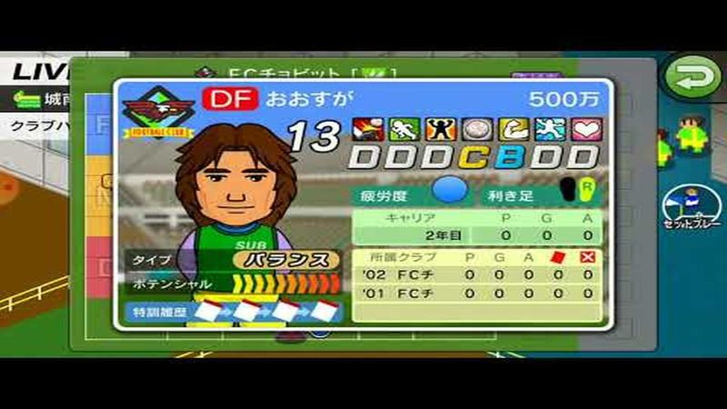

Ficha de um defesa jovem (DF, notas DDDCBDD) com barra de potencial em setas laranja; por trás, o ecrã de pré-jogo «LIVE».

- Etiquetas: ficha, notas-letras, emblemas, preco, carreira, potencial, historico-treino, live
- Qualidade: boa
- Origem: [e0LcJkdBRBo](https://www.youtube.com/watch?v=e0LcJkdBRBo&t=54s) (25%, ~54 s), canal ゆーげーむず

## jogador-ficha-19.jpg

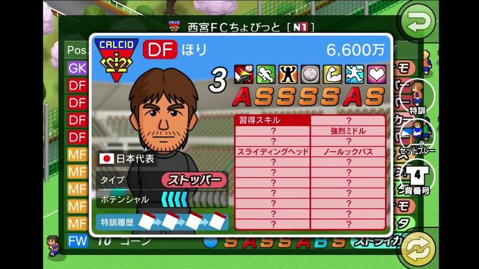

Ficha de jogador com o separador de habilidades aprendidas: grelha rosa de nomes com «?» por descobrir; lista do plantel por trás e botões laterais.

- Etiquetas: ficha, habilidades, lista-skills, notas-letras, emblemas, preco, selecao, botoes-laterais
- Qualidade: boa
- Origem: [fR9dKyYMxhs](https://www.youtube.com/watch?v=fR9dKyYMxhs&t=199s) (25%, ~199 s), canal しゃり

## jogador-ficha-20.jpg

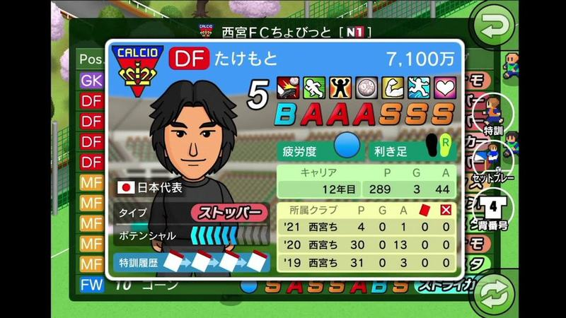

Ficha de defesa com notas BAAASSS, carreira e histórico por época; separadores de posição à esquerda.

- Etiquetas: ficha, notas-letras, emblemas, preco, carreira, selecao, historico-treino, botoes-laterais
- Qualidade: boa
- Origem: [fR9dKyYMxhs](https://www.youtube.com/watch?v=fR9dKyYMxhs&t=399s) (50%, ~399 s), canal しゃり

## jogador-ficha-21.jpg

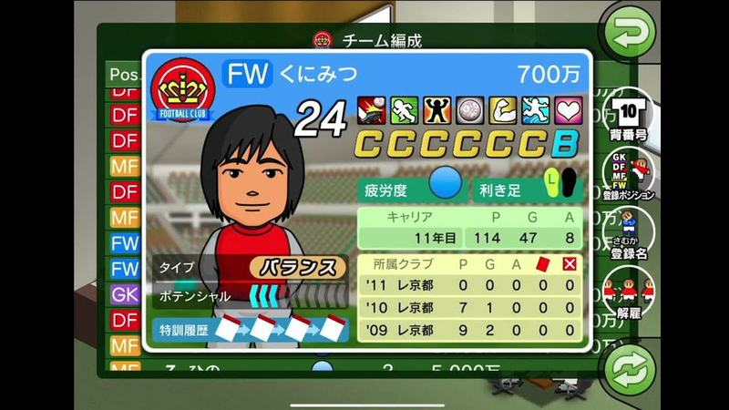

Ficha do jogador sobre a lista do plantel: retrato, número, notas em letras, indicador de cansaço, pé preferido e tabela da carreira por época. Coluna de botões à direita (número, posição, nome, despedir).

- Etiquetas: notas-letras, retrato, estatisticas-carreira, barra-cansaco, pe-preferido, lista, botao-voltar
- Qualidade: boa
- Origem: [jjwIGHWmDxM](https://www.youtube.com/watch?v=jjwIGHWmDxM&t=156s) (25%, ~156 s), canal NA

## jogador-ficha-22.jpg

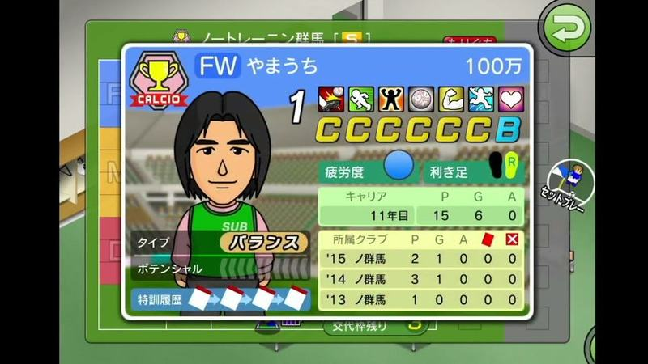

Ficha de jogador com moldura azul clara, retrato, notas CCCCCB, cansaço, pé preferido e carreira por época; botão de voltar verde no topo direito.

- Etiquetas: notas-letras, retrato, estatisticas-carreira, barra-cansaco, botao-voltar
- Qualidade: boa
- Origem: [kjKYsIUUbng](https://www.youtube.com/watch?v=kjKYsIUUbng&t=304s) (50%, ~304 s), canal しゃり

## jogador-ficha-23.jpg

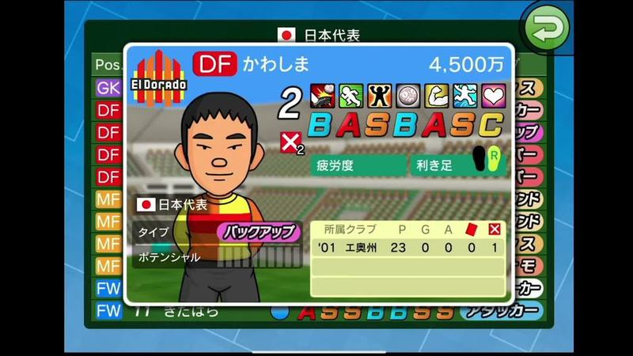

Ficha de um jogador da lista da seleção (bandeira no topo), com marca vermelha de indisponível junto ao número; lista de posições à esquerda e de tipos à direita.

- Etiquetas: selecao, notas-letras, retrato, lesao, lista, bandeira
- Qualidade: boa
- Origem: [v3waQj1BvGw](https://www.youtube.com/watch?v=v3waQj1BvGw&t=346s) (75%, ~346 s), canal しゃり

## jogador-ficha-24.jpg

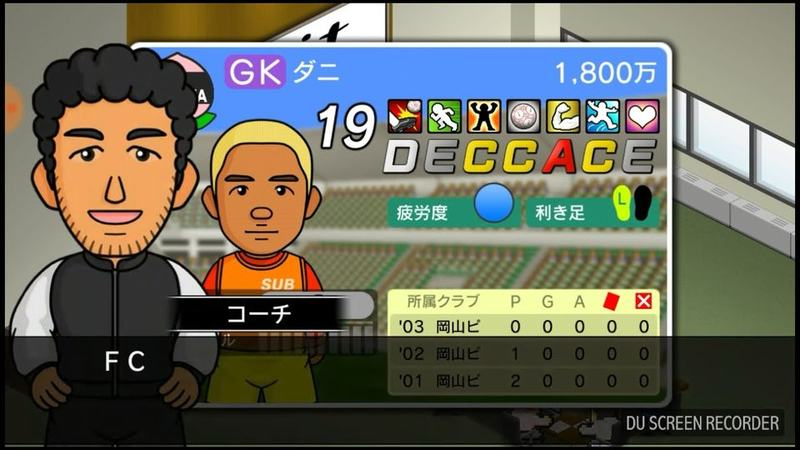

Ficha de guarda-redes com retrato grande, número, fila de ícones de atributos e notas em letras (D/E/C/A), indicador de cansaço e pé, e tabela de épocas por clube; ao lado o treinador-adjunto com nome numa etiqueta.

- Etiquetas: ficha, notas-letras, icones-habilidades, barra-cansaco, pe-preferido, historico, treinador, salario
- Qualidade: ok
- Origem: [CtR9CmLxZ9I](https://www.youtube.com/watch?v=CtR9CmLxZ9I&t=599s) (75%, ~599 s), canal シュンTV駿「駿猫」【ゲーム実況】

## jogador-ficha-25.jpg

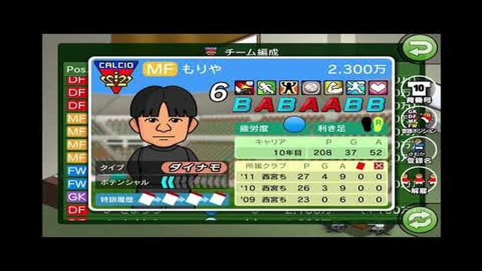

Ecrã «チーム編成» com a ficha de um médio aberta (notas B/A, carreira, histórico) sobre a lista de posições; ícones redondos à direita para número, posição e registo.

- Etiquetas: ficha, notas-letras, equipa, emblemas, carreira, icones-laterais, botao-voltar
- Qualidade: ok
- Origem: [HiNIxKn0wx8](https://www.youtube.com/watch?v=HiNIxKn0wx8&t=71s) (25%, ~71 s), canal しゃり
