# mercado-transferencias

Categoria: Menus e ecrãs de gestão. 20 imagens. A folha `_folha.jpg` mostra-as todas de uma vez.

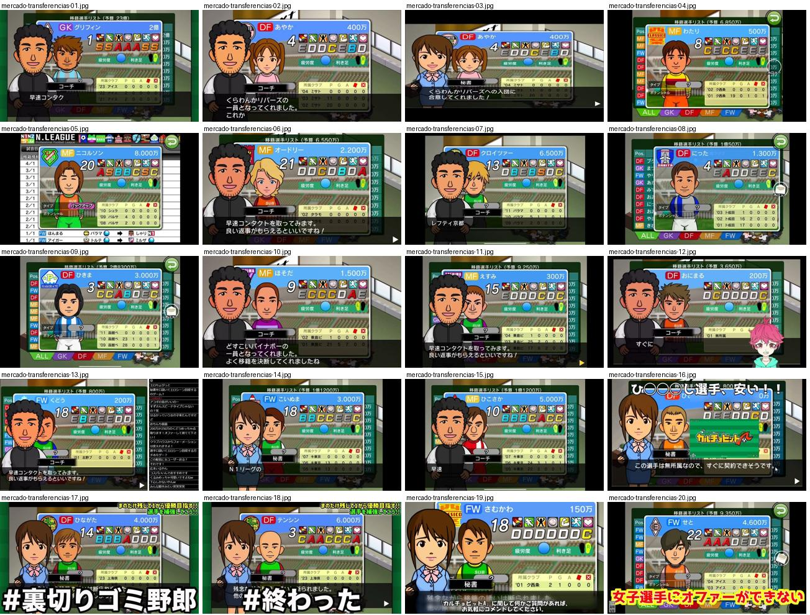

## mercado-transferencias-01.jpg

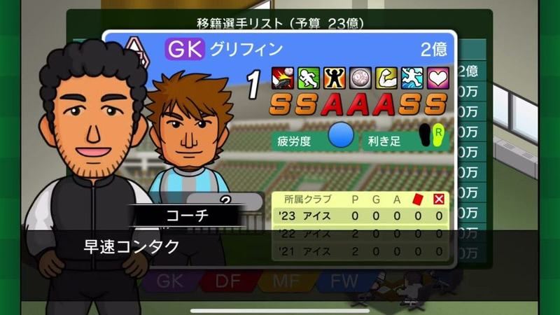

Lista de transferências «移籍選手リスト（予算 23億）» com ficha de um GK em destaque, adjunto à esquerda e separadores GK/DF/MF/FW em baixo.

- Etiquetas: retrato, notas-letras, orcamento, separadores-posicoes, treinador-adjunto
- Qualidade: boa
- Origem: [0LZjCg4Uo3M](https://www.youtube.com/watch?v=0LZjCg4Uo3M&t=240s) (75%, ~240 s), canal つばきち【Jリーグ系YouTuber】

## mercado-transferencias-02.jpg

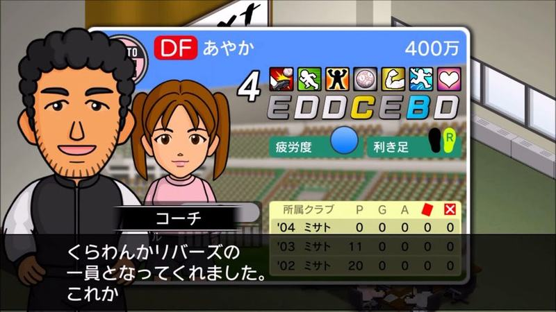

Adjunto anuncia nova contratação com a ficha da jogadora (DF, valor, notas, histórico) aberta ao lado.

- Etiquetas: contratacao, treinador-adjunto, retrato, notas-letras, caixa-dialogo
- Qualidade: boa
- Origem: [8GhUxHFSWD4](https://www.youtube.com/watch?v=8GhUxHFSWD4&t=145s) (25%, ~145 s), canal ゲーム動画で行こう! Playing Games.

## mercado-transferencias-03.jpg

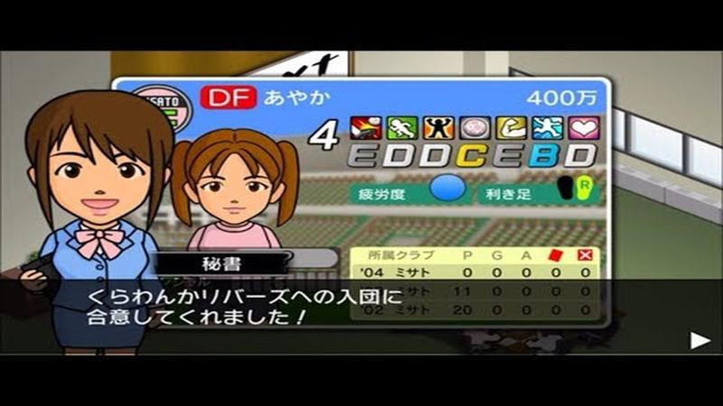

Secretária anuncia que a jogadora aceitou entrar no clube, com a ficha ao lado.

- Etiquetas: contratacao, secretaria, retrato, notas-letras, caixa-dialogo
- Qualidade: boa
- Origem: [8GhUxHFSWD4](https://www.youtube.com/watch?v=8GhUxHFSWD4) (capa), canal ゲーム動画で行こう! Playing Games.

## mercado-transferencias-04.jpg

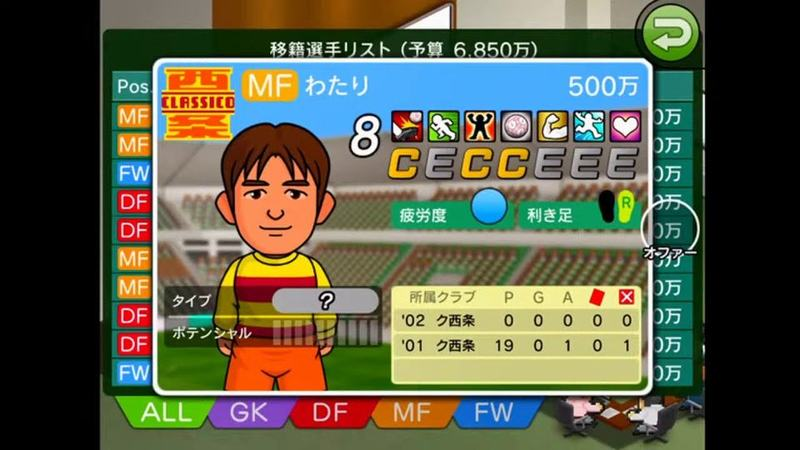

Lista de jogadores transferíveis com orçamento no topo e a ficha do jogador aberta por cima (retrato, notas em letras, histórico); separadores ALL/GK/DF/MF/FW em baixo e botão verde de voltar.

- Etiquetas: lista, ficha, notas-letras, separadores-posicao, orcamento, botao-voltar, emblemas
- Qualidade: boa
- Origem: [D8kVEiU1mvE](https://www.youtube.com/watch?v=D8kVEiU1mvE&t=2484s) (50%, ~2484 s), canal NA

## mercado-transferencias-05.jpg

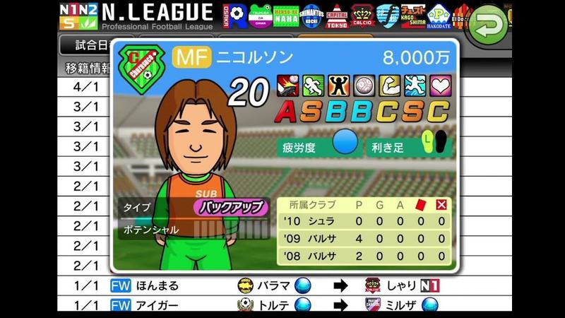

Ficha de médio com preço e notas em letras sobre a lista de movimentos de transferências (data, posição, nome, clube de origem e destino com setas).

- Etiquetas: ficha, notas-letras, historico, lista, transferencias, preco
- Qualidade: boa
- Origem: [Dh4Jel3J538](https://www.youtube.com/watch?v=Dh4Jel3J538&t=150s) (25%, ~150 s), canal しゃり

## mercado-transferencias-06.jpg

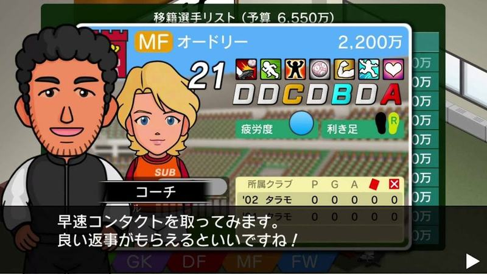

Lista de transferências com orçamento, ficha de médio aberta e o adjunto a dizer que vai contactar o jogador numa caixa de texto em baixo.

- Etiquetas: ficha, notas-letras, orcamento, treinador, caixa-texto, separadores-posicao
- Qualidade: boa
- Origem: [Iyaub2qAeGU](https://www.youtube.com/watch?v=Iyaub2qAeGU&t=223s) (25%, ~223 s), canal ぼくくんゲーム

## mercado-transferencias-07.jpg

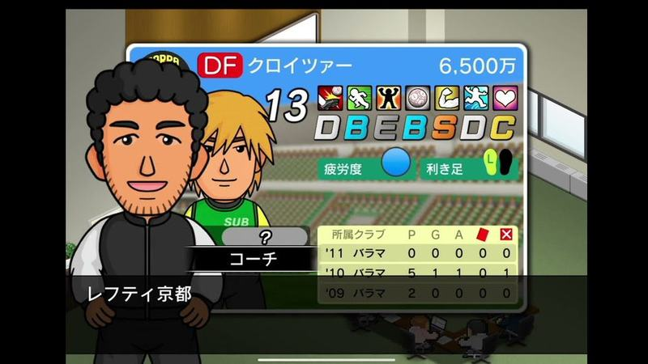

Ficha de um jogador estrangeiro proposta pelo treinador, com o treinador em primeiro plano e o nome do clube de origem. Mesmo cartão de ficha com preço no canto.

- Etiquetas: notas-letras, retrato, treinador, dialogo, valor, estatisticas-carreira
- Qualidade: boa
- Origem: [jjwIGHWmDxM](https://www.youtube.com/watch?v=jjwIGHWmDxM&t=469s) (75%, ~469 s), canal NA

## mercado-transferencias-08.jpg

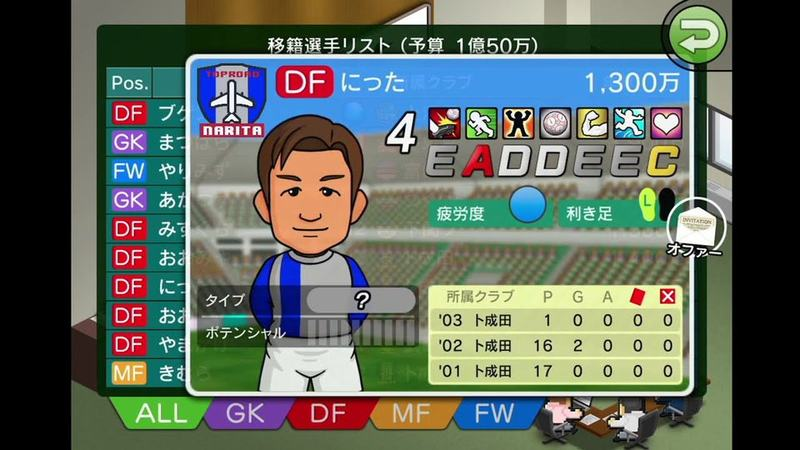

Lista de jogadores transferíveis com orçamento no topo, ficha do jogador selecionado e separadores coloridos por posição (ALL, GK, DF, MF, FW) em baixo; botão de oferta à direita.

- Etiquetas: lista, notas-letras, retrato, orcamento, separadores-posicao, botao-oferta
- Qualidade: boa
- Origem: [mtaI7yx9UXk](https://www.youtube.com/watch?v=mtaI7yx9UXk&t=352s) (75%, ~352 s), canal NA

## mercado-transferencias-09.jpg

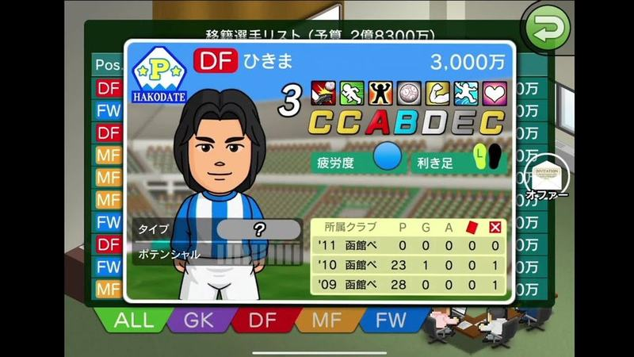

Lista de transferências com orçamento no topo e ficha de um defesa (emblema do clube de origem, preço, notas, carreira); separadores coloridos por posição em baixo.

- Etiquetas: lista, notas-letras, retrato, orcamento, separadores-posicao, preco
- Qualidade: boa
- Origem: [oHt_pJPg8Zo](https://www.youtube.com/watch?v=oHt_pJPg8Zo&t=113s) (25%, ~113 s), canal しゃり

## mercado-transferencias-10.jpg

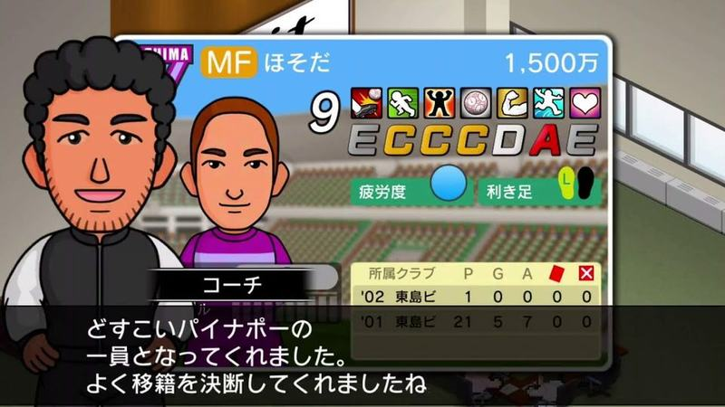

Treinador a confirmar a chegada de um reforço, com a ficha do novo jogador atrás (preço, notas, carreira).

- Etiquetas: treinador, jogador-ficha, contratacao, dialogo, notas-letras
- Qualidade: boa
- Origem: [zbuzyZBhp_c](https://www.youtube.com/watch?v=zbuzyZBhp_c&t=735s) (50%, ~735 s), canal ぼくくんゲーム

## mercado-transferencias-11.jpg

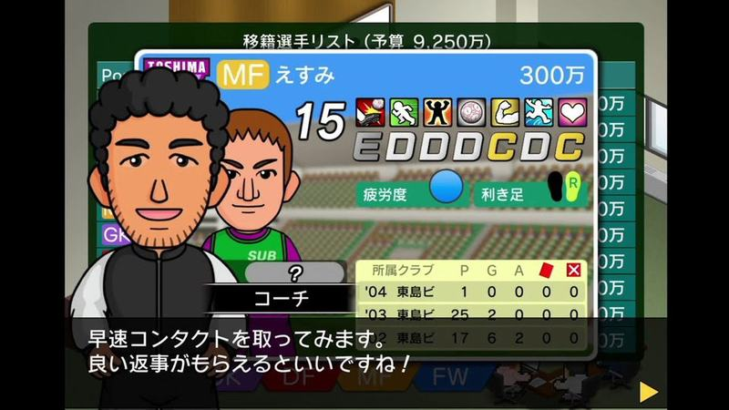

Treinador a dizer que vai contactar um jogador da lista de transferências (orçamento no topo), com a ficha atrás.

- Etiquetas: treinador, jogador-ficha, orcamento, lista, dialogo
- Qualidade: boa
- Origem: [znlZ6_YmAgE](https://www.youtube.com/watch?v=znlZ6_YmAgE&t=395s) (75%, ~395 s), canal NA

## mercado-transferencias-12.jpg

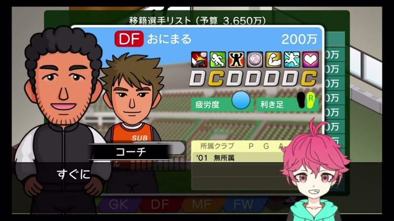

Lista de transferências «移籍選手リスト（予算 3,650万）» com ficha de um DF e adjunto a comentar; separadores GK/DF/MF/FW.

- Etiquetas: orcamento, retrato, notas-letras, treinador-adjunto, separadores-posicoes, avatar-youtuber
- Qualidade: ok · tem texto do youtuber por cima
- Origem: [CB8bYVHUjsM](https://www.youtube.com/watch?v=CB8bYVHUjsM&t=627s) (75%, ~627 s), canal こじりぬ

## mercado-transferencias-13.jpg

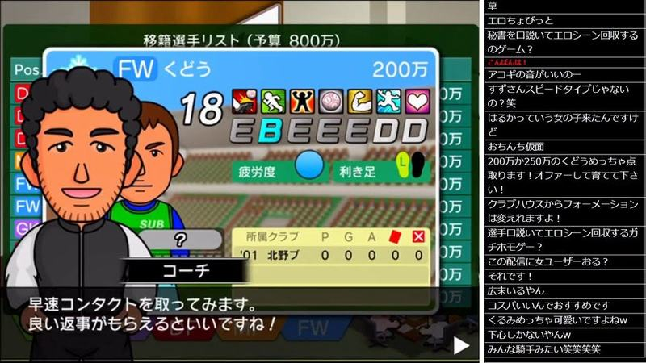

Lista de transferências com orçamento e ficha de avançado aberta; o adjunto em retrato diz que vai contactar o jogador. Comentários do direto à direita.

- Etiquetas: ficha, notas-letras, orcamento, treinador, caixa-texto, chat
- Qualidade: ok · tem texto do youtuber por cima
- Origem: [HHa2CBK3ik4](https://www.youtube.com/watch?v=HHa2CBK3ik4&t=3315s) (75%, ~3315 s), canal NA

## mercado-transferencias-14.jpg

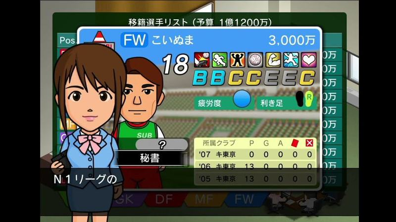

Lista de jogadores transferíveis com orçamento no topo; ficha com posição, nome, preço, notas em letras e histórico de clubes; secretária em pose à frente. Separadores GK/DF/MF/FW em baixo.

- Etiquetas: lista, notas-letras, precos, separadores-posicao, secretaria, estatisticas
- Qualidade: ok · tem texto do youtuber por cima
- Origem: [UHtlW4WpYUk](https://www.youtube.com/watch?v=UHtlW4WpYUk&t=111s) (25%, ~111 s), canal しゃり

## mercado-transferencias-15.jpg

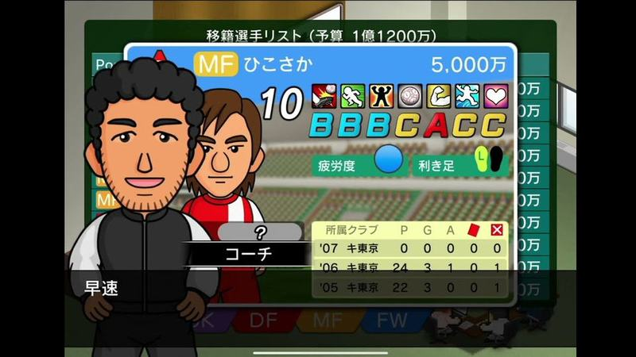

Mesmo ecrã de mercado com outro jogador (MF, 5.000万) e o adjunto em primeiro plano; boa referência da ficha compacta.

- Etiquetas: lista, notas-letras, precos, treinador, estatisticas
- Qualidade: ok · tem texto do youtuber por cima
- Origem: [UHtlW4WpYUk](https://www.youtube.com/watch?v=UHtlW4WpYUk&t=223s) (50%, ~223 s), canal しゃり

## mercado-transferencias-16.jpg

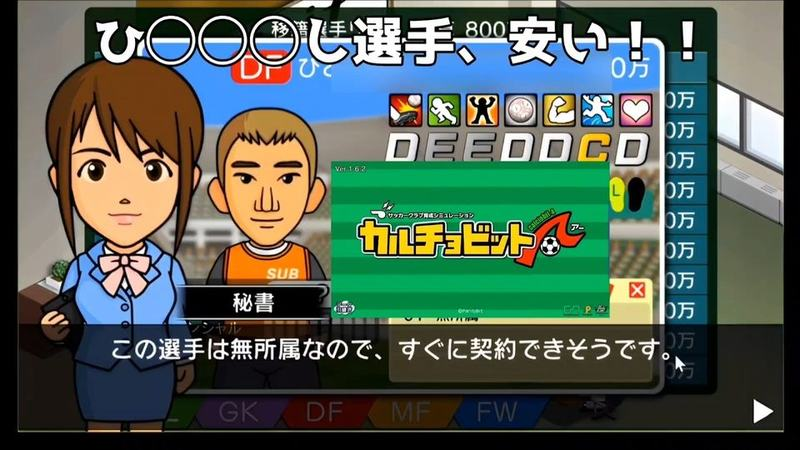

Mercado com a secretária a dizer que o jogador está livre e pode ser contratado já; ficha compacta com notas e separadores de posição; texto grande do youtuber.

- Etiquetas: lista, notas-letras, precos, secretaria, dialogo, texto-grande
- Qualidade: ok · tem texto do youtuber por cima
- Origem: [iSsr7oWiHQ4](https://www.youtube.com/watch?v=iSsr7oWiHQ4) (capa), canal 【ゲーム】海苔巻ぷんちゃん

## mercado-transferencias-17.jpg

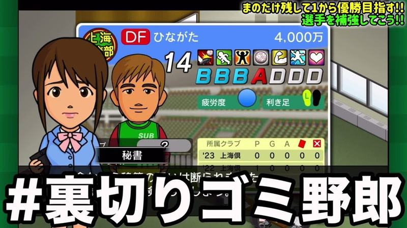

Secretária a apresentar um jogador do mercado com a ficha atrás (preço, notas, carreira); hashtag grande do youtuber por cima.

- Etiquetas: secretaria, jogador-ficha, notas-letras, preco, texto-grande
- Qualidade: ok · tem texto do youtuber por cima
- Origem: [uP8VWWpy3jA](https://www.youtube.com/watch?v=uP8VWWpy3jA&t=333s) (50%, ~333 s), canal つばきち【Jリーグ系YouTuber】

## mercado-transferencias-18.jpg

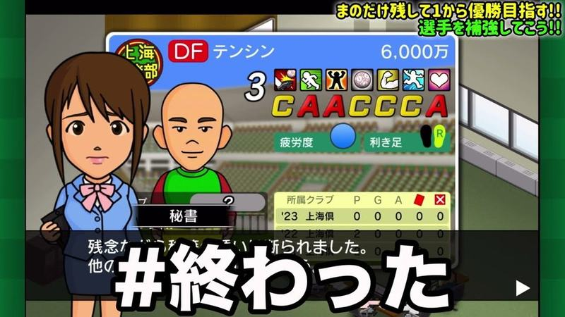

Secretária a avisar que a contratação foi recusada, com a ficha do jogador atrás; texto grande do youtuber por cima.

- Etiquetas: secretaria, jogador-ficha, recusa, dialogo, texto-grande
- Qualidade: ok · tem texto do youtuber por cima
- Origem: [uP8VWWpy3jA](https://www.youtube.com/watch?v=uP8VWWpy3jA&t=500s) (75%, ~500 s), canal つばきち【Jリーグ系YouTuber】

## mercado-transferencias-19.jpg

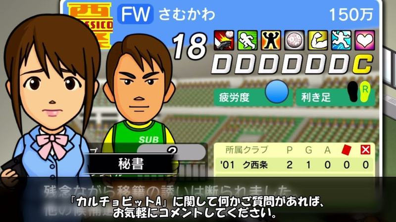

Secretária a avisar que a proposta de transferência foi recusada, com a ficha do jogador atrás; legenda do youtuber em baixo.

- Etiquetas: secretaria, jogador-ficha, recusa, dialogo, legenda
- Qualidade: ok · tem texto do youtuber por cima
- Origem: [zXdAUIoGAB8](https://www.youtube.com/watch?v=zXdAUIoGAB8&t=205s) (75%, ~205 s), canal のうきん(Nokin)

## mercado-transferencias-20.jpg

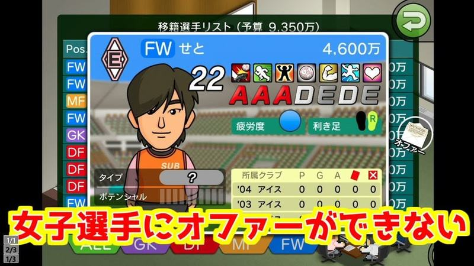

Lista de transferências com a ficha de uma avançada e separadores por posição; texto amarelo do youtuber em baixo.

- Etiquetas: lista, jogador-ficha, orcamento, separadores-posicao, texto-grande
- Qualidade: ok · tem texto do youtuber por cima
- Origem: [znlZ6_YmAgE](https://www.youtube.com/watch?v=znlZ6_YmAgE) (capa), canal NA
