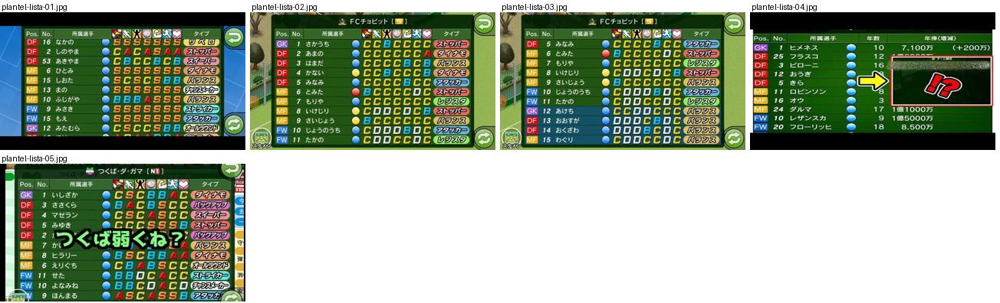
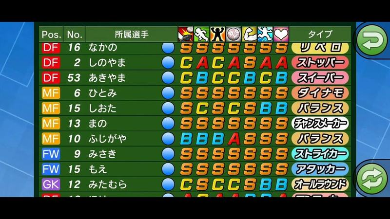
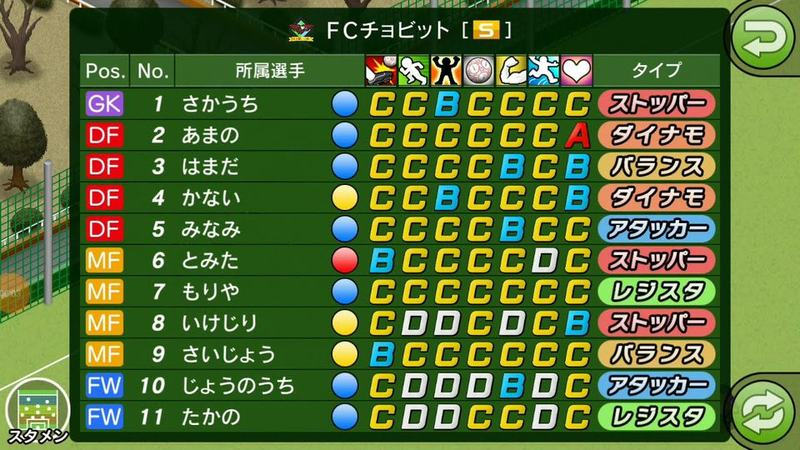
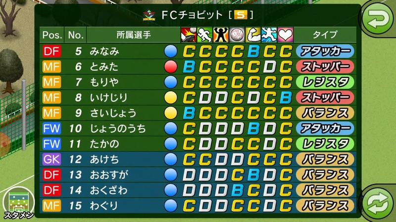
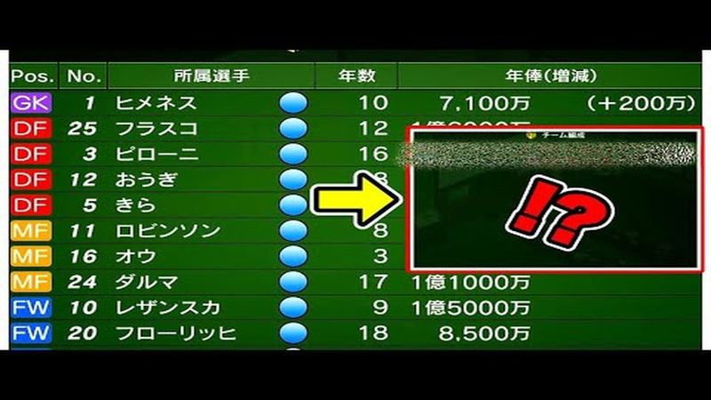
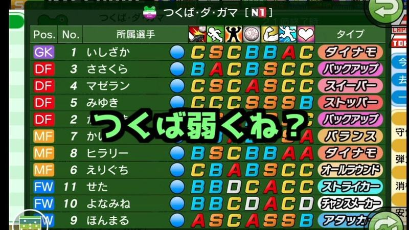

# plantel-lista

Categoria: Menus e ecrãs de gestão. 5 imagens. A folha `_folha.jpg` mostra-as todas de uma vez.

## plantel-lista-01.jpg

Lista do plantel com posição em etiqueta colorida, número, nome, sete notas em letras coloridas (S, A, B, C) e tipo de jogador em etiqueta amarela; fundo azul.

- Etiquetas: lista, notas-letras, posicoes-cor, tipo-jogador, botao-voltar
- Qualidade: boa
- Origem: [DID-HIF-aq4](https://www.youtube.com/watch?v=DID-HIF-aq4&t=24s) (75%, ~24 s), canal s

## plantel-lista-02.jpg

Lista do plantel: posição em etiqueta colorida (GK roxo, DF vermelho, MF laranja, FW azul), número, nome, bolinha de condição, sete notas em letras e tipo em cápsula colorida. Botões redondos verdes nos cantos.

- Etiquetas: lista, notas-letras, posicoes-cores, tipo-jogador, cansaco, botao-voltar, titulares
- Qualidade: boa
- Origem: [sPmekVNPVfc](https://www.youtube.com/watch?v=sPmekVNPVfc&t=4s) (25%, ~4 s), canal NA

## plantel-lista-03.jpg

Lista do plantel com os suplentes (12 a 15) em linhas de fundo azul escuro, separados dos titulares.

- Etiquetas: lista, notas-letras, posicoes-cores, suplentes, linha-escura
- Qualidade: boa
- Origem: [sPmekVNPVfc](https://www.youtube.com/watch?v=sPmekVNPVfc&t=14s) (75%, ~14 s), canal NA

## plantel-lista-04.jpg

Tabela do plantel com colunas Pos., No., nome, ícone de condição, idade e salário; posições em etiquetas coloridas (GK rosa, DF vermelho, MF laranja, FW azul). Seta amarela e caixa do youtuber por cima.

- Etiquetas: lista, posicoes-cores, salarios, idade, texto-youtuber
- Qualidade: ok · tem texto do youtuber por cima
- Origem: [0LZjCg4Uo3M](https://www.youtube.com/watch?v=0LZjCg4Uo3M) (capa), canal つばきち【Jリーグ系YouTuber】

## plantel-lista-05.jpg

Lista do plantel adversário: posição em etiqueta colorida, número, nome, cansaço, notas em letras coloridas e tipo de jogador em cápsula roxa; texto do youtuber ao meio.

- Etiquetas: lista, notas-letras, posicoes-cores, tipo-jogador, adversario, texto-grande
- Qualidade: ok · tem texto do youtuber por cima
- Origem: [qaswrrscATk](https://www.youtube.com/watch?v=qaswrrscATk) (capa), canal しゃり
