# pre-jogo

Categoria: Menus e ecrãs de gestão. 25 imagens. A folha `_folha.jpg` mostra-as todas de uma vez.

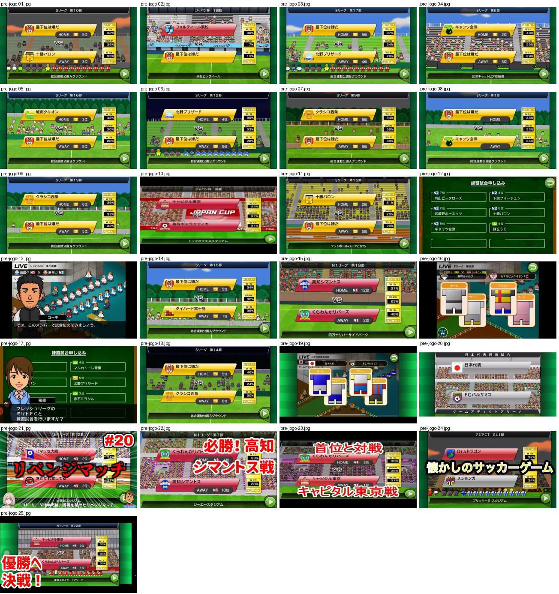

## pre-jogo-01.jpg

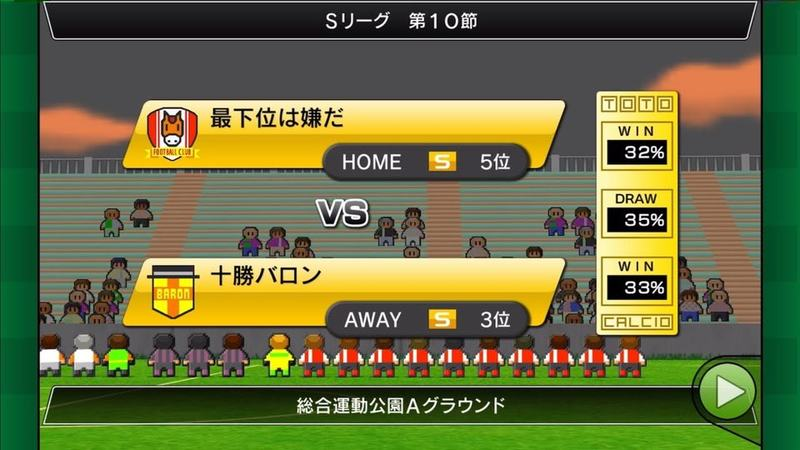

Apresentação do jogo «Sリーグ 第10節»: faixas amarelas inclinadas com emblema, HOME/AWAY e classificação, «VS» ao centro, coluna de probabilidades WIN/DRAW/WIN e nome do estádio em baixo.

- Etiquetas: home-away, posicao-liga, probabilidades, emblemas, faixas-amarelas, estadio, forma
- Qualidade: boa
- Origem: [0AWtZz7qiDM](https://www.youtube.com/watch?v=0AWtZz7qiDM) (capa), canal Booby

## pre-jogo-02.jpg

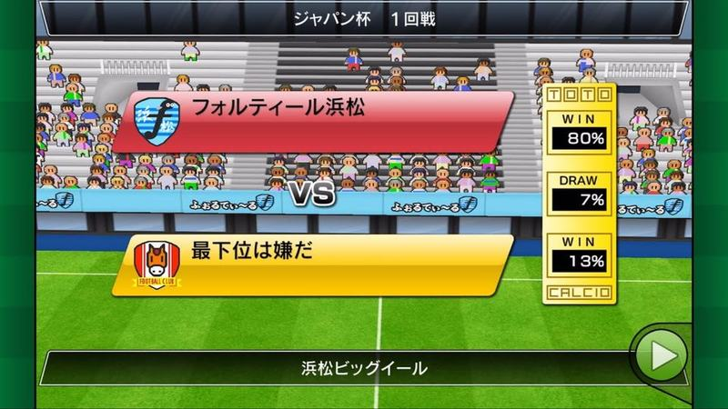

Apresentação «ジャパン杯 1回戦» com faixa vermelha do rival e faixa amarela do clube, «VS», probabilidades 80/7/13% e nome do estádio.

- Etiquetas: probabilidades, emblemas, faixas, estadio, vs
- Qualidade: boa
- Origem: [2E0XPxmtEyI](https://www.youtube.com/watch?v=2E0XPxmtEyI) (capa), canal Booby

## pre-jogo-03.jpg

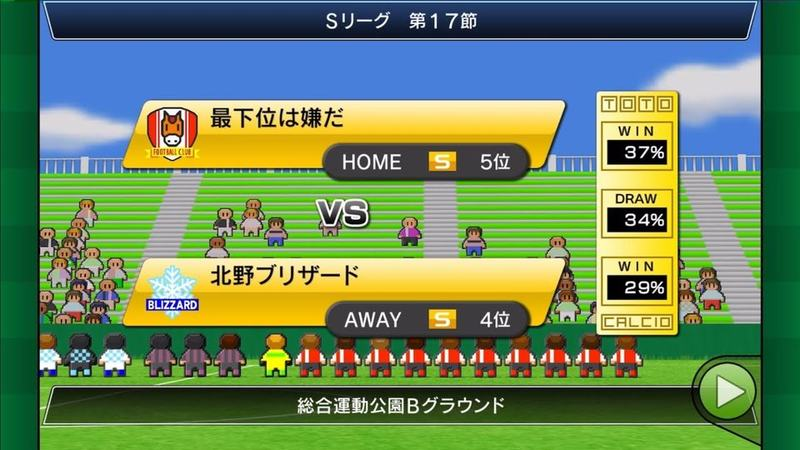

Apresentação «Sリーグ 第17節» com faixas amarelas, HOME/AWAY, posições, «VS» e probabilidades; jogadores pixel alinhados em baixo.

- Etiquetas: home-away, posicao-liga, probabilidades, emblemas, faixas-amarelas, vs
- Qualidade: boa
- Origem: [4ES7FWopuzE](https://www.youtube.com/watch?v=4ES7FWopuzE) (capa), canal Booby

## pre-jogo-04.jpg

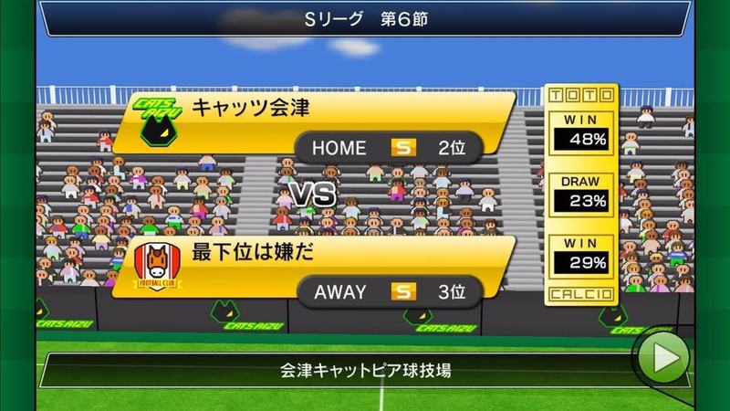

Apresentação «Sリーグ 第6節» com faixas amarelas, HOME/AWAY, posições, «VS», probabilidades 48/23/29% e nome do estádio.

- Etiquetas: home-away, posicao-liga, probabilidades, emblemas, faixas-amarelas, vs, estadio
- Qualidade: boa
- Origem: [78cfUtzUI-o](https://www.youtube.com/watch?v=78cfUtzUI-o) (capa), canal Booby

## pre-jogo-05.jpg

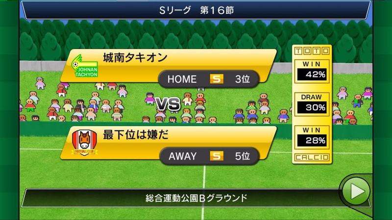

Apresentação «Sリーグ 第16節» com faixas amarelas, HOME/AWAY, posições e probabilidades.

- Etiquetas: home-away, posicao-liga, probabilidades, emblemas, faixas-amarelas, vs
- Qualidade: boa
- Origem: [8NDTji7T2Yc](https://www.youtube.com/watch?v=8NDTji7T2Yc) (capa), canal Booby

## pre-jogo-06.jpg

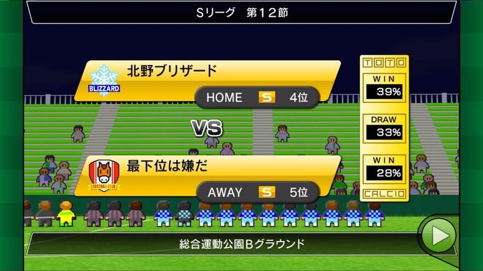

Apresentação «Sリーグ 第12節» com faixas amarelas, HOME/AWAY, posições e probabilidades; jogadores alinhados em baixo.

- Etiquetas: home-away, posicao-liga, probabilidades, emblemas, faixas-amarelas, vs
- Qualidade: boa
- Origem: [C8zRD4kIqzA](https://www.youtube.com/watch?v=C8zRD4kIqzA) (capa), canal Booby

## pre-jogo-07.jpg

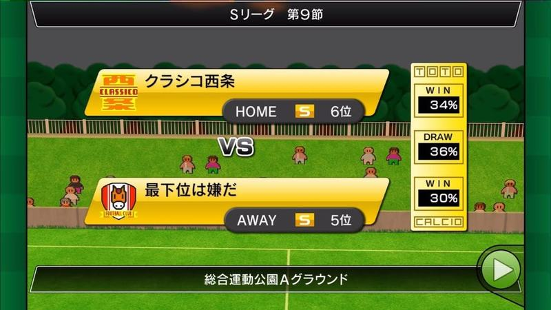

Antevisão limpa: faixas amarelas HOME/AWAY com emblema, nome, liga e posição, «VS» ao centro e coluna TOTO com WIN/DRAW/WIN em percentagem; nome do estádio em baixo e fundo de relvado com adeptos.

- Etiquetas: confronto, casa-fora, emblemas, percentagens, toto, estadio, botao-avancar
- Qualidade: boa
- Origem: [JXMmhBgYwTE](https://www.youtube.com/watch?v=JXMmhBgYwTE) (capa), canal Booby

## pre-jogo-08.jpg

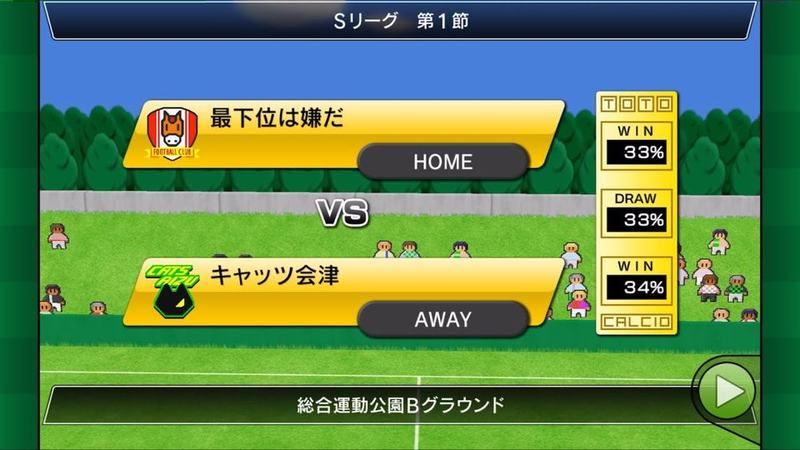

Antevisão da 1.ª jornada com faixas amarelas HOME/AWAY, emblemas, «VS» e coluna TOTO com percentagens; nome do recinto em baixo.

- Etiquetas: confronto, casa-fora, emblemas, percentagens, toto, estadio, botao-avancar
- Qualidade: boa
- Origem: [Ll7q5Gu8lQw](https://www.youtube.com/watch?v=Ll7q5Gu8lQw) (capa), canal Booby

## pre-jogo-09.jpg

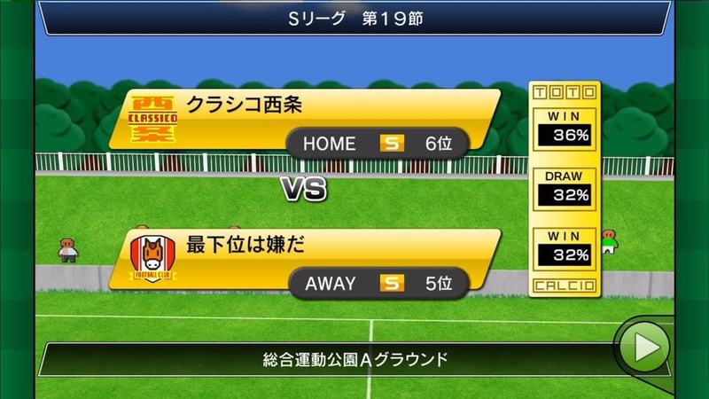

Antevisão com faixas amarelas HOME/AWAY, emblemas, liga S e posição, «VS» e coluna TOTO com percentagens; nome do recinto em baixo.

- Etiquetas: confronto, casa-fora, emblemas, percentagens, toto, estadio, botao-avancar
- Qualidade: boa
- Origem: [OSCtF-d6e4E](https://www.youtube.com/watch?v=OSCtF-d6e4E) (capa), canal Booby

## pre-jogo-10.jpg

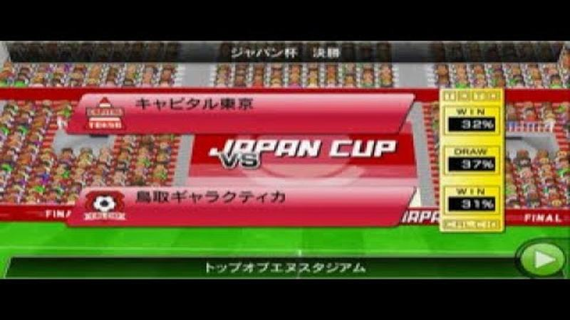

Antevisão da final da Japan Cup com faixas vermelhas, logotipo JAPAN CUP ao centro, percentagens TOTO e nome do estádio; bancada vermelha atrás.

- Etiquetas: confronto, final, emblemas, percentagens, toto, estadio
- Qualidade: boa
- Origem: [Pk_OYBTq1WU](https://www.youtube.com/watch?v=Pk_OYBTq1WU) (capa), canal おとどのカオスチャンネル

## pre-jogo-11.jpg

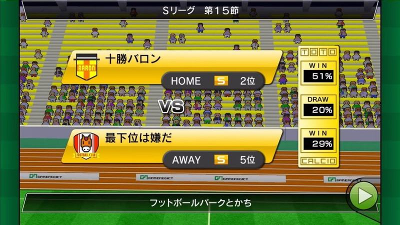

Antevisão com faixas amarelas HOME/AWAY, emblemas, «VS» e coluna TOTO; fundo de bancada amarela com pista de atletismo e nome do estádio em baixo.

- Etiquetas: confronto, casa-fora, emblemas, percentagens, toto, estadio, pista-atletismo
- Qualidade: boa
- Origem: [QZPE5y4dd9s](https://www.youtube.com/watch?v=QZPE5y4dd9s) (capa), canal Booby

## pre-jogo-12.jpg

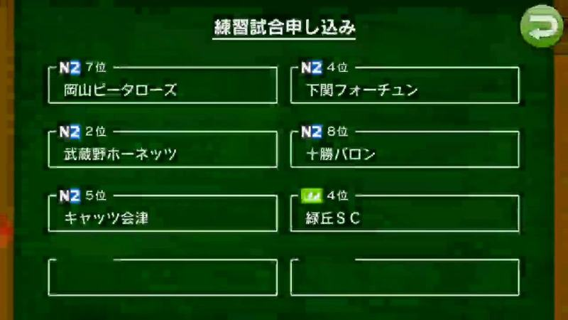

Pedido de jogo de treino: grelha de duas colunas com clubes possíveis, cada um com liga e posição, num fundo verde-escuro tipo ardósia e linhas finas brancas.

- Etiquetas: jogo-treino, lista, ligas, posicao, quadro-ardosia, botao-voltar
- Qualidade: boa
- Origem: [TO7dM6-mKGE](https://www.youtube.com/watch?v=TO7dM6-mKGE&t=137s) (50%, ~137 s), canal ゆーげーむず

## pre-jogo-13.jpg

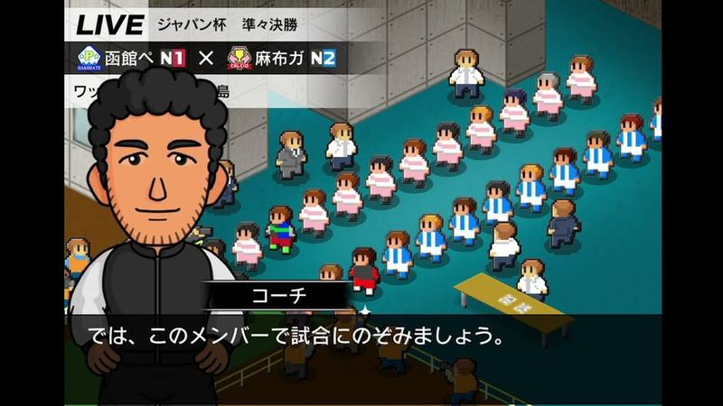

Antes do jogo: faixa «LIVE» com o nome da prova e os dois clubes com divisão, e o adjunto a dizer que se joga com estes jogadores; fundo isométrico com adeptos.

- Etiquetas: treinador, dialogo, live, nomes-equipas, emblemas, adeptos, isometrico
- Qualidade: boa
- Origem: [_taaYkFkJHc](https://www.youtube.com/watch?v=_taaYkFkJHc&t=184s) (25%, ~184 s), canal しゃり

## pre-jogo-14.jpg

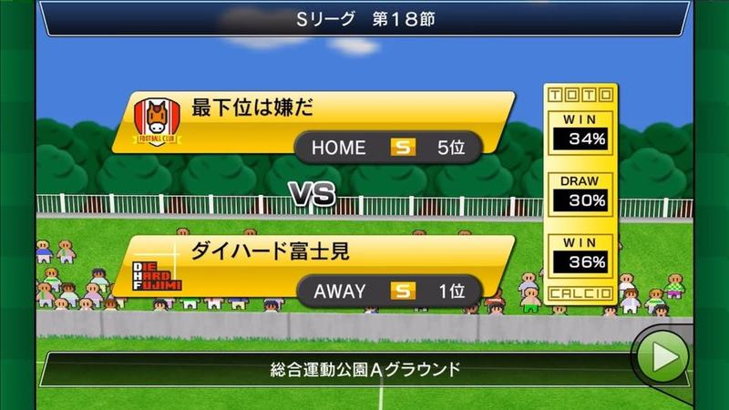

Ecrã de antevisão do jogo: duas faixas amarelas com emblema, nome, casa/fora e posição na liga, VS ao meio e caixa de probabilidades (vitória/empate/vitória). Nome do estádio em barra inferior e botão verde de seta.

- Etiquetas: vs, emblemas, percentagens, casa-fora, classificacao, botao-avancar, totobola
- Qualidade: boa
- Origem: [jCMU6_n8YAk](https://www.youtube.com/watch?v=jCMU6_n8YAk) (capa), canal Booby

## pre-jogo-15.jpg

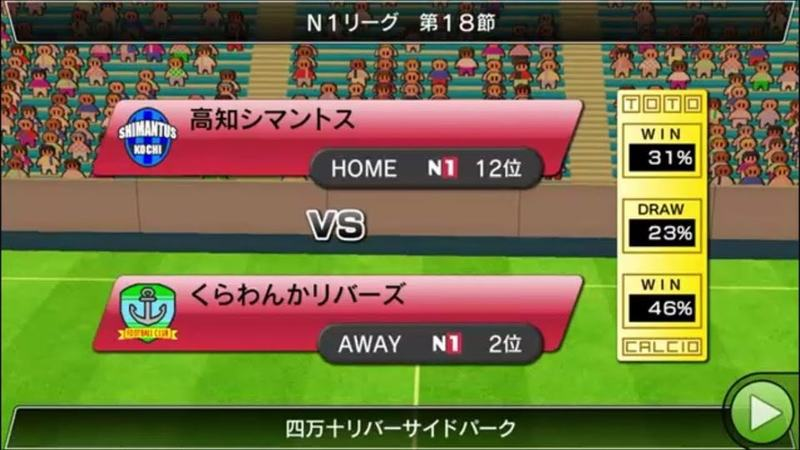

Antevisão do jogo com faixas vermelhas para as duas equipas (emblema, nome, casa/fora, liga e posição), VS ao meio e caixa de probabilidades; bancada cheia ao fundo e nome do estádio em baixo.

- Etiquetas: vs, emblemas, percentagens, casa-fora, classificacao, bancada, botao-avancar
- Qualidade: boa
- Origem: [qUCIPdrk-b4](https://www.youtube.com/watch?v=qUCIPdrk-b4) (capa), canal ゲーム動画で行こう! Playing Games.

## pre-jogo-16.jpg

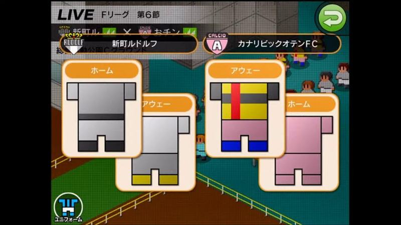

Escolha dos equipamentos antes do jogo: dois pares de camisolas (casa/fora) de cada equipa em cartões laranja, cabeçalho «LIVE» com liga e jornada.

- Etiquetas: equipamento, casa-fora, live, emblemas, botao-voltar
- Qualidade: boa
- Origem: [qYU_nKFSJ3I](https://www.youtube.com/watch?v=qYU_nKFSJ3I&t=791s) (25%, ~791 s), canal NA

## pre-jogo-17.jpg

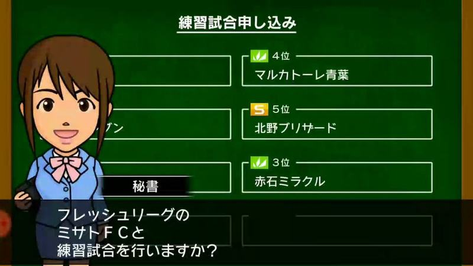

Pedido de jogo de treino: lista de clubes adversários com divisão e posição em caixas, a secretária à esquerda a perguntar se quer jogar contra um deles.

- Etiquetas: amigavel, lista-adversarios, secretaria, dialogo, divisao
- Qualidade: boa
- Origem: [rhz7Ynu8zMg](https://www.youtube.com/watch?v=rhz7Ynu8zMg&t=64s) (25%, ~64 s), canal ゆーげーむず

## pre-jogo-18.jpg

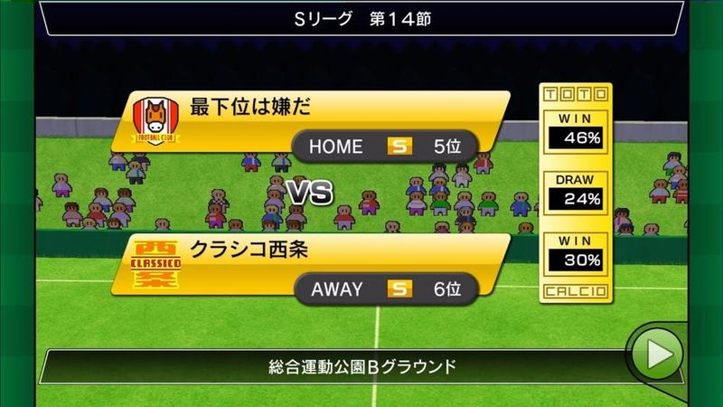

Antevisão do jogo com faixas amarelas (emblema, nome, casa/fora, divisão e posição), VS e caixa de probabilidades; nome do campo em baixo.

- Etiquetas: vs, emblemas, percentagens, casa-fora, classificacao, botao-avancar
- Qualidade: boa
- Origem: [tVh97f5JfZA](https://www.youtube.com/watch?v=tVh97f5JfZA) (capa), canal Booby

## pre-jogo-19.jpg

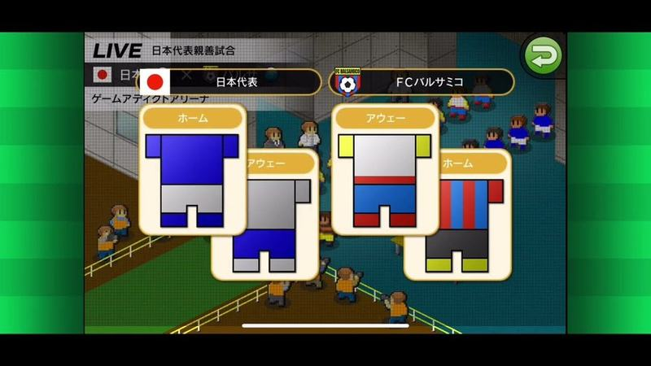

Escolha de equipamentos antes de um particular da seleção: cartões laranja com camisolas de casa e fora de cada equipa, cabeçalho «LIVE» com bandeira e emblema.

- Etiquetas: equipamento, casa-fora, live, bandeira, emblemas, botao-voltar
- Qualidade: boa
- Origem: [wXKmmY7vNQ8](https://www.youtube.com/watch?v=wXKmmY7vNQ8&t=164s) (25%, ~164 s), canal 78P03でんどろびーむ

## pre-jogo-20.jpg

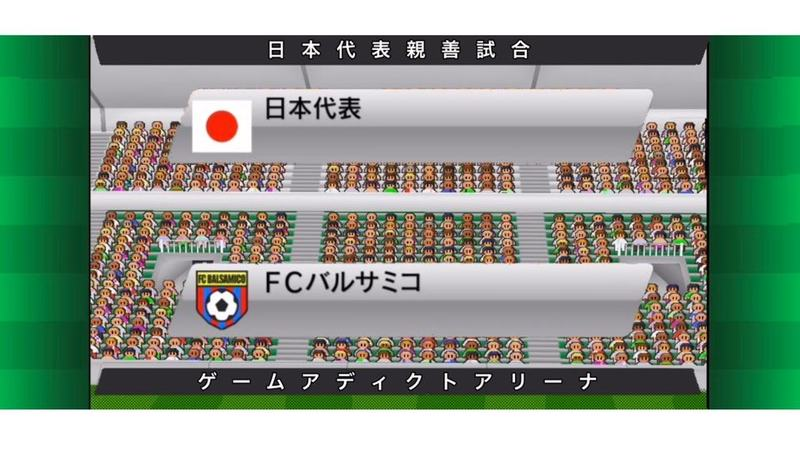

Apresentação de um particular: faixas prateadas com bandeira e emblema de cada equipa sobre a bancada cheia, título no topo e nome do estádio em baixo, letras espaçadas.

- Etiquetas: vs, bandeira, emblemas, bancada, faixas-prateadas, nome-estadio
- Qualidade: boa
- Origem: [wXKmmY7vNQ8](https://www.youtube.com/watch?v=wXKmmY7vNQ8) (capa), canal 78P03でんどろびーむ

## pre-jogo-21.jpg

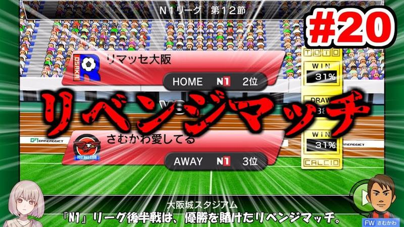

Ecrã de antevisão do jogo com faixas vermelhas HOME/AWAY, emblemas, classificação na liga e percentagens de vitória/empate; capa com texto vermelho e número do episódio por cima.

- Etiquetas: confronto, casa-fora, emblemas, percentagens, estadio, texto-grande
- Qualidade: ok · tem texto do youtuber por cima
- Origem: [DFQ-K6NbaZE](https://www.youtube.com/watch?v=DFQ-K6NbaZE) (capa), canal のうきん(Nokin)

## pre-jogo-22.jpg

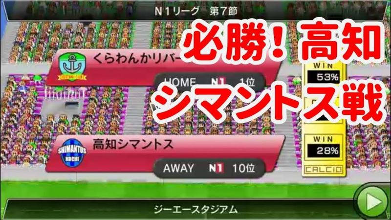

Antevisão do jogo da N1 com faixas HOME/AWAY, emblemas, posições e percentagens WIN; texto vermelho do youtuber a tapar o centro.

- Etiquetas: confronto, casa-fora, emblemas, percentagens, estadio, texto-grande
- Qualidade: ok · tem texto do youtuber por cima
- Origem: [EX_Y0XPJOvA](https://www.youtube.com/watch?v=EX_Y0XPJOvA) (capa), canal ゲーム動画で行こう! Playing Games.

## pre-jogo-23.jpg

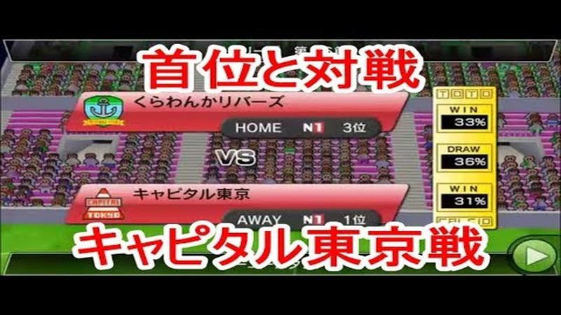

Antevisão com faixas vermelhas HOME/AWAY, emblemas, posições na N1 e caixas WIN/DRAW/WIN com percentagens; texto vermelho do youtuber por cima e por baixo.

- Etiquetas: confronto, casa-fora, emblemas, percentagens, estadio, texto-grande
- Qualidade: ok · tem texto do youtuber por cima
- Origem: [GWbB8Z4MXBI](https://www.youtube.com/watch?v=GWbB8Z4MXBI) (capa), canal ゲーム動画で行こう! Playing Games.

## pre-jogo-24.jpg

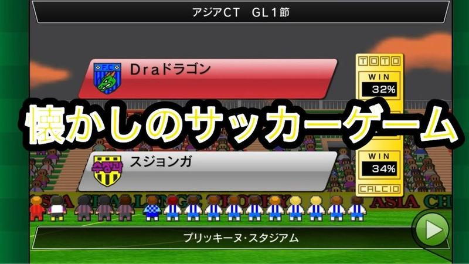

Antevisão da fase de grupos da Asia CT com faixas vermelha e cinzenta, emblemas e TOTO; texto branco do youtuber a meio.

- Etiquetas: confronto, emblemas, percentagens, toto, estadio, taca-asia, texto-grande
- Qualidade: ok · tem texto do youtuber por cima
- Origem: [QVZMaiiiDpA](https://www.youtube.com/watch?v=QVZMaiiiDpA) (capa), canal ドラDra

## pre-jogo-25.jpg

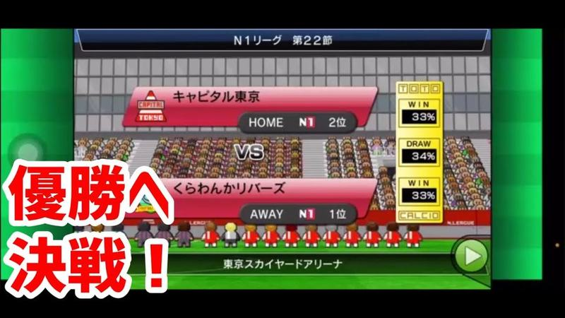

Antevisão do jogo decisivo da N1 com faixas vermelhas HOME/AWAY, emblemas e TOTO, bancada atrás; texto vermelho do youtuber à esquerda.

- Etiquetas: confronto, casa-fora, emblemas, percentagens, toto, estadio, texto-grande
- Qualidade: ok · tem texto do youtuber por cima
- Origem: [R7mfA8lYYoY](https://www.youtube.com/watch?v=R7mfA8lYYoY) (capa), canal ゲーム動画で行こう! Playing Games.
