# relatorio-pos-jogo

Categoria: Menus e ecrãs de gestão. 13 imagens. A folha `_folha.jpg` mostra-as todas de uma vez.

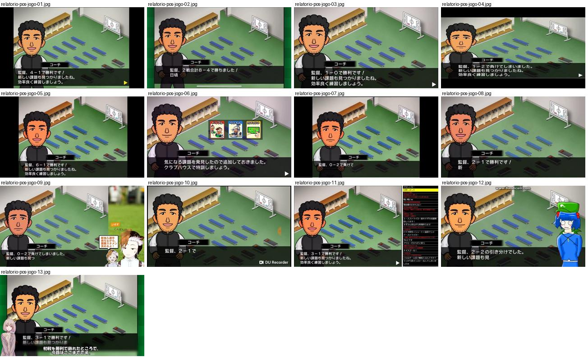

## relatorio-pos-jogo-01.jpg

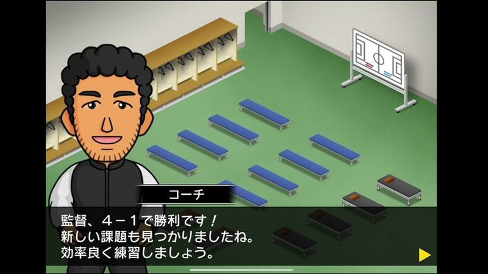

Balneário isométrico após o jogo com o adjunto a comentar a vitória por 4-1 numa caixa de texto escura com seta amarela de continuar.

- Etiquetas: balneario, treinador-adjunto, caixa-dialogo, seta-avancar
- Qualidade: boa
- Origem: [-gEREcToc9g](https://www.youtube.com/watch?v=-gEREcToc9g&t=443s) (75%, ~443 s), canal しゃり

## relatorio-pos-jogo-02.jpg

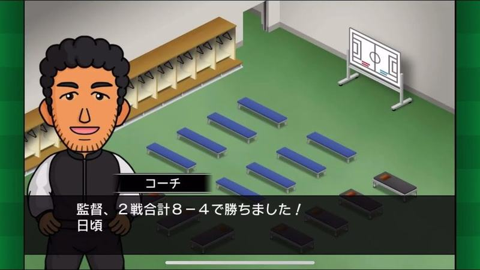

Adjunto no balneário a anunciar a vitória na eliminatória a duas mãos (8-4 no total).

- Etiquetas: balneario, treinador-adjunto, caixa-dialogo
- Qualidade: boa
- Origem: [053_tSnSBG8](https://www.youtube.com/watch?v=053_tSnSBG8&t=405s) (75%, ~405 s), canal つばきち【Jリーグ系YouTuber】

## relatorio-pos-jogo-03.jpg

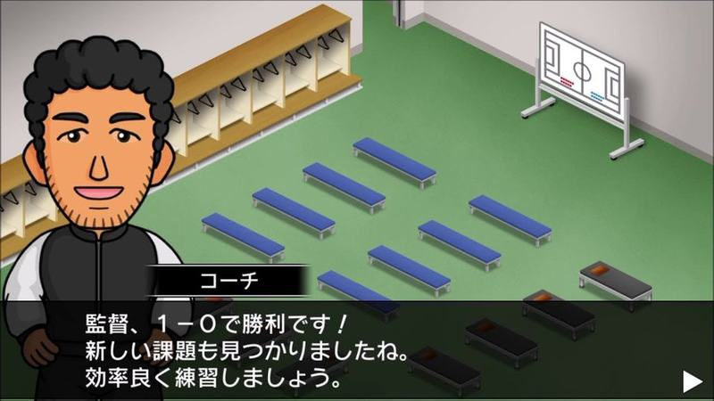

Adjunto no balneário anuncia vitória 1-0 e novos desafios para o treino.

- Etiquetas: balneario, treinador-adjunto, caixa-dialogo
- Qualidade: boa
- Origem: [0VoSVCdkdKE](https://www.youtube.com/watch?v=0VoSVCdkdKE&t=780s) (50%, ~780 s), canal ゲーム動画で行こう! Playing Games.

## relatorio-pos-jogo-04.jpg

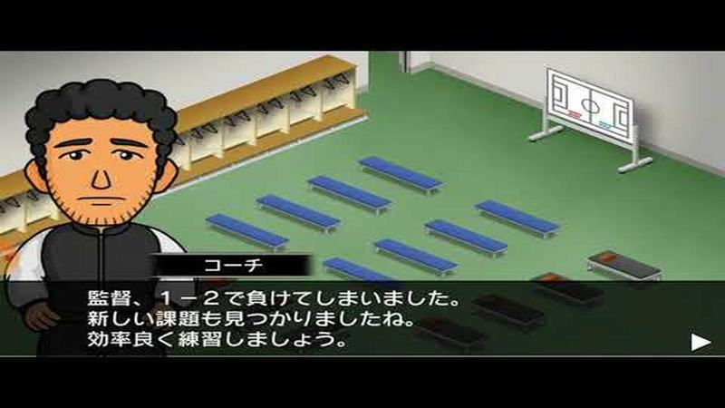

Adjunto sério no balneário a anunciar a derrota 1-2.

- Etiquetas: balneario, treinador-adjunto, caixa-dialogo
- Qualidade: boa
- Origem: [7_N12PB5jrg](https://www.youtube.com/watch?v=7_N12PB5jrg&t=179s) (75%, ~179 s), canal ゆーげーむず

## relatorio-pos-jogo-05.jpg

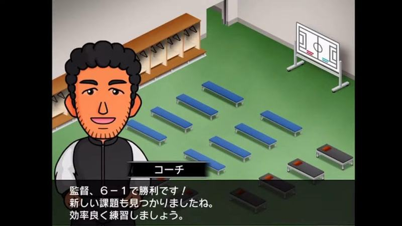

Adjunto sorridente no balneário a anunciar vitória 6-1.

- Etiquetas: balneario, treinador-adjunto, caixa-dialogo
- Qualidade: boa
- Origem: [82ITuK9RU-I](https://www.youtube.com/watch?v=82ITuK9RU-I&t=1280s) (50%, ~1280 s), canal NA

## relatorio-pos-jogo-06.jpg

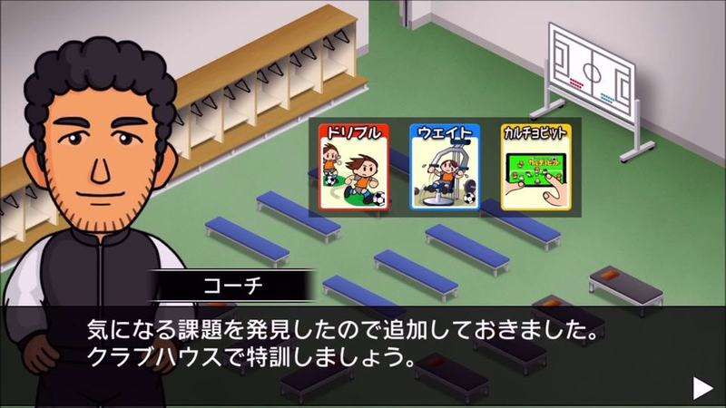

Depois do jogo, o adjunto entrega três cartas de treino novas («ドリブル», «ウエイト»...) mostradas como cartões ilustrados sobre o balneário.

- Etiquetas: balneario, treinador-adjunto, cartas-habilidades, recompensa, caixa-dialogo
- Qualidade: boa
- Origem: [As6slOhGbT0](https://www.youtube.com/watch?v=As6slOhGbT0&t=381s) (50%, ~381 s), canal ゲーム動画で行こう! Playing Games.

## relatorio-pos-jogo-07.jpg

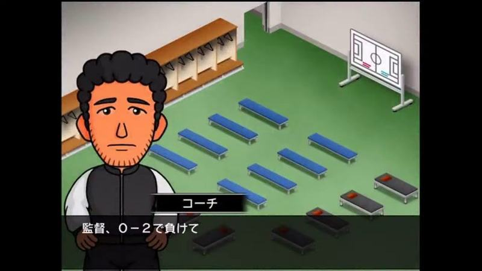

Treinador no balneário isométrico a comentar a derrota 0-2, em caixa de diálogo escura.

- Etiquetas: treinador, dialogo, balneario, isometrico, derrota
- Qualidade: boa
- Origem: [qYU_nKFSJ3I](https://www.youtube.com/watch?v=qYU_nKFSJ3I&t=1583s) (50%, ~1583 s), canal NA

## relatorio-pos-jogo-08.jpg

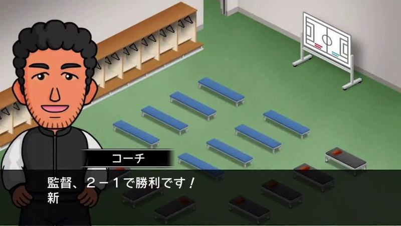

Treinador no balneário isométrico a anunciar a vitória 2-1, em caixa de diálogo escura.

- Etiquetas: treinador, dialogo, balneario, isometrico, vitoria
- Qualidade: boa
- Origem: [zXqXsKYj6qw](https://www.youtube.com/watch?v=zXqXsKYj6qw&t=961s) (75%, ~961 s), canal ぼくくんゲーム

## relatorio-pos-jogo-09.jpg

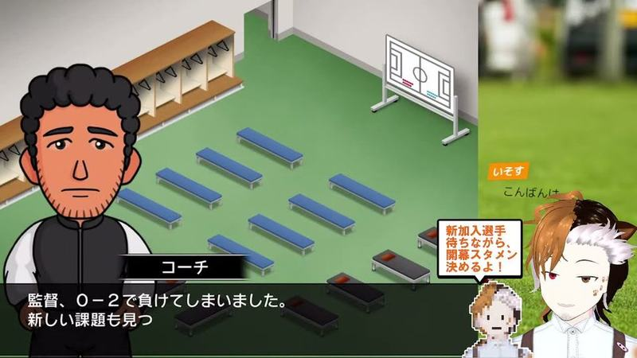

Adjunto no balneário a comentar derrota 0-2; avatar e comentários do streamer no canto direito.

- Etiquetas: balneario, treinador-adjunto, caixa-dialogo, avatar-youtuber, chat
- Qualidade: ok · tem texto do youtuber por cima
- Origem: [0HJZsTC0po8](https://www.youtube.com/watch?v=0HJZsTC0po8&t=1890s) (25%, ~1890 s), canal 三毛猫モリアーティの好奇心(ΦωΦ)

## relatorio-pos-jogo-10.jpg

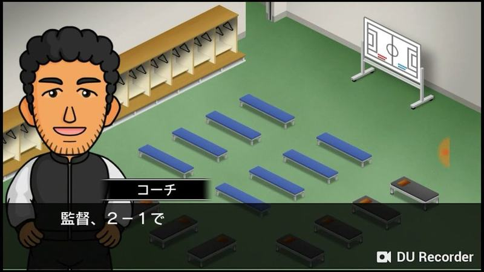

Adjunto no balneário a anunciar a vitória 2-1.

- Etiquetas: balneario, treinador-adjunto, caixa-dialogo
- Qualidade: ok · tem texto do youtuber por cima
- Origem: [7NIsK7GqURE](https://www.youtube.com/watch?v=7NIsK7GqURE&t=468s) (75%, ~468 s), canal シュンTV駿「駿猫」【ゲーム実況】

## relatorio-pos-jogo-11.jpg

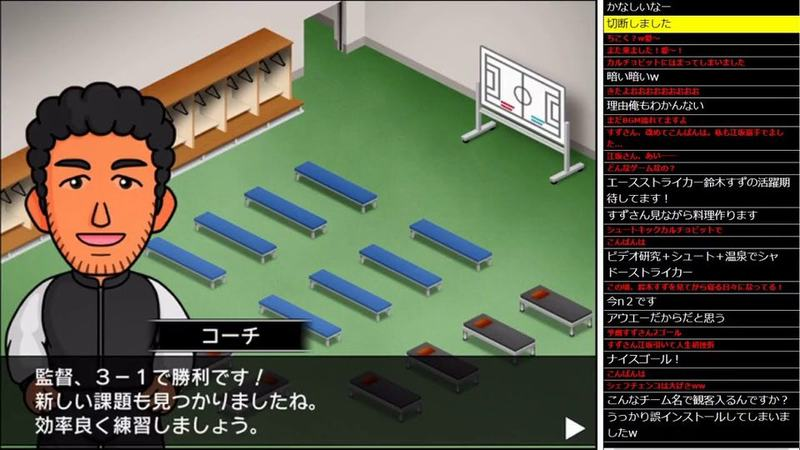

Treinador no balneário isométrico a comentar a vitória 3-1 e novos objetivos, em caixa de diálogo escura com nome por cima; chat do direto à direita.

- Etiquetas: treinador, dialogo, balneario, isometrico, chat-direto
- Qualidade: ok · tem texto do youtuber por cima
- Origem: [mt3qa3u5NYM](https://www.youtube.com/watch?v=mt3qa3u5NYM&t=2418s) (50%, ~2418 s), canal NA

## relatorio-pos-jogo-12.jpg

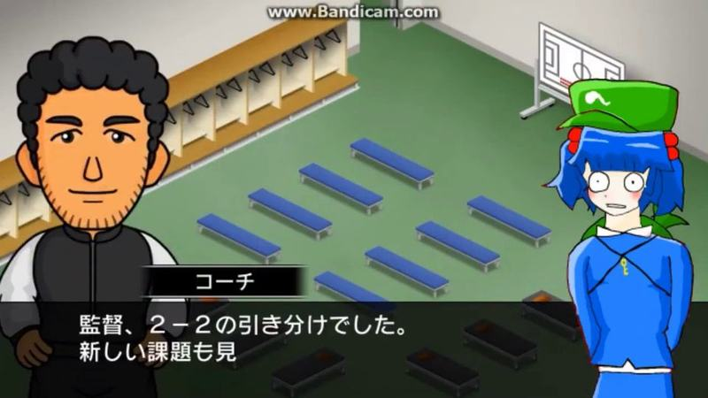

Treinador no balneário a comentar o empate 2-2; personagem do youtuber sobreposta à direita.

- Etiquetas: treinador, dialogo, balneario, isometrico, personagem-youtuber
- Qualidade: ok · tem texto do youtuber por cima
- Origem: [qD1HSmfayo4](https://www.youtube.com/watch?v=qD1HSmfayo4&t=416s) (75%, ~416 s), canal こやざる

## relatorio-pos-jogo-13.jpg

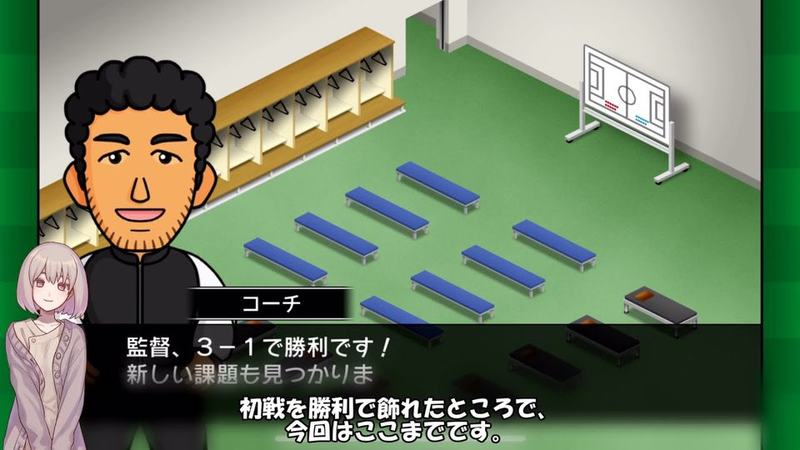

Treinador no balneário a anunciar a vitória 3-1 e novos objetivos; legenda e personagem do youtuber por cima.

- Etiquetas: treinador, dialogo, balneario, isometrico, personagem-youtuber
- Qualidade: ok · tem texto do youtuber por cima
- Origem: [sBQ-tTOR69s](https://www.youtube.com/watch?v=sBQ-tTOR69s&t=442s) (75%, ~442 s), canal のうきん(Nokin)
