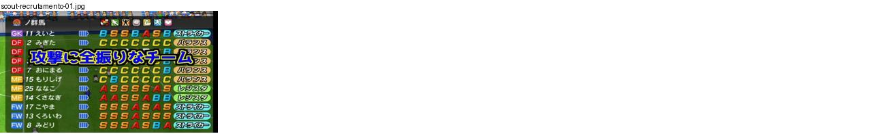
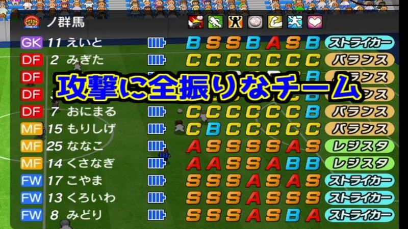

# scout-recrutamento

Categoria: Menus e ecrãs de gestão. 1 imagens. A folha `_folha.jpg` mostra-as todas de uma vez.

## scout-recrutamento-01.jpg

Plantel de um adversário com posições coloridas, notas em letras e tipo de jogador em etiquetas amarelas; texto azul e amarelo do youtuber a meio.

- Etiquetas: lista, notas-letras, posicoes-cor, tipo-jogador, outro-clube, texto-grande
- Qualidade: ok · tem texto do youtuber por cima
- Origem: [O_U6VWdFXzg](https://www.youtube.com/watch?v=O_U6VWdFXzg) (capa), canal NA
