# taticas-formacao

Categoria: Menus e ecrãs de gestão. 10 imagens. A folha `_folha.jpg` mostra-as todas de uma vez.

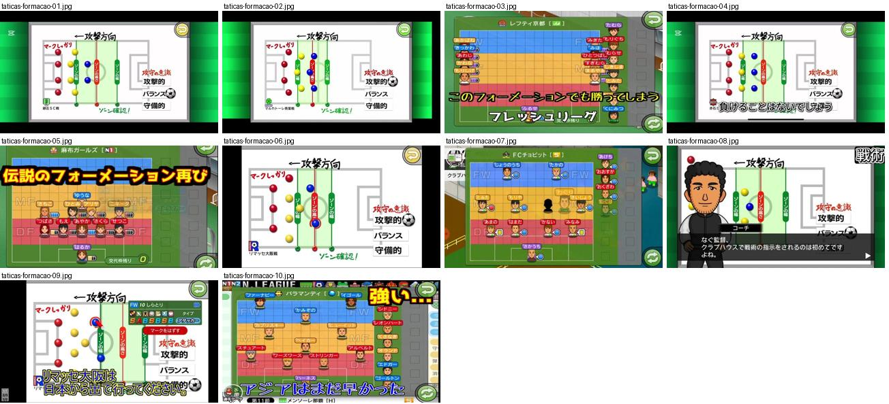

## taticas-formacao-01.jpg

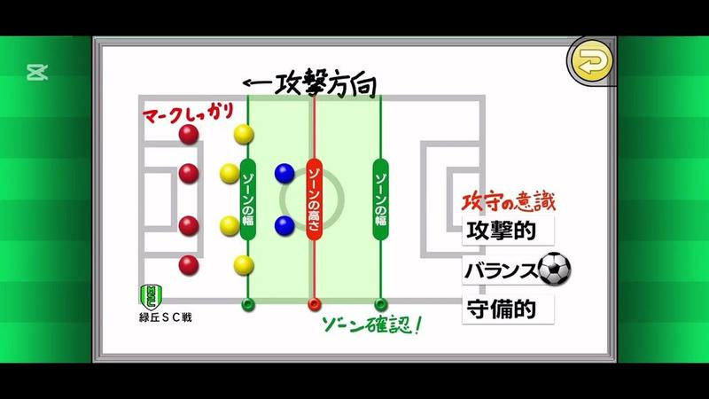

Ecrã de tática sobre um campo desenhado em branco: bolas coloridas por linha, faixas verdes e vermelhas de largura e altura da zona, seta da direção de ataque e escolha de atitude (攻撃的/バランス/守備的).

- Etiquetas: zonas, linhas-defesa, marcacao, direcao-ataque, atitude, diagrama-campo, botao-voltar
- Qualidade: boa
- Origem: [e5reAq1y5pY](https://www.youtube.com/watch?v=e5reAq1y5pY&t=249s) (50%, ~249 s), canal Booby

## taticas-formacao-02.jpg

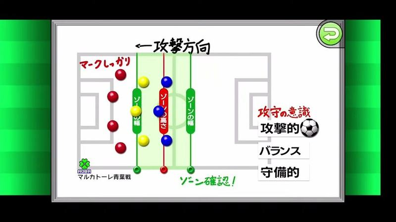

Esquema tático em campo branco: pontos vermelhos, amarelos e azuis por linha, faixas de zona e opções de mentalidade à direita (ofensivo, equilibrado, defensivo). Anotações manuscritas do jogo a vermelho.

- Etiquetas: instrucoes-equipa, zona, campo-esquematico, mentalidade, botao-voltar
- Qualidade: boa
- Origem: [t8T0hRYc-r4](https://www.youtube.com/watch?v=t8T0hRYc-r4&t=1710s) (75%, ~1710 s), canal Zoo Suu

## taticas-formacao-03.jpg

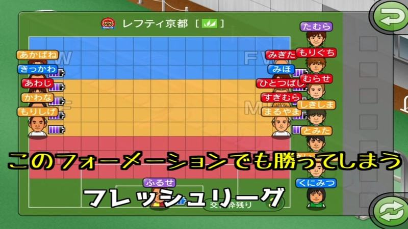

Ecrã de formação com campo dividido em faixas coloridas (azul FW, amarelo MF, vermelho DF) e etiquetas de nome com mini-retratos; texto do youtuber por cima.

- Etiquetas: formacao, faixas-cores, nomes, barras-energia, texto-youtuber
- Qualidade: ok · tem texto do youtuber por cima
- Origem: [2NBCTNPjJlM](https://www.youtube.com/watch?v=2NBCTNPjJlM) (capa), canal しゃり

## taticas-formacao-04.jpg

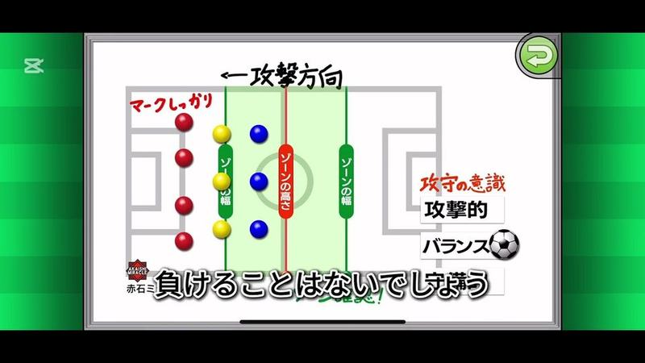

Ecrã tático em quadro branco: posições como pontos coloridos, direção de ataque, largura e altura das zonas, e escolha «攻撃的/バランス» com ícone de bola.

- Etiquetas: quadro-branco, direcao-ataque, marcacao, linha-defensiva, mentalidade, texto-youtuber
- Qualidade: ok · tem texto do youtuber por cima
- Origem: [3JsWO4fyh7U](https://www.youtube.com/watch?v=3JsWO4fyh7U&t=150s) (25%, ~150 s), canal Booby

## taticas-formacao-05.jpg

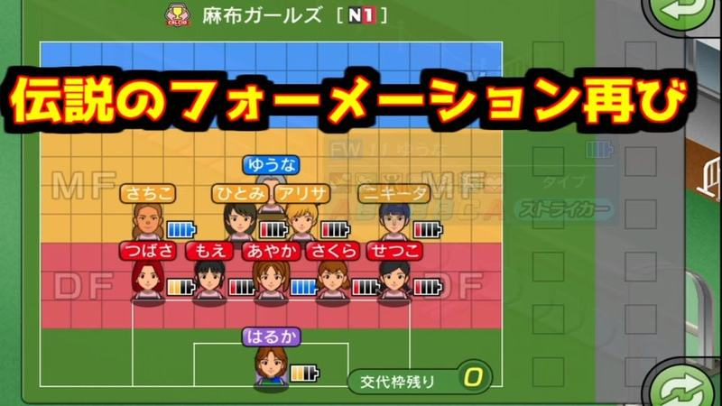

Ecrã de formação com zonas coloridas por linha (FW azul, MF laranja, DF vermelho), retratos pequenos com nome e barra de energia, e contador de substituições restantes; texto do youtuber no topo.

- Etiquetas: formacao, campo-zonas, retratos, barra-cansaco, substituicoes-restantes, texto-grande
- Qualidade: ok · tem texto do youtuber por cima
- Origem: [R1lwXH0fAp0](https://www.youtube.com/watch?v=R1lwXH0fAp0) (capa), canal NA

## taticas-formacao-06.jpg

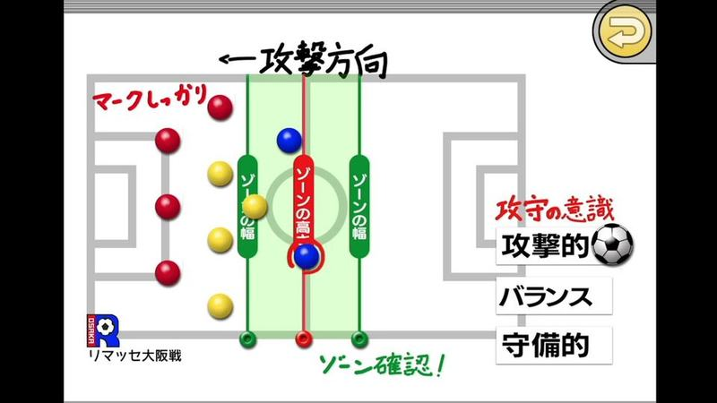

Esquema tático do adversário em campo branco com bolinhas coloridas por linha, faixas verdes de largura de zona e opções de mentalidade (atacante, equilibrada, defensiva); anotações a vermelho do youtuber.

- Etiquetas: formacao, esquema, zonas, mentalidade, anotacoes, botao-voltar
- Qualidade: ok · tem texto do youtuber por cima
- Origem: [RB3o2MxXfx0](https://www.youtube.com/watch?v=RB3o2MxXfx0&t=276s) (75%, ~276 s), canal しゃり

## taticas-formacao-07.jpg

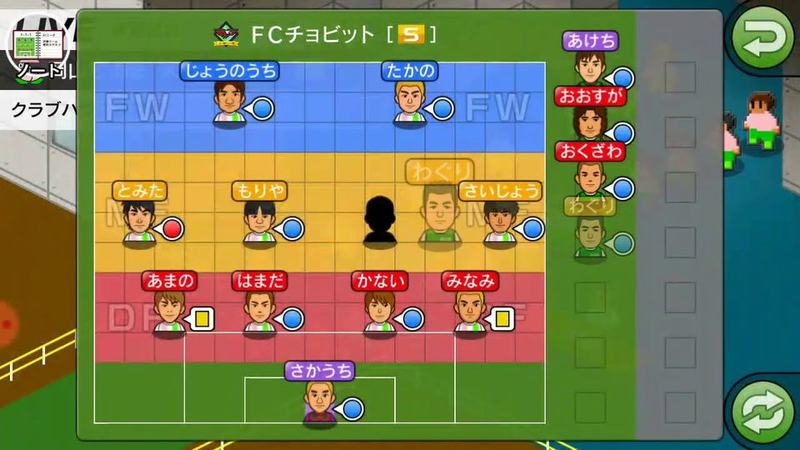

Ecrã de formação com o campo dividido em faixas coloridas por linha (FW azul, MF amarelo, DF vermelho) e caras dos jogadores com marcadores; banco de suplentes à direita e botões verdes redondos. Bom para o layout de táticas por zonas.

- Etiquetas: formacao, faixas-cor, caras-jogadores, banco, botao-voltar, nomes
- Qualidade: ok · tem texto do youtuber por cima
- Origem: [TO7dM6-mKGE](https://www.youtube.com/watch?v=TO7dM6-mKGE&t=206s) (75%, ~206 s), canal ゆーげーむず

## taticas-formacao-08.jpg

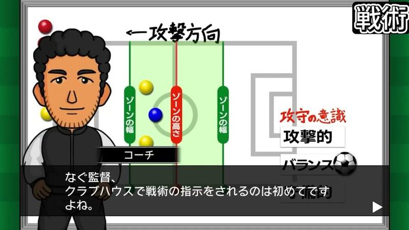

Ecrã de tática com o adjunto a explicar pela primeira vez (tutorial): diagrama de zonas, direção de ataque e atitude; rótulo «戦術» do youtuber.

- Etiquetas: zonas, direcao-ataque, atitude, diagrama-campo, treinador, dialogo, tutorial, texto-youtuber
- Qualidade: ok · tem texto do youtuber por cima
- Origem: [i57lBOMUCDE](https://www.youtube.com/watch?v=i57lBOMUCDE&t=299s) (50%, ~299 s), canal なぐ

## taticas-formacao-09.jpg

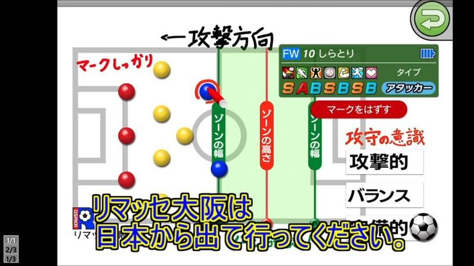

Instruções individuais de um jogador: campo esquemático branco com marcações e faixas de zona, ficha pequena e opções de mentalidade (ofensivo, equilibrado). Anotações e texto do youtuber por cima.

- Etiquetas: instrucoes-individuais, marcacao, zona, notas-letras, anotacoes, texto-grande
- Qualidade: ok · tem texto do youtuber por cima
- Origem: [r7YJZagEwHc](https://www.youtube.com/watch?v=r7YJZagEwHc) (capa), canal NA

## taticas-formacao-10.jpg

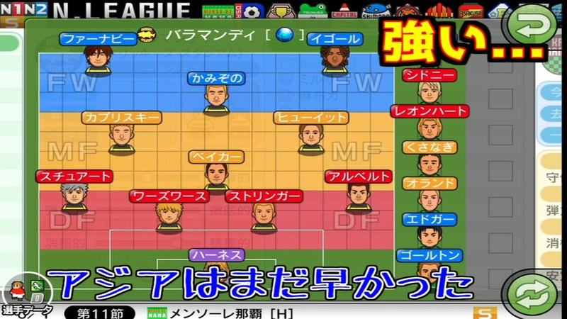

Formação do adversário em campo dividido em faixas coloridas (FW azul, MF amarelo, DF vermelho) com cabecinhas e nomes; suplentes à direita. Texto do youtuber por cima.

- Etiquetas: formacao, faixas-posicao, retratos-pequenos, adversario, texto-grande
- Qualidade: ok · tem texto do youtuber por cima
- Origem: [y3_P1pcBgl4](https://www.youtube.com/watch?v=y3_P1pcBgl4) (capa), canal しゃり
