# titulo

Categoria: Menus e ecrãs de gestão. 15 imagens. A folha `_folha.jpg` mostra-as todas de uma vez.

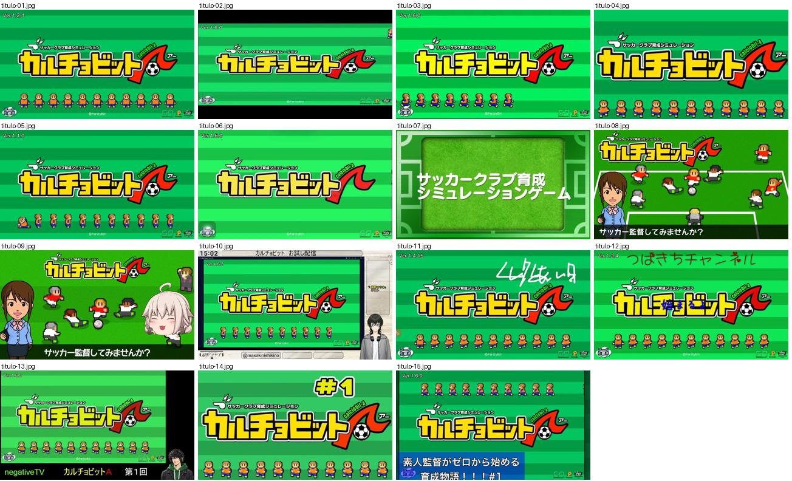

## titulo-01.jpg

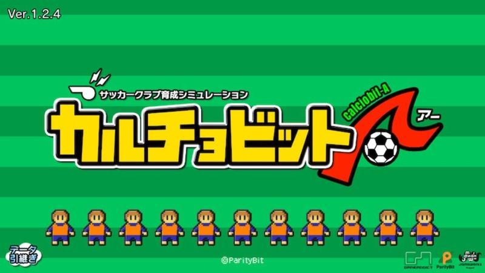

Ecrã de título: logotipo amarelo com contorno preto sobre fundo de listas verdes, fila de bonecos pixel em equipamento laranja e versão no canto.

- Etiquetas: logotipo, listas-verdes, pixel-art, versao
- Qualidade: boa
- Origem: [82ITuK9RU-I](https://www.youtube.com/watch?v=82ITuK9RU-I) (capa), canal NA

## titulo-02.jpg

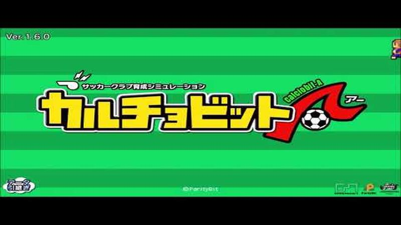

Ecrã de título com logotipo sobre listas verdes horizontais, sem bonecos.

- Etiquetas: logotipo, listas-verdes, versao
- Qualidade: boa
- Origem: [8KAv50LktC4](https://www.youtube.com/watch?v=8KAv50LktC4&t=191s) (25%, ~191 s), canal ゲーム動画で行こう! Playing Games.

## titulo-03.jpg

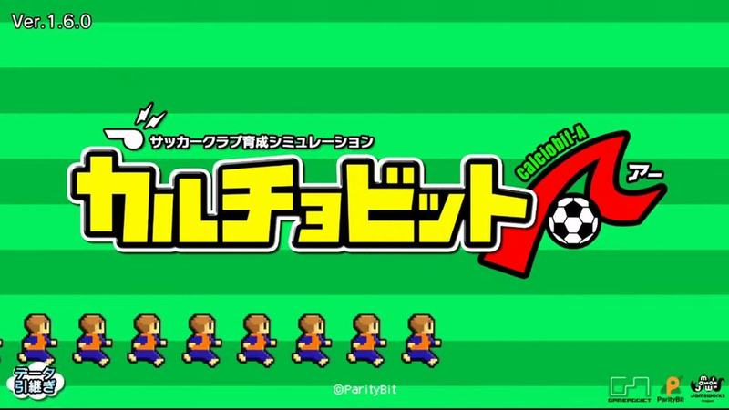

Ecrã de título com logotipo amarelo e vermelho de contorno preto sobre relvado listrado, fila de pequenos jogadores em pixel art e número de versão no canto.

- Etiquetas: logotipo, listras-verdes, bonecos, versao
- Qualidade: boa
- Origem: [D20fPVGhgt0](https://www.youtube.com/watch?v=D20fPVGhgt0&t=113s) (25%, ~113 s), canal ハリウッド.T

## titulo-04.jpg

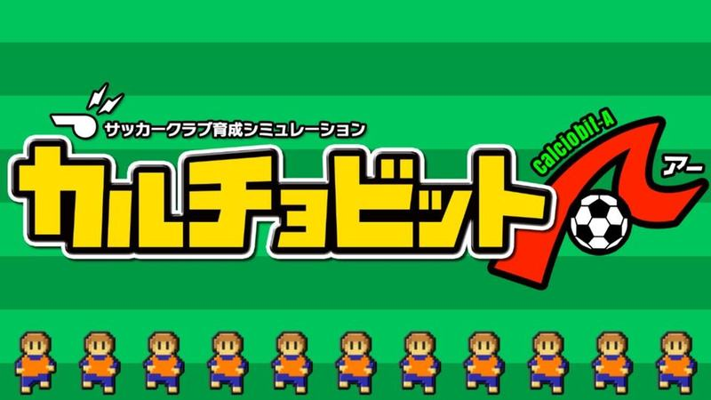

Ecrã de título com logotipo grande e fila de onze pequenos jogadores de laranja em pixel art sobre relvado listrado.

- Etiquetas: logotipo, listras-verdes, bonecos
- Qualidade: boa
- Origem: [DzNR3DlbxeE](https://www.youtube.com/watch?v=DzNR3DlbxeE) (capa), canal NA

## titulo-05.jpg

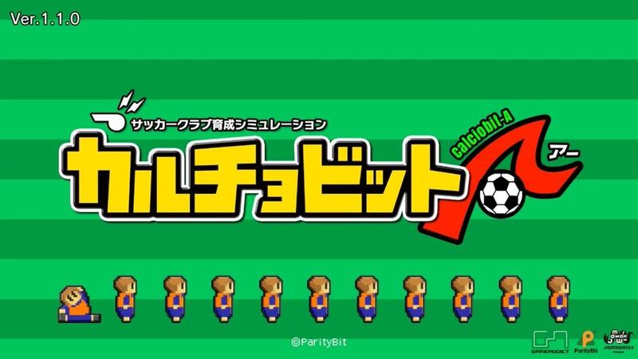

Ecrã de título limpo (Ver.1.1.0) com logotipo e fila de bonecos de laranja, um deles deitado; logos dos estúdios no canto.

- Etiquetas: logotipo, listras-verdes, bonecos, versao
- Qualidade: boa
- Origem: [IlpszHPk2qc](https://www.youtube.com/watch?v=IlpszHPk2qc&t=226s) (25%, ~226 s), canal ぼくくんゲーム

## titulo-06.jpg

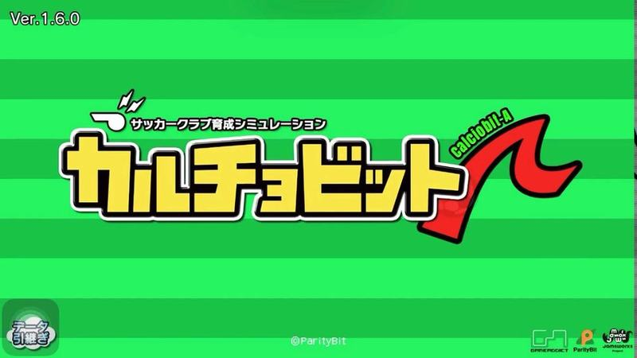

Ecrã de título com o logótipo vermelho e preto sobre relvado listrado verde, número de versão no canto e botão de dados em baixo.

- Etiquetas: logotipo, versao, fundo-listrado, relvado
- Qualidade: boa
- Origem: [o7O6SMWi1Ss](https://www.youtube.com/watch?v=o7O6SMWi1Ss) (capa), canal NA

## titulo-07.jpg

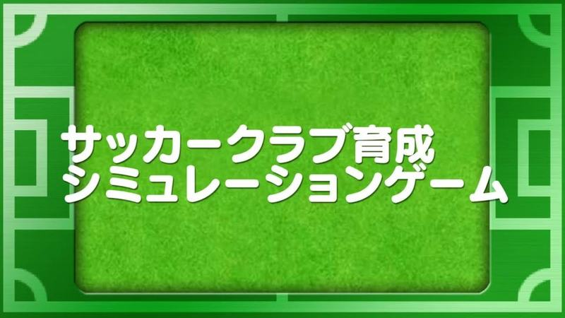

Abertura do jogo: texto branco grande sobre um relvado emoldurado por linhas de campo.

- Etiquetas: abertura, relvado, moldura-campo, texto-branco
- Qualidade: boa
- Origem: [v58l_A9n9bk](https://www.youtube.com/watch?v=v58l_A9n9bk&t=60s) (25%, ~60 s), canal ゲームアディクト

## titulo-08.jpg

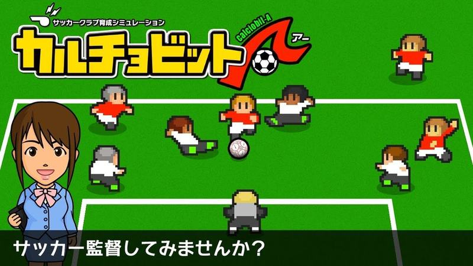

Abertura com o logótipo, bonecos grandes a jogar à bola e a secretária a convidar a ser treinador numa caixa de texto.

- Etiquetas: abertura, logotipo, secretaria, bonecos, dialogo
- Qualidade: boa
- Origem: [v58l_A9n9bk](https://www.youtube.com/watch?v=v58l_A9n9bk) (capa), canal ゲームアディクト

## titulo-09.jpg

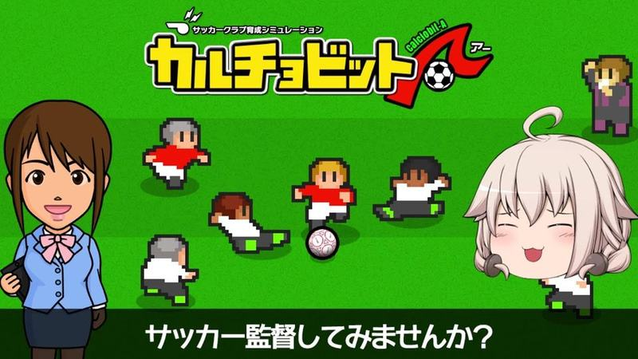

Ecrã de abertura com logotipo, secretária e bonecos pixel a jogar; personagem do youtuber à direita e pergunta «サッカー監督してみませんか？».

- Etiquetas: logotipo, secretaria, pixel-art, personagem-youtuber
- Qualidade: ok · tem texto do youtuber por cima
- Origem: [BZidRWq_qDM](https://www.youtube.com/watch?v=BZidRWq_qDM&t=530s) (75%, ~530 s), canal みらぽす

## titulo-10.jpg

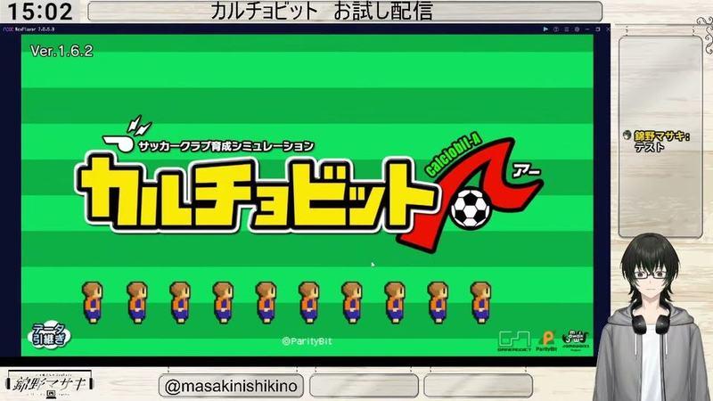

Ecrã de título dentro de uma moldura de direto com relógio e título da transmissão; avatar do vtuber à direita.

- Etiquetas: logotipo, listras-verdes, bonecos, moldura-stream, vtuber
- Qualidade: ok · tem texto do youtuber por cima
- Origem: [HRSDcGvOlpE](https://www.youtube.com/watch?v=HRSDcGvOlpE&t=4531s) (25%, ~4531 s), canal 錦野マサキ

## titulo-11.jpg

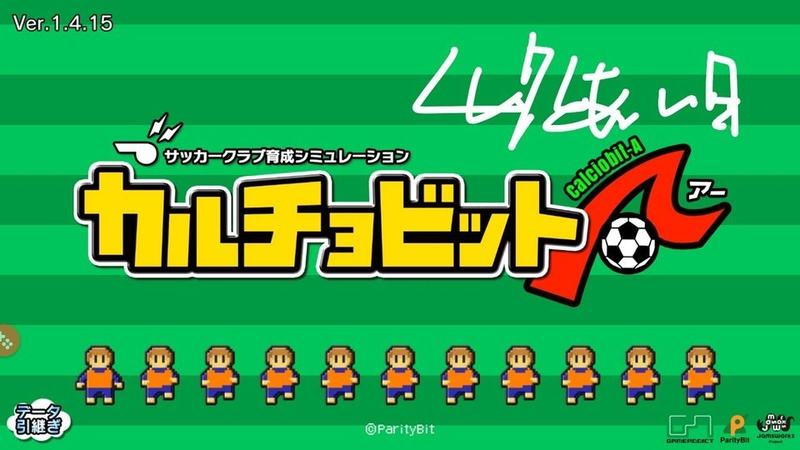

Ecrã de título com logotipo e fila de bonecos; rabisco manuscrito do youtuber no canto superior direito.

- Etiquetas: logotipo, listras-verdes, bonecos, versao
- Qualidade: ok · tem texto do youtuber por cima
- Origem: [Ho1F1CpLh5g](https://www.youtube.com/watch?v=Ho1F1CpLh5g) (capa), canal ろいのえい

## titulo-12.jpg

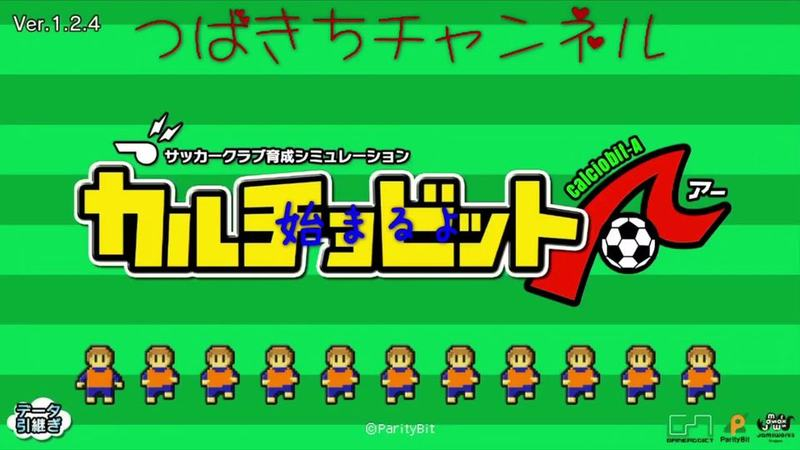

Ecrã de título com o logótipo amarelo do jogo sobre riscas verdes, uma fila de bonecos de laranja em baixo e número de versão; texto manuscrito do youtuber por cima.

- Etiquetas: logotipo-jogo, versao, bonecos-fila, riscas-verdes, texto-youtuber
- Qualidade: ok · tem texto do youtuber por cima
- Origem: [atpax1cSyzM](https://www.youtube.com/watch?v=atpax1cSyzM&t=146s) (25%, ~146 s), canal つばきち【Jリーグ系YouTuber】

## titulo-13.jpg

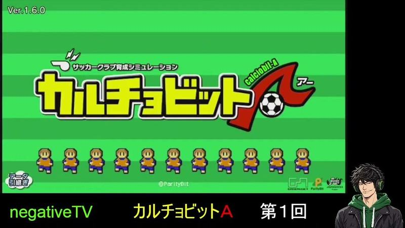

Ecrã de título com logótipo amarelo e vermelho sobre riscas verdes e fila de bonecos de equipamento azul e amarelo; faixa e personagem do youtuber em baixo.

- Etiquetas: logotipo-jogo, versao, bonecos-fila, riscas-verdes, personagem-youtuber
- Qualidade: ok · tem texto do youtuber por cima
- Origem: [dNhVETUoxMs](https://www.youtube.com/watch?v=dNhVETUoxMs&t=166s) (25%, ~166 s), canal negative TV

## titulo-14.jpg

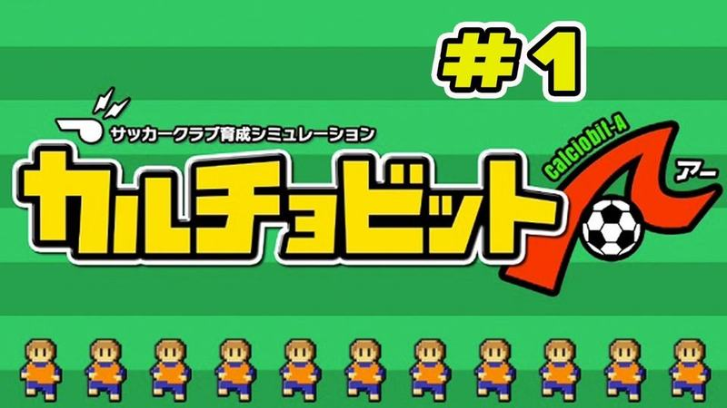

Ecrã de título com o logótipo e uma fila de bonecos de camisola laranja em baixo, sobre fundo verde listrado; número do episódio acrescentado pelo youtuber.

- Etiquetas: logotipo, fila-bonecos, fundo-listrado
- Qualidade: ok · tem texto do youtuber por cima
- Origem: [t8T0hRYc-r4](https://www.youtube.com/watch?v=t8T0hRYc-r4) (capa), canal Zoo Suu

## titulo-15.jpg

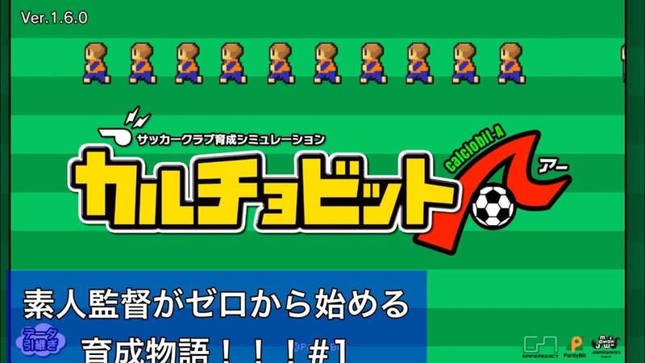

Ecrã de título com o logótipo e fila de bonecos em cima, versão no canto; faixa azul de texto do youtuber em baixo.

- Etiquetas: logotipo, fila-bonecos, versao, fundo-listrado
- Qualidade: ok · tem texto do youtuber por cima
- Origem: [uDUMcbci3wI](https://www.youtube.com/watch?v=uDUMcbci3wI) (capa), canal よつや
