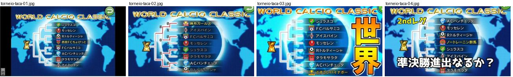
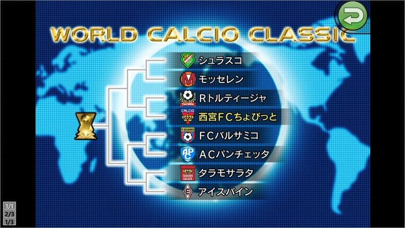
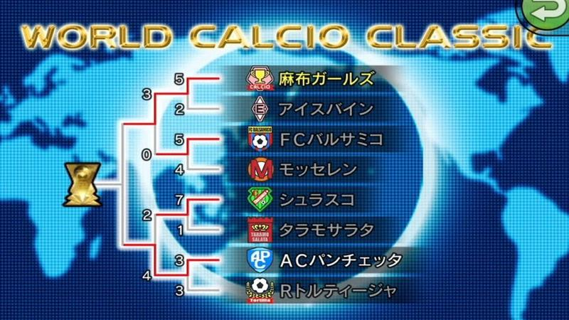
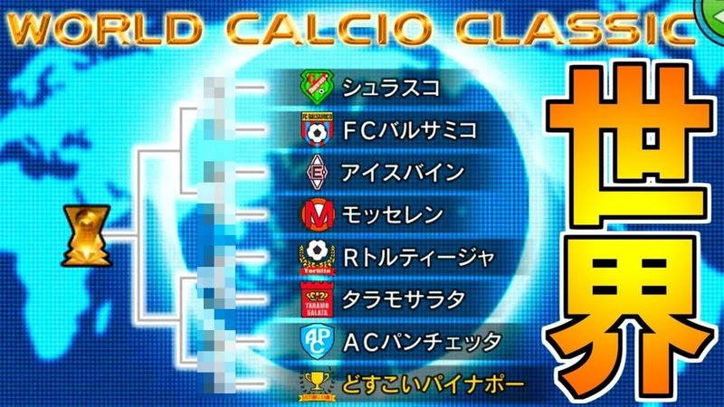
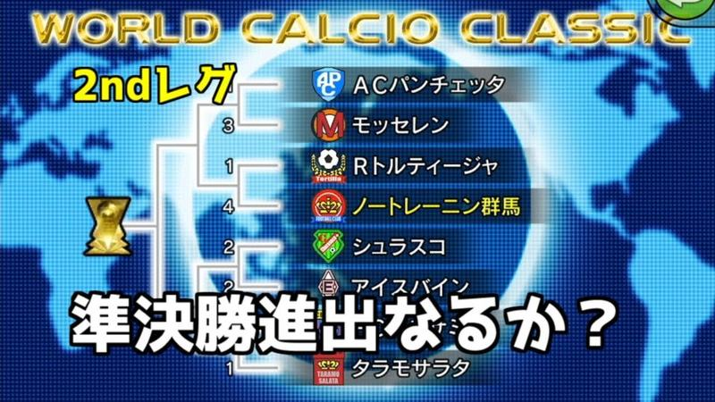

# torneio-taca

Categoria: Menus e ecrãs de gestão. 4 imagens. A folha `_folha.jpg` mostra-as todas de uma vez.

## torneio-taca-01.jpg

Chave do torneio «WORLD CALCIO CLASSIC» sobre mapa-mundo azul: lista de oito clubes com emblemas ligados por linhas até um troféu dourado; páginas 1/3 a 3/3 à esquerda.

- Etiquetas: chave-torneio, emblemas, mapa-mundo, trofeu, botao-voltar
- Qualidade: boa
- Origem: [7a1xcp4xAi8](https://www.youtube.com/watch?v=7a1xcp4xAi8) (capa), canal しゃり

## torneio-taca-02.jpg

Quadro de eliminatórias do torneio mundial com oito equipas e emblemas, resultados nas ligações e troféu à esquerda, sobre mapa-mundo azul brilhante.

- Etiquetas: quadro-eliminatorias, mapa-mundo, emblemas, trofeu, resultados
- Qualidade: boa
- Origem: [mTIbj3NqNug](https://www.youtube.com/watch?v=mTIbj3NqNug) (capa), canal しゃり

## torneio-taca-03.jpg

Quadro do World Calcio Classic com chave de eliminatórias, emblemas e nomes das equipas sobre mapa-múndi azul e título dourado; texto «世界» enorme do youtuber.

- Etiquetas: quadro-torneio, emblemas, mapa-mundo, taca, texto-grande
- Qualidade: ok · tem texto do youtuber por cima
- Origem: [MUaIfSDKYOU](https://www.youtube.com/watch?v=MUaIfSDKYOU) (capa), canal NA

## torneio-taca-04.jpg

Quadro do World Calcio Classic (2.ª mão) com resultados nas chaves e emblemas sobre mapa-múndi azul; texto do youtuber em baixo.

- Etiquetas: quadro-torneio, emblemas, mapa-mundo, resultados, texto-grande
- Qualidade: ok · tem texto do youtuber por cima
- Origem: [PMXi9KLEi6I](https://www.youtube.com/watch?v=PMXi9KLEi6I) (capa), canal しゃり
