# treino

Categoria: Menus e ecrãs de gestão. 25 imagens. A folha `_folha.jpg` mostra-as todas de uma vez.

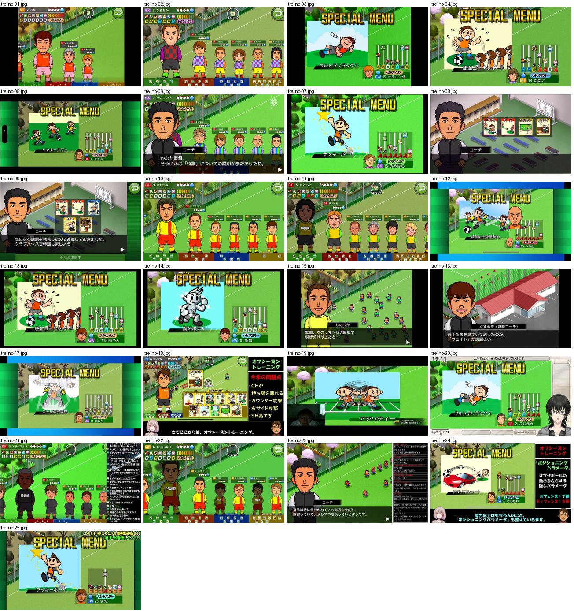

## treino-01.jpg

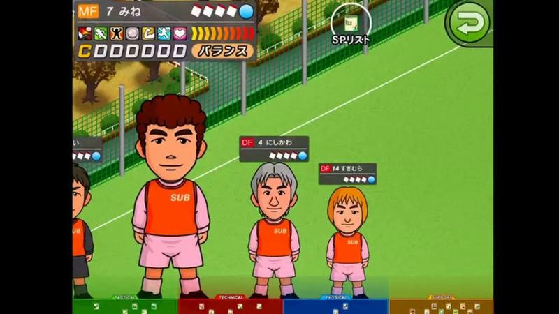

Treino: jogadores em corpo inteiro no campo de treino com pequenas fichas por cima (posição, nome, estrelas de condição), ficha do selecionado no topo e separadores de cartas por cor em baixo; botão «SPリスト».

- Etiquetas: campo-treino, retratos, barra-condicao, notas-letras, separadores-cartas, botao-voltar
- Qualidade: boa
- Origem: [82ITuK9RU-I](https://www.youtube.com/watch?v=82ITuK9RU-I&t=1920s) (75%, ~1920 s), canal NA

## treino-02.jpg

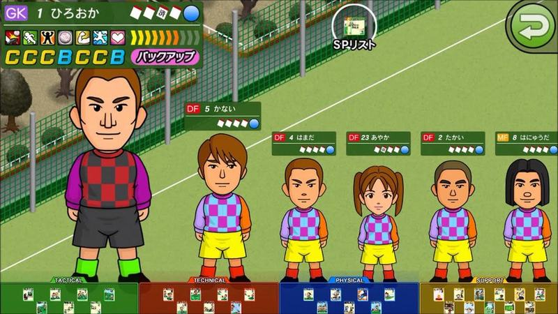

Treino com guarda-redes destacado à frente e fila de jogadores em corpo inteiro; separadores coloridos de cartas (TACTICAL, TECHNICAL, PHYSICAL...) em baixo.

- Etiquetas: campo-treino, retratos, barra-condicao, notas-letras, separadores-cartas, botao-voltar
- Qualidade: boa
- Origem: [8GhUxHFSWD4](https://www.youtube.com/watch?v=8GhUxHFSWD4&t=435s) (75%, ~435 s), canal ゲーム動画で行こう! Playing Games.

## treino-03.jpg

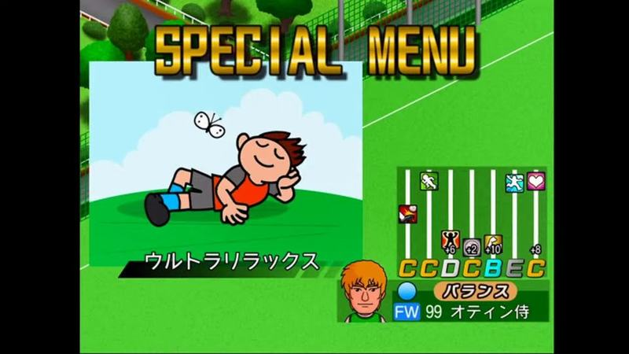

«SPECIAL MENU» de treino: título amarelo, ilustração de jogador deitado a relaxar («ウルトラリラックス») e mini-ficha com barras de atributos e notas.

- Etiquetas: menu-especial, ilustracao, notas-letras, barras-atributos, treino-especial
- Qualidade: boa
- Origem: [8ljqTx1muXg](https://www.youtube.com/watch?v=8ljqTx1muXg&t=2491s) (50%, ~2491 s), canal NA

## treino-04.jpg

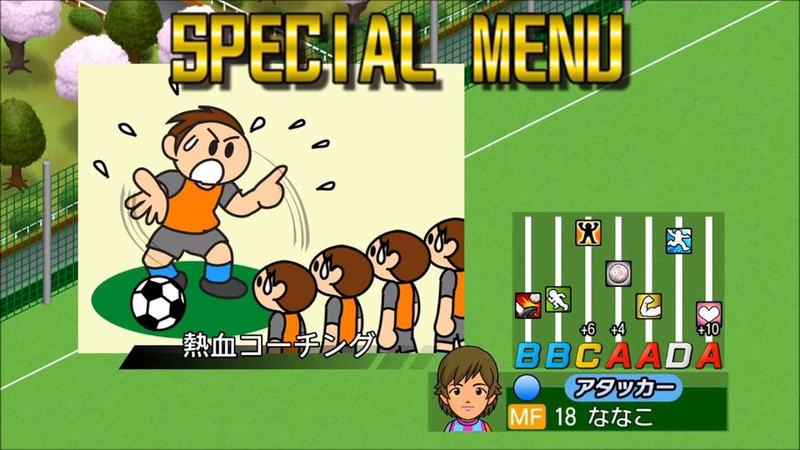

«SPECIAL MENU» com ilustração de treinador a gritar com jogadores («熱血コーチング») e mini-ficha com barras e subidas de atributos.

- Etiquetas: menu-especial, ilustracao, notas-letras, barras-atributos, treino-especial
- Qualidade: boa
- Origem: [AVQLF2gdLH0](https://www.youtube.com/watch?v=AVQLF2gdLH0&t=730s) (75%, ~730 s), canal ゲーム動画で行こう! Playing Games.

## treino-05.jpg

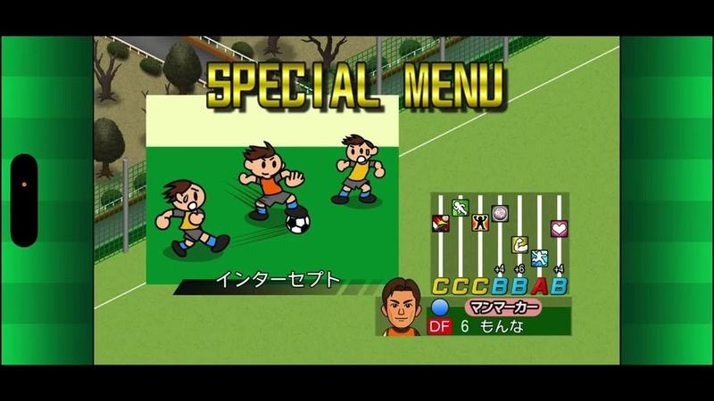

Ecrã «SPECIAL MENU» em letras douradas com cartão de treino especial (bonecos a disputar a bola, nome «インターセプト») e mini-ficha do jogador com barras e notas em letras.

- Etiquetas: special-menu, cartao-habilidade, notas-letras, barras, tipo-jogador, retrato
- Qualidade: boa
- Origem: [FLGYcdqNFWo](https://www.youtube.com/watch?v=FLGYcdqNFWo&t=826s) (25%, ~826 s), canal NA

## treino-06.jpg

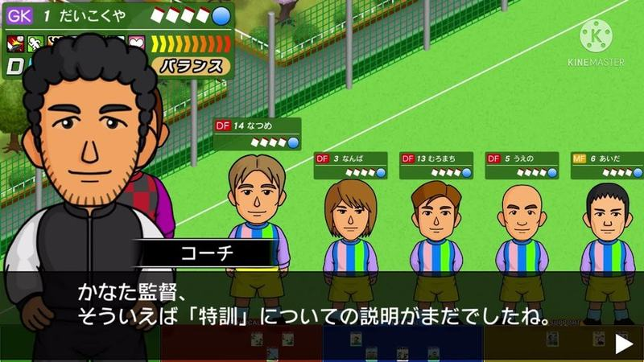

O adjunto explica o treino especial com uma fila de jogadores em corpo inteiro, cada um com mini-etiqueta de posição, nome e pontos; mini-ficha do guarda-redes no topo.

- Etiquetas: treinador, retratos, mini-fichas, estrelas, caixa-texto, tutorial
- Qualidade: boa
- Origem: [JFQ9eIcbgic](https://www.youtube.com/watch?v=JFQ9eIcbgic&t=84s) (25%, ~84 s), canal かなた。

## treino-07.jpg

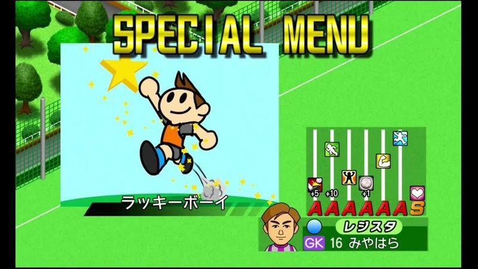

«SPECIAL MENU» com cartão de treino especial «ラッキーボーイ» (boneco a saltar com estrela e brilhos) e mini-ficha do guarda-redes com barras e notas A/S.

- Etiquetas: special-menu, cartao-habilidade, notas-letras, barras, estrela
- Qualidade: boa
- Origem: [LGye44A3hl8](https://www.youtube.com/watch?v=LGye44A3hl8&t=5886s) (75%, ~5886 s), canal フラメンコ

## treino-08.jpg

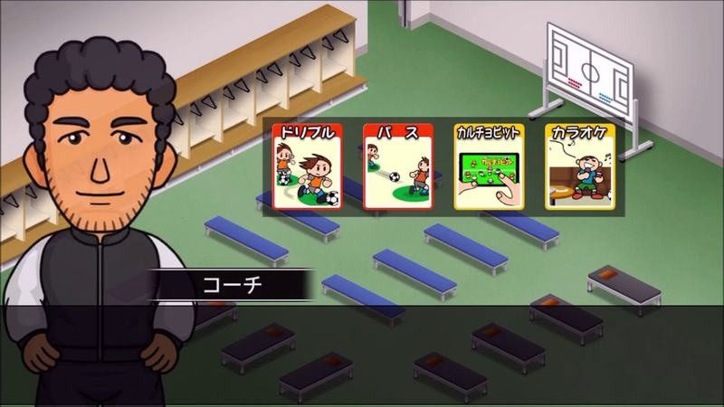

No balneário o adjunto propõe o treino com quatro cartas ilustradas (drible, passe, Calciobit, karaoke) numa fila sobre fundo escuro.

- Etiquetas: balneario, treinador, cartas, escolha-treino, isometrico
- Qualidade: boa
- Origem: [MKCrlWGeOLU](https://www.youtube.com/watch?v=MKCrlWGeOLU&t=573s) (75%, ~573 s), canal ゲーム動画で行こう! Playing Games.

## treino-09.jpg

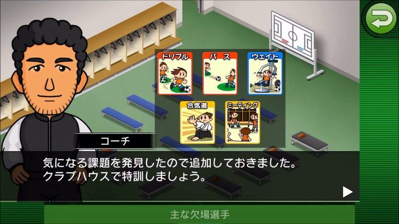

No balneário o adjunto acrescenta cartas de treino (drible, passe, musculação, etc.) numa grelha e convida a treinar no clube; rodapé com jogadores em falta.

- Etiquetas: balneario, treinador, cartas, escolha-treino, botao-voltar
- Qualidade: boa
- Origem: [NowypCuRdKs](https://www.youtube.com/watch?v=NowypCuRdKs&t=533s) (75%, ~533 s), canal ゲーム動画で行こう! Playing Games.

## treino-10.jpg

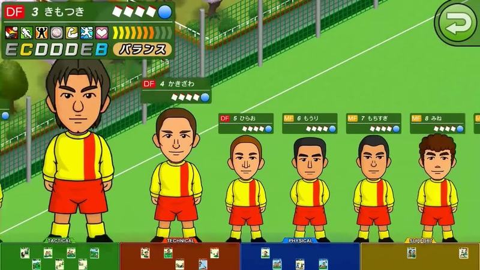

Escolha de jogadores para treinar: fila de jogadores em corpo inteiro com mini-etiquetas de posição e nome, ficha do primeiro no topo e separadores coloridos em baixo (tático, técnico, físico, mental).

- Etiquetas: jogadores-corpo-inteiro, mini-fichas, notas-letras, separadores-cor, estrelas, botao-voltar
- Qualidade: boa
- Origem: [S5j2j-O6g-Y](https://www.youtube.com/watch?v=S5j2j-O6g-Y&t=552s) (75%, ~552 s), canal ぼくくんゲーム

## treino-11.jpg

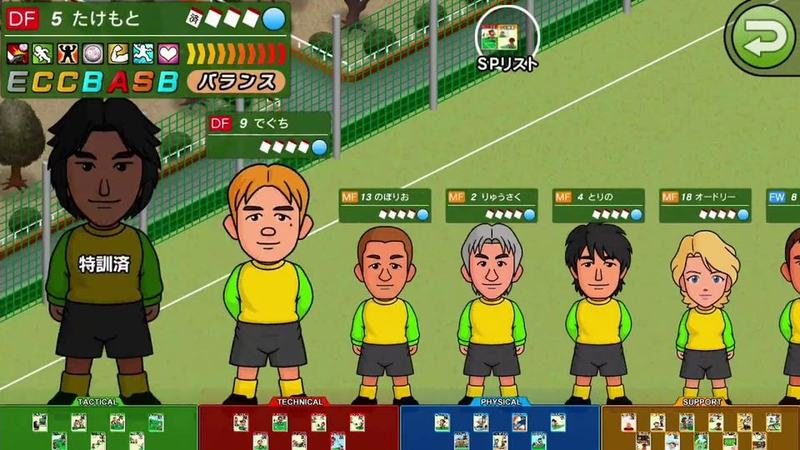

Ecrã de treino com a equipa amarela em fila, ficha do jogador selecionado em cima, mini fichas com estrelas sobre cada um e barra de categorias de treino colorida em baixo.

- Etiquetas: treino, jogadores-de-pe, notas-letras, cartas, estrelas, arvores, botao-voltar
- Qualidade: boa
- Origem: [_OancWksxtM](https://www.youtube.com/watch?v=_OancWksxtM&t=664s) (75%, ~664 s), canal ぼくくんゲーム

## treino-12.jpg

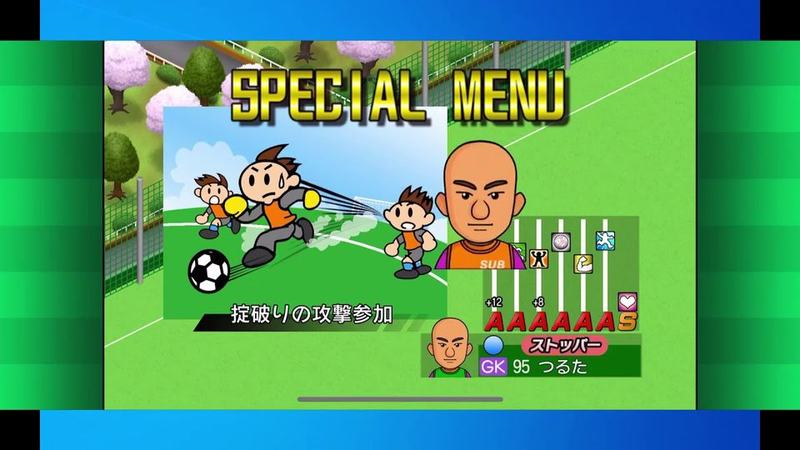

Ecrã «SPECIAL MENU» com ilustração do treino especial (guarda-redes a sair ao ataque), nome do treino e mini ficha de guarda-redes com notas e barras.

- Etiquetas: treino-especial, special-menu, ilustracao, notas-letras, tipo-jogador
- Qualidade: boa
- Origem: [ir5q8rydLZk](https://www.youtube.com/watch?v=ir5q8rydLZk&t=372s) (50%, ~372 s), canal もーりー【MG部】

## treino-13.jpg

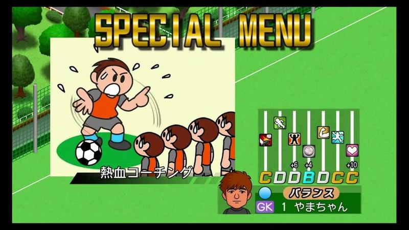

Treino especial: título «SPECIAL MENU» em letras douradas, ilustração cómica do treinador a gritar e barras verticais dos atributos com o ganho e as notas do jogador.

- Etiquetas: menu-especial, ilustracao, barras-atributos, notas-letras, retrato
- Qualidade: boa
- Origem: [nT5b_umKMOw](https://www.youtube.com/watch?v=nT5b_umKMOw&t=539s) (75%, ~539 s), canal ぼくくんゲーム

## treino-14.jpg

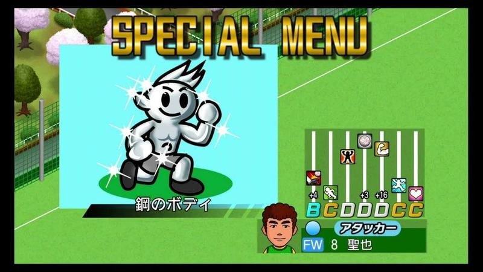

Treino especial «corpo de aço»: ilustração de um boneco prateado a brilhar, barras dos atributos com o ganho e notas do jogador.

- Etiquetas: menu-especial, ilustracao, barras-atributos, notas-letras, brilho
- Qualidade: boa
- Origem: [sqz0eYHzxJM](https://www.youtube.com/watch?v=sqz0eYHzxJM&t=214s) (25%, ~214 s), canal ぼくくんゲーム

## treino-15.jpg

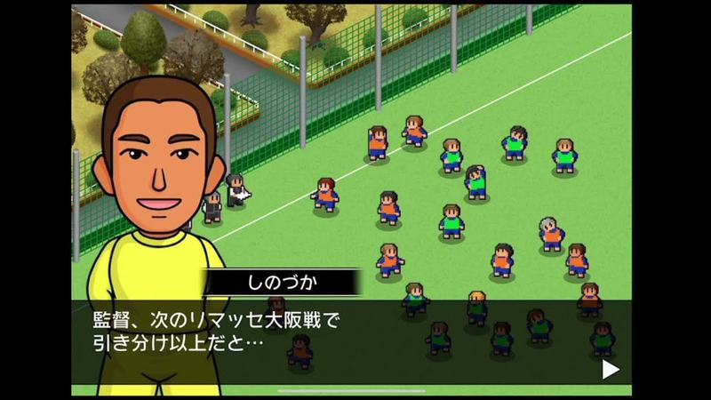

Jogador em primeiro plano sobre o campo de treino isométrico com o plantel a treinar, a falar do próximo jogo numa caixa de diálogo.

- Etiquetas: jogador, dialogo, campo-treino, isometrico, proximo-jogo
- Qualidade: boa
- Origem: [zNYtmBUGFG4](https://www.youtube.com/watch?v=zNYtmBUGFG4&t=229s) (25%, ~229 s), canal しゃり

## treino-16.jpg

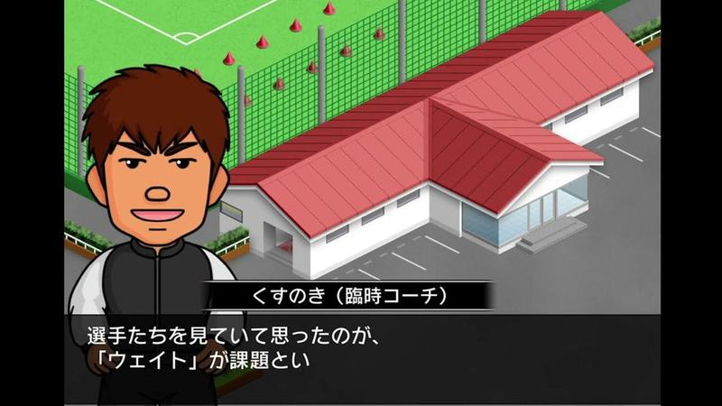

Treinador temporário diante do edifício isométrico a indicar o ponto fraco a treinar, numa caixa de diálogo com o nome por cima.

- Etiquetas: treinador-temporario, dialogo, edificio, isometrico, objetivo-treino
- Qualidade: boa
- Origem: [znlZ6_YmAgE](https://www.youtube.com/watch?v=znlZ6_YmAgE&t=131s) (25%, ~131 s), canal NA

## treino-17.jpg

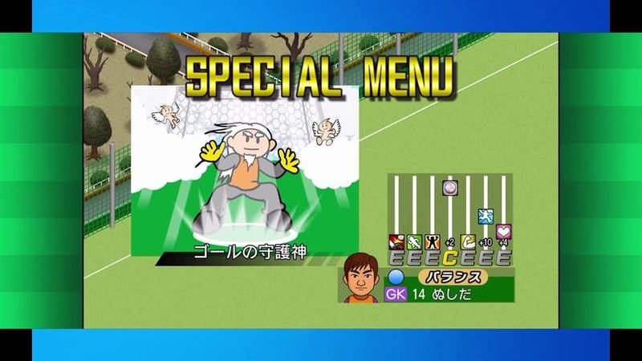

Ecrã «SPECIAL MENU» com uma ilustração do treino especial (velho guarda-redes num quadro), nome do treino e mini ficha do jogador com barras e notas.

- Etiquetas: treino-especial, special-menu, ilustracao, notas-letras, tipo-jogador, carta
- Qualidade: ok
- Origem: [dkXK9byC0wM](https://www.youtube.com/watch?v=dkXK9byC0wM&t=351s) (50%, ~351 s), canal もーりー【MG部】

## treino-18.jpg

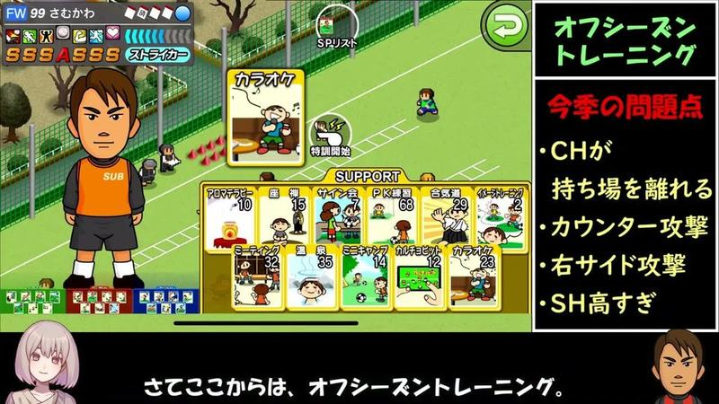

Treino de pré-época com jogador em corpo inteiro e grelha de cartas «SUPPORT» ilustradas; painel lateral e legenda do youtuber.

- Etiquetas: cartas-habilidades, pre-temporada, retrato, notas-letras, avatar-youtuber, anotacoes-youtuber
- Qualidade: ok · tem texto do youtuber por cima
- Origem: [8a-TlB8H3Pw](https://www.youtube.com/watch?v=8a-TlB8H3Pw&t=94s) (25%, ~94 s), canal のうきん(Nokin)

## treino-19.jpg

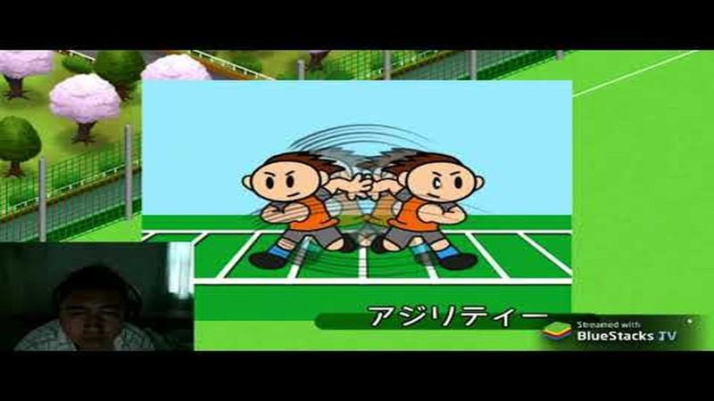

Animação de treino «アジリティー»: dois bonecos ilustrados a mexer-se rapidamente num painel azul sobre o campo de treino; webcam no canto.

- Etiquetas: animacao-treino, ilustracao, cerejeiras, webcam
- Qualidade: ok · tem texto do youtuber por cima
- Origem: [CbFU3oY9Al0](https://www.youtube.com/watch?v=CbFU3oY9Al0&t=829s) (50%, ~829 s), canal YS Studio 製作

## treino-20.jpg

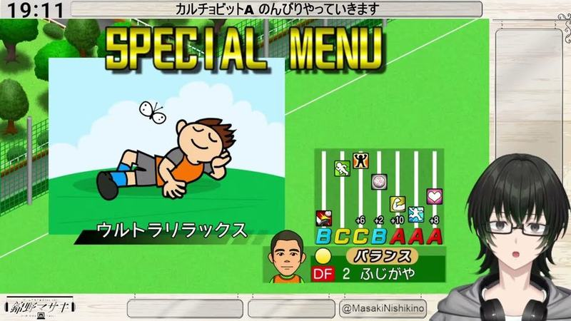

«SPECIAL MENU» com cartão de treino (boneco deitado a descansar, «ウルトラリラックス») e mini-ficha do defesa com barras e notas; avatar do vtuber por cima.

- Etiquetas: special-menu, cartao-habilidade, notas-letras, barras, vtuber
- Qualidade: ok · tem texto do youtuber por cima
- Origem: [HbtKHUCaqCU](https://www.youtube.com/watch?v=HbtKHUCaqCU&t=8003s) (50%, ~8003 s), canal 錦野マサキ

## treino-21.jpg

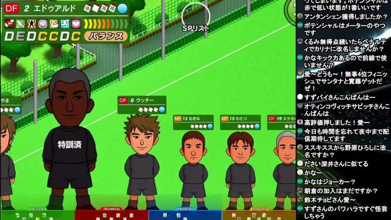

Ecrã de treino com os jogadores de pé em fila sobre a relva, ficha do jogador em cima com notas em letras (DEDCCDC) e ícones de cartas; etiqueta «特訓済» no treinador.

- Etiquetas: treino, jogadores-de-pe, notas-letras, cartas, estrelas, relvado
- Qualidade: ok · tem texto do youtuber por cima
- Origem: [TWFJn-0EV84](https://www.youtube.com/watch?v=TWFJn-0EV84&t=6264s) (75%, ~6264 s), canal NA

## treino-22.jpg

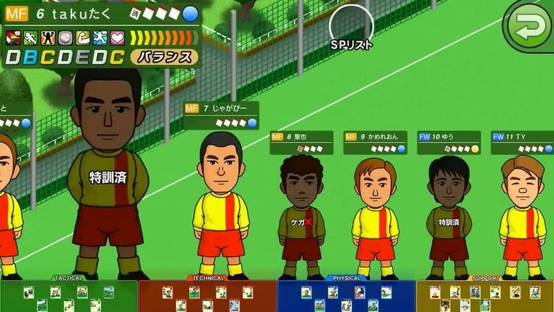

Ecrã de treino com a equipa de equipamento amarelo e vermelho em fila sobre a relva, ficha do jogador em cima e barra de categorias de treino em baixo.

- Etiquetas: treino, jogadores-de-pe, notas-letras, cartas, relvado, botao-voltar
- Qualidade: ok · tem texto do youtuber por cima
- Origem: [UN9g62Rw7M4](https://www.youtube.com/watch?v=UN9g62Rw7M4&t=242s) (25%, ~242 s), canal ぼくくんゲーム

## treino-23.jpg

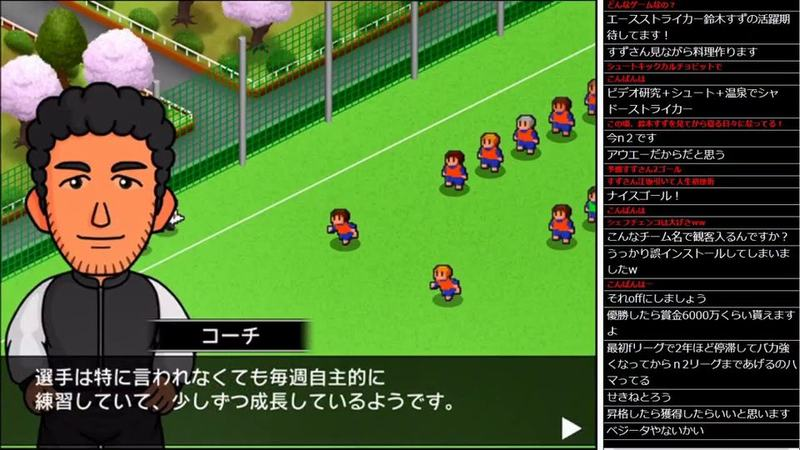

Treinador em primeiro plano sobre o campo de treino isométrico com jogadores e cerejeiras, a comentar o treino autónomo; chat do direto à direita.

- Etiquetas: treinador, dialogo, campo-treino, isometrico, cerejeiras, chat-direto
- Qualidade: ok · tem texto do youtuber por cima
- Origem: [mt3qa3u5NYM](https://www.youtube.com/watch?v=mt3qa3u5NYM&t=3627s) (75%, ~3627 s), canal NA

## treino-24.jpg

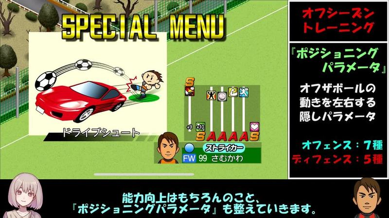

Treino especial com ilustração cómica de um remate «carro» e barras dos atributos com notas S; painel explicativo do youtuber à direita e legenda em baixo.

- Etiquetas: menu-especial, ilustracao, barras-atributos, notas-letras, explicacao
- Qualidade: ok · tem texto do youtuber por cima
- Origem: [qqPwYiucFiw](https://www.youtube.com/watch?v=qqPwYiucFiw&t=599s) (75%, ~599 s), canal NA

## treino-25.jpg

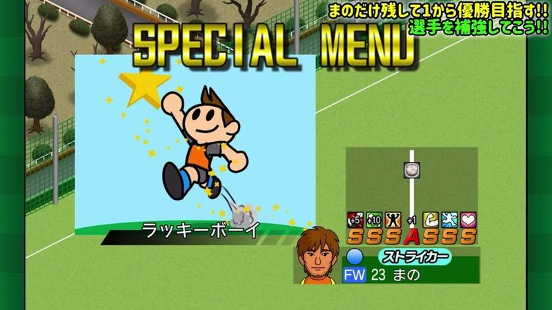

Treino especial «rapaz sortudo»: ilustração de um jogador a saltar com estrela e brilhos, barras dos atributos e notas; título do youtuber no canto.

- Etiquetas: menu-especial, ilustracao, barras-atributos, notas-letras, estrela
- Qualidade: ok · tem texto do youtuber por cima
- Origem: [uP8VWWpy3jA](https://www.youtube.com/watch?v=uP8VWWpy3jA&t=166s) (25%, ~166 s), canal つばきち【Jリーグ系YouTuber】
