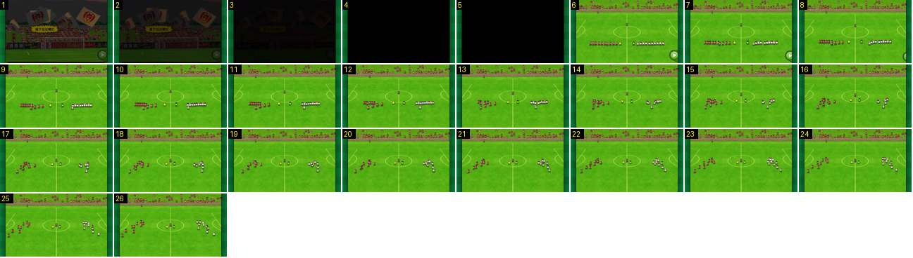

# Alinhamento até ao sorteio

Mostra o caminho entre a claque e o sorteio: depois do preto, a fila dos jogadores desfaz-se em leque e cada um corre para o seu lugar, com a câmara parada. A continuação está na sequência do sorteio, na área jogo-camara.

- **Duração:** 2,6 s, 26 frames a 10 fps
- **Origem:** [0AWtZz7qiDM](https://www.youtube.com/watch?v=0AWtZz7qiDM&t=16s), de 16,5 s a 19,1 s, canal Booby
- **Etiquetas:** alinhamento, entrada-equipas, camara-parada, fundido-preto, corte

## Frame a frame

- **1–3:** a claque, com bandeiras e um balão de grito, escurece até ao preto (0,3 s).
- **4–5:** preto (0,2 s).
- **6:** corte seco, sem fundido de entrada, para o plano alto e largo do meio-campo. As duas equipas estão em linhas horizontais a meio do campo, cada uma do seu lado da linha de meio-campo. Os dois capitães (aqui os guarda-redes, de amarelo e de verde) e o árbitro estão no círculo central. O botão verde de avançar está no canto.
- **7–26 (2,0 s):** as linhas desfazem-se. Os jogadores andam em leque, na diagonal para baixo e para fora, até às posições da formação. A câmara fica parada e o botão de avançar desaparece.
- **26 → 27:** corte seco para o grande plano do círculo central. O resto (zoom, sorteio, corte a preto e fundido para o jogo) está em [sorteio-zoom-e-fade](../../jogo-camara/sorteio-zoom-e-fade/README.md), que começa dois frames antes deste fim.
