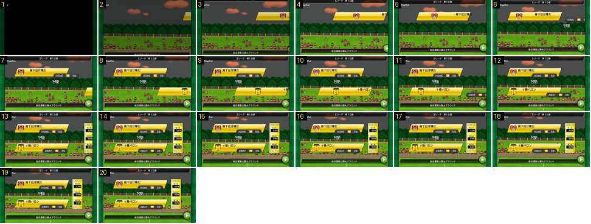

# Antevisão: as faixas entram

Abertura do ecrã de antevisão de um jogo de liga: o estádio aparece primeiro e depois os elementos entram um a um, da direita, por ordem fixa. Mostra o ritmo e a curva das entradas.

- **Duração:** 2,0 s, 20 frames a 10 fps
- **Origem:** [0AWtZz7qiDM](https://www.youtube.com/watch?v=0AWtZz7qiDM&t=0s), de 0,2 s a 2,2 s, canal Booby
- **Etiquetas:** antevisao, faixas, vs, toto, deslizar, ease-out, ui

## Frame a frame

- **1:** preto (início do vídeo).
- **2:** já se vê o estádio em 3D (bancada pequena, árvores, céu ao entardecer). A barra do rodapé com o nome do estádio sobe de baixo; a ponta da faixa amarela da equipa da casa aparece na borda direita (x ≈ 600 px).
- **3–5:** a faixa da casa desliza para a esquerda: borda esquerda a ≈ 390, 250 e 150 px. Passos de 210, 140 e 100 px por frame, por isso abranda no fim (ease-out), em 0,3 s. A barra do topo («Sリーグ 第10節») desce de cima ao mesmo tempo.
- **6–7:** a cápsula escura «HOME · divisão · posição» desliza da direita para debaixo da faixa (2 frames); o «VS» aparece sem animação.
- **8–10:** a faixa da equipa de fora entra igual à primeira: ≈ 390, 250 e 150 px.
- **11–12:** entra a cápsula «AWAY».
- **13–15:** a coluna TOTO (WIN, DRAW, WIN) desliza da direita: ≈ 556, 490 e 480 px, em 2 frames.
- **16–20:** fica tudo parado; só o público mexe. Do preto ao ecrã completo passa 1,3 s.
