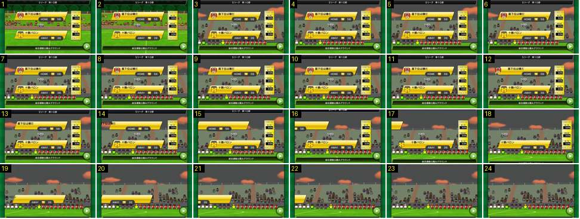

# Antevisão: as faixas saem para a esquerda

Fim da antevisão de um jogo de liga. Atrás das faixas, o fundo corta para a bancada principal, onde as duas equipas já estão em fila; depois as faixas saem para a esquerda, uma de cada vez. É assim que a antevisão passa a vez à entrada das equipas.

- **Duração:** 2,4 s, 24 frames a 10 fps
- **Origem:** [0AWtZz7qiDM](https://www.youtube.com/watch?v=0AWtZz7qiDM&t=5s), de 5,0 s a 7,4 s, canal Booby
- **Etiquetas:** antevisao, faixas, deslizar, ease-in, corte, bancada, fila-jogadores

## Frame a frame

- **Antes (2,5–5,0 s, fora da sequência):** com as faixas paradas, o fundo 3D (bancada pequena) sobe devagar, como uma câmara a inclinar-se.
- **1–2:** o mesmo fundo, a bancada pequena.
- **3 (5,2 s):** corte seco, só no fundo, para a bancada principal. Junto à linha lateral estão os 22 jogadores numa fila só (as duas equipas lado a lado) e os árbitros. As faixas não mexem.
- **4–11:** parado (0,8 s).
- **12:** o emblema da faixa da casa desaparece.
- **13–17:** a faixa da casa sai para a esquerda e acelera (ease-in), com o texto e a cápsula HOME a irem atrás. Some no frame 17, 0,5 s depois.
- **17–19:** num só frame cada, a barra do topo sobe, a coluna TOTO sai e a barra do rodapé desce.
- **18–23:** a faixa da equipa de fora sai do mesmo modo, a acelerar.
- **24:** fica só a bancada com a fila de jogadores. A câmara aguenta este plano até aos 10,2 s e depois funde para preto antes da claque.
