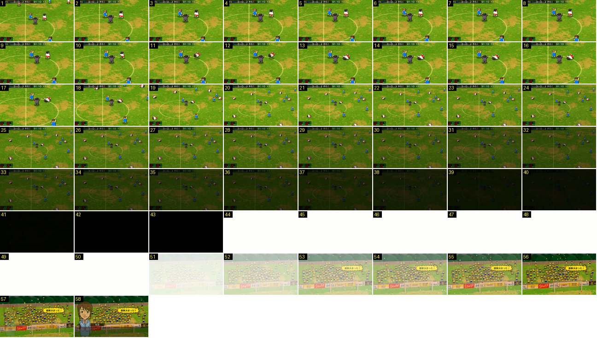

# Apito final do jogo do título

O apito final no jogo que deu o campeonato: um grande plano do árbitro, os vencidos caem, a câmara volta ao plano largo e escurece devagar, e depois há um clarão branco que abre a bancada com papelinhos. O clarão branco só aparece nos momentos de título.

- **Duração:** 5,8 s, 58 frames a 10 fps
- **Origem:** [KbPiy1_7C58](https://www.youtube.com/watch?v=KbPiy1_7C58&t=510s), de 510,6 s a 516,4 s, canal nakanaka
- **Etiquetas:** apito-final, grande-plano, arbitro, fundido-preto, clarao-branco, confetti, bancada, titulo

## Frame a frame

- **Antes (510,0–510,5 s):** do plano de jogo, um corte para grande plano no círculo central, com o relógio em «91:10 +1».
- **1–3:** a câmara ainda acaba de se aproximar. O árbitro, ao centro, está de braços no ar.
- **4–9:** parado. Dois jogadores da equipa vencedora (azul) e dois vencidos (branco) estão à volta do árbitro.
- **10–12:** um jogador de branco cai de costas no relvado (0,3 s).
- **13–17:** parado.
- **18–19:** a câmara afasta-se depressa para o plano largo (0,2 s). Os vencidos estão deitados pelo campo e os vencedores de braços no ar.
- **20–40:** fundido lento para preto (2,1 s). A barra do marcador escurece com o campo.
- **41–43:** preto (0,3 s).
- **44–50:** branco puro (0,7 s), um clarão.
- **51–56:** o branco desfaz-se (0,6 s) e revela a bancada da claque em festa. Caem papelinhos coloridos e aparece um balão amarelo de grito («優勝決まった！», está decidido o título).
- **57–58:** a secretária entra em retrato grande à esquerda, com a caixa de diálogo («・・・ついに、ついに優・・・勝！»). Durante a fala, a bancada continua a mudar de balão de grito mais ou menos a cada segundo.
