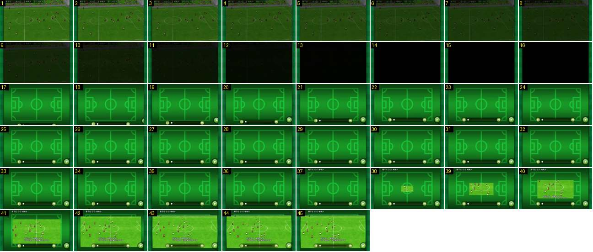

# Fim de jogo normal: passagem para o resumo

Num jogo normal (aqui uma vitória por 4-0 para a liga) não há papelinhos nem festa. Depois do apito, o plano largo funde para preto e abre-se o ecrã do resumo: um campo desenhado a verde com a barra de reprodução, e uma janela de vídeo que cresce a partir do centro.

- **Duração:** 4,5 s, 45 frames a 10 fps
- **Origem:** [cblD5BR_sfc](https://www.youtube.com/watch?v=cblD5BR_sfc&t=443s), de 443,6 s a 448,1 s, canal Booby
- **Etiquetas:** fim-jogo, fundido-preto, resumo, repeticao, janela-cresce, ui

## Frame a frame

- **Antes (440–443,5 s):** o apito final é um grande plano do árbitro de braços no ar, entre jogadores, durante ≈ 2 s. Depois há um corte de volta ao plano largo, com o relógio parado em «91:10 +1».
- **1–13:** o plano largo e o marcador escurecem até ao preto (1,3 s).
- **14–16:** preto (0,3 s).
- **17:** corte para o ecrã do resumo: fundo verde-escuro com as linhas de um campo desenhadas a verde-claro, sem jogadores.
- **17–20:** a barra de reprodução (pausa, progresso, saltar) sobe do fundo para o lugar. O botão verde de avançar está no canto inferior direito.
- **21–36:** parado (1,6 s).
- **37:** no topo aparece o cabeçalho do lance, com o minuto e o resultado nesse momento («3' 最下位 0-0 城南タ»).
- **38–43:** a janela de vídeo cresce a partir do centro do campo desenhado, ≈ 105 px de largura por frame, de forma linear, e enche o ecrã em 0,6 s. Já mostra o lance a correr e a legenda de narração («前半3分 城南タキオン たつなみは、決定機を生かせず»).
- **44–45:** o lance em ecrã inteiro. Entre lances, a janela encolhe até ao campo verde e cresce outra vez, e no fim aparece a frase «タイムアップ、ここで試合終了» (ver o mesmo vídeo de 449 s a 550 s).
