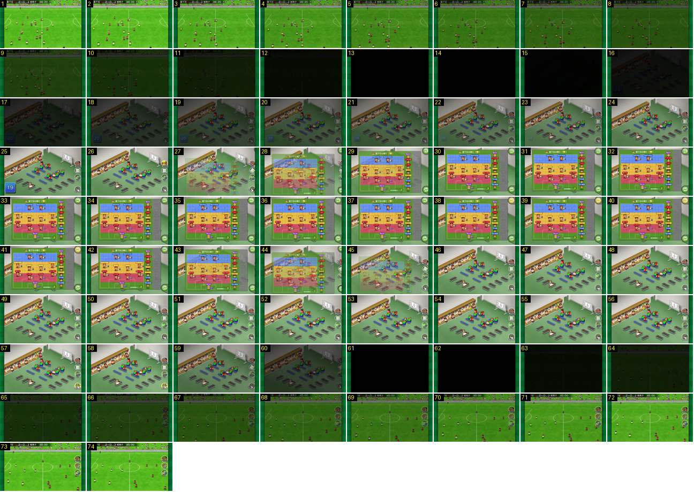

# Intervalo: ida ao balneário e regresso

O intervalo completo, num jogo limpo: o campo escurece, aparece o balneário com uma contagem decrescente, abre-se e fecha-se o quadro da formação, carrega-se em «後半開始» e o jogo volta já com os jogadores no lugar. Não há apito em grande plano nem pontapé de saída na 2.ª parte.

- **Duração:** 7,4 s, 74 frames a 10 fps
- **Origem:** [cblD5BR_sfc](https://www.youtube.com/watch?v=cblD5BR_sfc&t=214s), de 214,6 s a 222,0 s, canal Booby
- **Etiquetas:** intervalo, balneario, isometrico, fundido-preto, contagem, formacao, segunda-parte

## Frame a frame

- **Antes (213–214,5 s):** o relógio para em «46:20 +1», os bonecos ficam quietos e o jogo continua no plano largo, sem corte.
- **1–11:** o campo e a barra do marcador escurecem juntos até ao preto (1,1 s, linear).
- **12–15:** preto (0,4 s).
- **16–25:** fundido de entrada (1 s) no balneário isométrico, com paredes brancas e chão verde. Há cacifos com camisolas penduradas à esquerda e o quadro tático num cavalete à direita. Os jogadores estão sentados nos bancos azuis, aos pares e virados uns para os outros, e um está deitado numa marquesa a receber massagem. À direita ficam quatro botões redondos (選手交代, 戦術, 状況 e 後半開始 com o «45»). Em baixo à esquerda, um quadrado azul com um número grande conta para trás (20 no frame 16, 19 no frame 25): o intervalo tem tempo limite.
- **26:** o quadrado da contagem desaparece.
- **27–29:** o quadro da formação aparece num fundido cruzado (0,3 s) por cima do balneário, com as faixas FW azul, MF amarela e DF vermelha e os suplentes à direita.
- **30–43:** o quadro fica aberto (1,4 s).
- **44–46:** o quadro sai com o mesmo fundido (0,3 s).
- **47–56:** de novo o balneário, parado.
- **57–58:** o botão «後半開始» fica amarelo, porque foi carregado.
- **59–61:** o balneário escurece depressa (0,3 s).
- **62–63:** preto (0,2 s).
- **64–72:** fundido de entrada (0,9 s) no plano largo do campo, com os jogadores já nas posições, o relógio em «45:00» e os botões redondos à direita.
- **73–74:** o jogo recomeça a partir deste plano.
