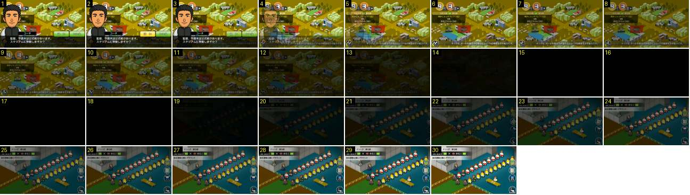

# Do mapa ao túnel «LIVE»

Mostra a transição entre o mapa da cidade e o ecrã «LIVE» antes do jogo. O LIVE não é um balneário: é o túnel, com as duas equipas em duas filas lado a lado e os árbitros à frente, prontos a sair para o relvado.

- **Duração:** 3,0 s, 30 frames a 10 fps
- **Origem:** [KbPiy1_7C58](https://www.youtube.com/watch?v=KbPiy1_7C58&t=45s), de 45,4 s a 48,4 s, canal nakanaka
- **Etiquetas:** mapa, adjunto, dialogo, fundido-preto, live, tunel, fila-jogadores, pre-jogo

## Frame a frame

- **1–3:** o adjunto em retrato grande pergunta «監督、今週末は公式戦があります。スタジアムに移動しますか？» (temos jogo oficial, vamos para o estádio?). No frame 2 o botão «はい» fica amarelo, porque foi carregado.
- **4:** o retrato e a caixa de diálogo desaparecem num fundido rápido (≈ 0,2 s).
- **5–13:** o mapa escurece até ao preto (0,9 s, linear).
- **14–18:** preto (0,5 s).
- **19–25:** o ecrã LIVE aparece num fundido a partir do preto (0,7 s). É um plano isométrico do túnel, em pixel art: duas filas diagonais de 11 jogadores, uma por equipa com o seu equipamento, os árbitros à cabeça, um delegado e uma mesa de oficiais. Em cima à esquerda: «LIVE · Fリーグ 第9節», as duas equipas com emblema e divisão, e o estádio. À direita, quatro botões redondos: スタメン (onze), 戦術 (tática), ユニフォーム (equipamento) e 試合開始 (começar, com «KICK OFF»).
- **26–30:** parado. Os bonecos estão quietos, à espera do jogador.
