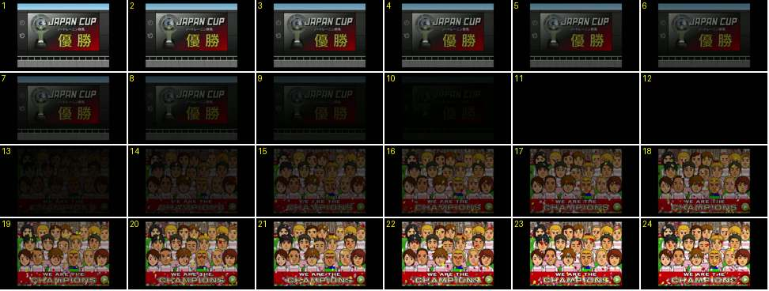

# Mosaico «WE ARE THE CHAMPIONS»

Mostra a passagem do painel da taça para o mosaico de retratos do plantel campeão. Prova a ordem da cerimónia: primeiro o painel, depois o mosaico.

- **Duração:** 2,4 s, 24 frames a 10 fps
- **Origem:** [8ogmIZH7WjE](https://www.youtube.com/watch?v=8ogmIZH7WjE&t=656s), de 656,2 s a 658,6 s, canal @syaritter
- **Etiquetas:** trofeu, campeoes, mosaico, retratos, confetti, faixa-vermelha, fundido-preto, cerimonia

## Frame a frame

- **1–10:** o painel «JAPAN CUP · 優勝», com a taça colorida e o brilho vermelho, escurece até ao preto (1 s, linear).
- **11–12:** preto (0,2 s).
- **13–19:** o mosaico aparece num fundido (0,7 s). São cerca de 20 retratos vetoriais do plantel com o equipamento da equipa, empilhados em filas como numa bancada, com os de trás mais pequenos. Em baixo há uma faixa vermelha com «WE ARE THE / CHAMPIONS» em letras brancas com contorno, e por trás vêem-se as placas «FINAL».
- **20–24:** cheio. Caem papelinhos coloridos à frente dos retratos, que não mexem. O botão verde de avançar está no canto.
- **Depois (658–663 s):** o mosaico fica ≈ 5 s e funde para a claque, com bandeiras do emblema, papelinhos e um balão com o nome do clube (≈ 15 s, até se carregar em avançar). Na liga o mosaico também vem depois do painel ([KbPiy1_7C58](https://www.youtube.com/watch?v=KbPiy1_7C58&t=559s), aos 559–560 s).
