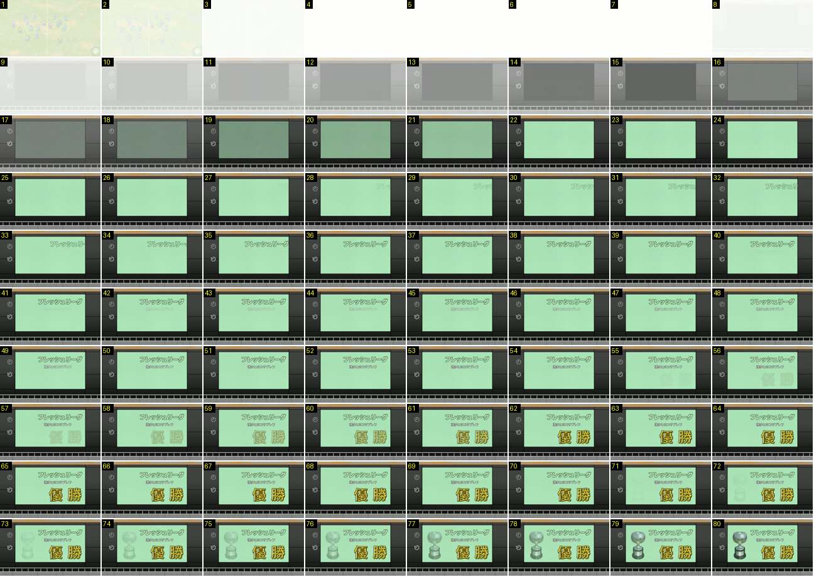

# Painel do título no ecrã gigante (liga)

O painel do título não é uma moldura dourada. É o ecrã gigante do estádio, entre duas colunas escuras e com um gradeamento em baixo. Os elementos aparecem em fundidos lentos, um de cada vez: nome da prova, clube, «優勝» (campeão) e a taça.

- **Duração:** 8,0 s, 80 frames a 10 fps
- **Origem:** [KbPiy1_7C58](https://www.youtube.com/watch?v=KbPiy1_7C58&t=547s), de 547,6 s a 555,6 s, canal nakanaka
- **Etiquetas:** trofeu, titulo, ecra-gigante, clarao-branco, fundido, deslizar, taca, cerimonia

## Frame a frame

- **Antes (536–547 s):** o plano largo do relvado com papelinhos. A câmara desliza até ao círculo central, onde a equipa se junta em roda, de braços no ar.
- **1–2:** a roda da equipa desaparece num fundido para branco.
- **3–7:** branco puro (0,5 s).
- **8–15:** o branco desfaz-se no ecrã gigante, ainda cinzento e apagado (0,8 s). Vê-se a moldura escura, dois ícones redondos à esquerda e o gradeamento em baixo.
- **16–21:** o ecrã acende-se e fica verde-claro (0,6 s).
- **22–27:** ecrã verde vazio (0,6 s).
- **28–35:** o nome da prova («フレッシュリーグ») entra da borda direita do ecrã e abranda até parar (ease-out, 0,8 s).
- **41–47:** o nome do clube aparece por baixo, em letra pequena, num fundido.
- **55–62:** «優勝» em dourado, com contorno escuro, sai de um fantasma transparente e fica opaco (0,8 s).
- **63–69:** parado.
- **70–80:** a taça de prata aparece à esquerda num fundido, de silhueta pálida a metal brilhante (≈ 1 s).
- **Depois (556–559 s):** fica parado ≈ 3 s e funde para preto. Segue-se o mosaico «WE ARE THE CHAMPIONS» (ver [mosaico-we-are-the-champions](../mosaico-we-are-the-champions/README.md)).
- **Taça (outra cor):** o ecrã é cinzento-escuro. A silhueta branca da taça aparece antes do texto, «JAPAN CUP» desliza da esquerda e no fim a taça ganha cor e acende-se um brilho vermelho atrás de «優勝». Ver [8ogmIZH7WjE](https://www.youtube.com/watch?v=8ogmIZH7WjE&t=642s), de 642 s a 656 s, e [aUptG4lwG1Q](https://www.youtube.com/watch?v=aUptG4lwG1Q&t=23s), de 23 s a 37 s.
