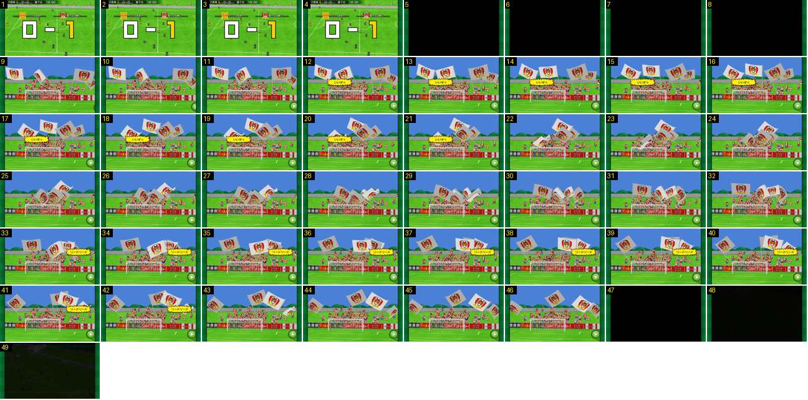

# Claque depois de um golo marcado

O que vem a seguir ao resultado gigante quando a equipa do jogador marca: corte para preto, a claque atrás da baliza com bandeiras grandes a varrer o ecrã e dois balões de grito amarelos, e depois a repetição a surgir do escuro.

- **Duração:** 4,9 s, 49 frames a 10 fps
- **Origem:** [OSCtF-d6e4E](https://www.youtube.com/watch?v=OSCtF-d6e4E&t=91s), de 91,7 s a 96,6 s, canal Booby
- **Etiquetas:** golo-marcado, claque, bandeiras, balao-grito, corte-preto, transicao, replay

## Frame a frame

- **1–4:** resultado gigante «0 – 1» (o 1 amarelo) sobre o campo, já parado. Neste golo, o resultado esteve no ecrã cerca de 4 s (de ~87,9 s a 92,0 s).
- **5–8 (0,4 s):** preto total. O resultado sai por corte seco.
- **9:** corte para a claque, sem fade: câmara fixa, baixa, de frente para a baliza do fundo. Céu azul, muro, bancada pequena com adeptos de vermelho e branco, e placas de publicidade por baixo. Por cima da bancada, seis bandeiras brancas enormes com o emblema do clube, cada uma com ~110 px de largura.
- **10:** entra o botão verde redondo de avançar, no canto inferior direito (o jogador pode saltar a claque).
- **9–46:** as bandeiras balançam em arco, sem parar, para a esquerda e para a direita, e cruzam-se umas por cima das outras. Um vaivém completo leva cerca de 1 s. Os adeptos saltam de braços no ar. A câmara não se mexe.
- **12–21 (1,0 s):** balão de grito amarelo com bicos (forma de explosão) e texto preto, «いいぞっ», à esquerda, por cima da bancada. Aparece e desaparece de um frame para o outro.
- **22–32:** sem balão.
- **33–42 (1,0 s):** um segundo balão igual, agora à direita, «リードリード» (estamos à frente).
- **43–46:** sem balão. Ao todo, a claque dura 3,8 s (frames 9–46).
- **47:** corte para preto.
- **48–49:** a repetição surge do preto num fade, que continua até ~97 s. O letreiro «REPLAY» cinzento está no canto superior esquerdo.
