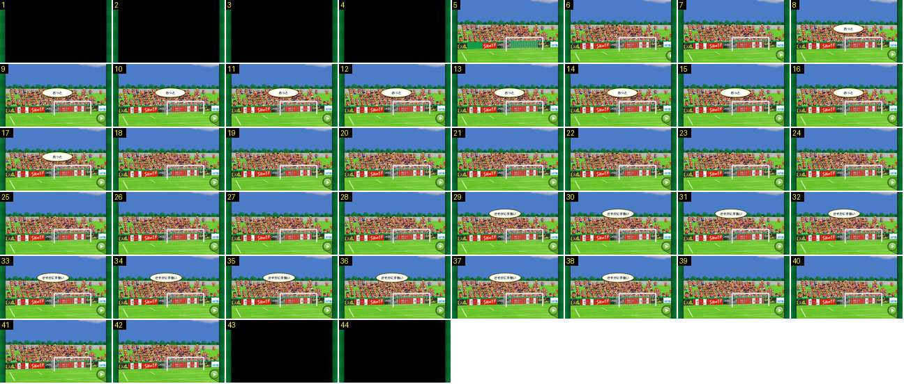

# Claque depois de um golo sofrido

A mesma cena da claque, mas quando a equipa do jogador sofre. A claque é sempre a do jogador: aqui não há bandeiras, os adeptos ficam quietos e os balões são ovais brancos, como um comentário em voz baixa. Serve para comparar com [claque-golo-marcado](../claque-golo-marcado/README.md).

- **Duração:** 4,4 s, 44 frames a 10 fps
- **Origem:** [ecma51SSHsI](https://www.youtube.com/watch?v=ecma51SSHsI&t=58s), de 58,1 s a 62,5 s, canal Booby
- **Etiquetas:** golo-sofrido, claque, balao-fala, corte-preto, transicao

## Frame a frame

- **1–4 (0,4 s):** preto. Antes disto, o resultado gigante «0 – 1» esteve 2,4 s no ecrã (de ~55,6 s a 58,0 s) e saiu por corte seco.
- **5:** a claque já está no ecrã, mas as placas de publicidade ainda não carregaram (aparece uma faixa verde lisa). É uma falha de carregamento do jogo, não um efeito.
- **6–42:** câmara fixa e baixa, de frente para a baliza. A bancada está cheia de adeptos de vermelho e branco, de pé e quietos, sem bandeiras. O botão verde de avançar está no canto inferior direito desde o frame 6.
- **8–17 (1,0 s):** balão oval branco, com contorno escuro e texto preto, «おっと» (ups), ao centro-direita, por cima da bancada. Aparece e sai de um frame para o outro.
- **18–28 (1,1 s):** sem balão.
- **29–38 (1,0 s):** segundo balão oval branco, «さすがに手強い» (são mesmo fortes), um pouco mais à direita.
- **39–42:** sem balão. A claque dura 3,7 s (frames 5–42).
- **43–44:** corte para preto. A seguir, a repetição surge do preto.

## Notas

- No segundo golo sofrido do mesmo vídeo (336,5–340 s), um dos balões é amarelo com bicos («気持ちで負けるな», não percam no ânimo). Portanto, o balão amarelo com bicos é um grito e o oval branco é um comentário: a cor não depende de o golo ser marcado ou sofrido. O que distingue de facto o golo marcado são as bandeiras e os adeptos aos saltos.
- Nesse segundo golo, o céu já está de fim de tarde (cinzento-azulado, com nuvens rosadas): a claque segue a hora do jogo.
