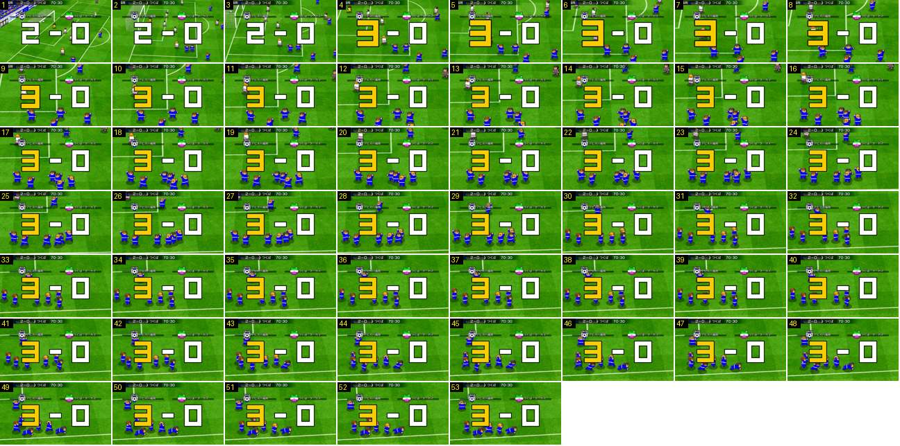

# Festejo em fila com mergulho

Outro tipo de festejo, num terceiro canal (versão de 2019). Com o zoom do golo, os jogadores correm de punho no ar, alinham-se lado a lado por baixo do resultado e mergulham de barriga, um a seguir ao outro.

- **Duração:** 5,3 s, 53 frames a 10 fps
- **Origem:** [WTeonmXJxU0](https://www.youtube.com/watch?v=WTeonmXJxU0&t=344s), de 344,5 s a 349,8 s, canal desconhecido
- **Etiquetas:** golo-marcado, festejo, mergulho, fila, zoom, camara, resultado-gigante

## Frame a frame

- **1–3:** o resultado gigante «2 – 0» (algarismos brancos) já está no ecrã, e a câmara aproxima-se da área: a baliza sai do quadro pela esquerda e os bonecos crescem.
- **4:** o «2» passa a «3» amarelo. Aqui quem marca é a equipa da casa, por isso o algarismo amarelo é o da esquerda.
- **4–12:** o zoom continua, mais devagar, até os bonecos terem ~50 px de altura. Depois, a câmara só desliza para seguir o grupo.
- **4–30:** os jogadores de azul correm em pequenos grupos, cada um com um braço levantado, a socar o ar.
- **30–42:** juntam-se numa fila horizontal por baixo do resultado, virados para a câmara.
- **43–53:** mergulham de barriga para a frente, da esquerda para a direita, um a seguir ao outro com ~2–3 frames de intervalo, e ficam deitados no relvado. O resultado continua parado por cima.

## Notas

- O vídeo acaba aos 353 s, antes de o resultado sair. Por isso não se vê a claque deste golo.
- Por volta dos 352 s, um brilho branco varre o «0». A gravação acaba antes de se perceber se faz parte de uma animação de saída.
