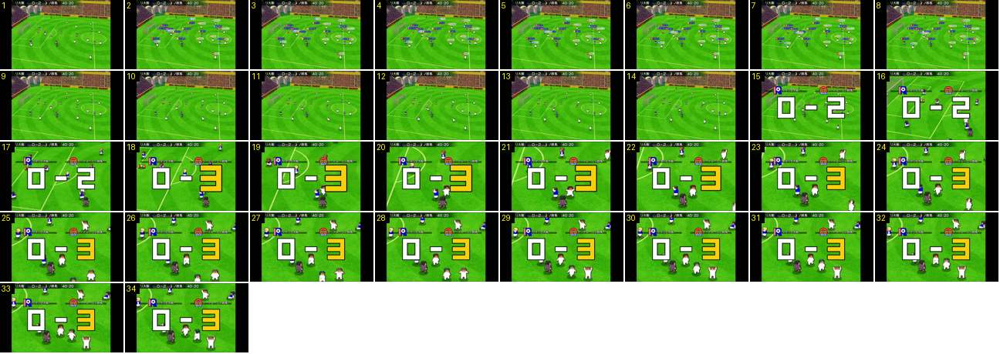

# Festejo com zoom: saltos de braços no ar

Um golo noutro canal e noutra versão do jogo (2021). Quando o resultado aparece, a câmara faz um zoom rápido sobre os marcadores, que saltam de braços no ar à volta dele. Antes disso, aparecem durante uns instantes as etiquetas de nome de todos os jogadores.

- **Duração:** 3,4 s, 34 frames a 10 fps
- **Origem:** [DYRnbrZw1O4](https://www.youtube.com/watch?v=DYRnbrZw1O4&t=219s), de 219,6 s a 223,0 s, canal しゃり
- **Etiquetas:** golo-marcado, festejo, zoom, camara, resultado-gigante, etiquetas-nome, saltos

## Frame a frame

- **1:** jogo normal, em plano largo; a bola acaba de entrar na baliza à esquerda. A gravação tem barras pretas dos lados.
- **2–8 (0,7 s):** aparecem de uma vez as etiquetas de nome de todos os jogadores em campo (número num quadrado de cor e nome), e não só a de quem tem a bola. O relógio parou (40:20).
- **9–14 (0,6 s):** as etiquetas desaparecem. Os jogadores começam a correr para o marcador.
- **15:** corte para o resultado gigante «0 – 2», com os algarismos brancos do resultado antigo. A câmara começa a aproximar-se.
- **15–17 (0,3 s):** zoom rápido para o grupo do marcador: os bonecos passam de ~20 px para ~45 px de altura. O resultado fica parado no ecrã enquanto o campo cresce por trás.
- **18:** o «2» passa a «3» amarelo, maior do que o «0», e depois assenta (como em [resultado-entra-golo-sofrido](../resultado-entra-golo-sofrido/README.md)).
- **18–34:** a câmara fica perto e segue o grupo devagar. Os jogadores de branco saltam no lugar, de braços no ar, um deles de joelhos, e juntam-se por baixo do resultado. Os adversários (de azul) e o árbitro (de escuro) passam pelo meio. O resultado ficou 6,8 s no ecrã (até 227,8 s).

## Notas

- Nos vídeos de 2025 do canal Booby ([OSCtF-d6e4E](https://www.youtube.com/watch?v=OSCtF-d6e4E&t=88s), [ecma51SSHsI](https://www.youtube.com/watch?v=ecma51SSHsI&t=329s)), a câmara fica larga durante o resultado: não há zoom, nem as etiquetas todas acesas. Pode ser uma diferença de versão ou de opção.
- Neste vídeo, depois do resultado vem a claque vista de cima, num estádio grande, com o balão «決まりかな» (228,9 s). O jogador salta a repetição com o botão (230,5–232 s).
