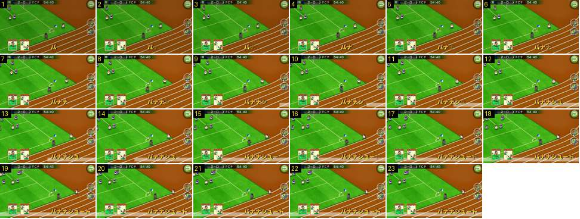

# Habilidade num canto: duas cartas e um nome curto

Uma segunda habilidade, «バナナシュート» (remate em arco), num pontapé de canto. Só tem duas cartas e um nome mais curto, mas o nome demora quase o mesmo tempo a escrever-se. Ao que parece, o que é fixo é o tempo total, não o tempo por letra.

- **Duração:** 0,77 s, 23 frames a 30 fps
- **Origem:** [JQIQI4kchQE](https://www.youtube.com/watch?v=JQIQI4kchQE&t=0s), de 0,17 s a 0,97 s, canal ゲームアディクト
- **Etiquetas:** habilidade, combo, cartas, nome-habilidade, tipografia, canto, bola-parada

## Frame a frame

- **1:** as duas cartas, «フリーキック» e «シュート», ambas com moldura vermelha, já estão no canto inferior esquerdo: o vídeo começa com elas. A primeira letra, «バ», está opaca, por volta de x = 340 (num ecrã de 640).
- **2–3:** a segunda letra, «ナ», entra translúcida e fica opaca no frame 4.
- **4–22:** as letras seguintes entram da esquerda para a direita, uma a cada ~3 frames, sempre com o mesmo fade curto. A partir do frame ~10, a faixa branca translúcida entra pela direita, por baixo do nome.
- **22–23:** o nome está completo, «バナナシュート», e acaba junto à borda direita. A câmara continua no plano do canto (bandeirola, pista de atletismo castanha) e o relógio não para.

## Notas

- Sete letras em ~0,73 s, contra nove letras em ~0,67 s na [outra habilidade](../habilidade-entrada-cartas-nome/README.md): o nome leva sempre cerca de 0,7 s a escrever-se. Como acaba sempre encostado à direita, um nome curto começa mais à direita.
- Uma terceira habilidade, «ロングスロー» ([ktqSs_8pJx8](https://www.youtube.com/watch?v=ktqSs_8pJx8)), e uma quarta, «掟破りの攻撃参加» ([wcZcGrrPbs0](https://www.youtube.com/watch?v=wcZcGrrPbs0)), ambas com três cartas, seguem o mesmo padrão.
